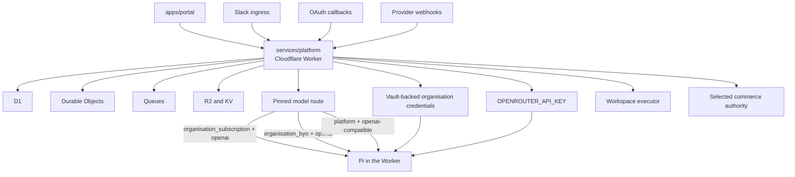
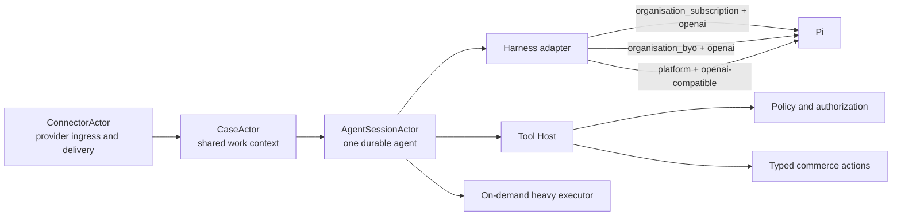

# Architecture

Pantry is Cloudflare-native. `services/platform` owns the Worker, HTTP routes,
Slack ingress, OAuth, onboarding, D1 migrations, Durable Objects, queues, R2,
KV, and container orchestration. The portal is compiled into Worker assets for
deployment, while its source lives in `apps/portal`.

## Runtime map

The platform communicates with other runtimes through authenticated,
versioned APIs and signed observations. No runtime imports another runtime's
database or private source.

## Ownership graph

`ConnectorActor`, `CaseActor`, and `AgentSessionActor` form the primary durable
ownership hierarchy. A Case may have several connectors and several
independent sessions. A session may have multiple execution attempts; an
executor is replaceable compute and owns no durable Case or session state.
Pi runs every route. It uses the organisation's ChatGPT sign-in, the
organisation's Vault-encrypted OpenAI API key, or the Purin `OPENROUTER_API_KEY`,
according to the pinned route.
The session contract pins one route; an
authority failure never switches harnesses. Picocodex is retired.
`AgentSessionActor` owns accepted history, tool authority, checkpoints,
budgets, cancellation, and output receipts for all active routes.

## Repository boundaries

| Area               | Responsibility                                                      | Location                                                       |
| ------------------ | ------------------------------------------------------------------- | -------------------------------------------------------------- |
| Platform           | Control plane, integrations, actors, projections, and orchestration | `services/platform`                                            |
| Portal             | Merchant and agent operations UI                                    | `apps/portal`                                                  |
| Commerce contracts | Provider-neutral TypeScript contract schemas                        | `packages/contracts`                                           |
| Commerce authority | Private catalog, inventory, checkout, order, and fulfillment state  | `services/commerce` or the selected provider                 |
| Agent behavior     | Sous Chef's instructions, skills, and installation                  | `services/platform/src/data/merchant-agent-skills.ts` and `merchant-agent-preset.ts` |
| Acceptance         | Buyer and cross-service acceptance scenarios                        | `scripts/punter`                                               |
| Heavy execution    | On-demand isolated workspace work                                   | `crates/workspace-executor` and `services/workspace-executor`  |

These names describe ownership. They do not imply one deployment per module.

## Durable storage roles

- D1 stores organisation, control-plane, lifecycle, projection, receipt, and
  migration records owned by the platform boundary.
- Durable Objects serialize actor-owned lifecycle, Case work, session history,
  delivery, and alarms.
- Queues carry durable asynchronous work and recovery paths.
- R2 stores attachments and immutable workspace artifacts at their explicit
  boundaries.
- KV supports bounded platform configuration and caches where the owning
  contract permits it.

Read [Runtime request flow](/concepts/runtime-request-flow) for the sequence
that ties these storage roles together.
