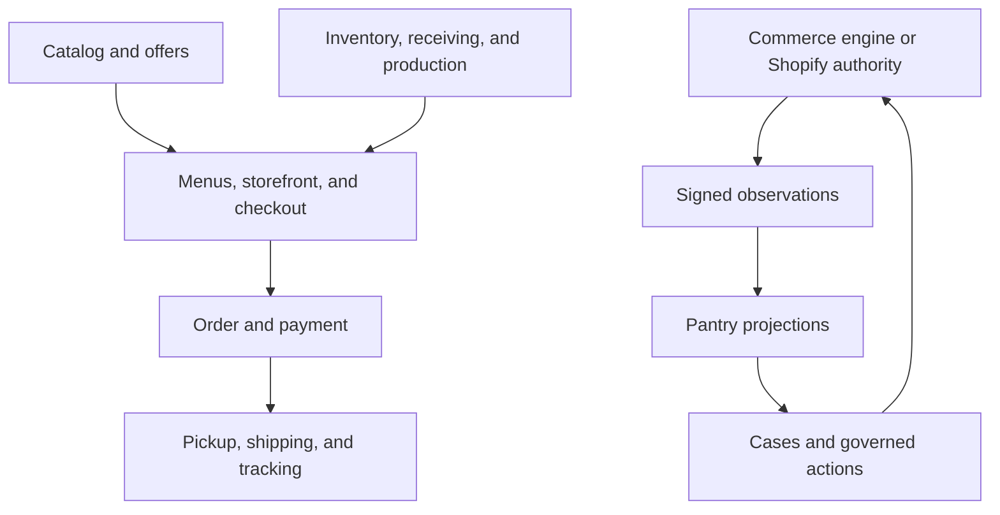

# Commerce domain

Pantry models a café and bakery as a merchant operation rather than as a set
of provider payloads. Provider shapes end at adapters. The internal domain
keeps products, offers, stock, orders, payment, preparation, fulfillment, and
shipping on separate lifecycles.

Plans 22 and 23 define the accepted café, patisserie, packaged-goods, and
flavored export paths. The full authoritative model remains in
`docs/commerce-domain-architecture.md`.

## Domain principles

1. Each active organisation selects exactly one commerce authority for a resource.
2. Every durable fact has one named writer.
3. Inventory movements and allocations are authoritative; balances are
   derived transactionally.
4. Mutable buyer intent ends at checkout. The order stores an immutable
   commercial snapshot.
5. Fulfillment method determines the valid fulfillment lifecycle.
6. Provider capability gaps remain explicit typed branches.
7. Read projections are rebuildable from ordered provider observations.

## Commerce layers

## Core aggregates

| Aggregate          | Owns                                                                       |
| ------------------ | -------------------------------------------------------------------------- |
| Location           | Operational identity, roles, address facts, and lifecycle                  |
| Product            | Descriptive catalog content and lifecycle                                  |
| Sellable variant   | One purchasable configuration and merchant code                            |
| Offer              | Variant, channel, market, price, scope, validity, and lifecycle            |
| Inventory position | Movements, allocations, lots, and derived balance for an item and location |
| Menu               | Sections, entries, modifier bindings, and publication revision             |
| Recipe revision    | Immutable inputs, output policy, and activation lifecycle                  |
| Preparation ticket | Order-specific preparation and measured consumption                        |
| Production batch   | Inputs, actual yield, output lot, and measured movements                   |
| Cart               | Mutable buyer selections                                                   |
| Checkout           | Quote, stock allocations, and protected delivery reference                 |
| Order              | Immutable commercial agreement and lifecycle                               |
| Payment            | Provider transactions for one tender lineage                               |
| Fulfillment        | Method-specific allocation of order lines                                  |
| Shipment           | One package and its carrier events                                         |

An aggregate is the smallest state unit that requires one transactional
invariant. Cross-aggregate effects use idempotent commands and confirming
observations.

## Café and patisserie

The café path combines prepared products, menus, modifiers, recipes,
preparation tickets, pickup, payment, and inventory movements. It keeps
finished goods and their ingredients separate so a production movement can be
measured and reconciled.

## Online export

The export path adds a first-party storefront, one-package shipping,
destination-specific customs facts, carrier rates, tax and duty quotes, label
purchase, and tracking. Flavored products preserve the product and variant
identity while binding packaging and customs requirements to the export offer.

See [Commerce operations](/guides/commerce-operations) for the operating view of
these aggregates.
