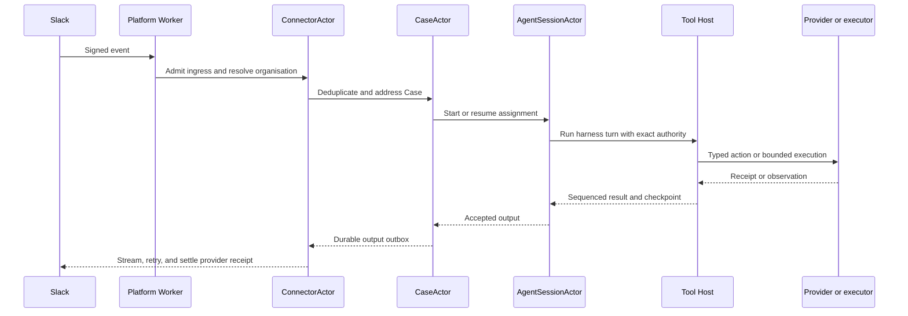

# Runtime request flow

Pantry treats provider input as a durable request before it acknowledges the
provider. The request receives an organisation, Case, assignment, session, and output
identity before execution begins.

## The six-stage path

1. Slack sends a signed event to `/slack/events`.
2. The Worker verifies the event and durably admits interactive Case work to a
   `ConnectorActor` before acknowledging Slack. The actor starts work
   immediately; its alarm recovers expired leases and scheduled retries.
3. `ConnectorActor` deduplicates provider ingress and addresses a `CaseActor`.
4. `CaseActor` owns shared context, assignments, accepted proposals, and its
   durable output outbox.
5. `AgentSessionActor` runs the embedded harness, persists every sequenced
   event, and exposes a cursor-based replay stream. It allocates a heavy
   executor only when the requested work requires one.
6. `ConnectorActor` projects replayed output through Slack's native AI stream,
   persists its delivery cursor, and returns the provider receipt to settle the
   exact Case outbox entry.

## Recovery rules

- Ingress recovery resumes the admitted target. It does not re-run organisation or
  Case routing decisions.
- Output delivery is idempotent. A retry settles the exact output identity
  against the original provider receipt.
- Session history is actor-owned and sequenced. A checkpoint binds the stable
  harness instruction digest and the accepted history cursor.
- A stale Case revision or authority revision requires rebase. It cannot
  silently apply a proposal to newer context.
- An indeterminate external action remains visibly indeterminate until its
  owning provider or adapter reconciles it.

## Boundaries inside a turn

The trusted platform resolves organisation credentials only after authentication,
policy, capability, and action checks. Prompts, transcripts, generated code,
workspace artifacts, and executor storage receive opaque references and
metadata rather than raw provider credentials.

The harness can request a capability. It cannot choose an arbitrary organisation,
credential, provider account, or environment. The platform derives those
identities from the authenticated request and pinned domain state.
