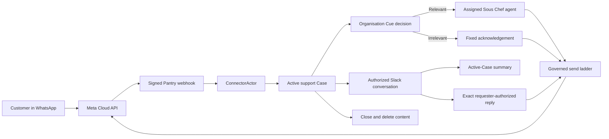

# WhatsApp customer support

Pantry turns new WhatsApp customer texts into governed support Cases. An
assigned agent immediately handles messages matching the organisation's relevant
topics. Other messages receive the organisation's fixed acknowledgement without a
model turn. An authorized Slack conversation can summarize the same active
work and direct one exact reply to the customer.

::: info Current availability
The complete path is verified with Meta's development test number: inbound
text, Case creation, relevant-message agent routing, irrelevant-message
acknowledgement without an agent turn, Slack summarization, Slack-directed
delivery, status convergence, and Case-close content cleanup.
Connecting arbitrary external business numbers still requires Meta App Review,
Advanced Access, business verification, and the production onboarding canary.
:::

## How a message moves through Pantry

1. Meta sends a signed webhook for a new customer text.
2. Pantry verifies the signature, resolves the exact organisation and phone-number
   account, deduplicates the event, and applies the published ingress policy.
3. `ConnectorActor` creates or updates one support Case for that customer. It
   encrypts the active transcript and waits for the configured burst debounce.
4. The organisation Cue policy selects an immediate assigned-agent turn for a
   relevant message or the fixed acknowledgement for an irrelevant message.
5. Pantry freezes the recipient, body digest, proposal version, policy version,
   service window, application credential generation, and asset-grant revision
   before the selected response enters the governed send ladder.
6. Meta returns the message identifier and later sends `sent`, `delivered`,
   `read`, or `failed` observations. Pantry keeps the durable receipts.
7. Closing the Case removes the active transcript and reply plaintext. Coarse,
   content-free receipt and lifecycle metadata remains for auditability.

Slack sees only active Pantry Cases granted to that exact conversation. The
integration processes new webhook-delivered text and does not import WhatsApp
chat history.

Slack-directed sends use a separate `whatsapp.support.reply.send` capability.
The standard organisation policy enables this capability by default. Each Slack
conversation still needs an explicit grant for one connected WhatsApp account
and its `active_cases` scope.
The tool derives the customer and business number from the active Case. Its
body must appear verbatim in the current Slack request, and the requester must
be an active owner, admin, or operator. Pantry then uses the same proposal,
service-window, credential, asset-grant, receipt, and ambiguous-send gates as
portal approval.

## Before you test

In the Portal, open **Settings → Integrations → WhatsApp** and confirm:

- the intended business phone-number account is `Connected`;
- provider health says `Webhook live`;
- processing is enabled under a published ingress policy;
- an agent is assigned;
- the test sender is an allowed recipient for Meta's development number; and
- the Slack conversation has `whatsapp.support.read` access when it should
  summarize Cases; and
- the conversation also has `whatsapp.support.reply.send` access when it
  should send requester-directed replies.

The ingress policy also controls two Cue-routing fields:

- **Relevant customer topics** is a comma-separated list of words and phrases.
  Matching messages go to the assigned agent for an immediate reply.
- **Automatic acknowledgement** is the exact text sent for a message that
  matches none of those topics.

The default sandbox policy waits 15 seconds after the newest customer message
before starting the agent turn. Allow up to a minute for the full proposal path.

## Cue-routing acceptance scenarios

The WhatsApp runtime has two customer-message dispositions. Both retain the
admitted question and outbound response in an active Case so an authorized
Slack conversation can inspect the exchange and direct a later response.

### Scenario A: relevant question, immediate agent reply

1. Send a unique customer question that matches the configured support Cue,
   such as: `What is the status of test order 8842?`
2. Confirm the Cue Engine selects `agent_reply_now` for that admitted message.
3. Confirm the assigned Sous Chef agent receives one turn and sends one immediate
   WhatsApp reply through the governed send ladder.
4. Confirm Meta records one message identifier and the delivery state reaches
   `sent` or later.
5. In the authorized Slack conversation, ask Sous Chef what the customer
   asked and what was sent. The answer must use the retained active Case.
6. In Slack, supply an exact follow-up body and approve sending it. Confirm the
   customer receives that exact text once.

### Scenario B: irrelevant question, automatic acknowledgement

1. Send a unique customer question that does not match the configured support
   Cue.
2. Confirm the Cue Engine selects `acknowledge_without_agent` and uses the
   configured acknowledgement response.
3. Confirm no `AgentSessionActor` assignment or model turn starts for the
   message.
4. Confirm Pantry sends the acknowledgement once through the governed send
   ladder and records the Meta receipt and delivery state.
5. In the authorized Slack conversation, ask Sous Chef what the customer
   asked and what response was sent. The answer must use the retained active
   Case.
6. In Slack, supply an exact substantive response and approve sending it.
   Confirm the customer receives that exact text once.

The automated acknowledgement is an organisation-configured response selected by the
Cue Engine. It does not invoke the assigned agent. A
replayed webhook, repeated tool call, or repeated approval must return the
original receipt without sending another customer message.

## Run the end-to-end test

### 1. Send a customer message

From a verified recipient, send a unique, natural support request to the phone
number displayed in the WhatsApp integration card. For example:

> Hi, manual test 8472 here. I need help changing the pickup time for my order
> from 2pm to 4pm. Can you help?

A natural request exercises the support behavior. Scripted instructions such
as “reply with TRACE OK” may trigger the agent's prompt-injection safeguards
and produce a human handoff.

### 2. Verify Case admission

After the debounce, refresh the WhatsApp integration page. Confirm:

- the open-Case count increased;
- **Reply approvals** contains the customer;
- **Open conversation** shows the new text; and
- the ownership message identifies the agent or the human handoff state.

### 3. Exercise a Cue-matched agent reply

For a message matching the relevant-topic policy:

1. Confirm the assigned agent produces one contextual response.
2. Confirm the customer receives it in WhatsApp without a portal approval
   step.
3. Refresh the portal and confirm the proposal reaches `Sent`.
4. Open the conversation and verify the inbound question and outbound response
   are both retained in the active Case.

The published organisation Cue policy is the authorization boundary for automatic
responses. A Slack-directed follow-up uses the exact current operator request
as its separate authorization boundary.

### 4. Exercise human takeover

To test the operator path:

1. Open the conversation and select **Take over** when the agent owns it.
2. Enter the response.
3. Select **Send this message to the customer now**.
4. Select **Send human reply** and confirm delivery in WhatsApp.
5. Select **Return to agent** if the Case should resume agent handling.

The confirmation checkbox makes a direct human reply an explicit send action.

### 5. Ask for a Slack summary

Keep the Case open. In the Slack conversation granted access to the WhatsApp
support source, ask:

> Have we received any WhatsApp messages? Summarize each active Case, what the
> customer needs, and whether an agent or human currently owns it.

The response should identify the active Case, accurately summarize the request,
and report its ownership state. You can also ask:

> Draft an appropriate response to the latest WhatsApp customer.

A draft requested in Slack still follows the WhatsApp approval boundary.

### 6. Send an exact reply from Slack

In the same authorized Slack conversation, name the Case when more than one is
active and include the exact customer-facing body. For example:

> Reply to the latest WhatsApp customer with exactly: “It’s all coming and in
> progress.”

The agent should call the send capability and report a successful provider
receipt. Confirm that the customer receives the exact sentence in WhatsApp.
Paraphrased instructions without an exact body remain drafts; ask again with
the final wording when you want Sous Chef to send.

### 7. Verify terminal cleanup

After the response is complete:

1. Open the conversation and select **Close Case**.
2. Refresh the integration page and confirm the open-Case count decreased.
3. Open any remaining terminal proposal metadata and confirm that customer and
   reply text is unavailable.
4. Ask the Slack agent whether any active WhatsApp Cases remain.

The Slack agent should report no active Case for that closed conversation window. A later
customer message starts a new conversation window.

## Expected evidence

| Boundary   | Expected result                                                                 |
| ---------- | ------------------------------------------------------------------------------- |
| Ingress    | One signed customer text becomes one admitted message                           |
| Case       | The customer has one active support Case conversation window                    |
| Agent      | The assigned agent proposes a reply or records a human handoff                  |
| Approval   | The customer receives only the exact approved or confirmed body                 |
| Provider   | A Meta message id and delivery-status observations are recorded                 |
| Slack      | The granted conversation can summarize the active Case                          |
| Slack send | An active operator can send only the exact body present in the current request  |
| Cleanup    | The conversation window is closed and a fresh read returns no message plaintext |

Use synthetic customer text in screenshots and committed evidence. Keep access
tokens, app secrets, real order information, and private customer details out
of fixtures and logs.

## Troubleshooting

### No Case appears

Check `Webhook live`, processing state, agent assignment, and the published
policy. Confirm that the sender is a verified recipient for a Meta test number,
that the message contains text, and that the debounce period has elapsed.

### The agent hands the Case to a human

Review the handoff reason. Trace phrases, commands to return exact strings, or
content that resembles model instructions can correctly activate the safety
boundary. Repeat the test with an ordinary customer question when you want to
exercise proposal generation.

### Slack cannot summarize the message

Keep the Case open and verify that the exact Slack conversation has an access
grant for the connected WhatsApp support account. Closed Cases have no active
transcript to summarize.

### Slack can summarize but cannot reply

Grant the exact conversation `whatsapp.support.reply.send` for the same
WhatsApp phone-number account and `active_cases` scope. Start a fresh Slack
thread so its Case assignment receives the updated capability partition. Make
the request as an active owner, admin, or operator and include the exact reply
body in that message.

### A reply does not arrive

Confirm the proposal was approved, the 24-hour service window remains open,
and provider health is current. A `send_indeterminate` result is quarantined
for operator resolution; Pantry does not automatically retry an outcome that
could already have reached the customer.

See [Integrations](/guides/integrations) for the shared provider boundary and
[Testing and evidence](/operate/testing-and-evidence) for repository-level
verification.
