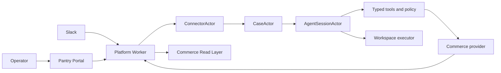

# Purin Pantry

People and Sous Chef agents operate Purin Pantry through the Portal and Slack.
The product direction covers the full bakery and café business: demand,
purchasing, recipes, production, quality checks, packaging, inventory, sales,
distribution, and customer service.

Kitchen is the production orchestration area within Pantry. Pantry connects
that work to commerce and daily operations. Agentic ecommerce means agents can
investigate records, prepare changes, and execute authorized commerce actions
with policy checks, approvals, and durable receipts.

The business reference is a pâtisserie selling fresh products and packaged gifts
through shops and online channels, such as Noix de Beurre or Lenôtre. These are
product and distribution references. Purin makes no claim about their use of
robotic production.

People, agents, and future machines use the same authorization, approval,
receipt, and replay boundaries. An accepted simulation never authorizes a
physical machine action.

## The system at a glance



The production Worker is `pantry`, on its one address `pantry.purin.io`. The
documentation app is a
separate VitePress site under `apps/docs`.

## What to read first

1. [Architecture](/concepts/architecture) explains ownership, runtime
   boundaries, and deployment shape.
2. [Runtime request flow](/concepts/runtime-request-flow) follows one piece of
   work from Slack ingress through durable output delivery.
3. [Commerce domain](/concepts/commerce-domain) describes merchant-native
   products, inventory, orders, fulfillment, and provider authority.
4. [First operating path](/guides/first-operating-path) connects the concepts
   to the café, patisserie, and export workflows of Pantry.
5. [Local development](/operate/local-development) gets the repository running.

## Run the repository

```bash
corepack enable
pnpm install
cargo check --workspace
pnpm portal:build
pnpm --filter @purin-labs/docs dev
```

The docs site runs at `http://docs.localhost:3005`. To start the platform and its
local resources, use `pnpm --filter @purin-labs/platform dev` in another terminal. The
full local surface is described in [Local development](/operate/local-development).

## Current product boundary

- Plans 22 and 23 establish accepted café, pâtisserie, packaged-goods, and export commerce paths.
- Plan 42 provides bounded Kitchen orchestration and native simulation. Plans
  42E/F close the selected local control and shared orchestration scope.
- Plan 42G automatic context loading passed production Pi and Codex acceptance.
  Plan 42H still has integrated file and production release gates.
- Plan 60A equipment models are in progress. Plans 61A–E describe draft recipe
  workflows and a combined café shift. Physical calibration remains pending.
- Plan 24 owns planned physical robot integration. The runtime has no physical
  robot controller or fleet service.
- Inference has three pinned routes, all on Pi: the organisation's ChatGPT
  subscription, organisation OpenAI API keys, and Purin-funded OpenRouter. Failure preserves the selected funding authority.
- Plan 40 product drafting is accepted. Plan 40B, the collaborative menu
  editor, is proposed. General desktop filesystem synchronization remains deferred.

Use the [reference](/reference/) for the source ownership map and the plans
that define these boundaries.
