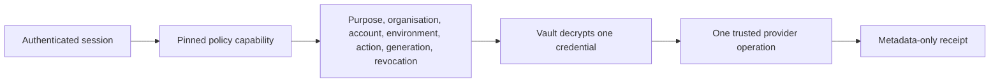

# Vault operations

Purin Vault is the organisation-scoped source for provider and model credentials.
Ciphertext and lifecycle metadata live in D1. Versioned encryption roots live
in Cloudflare Secrets Store. A trusted platform operation resolves an opaque
reference only after it has authenticated the request and rechecked policy.

## Resolution path

## Invariants

- Harnesses, sandboxes, generated programs, Durable Objects, and archives never
  observe plaintext credentials.
- D1 compromise alone cannot decrypt an organisation secret.
- Policy and authorization precede credential resolution for high-impact work.
- There is no public generic resolve function. Each runtime consumer uses the
  resolver for its exact purpose, and authorization binds that purpose to a
  organisation, provider account, environment, action, and credential generation.
- Ciphertext is bound to the organisation, the handle, and the key version with
  AES-256-GCM authenticated encryption.
- A revoked or superseded generation is denied even when a session pinned an
  older policy snapshot.
- Unknown keys, corrupt ciphertext, stale rule identity, ambiguous scope, and
  missing policy fail closed.
- Logs, traces, metrics, fixtures, and receipts contain identifiers and reason
  codes rather than secret material.

## Operator actions

Credential rotation, revocation, root-key rotation, recovery, and compromise
response are resumable and idempotent. Inspect the exact lifecycle receipt
after every bounded step.

The repository runbook is `docs/runbooks/vault-operations.md`. The full design
and open production measurements are recorded in Plan 12. The public API
surface is documented in [Vault API reference](/reference/vault-api).

## Credential custody

Platform signing roots, OAuth application secrets, and the platform-funded
`OPENROUTER_API_KEY` remain Cloudflare deployment secrets. Organisation provider
tokens, the organisation ChatGPT sign-in profile for the subscription route, organisation-owned
OAuth client credentials, and organisation webhook secrets belong in Purin Vault.

OAuth authorization codes are transient. After an OAuth exchange, validate the
merchant identity and scopes, store the resulting organisation token in Purin Vault,
and persist only its handle in the provider connection.
