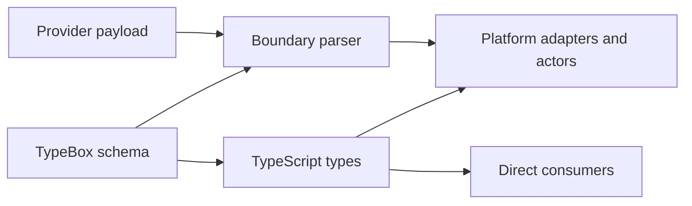

# Contracts

`packages/commerce-contracts` owns the provider-neutral commerce contracts,
and `packages/contracts` owns the actor and message protocols of Pantry. Each
contract is a TypeBox schema with a parser that refuses what the schema
refuses. The contracts describe shared language and invariants. They do not
prescribe another runtime's database or private wire format.

## Contract flow

## Boundary rules

- Parse raw D1 records, route bodies, provider responses, and decoded tokens
  once at their boundary.
- Convert them immediately into precise internal identities, lifecycle unions,
  revisions, and result states.
- Keep optional fields at display and configuration edges. Core identity,
  authorization, session, budget, lifecycle, and protocol fields are required.
- Prefer discriminated unions and exhaustive branches to boolean flags or
  optional bags.

## Change sequence

1. Change the owning schema and its parser in one commit.
2. Update the owning service and direct consumers.
3. Run focused invariant and boundary scenarios.
4. Run the relevant workspace and commerce-lab verification.
