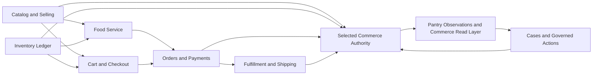

# Commerce Domain Architecture

Status: **authoritative** · Date: 2026-08-12 · Owners: Contracts,
Commerce, and Pantry platform

This document defines the commerce domain and runtime ownership implemented by
Plan 22.
It supersedes the Shopify-derived domain details in AD-043 and the canonical
model sections of Plan 9. It preserves the established provider-adapter,
single-authority, signed-delivery, governed-action, and rebuildable-projection
boundaries.

Plan 22 owns the replacement sequence and two Seams Checkout configurations: a
Cafe / Patisserie and its online packaged-goods storefront. Existing Shopify
support receives only the boundary updates required by the contract replacement.

## Goals

The model must support, without parallel product or order systems:

- prepared cafe and patisserie products;
- ingredients, packaging, and finished goods;
- menus, modifiers, recipes, preparation, production, and pickup;
- first-party carts, checkout, payment, inventory allocation, and orders;
- international shipping, one package, customs facts, carrier rates, tax and
  duty quotes, label purchase, and tracking;
- direct inventory receipts, counts, waste, and production movements; and
- exact replay, interruption recovery, governed actions, and provider receipts.

## Kitchen operating loop

These contracts supply the commerce facts for an end-to-end bakery and café
business. Kitchen owns procedure execution and simulation evidence. The selected
commerce authority owns inventory movements, lots, accepted orders, and fulfillment.

| Operating step        | Existing domain basis                                                      | Integration boundary                                                                   |
| --------------------- | -------------------------------------------------------------------------- | -------------------------------------------------------------------------------------- |
| Purchase and receive  | Suppliers, purchasing, inventory items, receipt movements, and lots        | Record ingredients and packaging through their owning operations                       |
| Produce and inspect   | Recipe inputs, completed production batches, actual yield, and output lots | Link accepted physical production evidence to the exact run and recipe revision        |
| Pack gift assortments | Packaging items, finished goods, bundles, and stock movements              | Record released quantities, rejected pieces, packaging consumption, and lot allocation |
| Sell and distribute   | Offers, channels, orders, pickup, and shipments                            | Bind availability and delivery promises to stock and evidenced capacity                |
| Evaluate performance  | Yield, waste movements, sales, payments, and fulfillment facts             | Combine measured labor and costs with these records; keep estimates visibly separate   |

These are reuse points and integration targets. The bounded Kitchen simulation
does not prove automatic production posting, packaging release, shelf life, or
physical fulfillment. The batch contract below records completed production.
Planned and in-progress commerce batches remain a later measured extension.
[Plan 24](plan-24-cafeos-bakery-automation.md) owns the physical boundary.
[Plans 61A–E](plan-61A-financier-workflow.md) own draft recipe and shift integration.

## Design principles

1. The domain is merchant-native. Provider shapes terminate in adapters.
2. Every durable fact has one named writer.
3. Products, offers, stock, orders, payments, and fulfillment have separate
   lifecycles.
4. Inventory items exist independently from sellable variants.
5. Mutable buyer intent ends at checkout. Accepted commercial decisions are
   immutable snapshots.
6. Fulfillment method determines valid fulfillment state.
7. Stock movements and allocations are authoritative. Inventory balances are
   derived transactionally.
8. Provider capability gaps remain explicit typed branches.
9. Private buyer data remains inside the selected transaction authority.
10. Compatibility exists only while reading an old persisted or request shape
    during a bounded migration. The compatibility path is deleted afterward.

## Runtime authority

Each active organisation retains exactly one selected commerce system under Plan 19.
The selected system owns catalog, selling, inventory, customer-order, payment,
and fulfillment aggregates for that organisation.

| Fact                                                                                                                     | Authority                                                                                  |
| ------------------------------------------------------------------------------------------------------------------------ | ------------------------------------------------------------------------------------------ |
| Seams Checkout catalog, stock ledger, checkout, order and payment orchestration, preparation, fulfillment, and shipments | Commerce merchant runtime                                                                |
| Shopify catalog, inventory, checkout, orders, payments, fulfillment, and shipments                                       | Shopify                                                                                    |
| External payment, address, tax, duty, carrier-rate, label, and tracking effects used by Seams Checkout                   | The connected supporting provider; Commerce retains the orchestration record and receipt |
| Provider-neutral observations and merchant-safe operational projections                                                  | OrganisationActor / Commerce Read Layer                                                    |
| Cases, proposals, approvals, actions, and effect receipts                                                                | Pantry CaseActor and ActionLedger                                                           |
| Provider connections, selected commerce system, capability activation, and directories                                   | D1 control plane                                                                           |
| Buyer contact and address data for Seams Checkout                                                                        | Encrypted Commerce customer boundary                                                     |

The two demonstrations use one Commerce-backed organisation with two Storefront
configurations. Concurrent Commerce and Shopify transaction authority inside
one organisation remains outside this architecture.

## Context map



These are bounded modules inside the existing runtimes. They do not imply a
new deployment or database.

## Shared value types

### Identity and revision

Every aggregate has an organisation-scoped identity and a positive monotonic revision.
Provider-native identities live in `SourceProvenance` and source-mapping
records. Display names, SKUs, handles, email addresses, and URLs never serve as
aggregate identity.

### Quantity

```text
Quantity
  amount: unsigned integer
  scale: 0..6
  unit: each | gram | kilogram | milliliter | liter

AvailableQuantity
  amount: signed integer
  scale: 0..6
  unit: each | gram | kilogram | milliliter | liter
```

Arithmetic requires compatible units. Unit conversion uses an explicit exact
`QuantityConversion`; core logic never converts by floating point. `each`
requires scale zero. Requirements, sale quantities, lots, on-hand, and
allocated stock use non-negative `Quantity`. Availability uses
`AvailableQuantity` so an external authority can report a real backorder
without coercion.

Rust and SQLite store quantity amounts as signed 64-bit integers. Versioned
JSON and TypeScript boundaries accept only integers within JavaScript's safe
integer range; a boundary rejects a larger provider value instead of rounding
it. Arithmetic uses checked integer operations before converting to a wire
value.

### Money

Money uses signed integer minor units plus an ISO 4217 currency. Prices,
discounts, tax, duty, shipping, and totals state their currency.
Cross-currency operations require a snapshotted conversion and never occur
implicitly.

### Time ranges

```text
Validity
  open_ended { starts_at }
  bounded { starts_at, ends_at }
```

The bounded branch requires `ends_at > starts_at`.

## Aggregate boundaries

An aggregate is the smallest state unit that requires one transactional
invariant. Cross-aggregate effects use an idempotent outbox command and a
confirming observation.

| Aggregate                | Transaction boundary                                                        |
| ------------------------ | --------------------------------------------------------------------------- |
| Location                 | Operational identity, roles, source-backed address, and lifecycle           |
| Catalog product          | Product content and lifecycle                                               |
| Sellable variant         | Purchasable configuration and lifecycle                                     |
| Offer                    | Exact variant, channel, market, price, scope, validity, and lifecycle       |
| Inventory position       | Movements, allocations, lots, and derived balance for one item and location |
| Stock policy             | Replenishment rules for one item and location                               |
| Menu                     | Sections, entries, modifier bindings, publication revision                  |
| Recipe revision          | Immutable inputs, output policy, and activation lifecycle                   |
| Preparation ticket       | Order-specific preparation and measured consumption                         |
| Production batch         | Batch inputs, actual yield, output lot, and measured movements              |
| Cart                     | Mutable buyer selections                                                    |
| Checkout                 | Quote, stock allocations, and protected delivery reference                  |
| Checkout payment attempt | One quote-bound external authorization attempt and reconciliation lifecycle |
| Order                    | Immutable commercial agreement and lifecycle                                |
| Payment                  | Provider transactions for one tender lineage                                |
| Fulfillment              | One method-specific allocation of order lines                               |
| Shipment                 | One package and its carrier events for one shipping fulfillment             |
| Shipment label attempt   | One rate-bound external label purchase and reconciliation lifecycle         |

Commerce may commit several aggregates atomically when a business transition
requires it. Checkout placement is the primary compound transaction.

## Catalog and selling

### Location

```text
Location
  location_id, revision, name, time_zone
  roles: NonEmpty<inventory | preparation | pickup | fulfillment>
  address:
    unavailable
    available { postal_address }
  lifecycle: active | inactive
```

Roles are a duplicate-free closed set. A command that requires inventory,
preparation, pickup, or fulfillment verifies the corresponding role. Provider
adapters retain `unavailable` until their source supplies enough address facts;
they never infer operational roles from a name or address.

### Product

```text
Product
  product_id, revision
  title, description, media
  lifecycle: draft | active | archived
```

A Product is descriptive content. It contains no variants, price, publication,
or stock state.

### SellableVariant

```text
SellableVariant
  variant_id, product_id, revision
  merchant_code, title, option_values, media
  lifecycle: draft | active | archived
```

A variant is one purchasable configuration. It does not own inventory state or
price.

### SalesChannel and Storefront

```text
SalesChannel
  sales_channel_id, revision
  kind: online
  lifecycle: active | inactive

Storefront
  storefront_id, sales_channel_id, revision
  countries: NonEmpty<CountryCode>
  currency, locales: NonEmpty<Locale>
  lifecycle: draft | active | suspended | retired
```

Commerce owns first-party Storefront configuration. Shopify owns its own
storefront configuration; Pantry retains only source-backed channel facts and
the selected integration identity.

### Offer

```text
Offer
  offer_id, variant_id, sales_channel_id, revision
  market: global | country { country_code }
  scope: channel_wide | location { location_id }
  price, validity
  lifecycle: draft | active | suspended { reason } | retired
```

Offer availability is a derived buyer-facing view over Offer lifecycle,
validity, fulfillment eligibility, capability activation, and current stock.
The Offer record does not copy an inventory count.

Resolution is deterministic for one variant, channel, country, location, and
instant. Specificity is a two-axis partial order: country dominates global and
location dominates channel-wide. A matching Offer wins only when it is at least
as specific on both axes and strictly more specific on one. Publication rejects
overlapping equal or incomparable candidates, including a country/channel-wide
Offer that overlaps a global/location Offer. Storefront and menu publication
tests prove that exactly one Offer resolves for every published entry.

## Inventory

### InventoryItem

```text
InventoryItem
  inventory_item_id, revision
  merchant_code, name, base_unit
  category: ingredient | packaging | finished_good | operating_supply
  tracking: aggregate | lot_tracked { expiry: required | optional }
  lifecycle: active | inactive
```

An InventoryItem is a stock identity. It has no required variant reference.
Products that are sold and consumed internally use explicit relationships.

### InventoryConsumptionPlan

```text
InventoryConsumptionPlan
  consumption_plan_id, variant_id, revision
  scope: organisation | location { location_id }
  mode:
    untracked
    direct {
      components: NonEmpty<InventoryRequirement>
      commit_on: order_placed | fulfillment_started | fulfillment_completed
    }
    prepared {
      recipe_id, recipe_revision
      commit_on: preparation_completed
    }
  lifecycle

InventoryRequirement
  inventory_item_id, quantity
```

Direct components support finished goods, bundles, and packaging without a
generic product bill of materials. Prepared products resolve requirements from
an immutable Recipe revision. A checkout snapshots the resolved requirements.
For one variant and fulfillment location, active plans cannot overlap. The
location-specific plan takes precedence over an organisation plan. Publication fails
unless exactly one plan resolves or the selected plan is explicitly
`untracked`.

### InventoryPosition

```text
InventoryPosition
  inventory_position_id, inventory_item_id, location_id, revision
  balance:
    accounted { on_hand: Quantity, allocated: Quantity, available: Quantity }
    available_only { available: AvailableQuantity }
  observed_at
```

Commerce positions are `accounted`. A provider adapter may emit
`available_only` when the source cannot establish on-hand and allocation facts.
All quantities use the InventoryItem base unit. For `accounted`, available is
derived as on-hand minus active allocations and cannot be negative. Commerce
rejects an allocation that exceeds available stock. Signed
`AvailableQuantity` exists only at a provider-limited boundary so Shopify can
report a real negative availability without coercion. Commerce backorders
require a later allocation model and are outside the first replacement.

### InventoryMovement

```text
InventoryMovement
  movement_id, inventory_item_id, location_id
  change:
    increase {
      quantity
      reason: receipt { receipt_id, receipt_line_id }
            | production { production_batch_id, recipe_revision }
    }
    decrease {
      quantity
      reason: sale { order_id, order_line_id }
            | preparation { ticket_id, recipe_revision }
      lot_allocation:
        not_tracked
        allocated { lots: NonEmpty<LotAllocation> }
    }
  occurred_at, idempotency_key

LotAllocation
  lot_id, quantity
```

Movements are append-only. Count, waste, transfer, and other operational
reasons require a later measured workflow.

### InventoryAllocation

```text
InventoryAllocation
  allocation_id, inventory_item_id, location_id, quantity, revision
  lifecycle:
    held {
      demand: checkout {
                checkout_id, checkout_line_id
                consume_on: order_placed | fulfillment_started
                          | fulfillment_completed | preparation_completed
              }
      expires_at
    }
    allocated_to_order {
      order_id, order_line_id
      consume_on: fulfillment_started | fulfillment_completed | preparation_completed
      allocated_at
    }
    committed {
      demand: order { order_id, order_line_id }
      movement_id, committed_at
    }
    released {
      demand: checkout { checkout_id, checkout_line_id }
            | order { order_id, order_line_id }
      reason, released_at
    }
    expired {
      demand: checkout { checkout_id, checkout_line_id }
      expired_at
    }
```

Holding an allocation advances the position revision and reduces available
quantity in the same transaction. Checkout placement atomically commits
order-placement requirements and transfers later-consumption requirements to
`allocated_to_order`. Commit, release, and expiry are idempotent terminal
transitions. An accepted Order never depends on a Checkout-owned allocation.
Order-owned allocations release through fulfillment failure instead of
autonomous expiry. Production completion validates and consumes its inputs
atomically, so it creates no durable input allocation.

### InventoryLot

```text
InventoryLot
  lot_id, inventory_item_id, location_id, revision
  source_movement_id, received_quantity, remaining_quantity
  expiry: not_tracked | expires { expires_at }
  lifecycle: available | depleted | quarantined { reason } | expired
```

Lot allocation is earliest-expiry-first among eligible lots. The selected lots
are recorded on each decrease movement. Aggregate-tracked items create no lot.

### StockPolicy

```text
StockPolicy
  stock_policy_id, inventory_item_id, location_id, revision
  replenishment:
    none
    threshold { reorder_point, target_quantity }
  lifecycle: active | inactive
```

A threshold crossing emits a deduplicated operational cue keyed by policy
revision and crossing movement. The target quantity must exceed the reorder
point and both quantities use the InventoryItem base unit.

## Food Service

### Menu

```text
Menu
  menu_id, revision, name, sales_channel_id
  scope: location { location_id }
       | location_group { location_ids: NonEmpty<LocationId> }
  validity, lifecycle

MenuSection
  section_id, menu_id, revision, name, position

MenuEntry
  menu_entry_id, section_id, revision
  offer_id, offer_revision
  consumption_plan_id, consumption_plan_revision
  modifier_group_revisions, lifecycle
```

Menus organize active Offers. They do not duplicate products or prices. Entry
construction verifies that the Offer and consumption plan resolve to the same
SellableVariant and location context.

### Modifiers

```text
ModifierGroupRevision
  modifier_group_id, revision, name
  minimum_selections, maximum_selections
  options, lifecycle

ModifierOption
  modifier_option_id, name
  price_delta
  requirement_adjustments: readonly InventoryRequirementAdjustment[]

InventoryRequirementAdjustment
  add { inventory_item_id, quantity }
  reduce { inventory_item_id, quantity }
```

Checkout validates cardinality and snapshots selected modifier revisions,
labels, prices, and resolved inventory requirements on the order line.
Applying adjustments must leave every requirement non-negative. Substitution
uses an explicit reduction of the base ingredient and addition of the
replacement ingredient.

### Recipe

```text
RecipeRevision
  recipe_id, revision, name
  inputs: NonEmpty<InventoryRequirement>
  output:
    immediate
    stocked { inventory_item_id, yield_quantity }
  lifecycle: draft | active | retired
```

An active recipe revision is immutable. A replacement creates a new revision.
On-demand preparation consumes inputs. Batch preparation consumes inputs and
creates a stock increase for the configured output item in one transaction.
InventoryConsumptionPlan owns the relationship between a sellable variant and
the Recipe revision, so several variants may use one preparation definition. A
`prepared` consumption plan may reference only an `immediate` recipe; a stocked
recipe produces inventory through ProductionBatch and its sellable output uses
a `direct` consumption plan.

### PreparationStation

```text
PreparationStation
  station_id, location_id, revision, name
  lifecycle: active | inactive
```

### PreparationTicket

```text
PreparationTicket
  ticket_id, order_id, fulfillment_id, location_id, station_id, revision
  line_snapshots
  lifecycle:
    queued
    preparing { started_at }
    blocked { reason }
    completed { completed_at, movement_ids }
    cancelled { cancelled_at, reason }
```

Completion requires every exact recipe and modifier snapshot and commits its
inventory movements once. Preparation state does not replace fulfillment
state.

### ProductionBatch

```text
ProductionBatch
  production_batch_id, recipe_id, recipe_revision
  location_id, station_id, revision
  planned_yield, actual_yield, completed_at
  input_movement_ids, output_movement_id, output_lot_id
```

Only a Recipe with `stocked` output can create a ProductionBatch. One atomic
command validates available inputs, records actual yield, consumes the exact
recipe inputs, creates the production increase movement and output lot, and
advances every affected position. Replay returns the original batch, movements,
and lot. Planned and in-progress batch workflows require a later measured
scenario.

## Cart and checkout

### Cart

```text
Cart
  cart_id, storefront_id, buyer_session_digest, revision, expires_at
  lines: variant, quantity, option and modifier selections
  lifecycle: active | converted { checkout_id } | abandoned | expired
```

A Cart is mutable intent. It carries no guaranteed price, tax, duty, shipping,
or inventory promise.

### Checkout

```text
Checkout
  checkout_id, storefront_id, buyer_reference, revision, expires_at
  lifecycle:
    building { selections }
    ready {
      line_snapshots, fulfillment_selection_snapshots
      inventory_allocation_ids, protected_delivery_reference
      quote_snapshot, quoted_at
    }
    payment_processing {
      line_snapshots, fulfillment_selection_snapshots
      inventory_allocation_ids, protected_delivery_reference
      quote_snapshot, payment_attempt_id
    }
    placed { order_id, placed_at }
    failed { stage, reason, failed_at }
    expired { expired_at }
```

`CheckoutQuoteSnapshot` contains exact Offer revisions, line prices,
discounts, tax, duty, shipping, totals, currency, quote providers,
configuration revisions, input digests, and expiry. Any buyer or merchant
change creates a new revision and invalidates the prior payment authorization.

### CheckoutPaymentAttempt

```text
CheckoutPaymentAttempt
  payment_attempt_id, checkout_id, checkout_revision, quote_digest
  amount, currency, provider_account_reference, revision
  lifecycle:
    requested { requested_at }
    authorized { provider_reference, authorized_at }
    declined { reason, declined_at }
    indeterminate { last_attempt_at }
    attached { order_id, payment_id, attached_at }
    voided { provider_reference, voided_at }
```

This aggregate remains private to Commerce. A declined attempt returns the
Checkout to a new `ready` revision so the buyer may retry. An indeterminate
attempt must reconcile by the same provider idempotency identity before the
Checkout can retry or place. An authorization becomes an Order Payment only
through `attached`.

Checkout placement has an idempotent provider step followed by one local
transaction. Payment authorization occurs through an idempotent provider
request bound to the checkout and quote revision. Commerce then atomically:

1. verifies the checkout and quote revision;
2. verifies unexpired held allocations;
3. verifies an `authorized` CheckoutPaymentAttempt for the same quote digest;
4. creates the immutable Order and method-specific Fulfillments;
5. commits order-placement allocations and transfers later allocations to the
   Order;
6. records the payment lineage;
7. converts the Cart; and
8. writes the receipt and signed observation outbox entries.

An identical placement command returns the original order and receipt. An
interrupted or indeterminate provider authorization enters reconciliation; it
never triggers a second unkeyed authorization. An authorization that exists
without a placed order is attached during recovery or voided through a typed
compensating transition.

## Orders and payments

### CommerceOrder

```text
CommerceOrder
  order_id, revision
  origin: online { sales_channel_id, storefront_reference, checkout_reference }
  buyer:
    guest
    identified { customer_reference }
  line_snapshots, totals, accepted_quote_snapshot
  lifecycle:
    placed { placed_at }
    closed { placed_at, closed_at }
```

Order lifecycle describes the commercial agreement. Payment and fulfillment
progress are separate records. Merchant views derive `payment_pending`,
`partially_fulfilled`, `fulfilled`, and exception summaries from related
records.

### OrderLineSnapshot

```text
OrderLineSnapshot
  order_line_id, title, quantity
  source:
    catalog {
      variant_id, variant_revision, merchant_code, option_values
      selection:
        standard
        food_service { menu_entry_revision, modifiers, recipe_revision }
    }
    source_only { source_item_reference, source_description }
  unit_price, discount, tax, duty_allocation, line_total
  inventory:
    untracked
    requirements { items: NonEmpty<InventoryRequirement> }
```

The snapshot never changes after placement.

### Payment

```text
Payment
  payment_id, order_id, provider, currency, revision
  transactions: NonEmpty<PaymentTransaction>
  derived_state: authorized | partially_captured | captured

PaymentTransaction
  authorization { transaction_id, amount, provider_reference, occurred_at }
  capture { transaction_id, authorization_id, amount, provider_reference, occurred_at }
```

Transactions are append-only. Payment state is derived and validated against
their ordered amounts. Plan 22 creates one Payment for one Order.

## Fulfillment and shipping

A Fulfillment allocates a non-empty set of order-line quantities and owns one
method-specific lifecycle.

```text
Fulfillment
  shipping {
    fulfillment_id, order_id, lines, location_id
    protected_address_reference, accepted_shipping_quote
    lifecycle: queued | preparing
             | handed_to_carrier { shipment_id, handed_over_at }
             | blocked { reason } | cancelled { reason }
  }
  pickup {
    fulfillment_id, order_id, lines, location_id, promised_at
    lifecycle: queued | preparing | ready_for_pickup
             | completed { handed_to_customer_at }
             | blocked { reason } | cancelled { reason }
  }
```

The type system rejects carrier handoff on pickup and ready-for-pickup on
shipping.

### Shipping specification, quote, and Shipment

```text
ShippingProfile
  shipping_profile_id, revision, name
  destinations: NonEmpty<CountryCode>
  lifecycle: active | inactive

VariantShippingSpecification
  variant_id, variant_revision, shipping_profile_id
  eligibility:
    prohibited { reason }
    physical {
      weight, dimensions, country_of_origin, hs_code, description
    }

ShippingQuoteSnapshot
  shipping_quote_id
  carrier_rate {
    provider_account_reference, rate_reference, service { code, name }
    shipping_amount
  }
  tax_quote { provider_account_reference, quote_reference, tax_amount }
  duty_quote { provider_account_reference, quote_reference, duty_amount }
  total
  estimated_delivery: unavailable | window { earliest, latest }
  address_validation_reference, package_plan_digest, input_digest
  quoted_at, expires_at

PackagePlanSnapshot
  package: PlannedPackage

PlannedPackage
  package_id, weight, dimensions
  line_quantities: NonEmpty<OrderLineQuantity>
  customs: required { lines: NonEmpty<CustomsLineSnapshot> }

CustomsLineSnapshot
  order_line_id, description, quantity
  weight, declared_value, country_of_origin, hs_code

Shipment
  shipment_id, order_id, fulfillment_id, revision
  package: ShipmentPackage
  lifecycle:
    ready
    label_purchased { label_attempt_id, tracking_number, purchased_at }
    in_transit { label_attempt_id, tracking_number, handed_over_at }
    delivered {
      label_attempt_id, tracking_number, handed_over_at, delivered_at
    }
  tracking_events

ShipmentPackage
  package_id, weight, dimensions, line_quantities
  customs: required { lines: NonEmpty<CustomsLineSnapshot> }

ShipmentLabelRateSnapshot
  label_rate_id, shipment_id, shipment_revision
  provider_account_reference, rate_reference, service { code, name }
  amount, currency, package_plan_digest, quoted_at, expires_at

ShipmentLabelAttempt
  label_attempt_id, shipment_id, shipment_revision
  label_rate_id, rate_reference, package_plan_digest, idempotency_key, revision
  lifecycle:
    requested { requested_at }
    purchased { provider_label_reference, tracking_number, purchased_at }
    rejected { reason, rejected_at }
    indeterminate { last_attempt_at }
```

International checkout accepts only eligible lines and countries. The accepted
ShippingQuoteSnapshot and PackagePlanSnapshot are copied into Checkout and
Order snapshots. The protected address and raw address, tax, duty, rate, label,
and carrier responses remain private boundary data. Quote refresh produces a
new checkout revision; placement rejects an expired quote or changed input
digest.

Label purchase uses one idempotent provider request bound to the Shipment
revision, an unexpired ShipmentLabelRateSnapshot, and the package-plan digest.
The buyer's accepted ShippingQuoteSnapshot remains immutable when a later label
rate changes because the label rate is an operational fulfillment cost. An
indeterminate attempt reconciles through the same provider idempotency identity
before another purchase can begin. The Shipment records only a purchased
attempt. Only signed carrier events advance `in_transit` and `delivered`.

## Provider mapping

Provider adapters declare exact support. They never fabricate facts to satisfy
the richer merchant model.

| Domain                                | Commerce                  | Existing Shopify adapter                                |
| ------------------------------------- | --------------------------- | ------------------------------------------------------- |
| Product, variant, offer               | authoritative               | source-backed projection                                |
| Inventory item and position           | accounted ledger            | available-only or source-backed quantities              |
| Movements, allocations, lots          | authoritative               | unavailable                                             |
| Menu, modifiers, recipes, preparation | authoritative               | unavailable                                             |
| Cart, checkout, customer PII          | authoritative private state | Shopify private state; not projected                    |
| Order and payment                     | authoritative               | source-backed projection                                |
| Fulfillment and shipment              | authoritative               | source-backed when the provider supplies complete facts |

An unsupported capability rejects with a typed provider-capability error before
mutation.

## Observation and projection boundary

The signed delivery envelope remains atomic and replayable. Observations are
grouped by domain while retaining one closed root union:

```text
CanonicalCommerceObservation
  catalog { product_change | variant_change }
  selling { channel_change | storefront_change | offer_change }
  inventory {
    item_change | position_change | movement_recorded
    | allocation_change | lot_change | stock_policy_change
  }
  order { order_change }
  payment { payment_change }
  fulfillment { fulfillment_change | shipment_change }
  food_service {
    menu_change | recipe_change | preparation_change
    | production_batch_change
  }
```

`*_change` expands to the operations valid for that resource. Lifecycle-owned
resources may upsert or delete. Append-only movement and payment transactions
can only be recorded, and reuse of their identities with changed content is a
conflict.

Each observation carries exact source authority, resource identity, revision,
occurrence time, and observation time. OrganisationActor accepts the delivery and all
children in one SQLite transaction.

Cart, Checkout, CheckoutPaymentAttempt, ShipmentLabelAttempt, protected customer
data, raw provider quote responses, and active allocation identities remain
private to Commerce or Shopify. An inventory observation may include a
merchant-safe allocation summary needed to validate the derived position
balance; it never includes a buyer, checkout, or session identifier.
Pantry receives the resulting Order, Payment, InventoryPosition, Fulfillment,
Shipment, menu/preparation facts needed for merchant operations, and signed
effect receipts.

## Storage and module structure

### Contracts

Split the current monolithic commerce contract by bounded domain:

```text
packages/contracts/src/commerce/
  mod.rs
  identity.rs
  values.rs
  catalog.rs
  selling.rs
  inventory.rs
  checkout.rs
  order.rs
  payment.rs
  fulfillment.rs
  food_service.rs
  observation.rs
  views.rs
  shopify.rs
  stripe.rs
```

Rust constructors enforce invariants. Generated TypeScript and Wasm bindings
remain mechanical outputs.

### Commerce

```text
services/commerce/src/
  domain/
    catalog.ts
    inventory.ts
    food-service.ts
    checkout.ts
    order.ts
    payment.ts
    fulfillment.ts
    shipping.ts
  application/
    admin-commands.ts
    storefront-commands.ts
  persistence/
    schema.ts
    repositories.ts
  api/
    admin.ts
    storefront.ts
  outbox.ts
```

HTTP DTOs are parsed once into precise commands. Domain services never accept
raw request objects. `packages/commerce-client` is split by API surface and
owns the versioned HTTP DTOs and parsers consumed by both sides of the service
boundary.

Commerce replaces generic `resource_json` authority tables with normalized
strict SQLite tables. JSON is limited to validated immutable nested snapshots
such as order-line configuration and quote details. The generic production
`upsert_resources` command is removed. Demo seeding calls the same typed domain
commands used by ordinary setup and storefront flows.

### Pantry platform

OrganisationActor remains the only commerce-delivery acceptance boundary. Projection,
query, and reducer code is split into catalog, inventory, orders, payments,
fulfillment, shipping, and food-service modules inside OrganisationActor. D1 stores
only directories, selected authority, capability activation, and deliberately
derived indexes.

## Governed commands

The provider-neutral action vocabulary becomes domain-specific:

```text
publish_offer
receive_inventory
purchase_shipping_label
advance_fulfillment
```

The existing absolute `adjust_inventory` action is removed. Internal checkout,
sale, preparation, production, and receipt transitions create typed movements.

Every command carries organisation, selected commerce-system revision, aggregate
identity, expected aggregate revision, command identity, idempotency key,
causation, actor, and request time. Reusing an idempotency key with different
normalized content is a conflict.

## Follow-on boundaries

Returns and refunds require a separate measured commerce context built from
immutable Order, Payment, and Fulfillment facts.

Automation remains in the Plan 16 Cue, Case, AgentSession, policy, and
ActionLedger control plane. Commerce publishes closed operational event
branches with stable source identities. A later automation plan may claim those
events and propose existing governed commands; it does not add an automation
aggregate to the commerce domain.

Commerce backorders require explicit backordered-demand allocation and
replenishment scenarios. Signed provider availability remains capable of
representing negative values without activating Commerce backorders.

## Capability activation

```text
CommerceCapability
  core
  online_commerce
  food_service
  retail_operations

CapabilityScope
  organisation
  location { location_id }
```

Profiles only seed activation choices. Admission checks the exact capability,
scope, selected provider support, and contract revision.

## Replacement and migration

The replacement is breaking and single-path.

1. Freeze the new Rust domain and invalid-state fixtures.
2. Inventory every persisted Commerce merchant and OrganisationActor projection
   schema before choosing reset or migration for that store.
3. Replace the Commerce schema with normalized tables. Synthetic stores may
   be reset only after the inventory proves they contain no required data.
4. Add one OrganisationActor schema migration that parses the old persisted shape at
   the storage boundary and writes the new projections.
5. Update the existing Shopify adapter only where the replacement contract
   requires a boundary change.
6. Replace Commerce API DTOs, commands, receipts, and observations with each
   accepted Plan 22 slice.
7. Switch affected readers and governed actions with that slice.
8. Remove old tables, old parsers, absolute inventory adjustment, generic
   resource upsert, order-wide fulfillment method, and obsolete tests after
   the accepted cohort is current.

There is no dual-write mode and no permanent compatibility union in core code.

## Required invariants

- An InventoryItem can exist without a SellableVariant.
- Every quantity operation preserves compatible unit and precision.
- Accounted available quantity equals on-hand minus active allocations and is
  never negative.
- A movement or allocation changes a position exactly once.
- Checkout placement commits or transfers every active allocation; an accepted
  Order never depends on a Checkout-owned allocation.
- A CheckoutPaymentAttempt and its provider request bind the same checkout
  revision, quote digest, amount, currency, and idempotency identity.
- A declined payment attempt is retryable through a new Checkout revision, and
  an indeterminate attempt reconciles before another authorization.
- Checkout placement creates one order for one idempotency identity.
- Offer and InventoryConsumptionPlan resolution is unique for the exact selling
  and fulfillment context.
- Order lines preserve exact commercial, selection, and inventory requirement
  snapshots.
- Fulfillment state is valid for its method.
- Recipe completion consumes the exact snapshotted requirements once.
- ProductionBatch completion records actual yield, input movements, output
  movement, and output lot atomically.
- An international Order retains the exact carrier rate, shipping, tax, duty,
  package, and customs snapshots accepted by Checkout.
- A Shipment label attempt binds one Shipment revision, unexpired label rate,
  package-plan digest, and provider idempotency identity; an indeterminate
  attempt reconciles before another purchase.
- Plan 20 receipt posting never writes a projection directly.
- Provider observations update only the selected organisation authority.
- Private customer and quote payloads never enter Pantry projections or logs.
- Replay and interruption converge to one receipt and one observed effect.

## Demonstration acceptance

The model is proven when:

1. the Cafe / Patisserie scenario receives oat milk, produces a cookie lot,
   prepares a modified latte, completes pickup, and emits one low-stock Case;
2. the ecommerce scenario sells a six-cookie box from that lot, authorizes one
   Stripe test payment, purchases one carrier label, and reaches tracked
   international delivery in Singapore; and
3. Punter completes both buyer paths through public APIs without Commerce
   admin or Pantry operator credentials.
