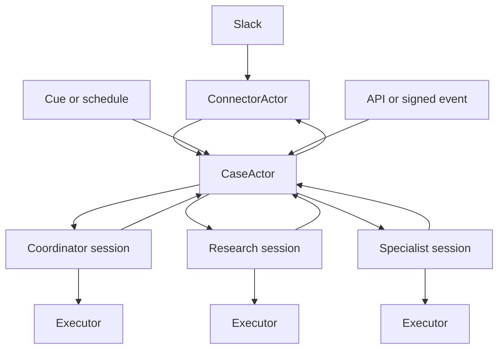

# Plan 15 — Case-Centered Multi-Session Actors

Status: Complete
Date: 2026-08-01  
Depends on:
[Runtime architecture: agent sessions (was Spec 3)](../architecture/runtime.md#agent-sessions),
[Runtime architecture: Case coordination (was Spec 7)](../architecture/runtime.md#case-coordination-and-connector-delivery),
[Runtime architecture: cues (was Spec 9)](../architecture/runtime.md#cues-and-proactive-work),
[Integration architecture: capabilities and tools (was Spec 10)](../architecture/integrations.md#capabilities-and-tools),
[Plan 14](plan-14-actor-runtime-architecture.md), and
[NF9 Actor-owned History](https://github.com/seams-tech/pantry-history/blob/2cf5676a714978ce2887a78523b1b0f6c87a53a8/docs/plan-14-nf9-actor-owned-history.md)

Collaborative authoring is scoped by
[Plan 40](plan-40-product-description-drafting.md) and
[Plan 40B](plan-40B-collaborative-menu-editor.md).
General desktop filesystem synchronization remains deferred.

## Current implementation

Connector, Case, and AgentSession ownership is implemented. The
[closure record](https://github.com/seams-tech/pantry-history/blob/2cf5676a714978ce2887a78523b1b0f6c87a53a8/docs/evidence/plan-15-closure-2026-08-03.md) preserves the original
cutover evidence. Current harness placement follows
[Runtime architecture: harness adapter (was Spec 4)](../architecture/runtime.md#harness-adapter): organisation Codex subscription, organisation OpenAI API
key through Pi, or platform OpenRouter funding through Pi. The session pins
one route and preserves it through recovery.

Stable `harnessInstructions` bind the checkpoint lineage. Each accepted
`turnPrompt` records the current request. Follow-up input cannot silently change
the stable instructions or the pinned authority.

## Objective

Coordinate agent work through one durable ownership hierarchy:

```text
ConnectorActor -> CaseActor -> AgentSessionActor -> Executor
```

- `ConnectorActor` owns provider ingress and delivery.
- `CaseActor` owns one canonical, provider-neutral body of related work.
- `AgentSessionActor` owns one independently durable agent participating in the
  Case.
- `Run` is one execution attempt within a session.
- `Executor` is replaceable compute and owns no durable domain state.

A Case may have several Connector bindings and several independently active
Agent Sessions. A Slack thread is one projection of a Case. Cues, schedules,
APIs and signed commerce events may also create or advance a Case.



## Scope decisions

These rules define the current coordination boundary:

1. **Cases own the active work path.** The retired SurfaceActor and ThreadActor
   runtime has been removed. Persistence boundaries disposition historical
   records without restoring the removed runtime.
2. **One session belongs to one Case.** A session never participates in two
   Cases and never changes its parent.
3. **The Case owns coordination.** Sessions submit proposals to the Case.
   Sessions do not call or mutate sibling sessions directly.
4. **The Case owns shared history.** Sessions retain private execution history;
   only the Case can accept shared journal entries and outputs.
5. **Short delegated work stays lightweight.** A task requiring independent
   lifecycle, budget, checkpoint or scheduled resume gets an Agent Session.
   Smaller work remains a Run or bounded execution child.
6. **Persistent business roles add no new Actor in Plan 15.** Inventory,
   scheduling or marketing defaults live in organisation configuration and the
   versioned workspace. Each participation remains a Case-scoped session.
7. **Quarantined identities cannot become active by inference.** Recovery follows
   the owning lifecycle contract with exact identity and authority checks.
8. **Connectors preserve provider boundaries.** Slack and other provider paths
   reuse Case coordination while their owning plans define provider behavior.

## Durable ownership

| Durable fact                                                   | Owner                                    |
| -------------------------------------------------------------- | ---------------------------------------- |
| Organisation policy, quota and provider configuration          | `OrganisationActor`                      |
| Provider event identity, cursor, retry and delivery receipt    | `ConnectorActor`                         |
| Case purpose, canonical journal, bindings and current revision | `CaseActor`                              |
| Session membership and accepted session proposals              | `CaseActor`                              |
| Agent objective, private history, budget and checkpoint        | `AgentSessionActor`                      |
| Run lease and executor attachment                              | `AgentSessionActor`                      |
| Canonical files and operational memory                         | versioned workspace and commerce records |
| Provider effects                                               | Tool Gateway ledger and provider receipt |
| Temporary files and processes                                  | current executor                         |

No component reads or writes another Actor's storage directly.

## Minimal domain model

Required identities:

```text
OrganisationId
ConnectorId
CaseId
CaseBindingId
AgentSessionId
AssignmentId
RunId
```

Raw provider, Queue, request and D1 records are parsed once at their boundary.
Core functions receive typed commands with required organisation, identity, revision
and fence fields.

### ConnectorActor

The Connector owns:

- provider account and delivery-ordering identity;
- inbound event deduplication and normalization;
- native cursor and echo suppression;
- provider-specific rendering; and
- outbound delivery, retry and receipt.

It does not own Case history, session lifecycle, workspace state or Tool
Gateway effects.

The first RPC surface needs only:

```text
acceptIngress
deliver
inspect
```

### CaseActor

The Case owns:

- identity, purpose, lifecycle and revision;
- canonical blocks and event journal;
- accepted trigger identities;
- Connector binding membership;
- child session assignments and lifecycle summaries;
- accepted proposals and conflict outcomes;
- shared approval and effect references; and
- outbound Connector work.

The first RPC surface needs only:

```text
ensure
acceptTrigger
attachBinding
assignSession
beginAssignment
settleAssignment
acceptSessionProposal
acceptDeliveryReceipt
transition
inspect
```

### AgentSessionActor

Plan 15 preserves the Plan 14 and Spec 3 session lifecycle. New sessions add:

- a required immutable `CaseId`;
- a required assignment and Case revision;
- a bounded Case context snapshot;
- a role and objective;
- a required authority and budget scope; and
- durable proposal identities and dispositions.

An Agent Session may sleep, resume, cancel, fail or retry independently of its
siblings. It retains at most one active Run.

## Multi-session protocol

The Case assigns work against a specific Case revision:

```ts
type CaseAssignment = {
  readonly assignmentId: AssignmentId;
  readonly caseId: CaseId;
  readonly caseRevision: CaseRevision;
  readonly sessionId: AgentSessionId;
  readonly role: AgentRole;
  readonly objective: AgentObjective;
  readonly authority: SessionAuthority;
  readonly budget: SessionBudget;
  readonly context: CaseContextSnapshot;
};
```

A session returns a deterministic proposal:

```ts
type SessionProposal = {
  readonly proposalId: SessionProposalId;
  readonly assignmentId: AssignmentId;
  readonly caseId: CaseId;
  readonly sessionId: AgentSessionId;
  readonly basedOnRevision: CaseRevision;
  readonly entries: readonly ProposedCaseEntry[];
  readonly requestedEffects: readonly ProposedEffectRef[];
};
```

The Case accepts the proposal once and returns one disposition:

```ts
type SessionProposalDisposition =
  | { readonly kind: "accepted"; readonly revision: CaseRevision }
  | { readonly kind: "rebase_required"; readonly revision: CaseRevision }
  | { readonly kind: "rejected"; readonly reason: CaseProposalRejection };
```

Append-only observations may be accepted from an older Case revision when they
cannot overwrite shared state. Mutable shared changes require the current
revision. Workspace changes continue to use semantic changesets against an
explicit workspace revision.

A coordinator is an ordinary session role. It may request another assignment,
while the Case applies organisation policy, reserves the child budget and creates the
session. The child authority must be a subset of the requesting session and
organisation authority. Cancellation of the coordinator does not implicitly cancel
siblings; the Case records the required disposition for each assignment.

## Request paths

### Slack input

```text
signed Slack event
  -> Worker verifies the signature
  -> ConnectorActor durably admits the native event once
  -> Worker acknowledges Slack
  -> ConnectorActor starts work; alarms recover leases and scheduled retries
  -> resolve or create Case binding
  -> CaseActor accepts the trigger once
  -> CaseActor assigns or wakes sessions
```

### Cue, schedule or API input

```text
validated source event or command
  -> deterministic routing identity
  -> resolve an exactly correlated Case or create a new typed Case
  -> CaseActor accepts the trigger once
  -> CaseActor assigns or wakes sessions
```

A store or factory is not one permanent Case. Continuous operation produces
bounded Cases for matters such as replenishment, fulfillment exceptions,
campaigns, staffing and incidents. Organisation configuration, workspace records and
commerce systems retain cross-Case operating knowledge.

### Session output

```text
AgentSessionActor commits private history and proposal
  -> CaseActor accepts the proposal once
  -> CaseActor appends accepted shared entries
  -> CaseActor addresses Connector output
  -> ConnectorActor delivers and records the provider receipt
```

Provider effects continue through the Tool Gateway. The Case records effect
references and outcomes without becoming another effect ledger.

## Lifecycle

The initial Case lifecycle is intentionally small:

```text
Open <-> Waiting
Open | Waiting -> Completing -> Completed -> Archived
Open | Waiting | Completing -> Quarantined
```

- `Open` accepts triggers, assignments and proposals.
- `Waiting` records the exact input, approval or schedule being awaited.
- `Completing` stops new assignments while required work settles.
- `Completed` has no required assignment without a terminal, quarantined or
  detached disposition and no unsettled output or indeterminate effect.
- `Quarantined` preserves storage for operator disposition.
- `Archived` retains the Case under the normal retention policy.

Case lifecycle and session lifecycle remain separate typed unions.

## Implementation evidence

The [Plan 15 closure](https://github.com/seams-tech/pantry-history/blob/2cf5676a714978ce2887a78523b1b0f6c87a53a8/docs/evidence/plan-15-closure-2026-08-03.md) records the completed
coordination and routing cutover. Current lifecycle changes must retain shared
Case ownership, independent session recovery, and exact output receipt settlement.
Use the [E2E coverage guide](../../test-coverage-e2e.md) for current commands.

## Essential validation

Use the existing E2E journeys to check Case acceptance, independent sessions,
proposal ordering, duplicate ingress, and exact delivery settlement. Lifecycle
changes require the onboarding-closure check. Add behavior coverage only for a
real gap and retain a repeatable artifact.

Production smoke requires an authorized environment and target. Local evidence
does not close production acceptance. A documentation change does not require
repeating the original routing cutover.

## Scope boundaries

This plan owns coordination and accepted proposals. Provider-specific behavior
belongs to connector plans. [Plan 55](https://github.com/seams-tech/pantry-history/blob/2cf5676a714978ce2887a78523b1b0f6c87a53a8/docs/plan-55.md) owns regional placement and
its remaining rollout gates. [Refactor 8](https://github.com/seams-tech/pantry-history/blob/2cf5676a714978ce2887a78523b1b0f6c87a53a8/docs/refactor-8.md) and
[Refactor 9](refactor-9.md) own planned naming and project changes. Their proposed
behavior is not part of this completed coordination contract.

## Accepted invariants

- Slack roots use Connector, Case, and AgentSession ownership.
- A Case can coordinate independently active sessions.
- Suspension, resume, cancellation, and failure retain each session's identity.
- Cue and API commands can create a Case without a conversation.
- Shared history and delivery pass through Case and Connector authorities.
- Retired runtime identities are not created by current work.

The [closure record](https://github.com/seams-tech/pantry-history/blob/2cf5676a714978ce2887a78523b1b0f6c87a53a8/docs/evidence/plan-15-closure-2026-08-03.md) preserves the original
production decisions, deletion inventory, and acceptance evidence.

## Attachment carry-through

[Plan 37](plan-37-typed-messages-and-attachments.md) owns typed messages and
attachment preparation. The Case path preserves the stored reference, content
digest, source restrictions, and scoped read authority through assignment and
harness reconstruction.

```text
stored attachment
  -> authorized ingress
  -> accepted Case input
  -> assignment context
  -> AgentSessionActor canonical input
  -> pinned Codex or Pi adapter
```

ConnectorActor owns provider addressing and delivery. CaseActor owns shared
artifacts and output routing. AgentSessionActor receives authorized attachments
and proposes results without selecting an unauthorized destination. Plan 37's
remaining acceptance gates retain their own status.
