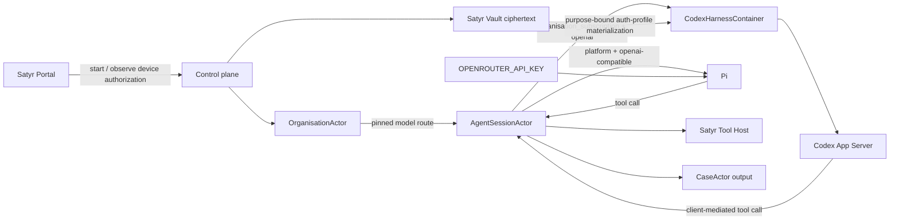

# Plan 28 — Organisation Codex Subscription OAuth

Status: Codex production canary passed; Pi route retained
Date: 2026-08-23 · Owner: Satyr platform
Depends on: [Plan 14 — Actor Runtime Architecture](plan-14-actor-runtime-architecture.md),
[Runtime architecture: harness adapter (was Spec 4)](../architecture/runtime.md#harness-adapter),
[Security architecture: Vault and policy (was Spec 6)](../architecture/security.md#vault-policy-and-revocation),
[Onboarding architecture: control plane (was Spec 11)](../architecture/onboarding.md#onboarding-control-plane),
and [Integration architecture: provider connections (was Spec 12)](../architecture/integrations.md#provider-connections)

Implementation note (2026-08-24): the encrypted connection domain, device-code
bridge, organisation-addressed container, control routes, Portal Integrations UI,
organisation-subscription model authority, and `AgentSessionActor` Codex adapter are
implemented. A dedicated organisation connected through the Portal, completed a real
Slack turn with the governed commerce catalog tool, slept its container, and
completed the same tool path again after cold materialization. Disconnecting
the subscription rejected the next turn with
`organisation_codex_subscription_unavailable`; reconnecting restored a healthy
ChatGPT Pro connection. The platform-funded `openai-compatible` Pi route
remains active through `OPENROUTER_API_KEY`. Picocodex is retired.
Fresh organisation admission uses the source selected in the Portal. The 2026-08-24
extension adds organisation-funded OpenAI API keys as an explicit Pi route alongside
Codex subscription and Satyr-provided inference.

## Purpose

Operate three explicit production funding routes behind the same Actor-owned
harness boundary. An organisation owner can connect an eligible ChatGPT subscription
from the Satyr Portal and run Codex through the organisation's allowance, supply an
OpenAI API key for Pi, or select the platform-funded Pi route through
OpenRouter. `AgentSessionActor` owns history, budgets, tools, checkpoints,
cancellation, and delivery receipts for every route.

The connection work in this plan delivers the organisation-funded path:

```text
Portal owner
  -> Connect ChatGPT for Codex
  -> OpenAI device authorization
  -> encrypted organisation auth profile
  -> organisation-scoped Codex App Server
  -> AgentSessionActor turn
  -> governed Satyr tools and Case output
```

The route pairs are fixed:

| Funding route               | Provider            | Harness          | Credential authority               |
| --------------------------- | ------------------- | ---------------- | ---------------------------------- |
| `organisation_subscription` | `openai`            | Codex App Server | Organisation ChatGPT OAuth profile |
| `platform`                  | `openai-compatible` | Pi               | Satyr's `OPENROUTER_API_KEY`       |

The session contract pins one pair. An expired organisation login, provider-rejected
funding, unavailable container, missing platform key, or provider failure fails
that route closed. Codex never falls back to Pi, and Pi never falls back to Codex.

## Upstream protocol constraints

The design follows the current official Codex App Server protocol:

- App Server is the supported interface for embedding Codex authentication,
  conversations, approvals, and streamed agent events in another product.
- `account/login/start` with `type: "chatgptDeviceCode"` returns a login ID,
  verification URL, and user code. The client owns the sign-in experience and
  receives `account/login/completed` and `account/updated` notifications.
- In managed ChatGPT mode, Codex persists and refreshes its own tokens.
- `account/rateLimits/read` and `account/rateLimits/updated` expose allowance
  windows and reset times.
- Host-managed `chatgptAuthTokens` and App Server dynamic tools are currently
  experimental. The latter is the most direct way to preserve Satyr's
  turn-scoped Tool Host, so it receives an explicit feasibility gate below.

Cloudflare Container disks are ephemeral across sleep and restart. The Codex
auth cache therefore cannot live only in the container filesystem. Satyr must
encrypt the cache as an organisation Vault credential and rehydrate it into the
trusted Codex host when the container wakes.

Protocol references:

- [Codex App Server](https://developers.openai.com/codex/app-server)
- [Codex authentication](https://developers.openai.com/codex/auth)
- [Cloudflare Container lifecycle](https://developers.cloudflare.com/containers/platform-details/architecture/)

Pin the exact Codex version used by the container. No production upgrade is
accepted until its login, event, tool, restore, and rate-limit fixtures pass.

## Scope

### Included

- one organisation-funded ChatGPT/Codex connection per organisation;
- device-code authorization initiated and observed from the Portal;
- encrypted persistence and rotation of Codex's managed auth cache;
- an organisation-addressed, scale-to-zero Codex App Server container;
- a Codex implementation of the existing harness-neutral adapter;
- exact mapping from App Server events and tools into Actor-owned contracts;
- Portal connection, reconnect, disconnect, account status, and allowance UI;
- onboarding and activation readiness for the organisation-funded launch mode;
- the organisation-funded `organisation_byo` + `openai` Pi route through a purpose-bound,
  Vault-encrypted API key;
- the explicit platform-funded `openai-compatible` Pi route through
  `OPENROUTER_API_KEY`; and
- removal of Picocodex and its production-selection paths.

### Excluded

- additional funding/provider pairs or a generic model-provider framework;
- more than one ChatGPT connection per organisation;
- model-selection UI;
- copying a user's local Codex files into Satyr;
- OpenAI's experimental host-managed token login;
- automatic failover between Codex and Pi; and
- conversion of Codex, Pi, or Picocodex checkpoints across harness lineages.

## Fixed architecture



### Ownership

| Component                 | Owns                                                                                                                      |
| ------------------------- | ------------------------------------------------------------------------------------------------------------------------- |
| Control plane and D1      | Authorization attempts, connection projection, immutable operation receipts, and Portal routes.                           |
| Satyr Vault               | Encrypted Codex auth-profile generations and revocation.                                                                  |
| `OrganisationActor`       | Organisation Codex usability, readiness, policy revision, and fencing new work after revocation.                          |
| `AgentSessionActor`       | Accepted history, turn leases, budgets, tool authority, event ordering, cancellation, checkpoints, and output receipts.   |
| `CodexHarnessContainer`   | One organisation's live App Server process, ephemeral thread state, protocol translation, and auth-cache synchronization. |
| Codex App Server          | Managed ChatGPT OAuth, token refresh, model interaction, and Codex protocol events.                                       |
| Pi adapter                | Platform-funded `openai-compatible` turns inside the Worker.                                                              |
| Platform secret authority | `OPENROUTER_API_KEY` for the exact Pi route.                                                                              |

`CodexHarnessContainer` has one logical instance per organisation, addressed by the
canonical organisation ID. It may serve multiple organisation sessions while awake and
sleeps after a short idle interval. The container is a transport and process
boundary; it is never the authoritative store for organisation or session state.

`WorkspaceExecutorContainer` stays separate. Codex authentication never enters
that container, its workspace, generated code, or artifacts.

### Restore model

Only `auth.json` is retained, as opaque encrypted bytes. Codex rollout files,
thread databases, command history, and container disk are disposable.

After a container wake or replacement:

1. the controller resolves the exact active Vault generation for the
   `codex_inference` purpose;
2. the bridge writes it to a private `CODEX_HOME` before App Server starts;
3. App Server proves the account with `account/read`;
4. `AgentSessionActor` starts a fresh Codex thread from accepted Actor-owned
   history; and
5. the new Codex thread ID is recorded as an opaque runtime binding.

A route change starts a fresh lineage. No code interprets or converts Codex,
Pi, or retired Picocodex checkpoints across harnesses.

## Credential boundary

Codex's file-backed auth cache contains access and refresh material and is
treated as one opaque Vault credential.

The trusted container bridge must implement an acknowledged cache protocol:

```text
App Server changes auth cache
  -> bridge reads exact bytes
  -> private controller channel
  -> Vault encrypts and rotates the fenced profile generation
  -> controller returns a durable receipt
  -> bridge may complete the triggering control or turn operation
```

Rules:

- The plaintext cache exists only in Worker memory during materialization and
  in the dedicated Codex host's private ephemeral credential directory.
- D1, Durable Object storage, R2, Queue messages, browser responses, logs,
  traces, Actor journals, prompts, and checkpoints contain no plaintext auth
  cache.
- The bridge transports exact bytes and a digest. It does not parse tokens.
- Every cache change is acknowledged by the current fenced Vault generation before the
  operation that caused it settles.
- A failed cache commit fails the operation closed and terminates the live
  Codex process. The last acknowledged generation remains authoritative.
- Disconnect calls `account/logout`, revokes the active Vault generation,
  removes the connection's policy authority, and deletes the live container's
  credential material.

The implementation updates Spec 6 to name the dedicated Codex host as a
trusted credential-materialization boundary. The existing prohibition on
credentials in workspaces, tools, prompts, transcripts, and the heavy executor
remains unchanged.

### Model-visible process isolation

App Server needs the cache; model-invoked processes must be unable to read it.
The container therefore places `CODEX_HOME` outside all thread-readable roots
and starts every turn with an explicit restricted-read sandbox policy. Satyr
does not expose `thread/shellCommand`, `command/exec`, or experimental
`process/*` control routes to Portal or model code.

The feasibility gate must demonstrate denials for:

- direct reads of `CODEX_HOME/auth.json`;
- traversal and symlink attempts from the empty working directory;
- `/proc` environment and file-descriptor inspection;
- child-process and shell attempts; and
- error, trace, and crash-report exfiltration.

The feature does not ship if this isolation depends only on instructions to the
model.

## Domain model

Create Codex-specific state. Do not add Codex to commerce
`provider_connection` or `integration_account`; those records carry provider
account, resource, webhook, and delivery semantics that inference does not
have.

```text
OrganisationCodexConnection =
  disconnected {
    organisation_id,
    revision
  }
  | authorizing {
      organisation_id,
      revision,
      attempt_id,
      expires_at
    }
  | connected {
      organisation_id,
      revision,
      auth_profile_generation,
      plan_type,
      connected_at,
      verified_at
    }
  | action_required {
      organisation_id,
      revision,
      auth_profile_generation,
      plan_type,
      reason,
      observed_at
    }
```

`action_required.reason` is a closed union:

```text
authorization_expired
workspace_access_revoked
device_authorization_unavailable
account_unavailable
```

Included-allowance percentages remain diagnostics. A connected account can
continue using purchased credits after included usage reaches 100%. OpenAI
decides whether a turn can run; authorization or account verification failures
fence the exact connection and require a new authorization. Diagnostics never
decide the lifecycle branch.

Authorization attempts use their own closed state machine:

```text
created
  -> awaiting_user { login_id, verification_url, user_code, expires_at }
  -> connected { connection_revision, completed_at }
  -> cancelled { cancelled_at }
  -> failed { reason, failed_at }
  -> expired { expired_at }
```

Terminal attempts are immutable. Only one open attempt may exist for an organisation.
The device login ID and user code are sensitive attempt data: encrypt them at
rest, exclude them from logs, and reveal them only to an authorized organisation
owner reading that exact open attempt.

Boundary parsers normalize every App Server response and notification into
these types once. Core functions do not accept raw JSON-RPC objects or optional
identity, generation, lifecycle, or usage fields.

## Control API

Add a focused inference surface:

| Method   | Route                                                                                          | Purpose                                                                   |
| -------- | ---------------------------------------------------------------------------------------------- | ------------------------------------------------------------------------- |
| `GET`    | `/v1/control/organisations/:organisation_id/inference/codex`                                   | Read the canonical connection, open attempt, and allowance projection.    |
| `POST`   | `/v1/control/organisations/:organisation_id/inference/codex/authorizations`                    | Create or return the organisation's one open device authorization.        |
| `POST`   | `/v1/control/organisations/:organisation_id/inference/codex/authorizations/:attempt_id/cancel` | Cancel the exact open login in App Server and persist its terminal state. |
| `POST`   | `/v1/control/organisations/:organisation_id/inference/codex/reconnect`                         | Fence new turns and start a replacement authorization.                    |
| `DELETE` | `/v1/control/organisations/:organisation_id/inference/codex`                                   | Logout, revoke, and disconnect the organisation.                          |

All mutations require current organisation-owner authority, canonical CSRF checks,
and an idempotency key. Reads require current organisation membership. Responses
contain connection metadata, display-safe device authorization fields, plan
type, allowance percentages, and reset times. They never contain account
tokens, the auth cache, Vault handles, or internal container addresses.

The Portal polls the canonical projection while an authorization is open.
There is no Satyr OAuth callback route because OpenAI's device flow completes
through App Server notifications.

## Portal experience

Add **Codex** to the existing Integrations tab strip and Home integration rail.
Its description should say that the organisation's ChatGPT subscription pays for
agent inference. Keep operational tools and commerce integrations as separate
cards.

### Disconnected

- Explain that the owner needs an eligible ChatGPT account and that device-code
  login may need to be enabled by a personal or workspace administrator.
- Present one primary action: **Connect ChatGPT**.
- State clearly that Satyr cannot run organisation-funded Codex turns until the
  connection is complete.

### Awaiting user

- Show the exact OpenAI verification URL and one-time code.
- Provide **Open OpenAI** and **Copy code** actions.
- Announce copy success and terminal-state changes through an `aria-live`
  status region.
- Preserve the attempt across reloads and display its expiry.
- Provide **Cancel connection**.

### Connected

- Show **Connected**, the plan type returned by App Server, last verification,
  and current allowance windows with reset times.
- Provide **Reconnect** and a confirmed **Disconnect** action.
- Avoid showing email or other account data unless the protocol returns it and
  the product has a demonstrated need.

### Action required

- Expired or revoked authorization offers **Reconnect ChatGPT**.
- Allowance exhaustion shows the provider reset time and disables new agent
  work without presenting reconnect as a repair.
- Device authorization unavailable explains the required OpenAI account or
  workspace setting.

The shared integration rail receives the required `OrganisationCodexConnection`
projection, so Home and Integrations cannot disagree about status. Organisation
activation for a `organisation_subscription` + `openai` policy adds one blocker,
`codex_subscription_required`, until the connection is usable. A platform Pi
policy uses its pinned platform funding authority and Actor budget.

## Runtime integration

The existing harness-neutral contract selects an adapter only from the pinned
route pair:

```text
organisation_subscription + openai           -> CodexAppServerAdapter
platform + openai-compatible            -> Pi adapter
```

Every other pair is unsupported. Adapter or authority failure returns through
the session failure path without attempting the other route. Picocodex has no
adapter selection path.

For each Codex turn:

1. `AgentSessionActor` resolves a connected organisation inference revision and
   active auth-profile generation.
2. It reserves the existing turn and budget lease before contacting the
   container.
3. The organisation-addressed container starts or verifies App Server and creates a
   fresh thread when no valid runtime binding exists.
4. Accepted Actor history, current instructions, and bounded inputs are
   materialized into that thread.
5. App Server events are parsed once and appended through the existing
   canonical event and history sinks.
6. App Server client-mediated tool calls are matched to the exact thread,
   session, turn lease, catalog digest, and call ID before reaching the current
   `HarnessToolHost`.
7. The final event, usage, latest acknowledged auth generation, and checkpoint
   binding settle atomically through the current Actor path.

`AgentSessionActor` remains authoritative when App Server and Actor history
disagree. The runtime discards the App Server thread and rebuilds from accepted
history. It never imports unaccepted App Server rollout records.

For a platform-funded Pi turn, the Actor resolves `OPENROUTER_API_KEY` through
the purpose-bound platform route lease, reconstructs Pi from accepted history
and its validated checkpoint projection, and uses the same event, Tool Host,
budget, cancellation, and delivery contracts. The raw key never enters Actor
persistence, history, prompts, tools, generated code, or executor storage.

Cancellation maps to `turn/interrupt`. Steering maps to `turn/steer` with the
exact active turn ID. Unknown, duplicate, out-of-order, or post-terminal events
fail through the current canonical event boundary.

### Governed tools

Use App Server client-mediated dynamic tools only if Phase 0 accepts the pinned
experimental protocol. The adapter supplies the exact existing tool catalog
for the turn and handles `item/tool/call` inside the client. The model cannot
select an organisation, session, capability, credential generation, or execution
lease through tool arguments.

The App Server client enables `experimentalApi` solely for this dynamic-tool
surface. Its parser rejects every other experimental request and notification;
the Portal never exposes a generic App Server proxy.

The client rejects a tool call unless all of these match live Actor state:

- organisation and session;
- App Server thread and turn;
- Actor turn-lease generation;
- policy and catalog digests;
- call ID and expected sequence; and
- current connection and auth-profile generation.

This reuses the existing Tool Host and workspace-execution boundaries. It does
not add a second tool framework.

## Implementation sequence

### Phase 0 — Feasibility gate

Build a disposable local prototype before migrations or Portal UI:

1. Pin Codex and launch App Server through a small stdio bridge.
2. Complete device-code login with a test ChatGPT account.
3. Capture `account/login/completed`, `account/updated`, account reads, logout,
   and rate-limit reads.
4. Export the opaque file-backed auth cache, destroy the process and disk,
   restore the cache, and prove one new model turn succeeds.
5. Force or observe a token refresh and prove the changed cache is durably
   acknowledged before the triggering operation settles.
6. Start two concurrent threads for one organisation and prove event and tool-call
   routing cannot cross sessions.
7. Route one existing read-only Satyr tool through `dynamicTools`, then route
   one approval-governed commerce action through the same Actor authority.
8. Run the credential-isolation probes listed above.
9. Record cold-start, warm-turn orchestration overhead, active container time,
   and failure behavior when the container sleeps mid-idle.

Gate P0 passes only when the pinned beta device flow and experimental dynamic
tool API are reliable enough for a controlled production canary. If either
protocol fails, stop this plan. Do not add a localhost callback proxy, parse
OAuth tokens, call undocumented subscription endpoints, or use Satyr API keys
as a fallback.

### Phase 1 — Connection domain and Vault

- Add one append-only D1 migration for Codex connection metadata,
  authorization attempts, and operation receipts.
- Add precise connection and attempt unions, boundary parsers, builders, and
  exhaustive transitions.
- Add `codex_auth_profile` as an organisation-funded model credential variant in the
  existing Vault.
- Implement purpose-bound materialization, acknowledged generation rotation,
  disconnect revocation, archive closure, and restore behavior.
- Project connection readiness through `OrganisationActor` and onboarding.

Gate P1: a fake App Server can drive connect, restore, refresh, reconnect,
disconnect, archive, and organisation deletion without leaking credential bytes.

### Phase 2 — Codex host and adapter

- Add `services/codex-harness/` with a pinned Docker image and the smallest
  stdio-to-private-HTTP bridge around `codex app-server`.
- Add `CodexHarnessContainer` to `services/platform`, `Env`, Wrangler bindings,
  exports, migrations, and container configuration.
- Address containers by organisation ID, use the smallest viable instance type, cap
  maximum instances deliberately, and set a short idle sleep.
- Implement managed auth-cache materialization and acknowledged writeback.
- Implement the Codex protocol client, canonical event mapping, cancellation,
  steering, usage parsing, rate-limit projection, and error normalization.
- Implement `CodexAppServerAdapter` against the existing harness-neutral
  contract and current Tool Host.

Gate P2: local container tests prove cold restore, two-session isolation, one
read tool, one governed action, cancellation, retry, and cache rotation.

### Phase 3 — Actor operating path

- Require the exact connected inference revision and credential generation at
  turn start.
- Bind App Server thread and turn IDs to the current Actor turn lease.
- Rebuild disposable Codex thread state from accepted Actor history after
  container sleep or restart.
- Settle Codex usage through the existing session budget account. Subscription
  allowance and Satyr safety budgets remain separate typed states.
- Fence new work immediately on disconnect, revocation, or authentication
  failure.
- Surface allowance exhaustion as a typed retry time through Case and Slack
  delivery.

Gate P3: the existing Slack-to-Case-to-AgentSession-to-Slack path completes
with organisation-funded Codex and one real governed commerce tool call.

### Phase 4 — Control API and Portal

- Add the focused routes and Portal client methods.
- Extend the required Integrations and Home route data with the Codex
  connection projection.
- Add the Codex tile, device-code panel, status, allowance, reconnect, and
  disconnect states.
- Add `codex_subscription_required` to readiness and activation for policies
  selecting organisation-subscription Codex.
- Preserve owner-only mutations, keyboard behavior, focus order, live status,
  reload recovery, and narrow-screen layout.

Gate P4: a new organisation can connect and activate without operator steps; a page
reload during authorization resumes the exact attempt; a member can inspect
status but cannot mutate it.

### Phase 5 — Canary, cutover, and deletion

1. Deploy to one operator-owned organisation.
2. Run representative direct and shared Slack conversations, read tools,
   governed commerce actions, cancellation, container sleep, auth refresh, and
   disconnect.
3. Compare Actor orchestration benchmarks with the current committed baseline.
   Report inference time separately from Satyr overhead.
4. Expand to the initial merchant organisations only after the canary meets every
   completion criterion.
5. Activate organisation-subscription Codex for fresh organisation admission. Retain the
   platform-funded Pi route for the later Satyr-provided inference rollout.
6. Delete Picocodex, obsolete selectors and credentials, compatibility paths,
   dead fixtures, and stale documentation. Preserve the Pi platform route,
   `OPENROUTER_API_KEY`, Tool Host, and workspace-execution code that belong to
   the operating architecture.

The two harness implementations expose three separate funding authorities. A
session uses one pinned route for its lineage, and failures never cause
cross-route selection. Fresh admission resolves the organisation's explicit Portal
selection.

## Expected file ownership

The exact list may shrink during implementation. Start from these existing
boundaries:

```text
services/platform/
  migrations/                         Codex connection and attempt metadata
  src/control-router.ts               focused control routes
  src/data/onboarding-projection.ts   readiness and repair projection
  src/actors/organisation.ts                inference readiness and revocation fence
  src/actors/agent-session.ts         turn binding and operating path
  src/actors/embedded-harness*.ts     adapter contract and exact route selection
  src/credential-vault/               auth-profile resolution and rotation
  src/codex-connection.ts             connection state and transitions
  src/codex-app-server-client.ts      parsed JSON-RPC boundary
  src/codex-harness-container.ts      organisation-addressed container controller
  src/env.ts                          container binding
  wrangler.jsonc                      container declaration and deploy config

services/codex-harness/
  Dockerfile
  package.json
  src/bridge.ts                       App Server stdio supervisor only

apps/portal/src/
  control-client.ts                   typed connection commands
  pages/settings.tsx                  Codex integration panel
  pages/home.tsx                      shared readiness status
  page-content.ts                     required route projection
  styles.css                          existing integration visual language
```

Keep connection logic out of `settings.tsx`. The page renders precise route
state and emits typed commands. Keep raw App Server JSON out of Actor and Portal
types.

## Verification

### Type and unit tests

- Invalid connection and attempt branches fail type checking.
- Raw JSON-RPC objects cannot cross the parser boundary.
- Every switch over connection, attempt, account, allowance, login, and App
  Server event state is exhaustive.
- Direct object literals, broad spreads, unsafe casts, missing identity, and
  missing generation fields have targeted `@ts-expect-error` fixtures.
- Transition, idempotency, expiry, refresh, reconnect, logout, and revocation
  tests use a deterministic fake clock and fake App Server.

### Integration tests

- App Server protocol fixtures cover the pinned version's accepted responses,
  notifications, unknown messages, duplicates, reordering, and failure shapes.
- Container tests destroy the disk between authorization and reuse.
- Credential sentinel tests cover browser responses, D1 plaintext, DO storage,
  Queue payloads, logs, Actor history, checkpoints, workspaces, and artifacts.
- Actor tests cover cold restore, concurrent session routing, cancellation,
  retry, allowance exhaustion, and disconnect during active work.
- Portal tests cover owner/member permissions, copy feedback, polling, reload,
  expiry, reconnect, allowance reset display, and keyboard navigation.

### Live canary

The essential production canary passed on 2026-08-24 with a dedicated organisation:

1. Portal authorization completed and reported a healthy ChatGPT Pro account.
2. Slack invoked `commerce_catalog_list` through the governed Tool Host and
   delivered the result.
3. After container sleep, a second governed turn cold-materialized the OAuth
   profile and completed.
4. Disconnect rejected the next turn before inference. Reconnect restored the
   healthy connection.

### Repository checks

Run the narrow checks first, then the full operating suite:

```bash
pnpm --filter satyr-edge check:types
pnpm --filter satyr-edge check:test-types
pnpm --filter satyr-edge test
pnpm --filter satyr-edge test:onboarding-closure
pnpm --filter satyr-edge test:commerce-lab
pnpm portal:build
cargo test --workspace
git diff --check
```

## Completion criteria

- An organisation owner connects ChatGPT for Codex entirely through the Portal.
- Reloading the Portal or sleeping and replacing the container loses no
  accepted authorization or Actor history.
- A connected organisation completes the real Slack-to-AgentSession-to-Case delivery
  path using its subscription and a governed Satyr tool.
- `AgentSessionActor` remains authoritative for history, lifecycle, budgets,
  tool calls, cancellation, and receipts.
- Auth cache bytes are absent from browser state, plaintext persistence, logs,
  prompts, model-visible files, generated code, the heavy executor, and
  artifacts.
- A token refresh is acknowledged as an encrypted Vault rotation before
  the triggering operation settles.
- Disconnect or revocation denies the next organisation-subscription model use. The
  session never changes to platform-funded Pi as fallback.
- Allowance exhaustion produces a typed wait state with the provider reset
  time; it does not corrupt the connection lifecycle.
- Home, Integrations, onboarding, and activation read one canonical connection
  projection.
- Container active time, cold-start overhead, and Satyr orchestration overhead
  are recorded against the existing benchmark baseline.
- Organisation-subscription Codex requires no Satyr-funded model API key.
- Platform-funded Pi requires `OPENROUTER_API_KEY` and a pinned
  `platform` + `openai-compatible` route.
- Picocodex selectors, credentials, runtime, and operating tests are deleted.
  Its legacy identifier remains only in the persistence parser for stored
  checkpoint classification.

## Platform-funded inference

Satyr-funded inference is the closed `platform` + `openai-compatible` authority
class. It runs Pi through OpenRouter with `OPENROUTER_API_KEY` and must carry
explicit quota, pricing, model-route, usage, and receipt policy. It is a
deliberate session route and is not selected by current fresh organisation admission.
Expired, disconnected, or exhausted organisation Codex authority never selects it
automatically.
