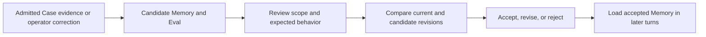

# Plan 42J — Brain: Memory, Evals, and Case Execution

Status: B1a, B1b and B2 are built and checked locally, and in production
since 12 October 2026. Each box of this plan is closed since 28 November 2026
on the branch `plan-42j`, which is not released. What is left is the
production acceptance, after a release that the owner approves. A box below
marks an item that is built and checked.
Date: 9 October 2026.
Owners: Platform context and Case runtime, with CafeOS Portal.

This plan had the number 42G until 13 October 2026.
[Plan 42G — Automatic agent context loading](plan-42G-automatic-context-loading.md)
keeps the number 42G and is complete. The Brain journey tools are in
`scripts/plan-42J/`.

## Outcome and priority

Satyr learns from reviewed corrections and verified outcomes. Operators can
inspect what it remembers, test a proposed change, and trace accepted execution.

Deliver this work in order:

1. B1a: the Memory loop, including the Brain Overview and Memory views needed
   to review it. Accept it on recorded replay evidence. It does not wait for Evals.
2. Plan 56 S1: the Slack review card. Its edit and decline actions are the
   operator corrections that supply evidence for candidate memories. It exercises
   proposal revision binding on a real surface before the visualizer projects it.
3. B1b: versioned Evals, bounded EvalRuns, and current/candidate comparisons.
4. B2: a read-only Case execution visualizer backed by accepted runtime records.

The interface over these records is
[Plan 42K — Brain interface](plan-42K-brain-ui.md).

[Plan 56 — Slack API interactions](https://github.com/seams-tech/pantry-history/blob/2cf5676a714978ce2887a78523b1b0f6c87a53a8/docs/plan-56-slack-in-browser.md) owns the Slack
work. A Slack browser pilot is not planned.

Brain is the product area that combines these capabilities. Each domain module
owns its records and rules within the existing Platform runtime. This plan
creates no BrainActor, learning service, general workflow engine, or second
authorization system.

## Current foundation

| Foundation                                                                                             | Current position                                                                                                                          | Use in this plan                                                                     |
| ------------------------------------------------------------------------------------------------------ | ----------------------------------------------------------------------------------------------------------------------------------------- | ------------------------------------------------------------------------------------ |
| [Refactor 8](https://github.com/seams-tech/pantry-history/blob/2cf5676a714978ce2887a78523b1b0f6c87a53a8/docs/refactor-8.md)                                                                            | CaseContextCollection owns validated relationships and their review. CaseContextDiscovery finds those relationships.                      | Preserve these names and responsibilities.                                           |
| [Plan 46](https://github.com/seams-tech/pantry-history/blob/2cf5676a714978ce2887a78523b1b0f6c87a53a8/docs/plan-46-case-context-discovery.md)                                                           | Bounded relationship discovery, review, evaluation receipts, and protected collection inspection exist. Broader activation remains gated. | Use permitted collection evidence without expanding discovery rollout.               |
| [Automatic context loading](plan-42G-automatic-context-loading.md)                                     | On-demand context loading passed production Pi and Codex acceptance.                                                                      | Add accepted Memory through the existing admission and assembly path.                |
| [Plan 39](plan-39-urk-merchant-agent-parity.md)                                                        | Merchant memory is deferred. Runtime commands reject it as unavailable.                                                                   | Replace the deferred memory path with one implemented lifecycle.                     |
| [AD-027](plan-3-decisions.md#ad-027--replaceable-agent-context-and-cue-workflow-boundaries-2026-07-15) | Evaluation identifies context, prompt, model, tool, and fixture versions.                                                                 | Make behavior comparisons repeatable and inspectable.                                |
| [Plan 15](plan-15.md) and [Plan 50](https://github.com/seams-tech/pantry-history/blob/2cf5676a714978ce2887a78523b1b0f6c87a53a8/docs/plan-50-pi-durable-execution-multiplayer.md)                       | Cases, assignments, accepted session events, durable execution, and receipts have existing owners.                                        | Run bounded learning work and project recorded execution.                            |
| [Plan 42](plan-42-bakery-workflow-simulator.md)                                                        | BakeryOS has a workflow canvas with domain-specific execution state.                                                                      | Reuse suitable presentation code while preserving the separate Case execution model. |
| [Refactor 9](refactor-9.md)                                                                            | Every Case belongs to one Project within an Organisation.                                                                                 | Preserve Project grouping and independent Case/source access checks.                 |

Discovery evaluations classify evidence relationships. Behavior evals test an
agent configuration against expected behavior. Their records retain separate
domain ownership.

## Modules and ownership

| Module                 | Owns                                                                                                      | Boundary                                                               |
| ---------------------- | --------------------------------------------------------------------------------------------------------- | ---------------------------------------------------------------------- |
| CaseContextCollections | Validated evidence relationships, revisions, and review commands.                                         | Source owners retain content. A relationship grants no access.         |
| CaseContextDiscovery   | Candidate selection, relationship inference, configuration, budgets, and discovery receipts.              | Proposes or attaches relationships through collection operations.      |
| Memory                 | Candidate lessons, reviewed revisions, applicability, evidence, acceptance, supersession, and revocation. | Ordinary context reads admit only current accepted revisions.          |
| Evals                  | Eval definitions, EvalRuns, EvalResults, criteria, and version comparisons.                               | Executes bounded trials through existing Case and session machinery.   |
| Context assembly       | Selection and admission of permitted evidence for a turn.                                                 | Reads module interfaces and applies existing live authority checks.    |
| Case execution view    | A rebuildable projection of recorded execution and causal links.                                          | Case and session owners remain authoritative.                          |
| Brain screen           | Combined read views, navigation, and module commands.                                                     | Owns presentation state. Domain modules own decisions and persistence. |

OrganisationActor retains collection and discovery ownership. It also owns the
shared Memory and Eval publication commands and review revisions introduced here.
Keep each module's persistence behind its owning interface.

Memory and Eval records persist in OrganisationActor SQLite, beside
CaseContextCollections. Revisioned publication with expected-revision conflicts
already exists there, and Actor SQLite follows the organisation's regional
placement without a separate D1 placement decision. The D1 `merchant_memory`
table is removed with the required deployed-database patch script when the new
implementation lands. D1 holds no writable Memory or Eval record. Do not
maintain writable copies in both D1 and Actor SQLite.

CaseActor owns learning assignments and accepted proposals. AgentSessionActor
owns inference execution, history, cancellation, and budgets. One EvalRun is one
Case with one assignment per scenario and configuration. CaseActor and
AgentSessionActor absorb that fan-out. OrganisationActor receives only the
settled EvalResult and never hosts run execution. The Evals module links runs
and results to those existing execution records. Large authorized artifacts use
the existing artifact boundary.

Keep collection record/review code separate from discovery orchestration as those
files change. New Memory and Evals code belongs in focused Platform modules.
Reuse existing proposal, revision, receipt, and persistence helpers where they fit.
Portal exchange types belong in `packages/control-api`.

The initial implementation map is:

| Existing code                                                                  | Planned work                                                                                                                                              |
| ------------------------------------------------------------------------------ | --------------------------------------------------------------------------------------------------------------------------------------------------------- |
| `services/platform/src/case-context-discovery/`                                | Preserve discovery behavior. Separate collection operations where the learning loop needs a public record/review interface.                               |
| `services/platform/src/data/merchant-memory.ts` and `data/agent-operations.ts` | Replace deferred memory shapes and unavailable commands with the single Memory implementation. Remove obsolete paths.                                     |
| `services/platform/migrations/0001_current_schema.sql` and `migrations-regional/0001_current_schema.sql` | Remove `merchant_memory` and its index from both baselines. Ship a guarded patch that checks every production database before removal. |
| `services/platform/src/actors/organisation.ts`                                 | Own Memory and Eval SQLite schemas, publication commands, and settled EvalResult receipt. Run no eval execution here.                                      |
| `services/platform/src/context/`                                               | Admit relevant accepted memories through existing turn authority and source checks as a distinct context provenance, recording admitted revisions.       |
| `eslint.config.mjs`                                                            | Restrict imports of the raw Memory reader and permit its authorized callers through explicit overrides in the same change. |
| `services/platform/src/actors/`                                                | Reuse publication, Case assignment, session execution, and receipt ownership. Add the missing causal fields listed under B2.                               |
| `services/platform/src/integrations/typesafe/`                                 | Retain discovery inference accounting. Reuse only helpers whose contracts fit behavior evaluation.                                                        |
| `packages/control-api`                                                         | Publish the Memory, Eval, and execution node/edge contracts the portal and platform exchange.                                                             |
| `services/platform/src/chat/timeline.ts` and `apps/portal/src/features/chat/`  | Render tool, approval, and receipt items through shared execution identities. Keep conversation records under their existing owner. |
| `apps/portal/src/`                                                             | Add Brain views and Case execution inspection through shared control contracts.                                                                           |

## Dependency rules

1. Collections remain readable and reviewable when discovery is disabled.
2. Memory may cite a collection, an admitted Case observation, or an explicit
   operator instruction. It does not require discovery to run.
3. Evals may use reviewed synthetic scenarios or permitted recorded evidence.
   An eval need not depend on a Memory or collection.
4. Context assembly reads accepted knowledge through public module operations.
   It never starts learning or publishes a memory during an ordinary read.
5. Brain calls those same operations. It creates no alternative write path.
6. References carry exact record identities and revisions. Consumers do not
   import another module's private storage implementation.
7. EvalRun execution writes only to its Case and session owners. Only the
   settled EvalResult publishes to OrganisationActor.

## Memory contract

A Memory states a reusable fact, preference, or operating lesson. It must name
where it applies and retain the evidence and decision that justify its use.

Require organisation identity, exact revision, applicability, source references,
source restrictions, and an explicit validity rule. Acceptance requires the
reviewer's identity and decision receipt. Use existing skill/resource scopes
where sufficient. Add an exact commerce entity scope in the first release: the
supplier cutoff scenario requires it. Applicability names the organisation,
merchant, and existing commerce entity reference. For a supplier, use
`origin: "custom"`, `typeId: SUPPLIER_ENTITY_TYPE_ID`, and its exact `entityId`.
Import the constant from `@satyr/bakery-model`. Its value is `trade_partner`.
The supplier directory entry and display name do not replace the entity identity.

Validity separately names the evidence records and exact revisions that support
the cutoff, plus its timezone and effective dates. Recheck those dependencies
before use. A merchant snapshot revision records the observation context. It
does not alone determine the validity of a supplier fact when unrelated records change.
Project placement alone supplies neither applicability nor access.

Model candidate, accepted, rejected, superseded, and revoked states as precise
branches. Acceptance fields exist only on accepted or previously accepted
branches. A superseded revision identifies its replacement. Revocation retains
its decision evidence subject to the governing retention policy.

Publication uses the expected revision and an idempotent command identity.
Repeated commands return the same receipt. Conflicting commands return a typed
conflict. Reading an accepted memory requires current validity and source access.

The first release requires operator acceptance. The agent may propose memories
from corrections or outcomes. It cannot accept its own proposal or silently
convert a single incident into a general rule.

When a new candidate contradicts an applicable accepted memory, require explicit
replacement or rejection. Ordinary turns disclose unresolved ambiguity when it
affects the answer. They must not choose a rule solely because it is newer.

Acceptance adds no permission, policy override, or commerce authority. An accepted
memory about supplier ordering remains subject to current source facts and action
policy. Changed source revisions or expired evidence require renewed review when
the memory's validity depends on them.

[Plan 16](plan-16-merchant-console-commerce-operations.md) playbooks remain the
owner of procedure. A Memory records a scoped, evidenced, revocable fact or
preference with a validity rule, such as a cutoff or a reporting preference. A
correction that changes how work is done becomes a playbook revision through
existing agent configuration publication. `composeAgentInstructions` already
includes the pinned definition's instructions and attached skill Markdown.
Memory enters the bounded context prompt through its own provenance branch.

### Admission and unavailable Memory

Add an authorized Memory reader to the assembly permit beside the Case-tail
reader. Apply applicability, validity, and live source checks before admission.
The Memory lookup has its own deadline, initially 250 ms, and runs alongside
the existing readers. The selection loop's time limit does not bound reader I/O.
Discard late results after the lookup settles. Required authority checks remain
mandatory for every admitted item.

Order Memory candidates ahead of projection results. Exempt them from the
selection loop's elapsed-time check, as Case-tail candidates already are, so a
read that settles inside its own deadline is not then dropped for latency.
Preserve the hard item, token, and prompt-byte limits. Expose every omission
those limits cause.

Record one precise Memory outcome in each accepted context bundle:

- `none`: the read completed and found no permitted, applicable Memory. No
  size or time limit removed one.
- `admitted`: a nonempty set of exact Memory identities and revisions. Every
  permitted, applicable Memory the read returned survived selection.
- `limited`: the read completed and returned at least one permitted, applicable
  Memory, and a limit omitted some or all of them. Record the admitted
  revisions, which may be empty, and the limiting reason: items, tokens, or
  prompt bytes. Record no content or identity of an omitted Memory beyond what
  the reader may already see.
- `unavailable`: a deadline or read failure prevented Memory retrieval. Record
  a bounded reason without source content, hidden counts, or provider secrets.

`modelContextPrompt` renders from the accepted bundle and stops adding excerpts
once the encoded prompt exceeds its byte budget. That budget depends on the
instruction and attachments, so it is known only at render time. Render the
Memory items and any limitation line before the ranked excerpts and count them
first against the budget. The limitation line is fixed text that always
renders. When the byte budget still omits a Memory item, record the rendered
revisions and the `prompt_bytes` reason on the accepted user-input history
entry. Turn details report the rendered record. It is the evidence of what a
turn admitted.

For `limited`, treat the omitted knowledge as `unavailable` does below: render
the limitation, disclose it when it affects the answer, and establish the facts
through current evidence or operator review before a dependent action.

For `unavailable`, continue the turn using the remaining admitted context.
Render an explicit limitation for the model and record it in turn details.
An unavailable read cannot establish that no Memory applies. Disclose the
limitation when it affects the answer or proposed action. Establish relevant
facts through current authorized evidence or request operator review before a
dependent action. Action policy still applies, but permission alone does not
establish the missing business facts. Preserve existing denial and corrupt-state
failures. The unavailable outcome applies only to Memory retrieval availability.

### Replay and restore

Store the Memory outcome, exact item identities, and revisions inside
`ContextBundle`. `session_turn_context` persists the bundle and its digest.
Extend the existing parser and materializer for the new provenance and outcome.
`restoreSessionTurnContext` verifies the digest and re-materializes the recorded
bundle. The existing `instructionDigest` continues to cover `harnessInstructions`.

Resume uses the recorded bundle, including an unavailable or limited outcome. A new turn
reads current Memory. Never substitute newer revisions into accepted history.
The bundle digest proves consistency of recorded content. Current authorization
and validity checks still govern its use. If a resumed action would rely on
invalid or revoked knowledge, stop that action and require a fresh authorized turn.

Viewer replay checks current source access and retention before disclosure.
An authorized historical view may explain a superseded or revoked Memory as
historical evidence. It cannot present that revision as current guidance.

## Eval, EvalRun, and EvalResult

These are separate records within one Evals module.

| Record     | Required meaning                                                                                     |
| ---------- | ---------------------------------------------------------------------------------------------------- |
| Eval       | A versioned scenario, permitted fixture, expected behavior, explicit criteria, and scoring method.   |
| EvalRun    | One bounded execution against exact scenario, configuration, context, and scorer revisions.          |
| EvalResult | A completed assessment with criterion outcomes, observed evidence, scorer identity, and limitations. |

An EvalRun records its pinned inference authority, prompt/skill revision, tool
catalog, relevant memory revisions, fixture revision, and execution references.
It also records the context assembly, authorization policy, and scorer revisions.
Record effective model identity and relevant settings when available. Provider
output may vary even with identical inputs. Identify that limitation in comparisons.

Use distinct pending, running, completed, failed, cancelled, and indeterminate
run states. A completed assessment may pass or fail its criteria. An execution
failure or unknown outcome must not become a failed behavior verdict.

Corrections produce candidate evals. Review establishes the intended behavior
before a test becomes a release criterion. Check whether an existing scenario
already covers the behavior. Avoid one test for every wording change.

Prefer criteria grounded in observable behavior: correct source selection,
required escalation, prohibited effect absence, exact approval binding, and
confirmed completion. Use a model scorer only for criteria that need judgment.
Record its version and instructions. A scorer failure leaves its criterion
unassessed and prevents a passing result.

Preserve results against exact tested revisions. Editing an Eval creates a new
revision. Candidate Memory or prompt revisions remain isolated to the eval run
until accepted. Compare the current and candidate configurations on the same
reviewed scenarios, including unrelated controls that detect overgeneralization.

Use finite per-run and aggregate budgets through existing accounting. An absent
credential or exhausted pinned authority produces a typed unavailable outcome.
No run changes its funding route automatically.

The initial eval environment uses synthetic or authorized captured evidence and
provider test targets. Tool permissions block production writes. Historical
replay cannot send messages, publish records, or repeat payments. Reuse existing
E2E/provider test boundaries. Add no general simulation framework.

Keep only the minimum permitted fixture and result content. Stored fixtures and
outputs retain source restrictions, retention, and erasure dependencies. A source
link or digest alone cannot reproduce missing evidence. Report an unavailable
fixture when required evidence cannot lawfully be retained or retrieved.

Passing an eval supplies evidence for a review decision. Publication and action
approval use their existing authorities. Automatic prompt rewriting, automatic
policy changes, and autonomous production promotion are outside this release.

## Learning workflow

Use existing Case assignments and proposals to coordinate these steps.
The minimum release covers candidate Memory, reviewed behavior evals, bounded
comparison, and explicit acceptance. Existing agent configuration publication
remains the owner of any prompt or skill revision.

The first scenario concerns a supplier's next-day order cutoff. Retain its
timezone and effective dates in the scoped rule and test criteria. The commerce
action union has no purchase-request amendment action, so the proposal under
correction is a supplier reply draft through the existing Gmail supplier-reply
path from [Plan 46](https://github.com/seams-tech/pantry-history/blob/2cf5676a714978ce2887a78523b1b0f6c87a53a8/docs/plan-46-case-context-discovery.md) that proposes an order
change after the cutoff. An operator corrects that draft. Satyr proposes a
supplier-scoped memory and an eval covering the correct escalation. The
candidate must also preserve ordinary handling for another supplier and an
earlier request.

## Brain screen

Deliver the smallest screens needed for the first learning scenario:

| View     | Initial content                                                                                            |
| -------- | ---------------------------------------------------------------------------------------------------------- |
| Overview | Pending review, failed assessments, unavailable runs, and evidence that needs review.                      |
| Context  | Existing protected collections, related Cases, source references, and discovery status.                    |
| Memory   | Candidate and accepted revisions, applicability, evidence, decisions, and replacement/revocation controls. |
| Evals    | Definitions, runs, criterion results, and current/candidate comparisons.                                   |
| Activity | Authorized links to the existing Case, decision, and execution records.                                    |

Overview and Memory ship with B1a. Evals ships with B1b. Activity and the
execution detail ship with B2. Context links to the existing Plan 46 inspection.

Expose the same detail views from the originating Case. Show which memory
revision a turn actually admitted. A memory count is not evidence of use.
Discovery configuration and source connection settings keep their existing
owners and can be reached through links.

## Case execution visualizer

Start this phase after the memory-and-eval loop passes its acceptance journey.
The first view is read-only and scoped to one authorized Case.

Project recorded assignments, session attempts, tool operations, proposals,
approval waits, effects, and delivery receipts. Show inputs, accepted outputs,
status, and links to supporting evidence where access permits them.

Create edges from recorded parent, assignment, causation, proposal, or receipt
references. Timestamps establish order only. They cannot establish dependency.
Show independent recorded branches in parallel. When a causal link is absent,
show an unlinked event or a chronological list with that limitation.

An operation and its retry attempts have separate identities. Waiting for human
approval differs from running inference. An unknown provider outcome remains
unresolved until reconciliation establishes the result. The graph must agree
with the existing Case state after refresh, reconnect, and Actor replacement.

The [Plan 45](https://github.com/seams-tech/pantry-history/blob/2cf5676a714978ce2887a78523b1b0f6c87a53a8/docs/plan-45-chat-portal.md) chat timeline already renders tool,
approval, and receipt items. Its `tool_started`, `tool_settled`, `approval`, and
`receipt` items use the execution identities published in `packages/control-api`.
User and assistant messages, attachments, questions, ratings, and other
conversation kinds retain their existing records. The execution items share
one projection with the graph.

Reuse the existing cursor/replay contract where suitable. Bound pagination and
graph size. Retain a keyboard-accessible list view and details panel for narrow
screens. Reuse canvas presentation primitives only when they fit this model.
Keep bakery operations and Case execution types separate.

The graph is a rebuildable read projection. It cannot schedule work, edit
dependencies, change approvals, or infer completion from UI diagnostics. Raw
chain of thought remains excluded.

## Authorization, lifecycle, and persistence

Apply the [IFC integration guide](../../foundation/authority/policy/information-flow/README.md)
to every new source and output. Information Flow Control preserves restrictions
from observed sources through derived records and delivery.

Memory, eval fixtures, results, graph nodes, titles, counts, and previews retain
their contributing source restrictions. Recheck current access before model
inference, retrieval, review, replay, export, and delivery. Hidden graph records
must not leak through labels, counts, timing, or connecting edges.

Replace the deferred `merchant_memory` source-label implementation with the
Actor-owned Memory source. It currently derives restrictions from turn authority
and organisation policy. The new label joins all contributing evidence labels
with the authoring principal's input label. Operator edits retain both the
evidence restrictions and the author's restrictions. The existing `sensitivity`
field does not establish a flow label.

Add a restricted-import pattern for the raw Memory reader in `eslint.config.mjs`,
following `rawProjectionImport`. Allow only authorized boundary callers through
explicit overrides. `ifcBoundaryOwners` is an exemption list, so adding a filename
there alone cannot prevent bypasses. Ship the reader, import restrictions, and
IFC entry-point documentation together. Run `pnpm lint:ifc-boundaries` and the
allowed/denied E2E journey.

Organisation storage ownership grants no organisation-wide visibility. Project
movement, Case sharing, forks, and restore retain contributing restrictions.
Source erasure and revocation invalidate dependent use through existing lifecycle
boundaries. Accepted historical decisions cannot substitute for current access.

Parse external and persisted shapes once at their boundaries. Use discriminated
unions, branch-specific builders, required identity fields, Result-style errors,
and exhaustive switches. Core operations receive the narrowest valid state.
Add compile-time fixtures for invalid lifecycle combinations, direct construction,
broad spreads, and any known unsafe-cast escape. Follow the testing policy in
`AGENTS.md`: no unit tests, E2E journeys as the testing mechanism, a
medium-to-hard scenario, and a verifiable, repeatable artifact at the end.
Tautological and change-detector tests are harmful. Add no regression test for
a bug fix without a genuine gap in behavior coverage.

Replace obsolete deferred memory paths when the new implementation lands.
Remove `data/merchant-memory.ts`, unavailable commands, obsolete public types,
configuration draft/presentation paths, Portal references, and old label code.
Update shared fixtures and remove assertions that encode deferred behavior.
Retain unrelated behavior coverage. Actor schema changes stay with the owning Actor.

### D1 removal precondition

Remove `merchant_memory` and its index from `migrations/0001_current_schema.sql`
and `migrations-regional/0001_current_schema.sql`. The `migrations-global`
baseline does not declare the table. The production configuration names
`satyr-global`, `satyr-organisation-wnam`, and `satyr-organisation-apac`.
A database created before the split may still contain the table.

Ship a patch and verification path in `services/platform/scripts/`. Inspect
table existence and, where present, its row count on all three databases before
any drop. An absent table satisfies the precondition. Any row or failed check
aborts removal. Recheck emptiness at each drop and verify the table and index
are absent afterward. Preserve unexpected rows for review. Do not infer an
empty table from unavailable commands or add a speculative conversion.

Production preflight is a removal and release gate. Local contracts, storage,
admission, and Portal work proceed without it. Author the guarded patch during
implementation. Check production before removing the table and recheck
emptiness when applying the patch.

## Delivery and acceptance

### B1a — Memory loop

Status, 10 October 2026: built and checked locally. The
[evidence notes](https://github.com/seams-tech/pantry-history/blob/2cf5676a714978ce2887a78523b1b0f6c87a53a8/docs/evidence/plan-42J-brain/README.md) give the state of each item
below. The production preflight passed on 12 October 2026: `satyr-global` has
no table, and the table was empty on both regional databases. The table was
removed from both regional databases and from both baselines on 12 October
2026. The four open edits of the mail reply review are resolved. A real model
refused a late change without a person in 4 of 9 turns; after one line in the
mail instructions it asked a person in each of 24 turns. On 18 October 2026
the operator ran the loop live in the local Portal, with a real Gmail mailbox
and the Codex route: a sender linked to a supplier in the Inbox, a corrected
draft, an agent-proposed Memory, its acceptance, and a next draft to that
sender that cited it. Open: production acceptance.

- [x] Persist Memory records in OrganisationActor SQLite. Publish Memory
      contracts in `packages/control-api`.
- [x] Author the guarded patch and verification path for the D1
      `merchant_memory` table. Release gate: run the production preflight, then
      remove the table from both declaring baselines.
- [x] Implement candidate, review, publication, supersession, and revocation
      commands with expected revisions and idempotent command identities.
- [x] Add the exact commerce entity scope and separate evidence-bound validity.
- [x] Admit current accepted memories through existing context assembly as a
      distinct provenance kind. Bound the Memory read with its own deadline and
      record none, admitted, limited, or unavailable in the accepted bundle.
      Record a prompt-byte omission on the accepted user-input history entry.
- [x] Verify the bundle digest on restore and preserve recorded Memory on resume.
      Recheck current access and validity for use, and current access for viewer replay.
- [x] Restrict raw Memory reader imports, allow authorized callers through explicit
      overrides, and extend the IFC entry-point documentation.
- [x] Deliver the Overview and Memory views and the originating-Case detail link.
- [x] Complete the Memory journey below with a repeatable artifact.

Acceptance journey:

1. Seed two suppliers, a delivery Case, reviewed source evidence, and two operators
   with different source permissions. Give the primary supplier a noon cutoff.
2. Correct a supplier reply draft that proposes an order change after the
   cutoff. Create a supplier-scoped candidate memory. Keep the candidate absent
   from ordinary turns.
3. Accept the candidate. Confirm that a fresh applicable turn records the exact
   admitted memory revision and performs the required escalation, and that an
   earlier request and another supplier keep ordinary handling. Record all
   three turns as replay evidence.
4. Replace an Actor during publication and repeat the command. Preserve one
   logical decision and accurate interrupted or settled state.
5. Delay a Memory read beyond its deadline. Confirm the turn continues with an
   unavailable outcome, discloses the relevant limitation, and verifies the cutoff
   through current evidence or requests review before a dependent action.
   Confirm late results cannot change the accepted bundle. Restore that turn and
   preserve its outcome. A fresh turn after recovery re-reads Memory.
6. Fill the item or token budget so an applicable Memory is omitted, then
   repeat with an instruction large enough to exhaust the prompt byte budget.
   Confirm each turn records `limited` with its admitted revisions and reason,
   that the limitation line reaches the model, and that neither turn records `none`.
7. Restore an admitted bundle and verify its exact Memory revision. Confirm a
   changed revision with the old digest fails verification. Supersede the Memory
   and preserve an authorized historical view. Revoke source access and then the
   Memory. Check denied disclosure and new admission, and blocked resumed use
   when authority or validity fails. The second operator never receives restricted content.
8. Save command identities, revisions, Memory outcomes, bundle digests, authorized
   screenshots, and reproduction instructions as protected evidence.

B1a is accepted on recorded replay evidence. It does not wait for B1b.

### B1b — Evals and comparison

Status, 12 October 2026: built and checked locally. The
[evidence notes](https://github.com/seams-tech/pantry-history/blob/2cf5676a714978ce2887a78523b1b0f6c87a53a8/docs/evidence/plan-42J-brain/b1b-evals.md) give the state of each
item below and of each step of the acceptance journey. A real model ran the
Eval and the learning turn on the Pi route on 12 October 2026. The journey
now replaces the CaseActor and the OrganisationActor during a run, and shows
a platform key with no credit left. Open: the real Codex route, and a Codex
subscription with no allowance left. A review on 12 October 2026 gave eleven
findings. Eight were corrected at once. On 14 October 2026 two more were
corrected and one was examined and needs no change: the limit of 200 Evals
counts only Evals in use or under review, an Eval turn is asked the words of
a turn for arrived mail, and a refused settlement of an assignment is traced.
No finding is open. The run on the real Pi route was not repeated with the
new request. The journey stays open until the real Codex route runs.
In production since 12 October 2026, with the review corrections of that day
and the later Eval gates (`ac145e1d1`). The corrections of 14 October are in
production since the release of 31 October 2026. Production acceptance is not run.

- [x] Implement versioned Evals, bounded EvalRuns as Cases with one assignment
      per scenario and configuration, and evidence-backed EvalResults settled to
      OrganisationActor.
- [x] Implement candidate isolation and current/candidate comparisons.
- [x] Convert the B1a correction into the first reviewed eval with
      earlier-request and other-supplier controls.
- [x] Deliver the Evals view and the comparison detail.
- [x] Extend IFC entry-point documentation for fixture and result outputs.
- [x] Complete the Evals journey below with a repeatable artifact.
      28 November 2026: the journey `compares the accepted and a candidate
      Memory` in `workers/platform/tests/e2e/mail-inbox.test.ts` passes each
      step below and writes `output/plan-42j/evals-journey.json`: the
      reviewed criteria, the two Memory revisions, each run, Case, assignment
      and Session identity, each result and the command to run it again.
      The platform route runs through a deterministic transport, and the
      artifact names each substitute. A real model ran that route on 12
      October 2026; that run was not repeated. The ChatGPT subscription
      route has no Gmail model review, so Pantry sends it no mail content:
      each of its tasks ends as `unavailable: authority_unavailable`, with no
      verdict and on no other route, as the tasks of a route with no
      credential do. The gate of October 2026, a run on the real Codex
      route, so no longer applies. The journey was built in October 2026;
      this work added the artifact file.

Acceptance journey:

1. Reuse the B1a seed and the accepted supplier memory. Create a candidate
   revision that changes the cutoff.
2. Review eval criteria for the required escalation, the earlier-request control,
   and the other-supplier control.
3. Run current/candidate comparisons through the actual supported Pi and Codex
   routes using bounded test targets. Confirm the run is one Case with one
   assignment per scenario and route.
4. Replace an Actor during a run. Preserve one logical run with accurate
   interrupted or settled state and no duplicate assignment.
5. Exhaust the pinned authority on one route. Confirm a typed unavailable
   outcome that does not become a failed verdict and does not change the
   funding route.
6. Accept the passing candidate through the B1a publication path. Confirm the
   superseded revision names its replacement.
7. Save fixture revisions, criteria, run and assignment identities, results,
   authorized screenshots, and reproduction instructions as protected evidence.

Use native end-to-end behavior checks following the `AGENTS.md` testing policy.
Deterministic transport tests substitute a provider only where the real route is
unavailable, and the evidence marks every substituted component. An unavailable
production route remains an explicit unverified gate.

### B2 — Case execution visualizer

Status, 12 October 2026: built and checked locally. The
[evidence notes](https://github.com/seams-tech/pantry-history/blob/2cf5676a714978ce2887a78523b1b0f6c87a53a8/docs/evidence/plan-42J-brain/b2-execution.md) give the state of each
item below and of each step of the acceptance journey. One Case now holds two
assignments side by side, a combined proposal, an approval and one effect
(`4a5285188`); the combined step is off in production. Open: the resumed
attempt is shown on a different Case, no Portal reader reads an approved
effect in the open, a resumed Codex turn records one attempt, an alert turn of
the inventory cue is bound to an empty label, and the chat timeline keeps its
own item types. A review on 12 October 2026 gave
nine findings: eight are corrected, three of them in part, and the notes list
what stays open. The two open boxes are the event fields that are still shown
as missing links, and a journey that holds every step in one Case.
In production since 12 October 2026. The current version `0e51d8f3` holds the
review corrections (`40c6d6236`), and not the combined step (`4a5285188`).
Production acceptance is not run.

- [x] Inventory recorded execution identities, event payloads, and causal references.
      Case assignments carry their session. Commerce proposals carry their
      originating session, assignment, and thread. Harness events carry turn,
      sequence, and a tool `callId` parsed from the payload. `session_event` stores
      that payload alongside its turn columns. Known gaps: a proposal does not name the tool
      call that produced it, retry attempts have no recorded identity on events,
      and an approval wait is not an event.
- [x] Add only the missing accepted event fields needed for an honest
      projection, starting with the gaps above. Expect this to be the largest item.
      28 November 2026, each gap of the inventory:
      - A proposal names its tool call. A commerce proposal's acceptance
        holds `toolCallId` since October 2026, and its node hangs from that
        tool operation (`tool_call`).
      - An attempt has an identity on its events. Each entry of the Session's
        history now records the runtime generation that accepted it
        (`session_harness_history.runtime_generation`). A tool operation
        names the attempt that accepted its call and the attempt that
        accepted its result. An entry from before this record keeps no
        attempt, and the read still lists `tool_attempt_unrecorded` for it.
      - An approval wait needs no new event. The Case keeps each wait as one
        record under one state machine (`CASE_APPROVAL_WAIT_MACHINE`): the
        request and its time, then the decision or the lapse and its time.
        The read shows the wait as `waiting` before the decision and as
        `approved` after it, with both times.
      - An effect now shows its receipt. The ledger keeps the time of a
        provider receipt as text, and the read accepted a number only, so
        each effect showed no receipt.
      Not recorded, and listed by the read as absent links: each try of an
      effect, each try of a delivery, and the turn or tool call of a mail
      reply proposal. They need new records in the action ledger, the Case
      outputs and the Inbox, and no step of the journey below needs them.
- [x] Publish one execution node and edge union in `packages/control-api`. The
      tool, approval, and receipt items in `services/platform/src/chat/timeline.ts`
      render the same execution identities. Preserve conversation records.
- [x] Implement bounded reads, graph/list views, details, and reconnect behavior.
- [x] Apply source restrictions to the complete projection and each detail read.
- [x] Complete the execution journey below with a repeatable artifact.
      28 November 2026: `workers/platform/tests/e2e/case-execution-journey.test.ts`
      holds each step in one Case and writes
      `output/plan-42j/execution-journey.json`. Two assignments run side by
      side, and a third is given both proposals. The third Session's instance
      is lost during its catalog read, and its next instance resumes the turn
      as a second attempt. The next delivery of the cue's command gives the
      completed turn to the Case; before this work the command had no such
      step, and the assignment stayed open. One approval wait is read as
      waiting and then as approved. The provider applies one effect, its
      answer is lost, the Case and Organisation instances are replaced, and
      the same command settles the one effect. The owner reads each record
      in the open, in pages and after the Session and Case instances are
      replaced. A member without the Case read gets the answer of a missing
      Case. The artifact holds the event export, the receipts, each absent
      link with its reason, and the command to run it again. Not in this
      journey: graph screenshots, keyboard use and the narrow-screen list.
      The browser journey of [Plan 42K](plan-42K-brain-ui.md) covers them,
      and it was not run again.

Acceptance journey:

1. Execute a Case with two independent evidence assignments, a combined proposal,
   a human approval wait, and one governed test effect.
2. Interrupt one attempt and retry it. Replace an Actor before delivery settles.
3. Compare the graph with canonical records. Confirm the parallel branches,
   attempt identities, approval transition, and exactly one settled test effect.
4. Reconnect the Portal and repeat the read with restricted authority. Check
   protected metadata, pagination, keyboard use, and the narrow-screen list.
5. Save an authorized event export, graph screenshots, receipt references, and
   exact rerun instructions. Explain every absent or unverified causal link.

For implementation, run the narrow type and E2E checks for changed code,
`pnpm lint:ifc-boundaries`, `pnpm portal:build`, and `git diff --check`.
Run repository-required lifecycle or commerce checks when those contracts change.

### The Brain interface

The interface work has its own plan:
[Plan 42K — Brain interface](plan-42K-brain-ui.md). It gives the records of
B1a, B1b and B2 one interface. It adds no record kind and no authority, and it
is not a gate of this plan.

## Deferred scope and completion

Defer general workflow authoring, a universal knowledge graph, new retrieval
vendors, automatic strategy deployment, and broad discovery activation.
Business outcome measurement may follow verified operational use. Passing a
behavior eval alone cannot establish business benefit or causal attribution.

This plan is complete when all three Brain journeys pass with repeatable evidence and
current runtime owners remain authoritative. Report local acceptance and
production release acceptance separately. Until then, preserve the open gates
in this document rather than inferring completion from a screen or type check.

## Information-flow contracts

Moved from the IFC integration guide
(`services/platform/src/policy/information-flow/README.md`) on 2026-10-19.
Code paths are under `services/platform/src/`, and test paths are under
`services/platform/tests/`. Record this plan's information-flow contracts here.
Change the guide only when the kernel, a sink, a rule for every surface or an
entry point changes.

Chat's `/chat/:conversationId/execution` read resolves the persisted Case only
through `readConversationCaseId` and `VISIBLE_CONVERSATIONS_SQL`. It then uses
`readCaseExecutionPage`, including its current context capability and per-record
label checks. Expanded inputs and outputs use the existing Case execution node
detail route. Neither entry point reads model reasoning. The Portal drops a
detail when access fails or a record becomes withheld, and performs a fresh read
when activity reopens. No copied payload is added to the conversation timeline.
The allowed and denied chat-route journey is in `e2e/chat-execution.test.ts`.

Memory records live in OrganisationActor SQLite. `readMemoryViews` and
`commandMemoryAsOperator` in `memory/access.ts` are the Portal entry points.
Reading requires live `context.case.read`; commands also require the admin
role at the route. A request body supplies only the command. The principal
comes from the live control session. A proposal states its submission context.
`own_input` is private: the label starts from the person's current ingress
label, which names only that person. `shared_review` is an explicit edit of the
candidate under review or, when none is open, a proposed replacement for the
accepted revision: the label starts from that revision's label, so the edit
reaches its audience and keeps every restriction it carries, including a
private one. A Memory with neither offers no shared edit. The OrganisationActor
holds the supplied label to the revision it inherits from, refuses one that
drops a policy, and applies the command only while that is still the revision
it inherits from. A repeated command is answered from its receipt first. The
accepted revision stays in force, and turns keep admitting it, until the
replacement is accepted and supersedes it. Both contexts join the label recorded
with every cited Case entry, read from its CaseActor with the exact content
digest, and the author must be able to read each cited record. An
`operator_instruction` must be a user message a person's authority admitted.
CaseContextCollections are refused as evidence until their complete provenance
is recorded per revision.

A `proposal_correction` cites a reviewed edit of a mail reply draft by its
mailbox, proposal, exact version and body digest. The Gmail Connector records
one (`recordEmailReplyCorrection` in `actors/connector-email.ts`) when
`editEmailReplyBody` saves an edit made through review, and only when it holds
the whole history of that body: the edit was made on the agent's draft or on
an earlier recorded edit. A draft changed in Gmail has no editor on record, so
neither that change nor an edit built on it is recorded. The record keeps both
body digests, the editor, the Case and the proposal's own flow binding, which
names every source the draft drew on. The editor wrote into that draft, so
their words carry its label; the Connector stores no body. `citedCorrection`
in `memory/access.ts` reads the record from the Connector and refuses a
citation whose version, Case or digest differs. The Connector releases the
record only while every source the proposal's flow depends on still stands at
the revision the proposal cited, so a detached or erased source ends what the
correction supports.

Each read checks every revision's stored label and every cited record against
the viewer through the conversation delivery sink, which resolves live
conversation and Project access and re-reads integration source policy. Any
hidden revision or record withholds the whole Memory, so a list's length and a
command's error are the same for a hidden Memory and a missing one. Labels are
never returned. The Actor verifies a supplied label's digest; it cannot check
that the label covers every source, so only `memory/access.ts` may assemble
one. The raw store is lint-restricted to `actors/organisation.ts` and
`memory/access.ts`.

Every turn passes a `memoryReader` to `prepareTurnContext` or
`assembleTurnContext`, and every new bundle records one Memory outcome.
`createTurnMemoryReader` in `memory/access.ts` reads accepted revisions through
the applicability index, a page at a time, until none remain. It offers a
revision only when its scope exactly matches one of the turn's subjects, it
holds on the turn's date in its own timezone, the turn's destination audience
may receive its label, the turn's own authority admits that label, and every
record its validity depends on resolves. `conversationAudienceMayReceive` is
the destination check for a Portal conversation. The assembler supplies the
authority check with its limit and checks each offered label again when it
selects. Candidates and earlier revisions play no part.

The limit counts offered revisions only. A revision the turn may not be shown
takes no place and is never counted as omitted, so `limited` means a permitted
revision was left out. The label is decided before any cited record is read,
and each label and cited record is decided once per read.

The reader separates a known fact from a failed lookup. An expired rule, a
dependency that is gone or rewritten, and a destination that refuses the label
each exclude that revision, so a Memory the destination cannot receive is
never offered, recorded or revealed. A lookup that fails decides nothing: the
read is `unavailable`. Persisted Memory that fails verification is
`invalid_state`, and the assembly fails with `memory_state_invalid`.
`turnMemoryReaderWithoutSubjects` is the reader for a turn with no verified
subject; it reads nothing and the bundle records `none`.

An admitted revision is an `organisation_record` observation named
`memory:<id>` at its revision, carrying the revision's stored label, so the
session's cumulative binding and the final delivery check include it. Memory is
selected before other candidates and is exempt from the selection deadline. The
read has its own 250 ms deadline. The outcome is `none`, `admitted` with exact
revisions, `limited` with the revisions that fit and the limit, or
`unavailable`. The parser requires the outcome's revisions to equal the
bundle's Memory items. `renderModelContext` puts Memory first and always
renders the limitation notice when any was withheld, including by the prompt's
byte budget.

A bundle accepted before Memory admission has no Memory outcome. Only
`actor-journal.ts` handles that: it parses such a bundle as historical,
verifies it with `digestHistoricalContextBundle`, and serializes it without the
key. Core assembly has no such branch.

The mailbox turn passes `createMailboxTurnMemoryReader`. Its subjects are the
skills of the pinned agent and, when the admitted message's receipt is bound to
a verified contact that is still current for this mailbox, organisation and
merchant and names a supplier, that supplier. A missing, superseded or revoked
verification supplies no supplier. `readContactVerificationStanding` in
`data/contact-verification.ts` separates that known absence (`not_current`)
from a contact, account or merchant binding it could not read (`unreadable`).
The subject lookup runs inside the read, so an unreadable standing or a failed
lookup is `unavailable`, never an empty read. `emailTurnDestinationMayReceive`
is the destination check: the sink the proposal's flow must pass when its draft
is created, with no approval given.

The mailbox agent proposes Memory from a recorded correction in a learning
turn. `editEmailReplyBody` queues one for each correction it records
(`connector_email_correction_learning`), and the Connector alarm runs it
(`runDueEmailCorrectionLearning`). The Connector reads the corrected reply
from the Gmail draft, only while that version is still the draft and its body
has the recorded digest (`readCorrectedEmailReply`). The text reaches the
model with the turn's request and is stored nowhere, like the rest of the
mail. A correction that was edited again, sent or removed is not learned from.

The turn is `processEmailCorrectionLearning` in `email-case-processing.ts`: a
mailbox turn with the `correction_learning` policy, under the mailbox
authority, token budget and fencing of a reply turn. It runs as its own Case
assignment in its own Session, reads the thread through `read_email_case`,
and may only call `propose_memory` or `no_memory`. It drafts and sends
nothing. The turn read the mailbox's mail through its tools, so its label is
the turn's flow label joined with the mailbox's current source label
(`createCurrentSourceFlowLabel`). A plain reply's flow records no source of
its own, and without this a candidate learned from one would carry an empty
label that no turn admits. `proposeMemoryFromCorrection` in
`memory/access.ts` joins that label with the cited correction's label, so the
candidate carries every source the corrected draft drew on. The candidate
applies to the supplier the message's verified contact names; with no such
supplier nothing is proposed.
The command identity is derived from the exact correction, so a repeated run
returns the first candidate, and a settled assignment is not run again. An
agent cannot decide a candidate: a person reviews it on the reply review
surface and accepts it through the Portal.

A turn of a Portal conversation passes a reader from `chat/application.ts`.
Its one subject is the `portal_chat` scope, so it is offered only Memory that
a person taught in a Portal chat. `conversationAudienceMayReceive` is its
destination check: the reply reaches each current reader of the conversation,
so each of them must be able to receive the revision's label. A rule taught in
a private chat is therefore offered to that person's private chats only, and a
rule taught in a shared chat to chats whose readers all read that one. The
read runs beside the tail and projection reads under the 250 ms deadline of an
interactive turn. `prepareSessionInformationFlow` in
`actors/agent-session-information-flow.ts` takes the admitted revision as an
`organisation_record` observation, so the turn's cumulative binding carries
its label. A canonical prompt has room for every revision the item and token
limits admit, so it records no prompt-byte omission.

The agent proposes that Memory with the `propose_memory` tool of the chat
catalogue (`MEMORY_PROPOSAL_DEFINITION` in `actors/harness-tool-catalog.ts`).
The tool is selected by the turn's authority, a signed-in owner or admin
(`turnMayProposeMemory`), and by no capability grant. Its arguments are the
statement and its kind only. `proposeMemoryForHarness` in
`actors/harness-memory-proposal.ts` checks the live authority, reads the
admitted chat input of the turn, and cites the Case entry of the message that
started the turn (`trigger:<id>`, with the digest in the assignment's
snapshot). The agent can name no other entry, Case or record.
`proposeMemoryFromInstruction` in `memory/access.ts` reads that entry from its
CaseActor, requires a `user_message` with an author, and joins the entry's
label with the turn's flow label. The candidate depends on the entry, so an
erased or rewritten message ends what it supports. The command identity is
derived from the entry and the statement: a repeated call returns the first
candidate. A script cannot call the tool, and Pi may run the call again after
a lost process. An agent cannot decide a candidate.

A direct Case command that names no reader, and the other four call sites,
pass the no-subject reader. They have no verified subject that a Memory scope
could match, so their turns carry no Memory. A
Memory that cites a mailbox Case entry, and no reviewed reply, has no review
surface in the Portal. The Inbox draft path keeps its own retry rule and runs
one attempt under one name.

`tests/e2e/memory-access.test.ts` is the allowed/denied Portal journey,
`tests/e2e/memory-teaching.test.ts` is the allowed/denied journey of a rule
taught in a Portal chat, on the Pi and the Codex route,
`tests/e2e/memory-admission.test.ts` covers turn admission at the assembly
boundary, `tests/e2e/memory-commands.test.ts` covers command replay across
Actor replacement, and `tests/e2e/mail-inbox.test.ts` filtered by `gives the
mailbox agent the accepted Memory` is the mailbox journey: the allowed and
refused cases for the recipient binding, a second message on a thread, and
recovery of an interrupted reply turn. `scripts/plan-42J/run-browser.py` runs
the Brain page in a browser against a local Worker. Evidence is in
`docs/evidence/plan-42J-brain/`.

The Brain summary (`GET …/brain/summary`, `control/routes/brain.ts`) is the
count that the Portal shows beside the Brain entry of its navigation, on every
page. A count is source-derived content. `countMemoriesToReview` and
`countEvalsToReview` count over the lists that `readMemoryViews` and
`readEvalViews` return for the same person, under one shared review, so a
count reveals nothing that a list withholds. A person below the admin role
cannot decide, and a person without live `context.case.read` reads nothing:
each receives the summary of an Organisation with no records, with status 200.
`tests/e2e/memory-access.test.ts` and `tests/e2e/eval-commands.test.ts` hold
the allowed and denied cases. Each denied answer is compared with the answer
of an empty Organisation, byte for byte.

Eval records live in OrganisationActor SQLite beside Memory. `readEvalViews`
and `commandEvalAsOperator` in `evals/access.ts` are the Portal entry points,
under the same live `context.case.read` capability and the admin role for
commands. An Eval holds synthetic scenarios, their criteria and the evidence
that justifies them. Satyr opens one (`proposeEvalFromCorrection`): its label
joins what the learning turn observed with the cited correction's label. The
correction-learning turn calls it when the agent wrote a test message with
the fact it proposes (`check` of `propose_memory`). The agent supplies the
message text only. The trusted path names the sender, which is the verified
contact of the corrected message's receipt at its revision, and sets the
arrival time and the one criterion. A test that cannot be proposed leaves the
Memory candidate standing. A
person has no command that opens an Eval. A person's `revise` command edits
the candidate under review or, when none is open, proposes a replacement for
the accepted revision. Its label starts from that revision's label and joins
every record it newly cites, each of which its author must be able to read.
The OrganisationActor holds the supplied label to the revision it inherits
from and refuses one that drops a policy, as it does for Memory. A revision
keeps the subject and the source Case of the revision it inherits from, so an
edit cannot point reviewed scenarios at another agent. Reads apply the Memory
check (`viewerMayInspectRevisions` in `memory/access.ts`) to every revision's
stored label and every cited record: any hidden one withholds the whole Eval,
labels are never returned, and a hidden Eval and a missing one give the same
answer. The raw store is lint-restricted to `actors/organisation.ts` and
`evals/access.ts`. `tests/e2e/eval-commands.test.ts` is the allowed/denied
journey for these records.

`readEvalSenderChoices` (`GET …/evals/:evalId/contacts`) lists the contacts
whose verification stands now for the mailbox that one Eval tries, for the
sender choice of the Portal's scenario editor. A contact's address is content
of that mailbox. It is released only to a person with the admin role who may
inspect that Eval in full, under the Portal rule of Plan 27C. A hidden Eval
and a missing one give the same answer. The Eval run journey in
`tests/e2e/mail-inbox.test.ts` (`compares the accepted and a candidate
Memory`) gives an administrator who does not review the mailbox the same
Evals, runs and contacts as the owner.

An Eval run tries the accepted revision of an Eval. `commandEvalRunAsOperator`
in `evals/access.ts` starts and cancels runs for a person who may inspect the
Eval in full. A candidate configuration names a Memory candidate they may
inspect in full. A run belongs to the mailbox agent the Eval tries. That
mailbox's Gmail Connector holds it while it is in progress
(`actors/connector-eval.ts`) and drives its tasks from its alarm. Each task is
one assignment on the run's Case and one Session
(`actors/eval-task-processing.ts`): a mailbox reply turn under the mailbox
authority, with the agent's own instructions, on the scenario's synthetic
message. A scenario names its sender by an exact contact verification
revision. The supplier scope, the sender's address and the reply recipient are
derived from that verification as it stands, and a verification that is no
longer current makes the task unavailable. `runTransientEvalTurn` in
`actors/agent-session.ts` is the turn. The mail tool host reads the scenario
from a fixture source, so the turn reads no mailbox mail and has no
attachment to fetch, and the outcome tools only record a choice. Nothing is
drafted or sent.

The scenario is the turn's first source. Before the model is asked, the
Session checks that the mailbox agent is a reader of the Eval revision's label
(`decideRecipientContextAdmission`) and records the scenario as an observation
under that label, so the turn's binding carries it. A label bound to one
recipient stays bound: admission holds the label to its own recipient, a label
bound to more than one is refused, and the result is released only on the
review surface. Memory is offered as in a turn on real mail from the same
sender, through `createEvalTurnMemoryReader` in `memory/access.ts`. With a
candidate configuration that reader gives the named Memory's candidate
revision in place of its accepted one, under every check an accepted revision
passes, and in that read alone: the applicability index and every other reader
still see the accepted revision. A candidate that a person has since decided
is no configuration, so a task that names it is unavailable.

A task ends once: assessed against its criteria, unavailable, failed,
cancelled or indeterminate. Only an assessed task carries a verdict. A missing
inference authority, a spent budget, an unreadable fixture and Memory that
could not be established are unavailable outcomes, and a task never moves to
another authority. A turn interrupted after its assignment began is not run
again: its task ends as indeterminate. Tokens come from the mailbox's daily
budget through the existing reservations, within a per-task allowance and a
per-run budget. The task's observation is accepted on the run's Case under
the turn's flow binding, without the reply text.

Only the settled run goes to the OrganisationActor (`publishEvalRunResult`,
`settleEvalRun`). Its label joins the Eval revision's label with the label of
each task's turn. `readEvalRunViews` releases a settled run to a person who
may inspect the Eval in full, may inspect every Memory any task was shown, and
may read the run's label under the Portal rule of Plan 27C. A run with
anything hidden is
absent, and the run list of a hidden Eval answers as the list of a missing
one. A run in progress is read from its Connector and shows task states only.
`tests/e2e/mail-inbox.test.ts` filtered by `compares the accepted and a
candidate Memory` is the run journey: both configurations on the platform
route and on the Codex subscription, a route with no credential, an Actor
stopped during a turn, and a member who may not review the mailbox.

The Case execution projection is a read of one Case's recorded work.
`readCaseExecutionPage`, `readCaseExecutionNodeDetail` and
`listCaseExecutionCases` in `case-execution/access.ts` are the Portal entry
points. They change no record. They find the Case, Session, Organisation and
Connector Actors through the registry (`findActive…AtScope`) and never
reserve or activate one for a read. A reader needs the live `context.case.read`
capability. A Case that a chat presents follows the
chat's own access (`authorizeConversation`). Any other Case belongs to the
whole Organisation, whatever its Project
([Plan 27C](plan-27C-simple-information-flow.md), step 1). A Case whose
triggers are all withheld from the reader, because it came from a private
source, is absent. A Case that fails these checks and a missing Case give the
same answer.

Each node stands for one record and carries that record's stored label: a
journal entry's label for a trigger, a proposal or an assignment's context,
the turn's flow binding for a turn, an attempt and a tool operation, and the
output's flow binding for a delivery. An approval wait and an effect carry
their proposal's label, and an effect also carries its outcome entry's. The
read decides each distinct label once with `viewerMayRead` in
`memory/access.ts`, which applies the Portal rule of Plan 27C
(`memberMaySee` in `memory/member-view.ts`): a label is private only when
each reader of one of its policies is private, and a private label shows only
to its people. A record that stored no label is shown to nobody. A mail reply
proposal shows to each member, because a mailbox belongs to the whole
Organisation. A reader who may know of the Case and may not read a node's
label gets that node withheld: its kind and its recorded edges, and no
identity, time, tool name or content. A Case from a public Slack channel that
Satyr discovered is open to each member. A Case from a direct message, a
group message or a private channel is absent for each member, its owner
included, until Plan 27C step 2 reads Slack membership. A node's detail is read under the same
decision, and a withheld node answers as a missing one. Model reasoning and
an assignment's instruction are never returned.

A turn node carries the Memory result that its Session recorded for the turn:
the kind, the reason and the count of revisions. It carries no Memory text and
no Memory identity, and a withheld turn carries no result. A mail turn and an
Eval turn keep no turn record and no flow binding in their Session. The read
shows such a turn from the context that the Session recorded for its latest
run (`recordTransientTurnContext`), with no state and no time. That node
carries the stored label of each Memory revision in that context, so a reader
who may not read one of them gets the turn withheld. A context with no Memory
revision adds no label: its node follows its assignment.

A node is open only when its own label passes and every record it follows
from is open: the source of each recorded edge to it, and the assignment that
a turn or a proposal names. So no record is open below a withheld one. A
limitation that tells what kind of record a node is goes only to a reader who
sees that node. A node identity and the page `basis` are digests keyed from
`SESSION_TOKEN_SECRET` for this purpose alone, so a record identity does not
give its node identity. The `basis` covers what this reader was shown and
nothing else. A cursor inside a Session carries a keyed digest of that
Session's part. A changed Case and a changed Session both refuse the next
page as `case_execution_changed`. An open node that does not have the
contract's shape is returned withheld, and the page lists `record_invalid`.

An edge is drawn only from a recorded reference, and the read lists each
link that the records do not hold. `readExecutionRecords` and
`readExecutionContent` on the CaseActor and the Session, and
`readCaseExecutionEffects` on the OrganisationActor, return records with
their stored labels for this module alone. They decide nothing, and the raw
readers are lint-restricted to their Actors. The journeys are the execution
checks in
`tests/e2e/chat-shared-runtime.test.ts` (readers of a shared chat, an excluded
member, a private chat), `tests/e2e/portal-chat-finalization.test.ts`
filtered by `fences captured read authority` (tool operations),
`tests/e2e/pi-sdk-effect.test.ts` (a Slack Case with an approved effect,
absent while its channel is private and open once it is public),
`tests/e2e/case-execution-journey.test.ts` (the acceptance journey of B2: a
third assignment that was given two proposals, an interrupted attempt, one
approved effect, and a member without the Case read), `tests/e2e/slack-case-title.test.ts` (a Slack Case and
its title, absent and then open), `tests/e2e/commerce-lab.test.ts` (no
record open below a withheld source) and the mail journey above (the
reviewer, and a member who reads only what came from the mailbox). `tests/e2e/memory-admission.test.ts`
reads the Memory result of a turn, and a turn withheld for the Memory it was
given below an open assignment. The mailbox journey (`gives the mailbox agent
the accepted Memory`) reads the result of a mail turn as the reviewer and as a
member without the review grant.

### Scheduled runs

The Agents page lists a schedule's runs through
`GET /v1/control/organisations/:id/case-executions/schedule-runs?from&to`
(`readScheduleRunsDay` in `case-execution/timeline.ts`). It joins
`schedule_dispatch_receipt` with each run's Case and summarises that Case
through the same read as the Case Timeline. A run whose Case the reader may
not read adds to `withheld` and discloses nothing else. A window is at most
one week.

Plan 27C changed who reads a run. A schedule's `workflow` reader belongs to
the whole Organisation, so each member with the Case read capability sees each
run. Step 5 removed the schedule's Project and `schedule_binding.project_id`. A
schedule's output is internal, so it may go anywhere inside the Organisation. A
source that a run reads keeps its own level, so a run that reads a private source
stays hidden from a member who cannot see that source.

The trigger of a scheduled run stores a title: the first line of the schedule's
instruction, else "Scheduled <cadence> run". The title shows under the trigger's
label.

The journey is `tests/e2e/schedule-runs.test.ts`. A scheduled agent reads the
Organisation's integrations under the schedule's grant and answers. A member reads
the run as finished, with no record withheld, exactly as the Activity timeline
shows the Case. Both members see the run's title.
