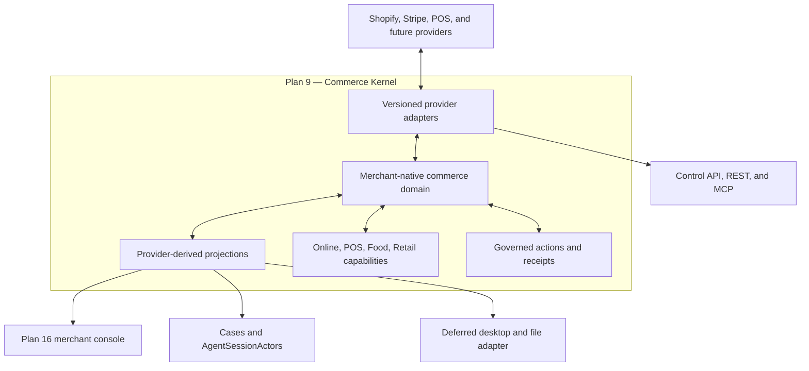

# Plan 9 — Commerce Kernel and Provider Integration

Status: initial provider-integration release complete; merchant-native domain
replacement active in Plan 22. Satyr Commerce and Shopify provide
provider-derived reads, governed actions, signed observations, receipts, and
deterministic replay.
Date: 2026-08-03 · Updated: 2026-08-12
Depends on:
[Runtime architecture: data model (was Spec 1)](../architecture/runtime.md#data-model-and-actor-persistence),
[Integration architecture: ingress (was Spec 5)](../architecture/integrations.md#ingress-gateway),
[Security architecture: identity and approval (was Spec 8)](../architecture/security.md#identity-approval-and-authorization),
[Runtime architecture: cues (was Spec 9)](../architecture/runtime.md#cues-and-proactive-work), and
[Integration architecture: capabilities and tools (was Spec 10)](../architecture/integrations.md#capabilities-and-tools).
Organisation selection of Satyr Commerce or Shopify is owned by
[Plan 19](https://github.com/seams-tech/pantry-history/blob/2cf5676a714978ce2887a78523b1b0f6c87a53a8/docs/plan-19-organisation-commerce-system.md).

Plan 9 is the authority for provider normalization, signed commerce delivery,
projections, query contracts, governed commerce actions, and the deterministic
Commerce Lab. [Commerce Domain Architecture](../commerce-domain-architecture.md)
defines the target provider-neutral records and aggregate invariants.
[Plan 22](plan-22-commerce-capabilities-and-storefront-demos.md) owns the
breaking replacement and storefront proof.
Plan 16 consumes these contracts to build the merchant console and
agent-operations experience.

The deferred desktop workspace is an optional client of this foundation. Local
SQLite, folder materialization, Markdown playbooks, and file synchronization do
not define or gate the Commerce Kernel.

## Goal

Build one stable commerce foundation that can support:

- the Satyr web console;
- Case-centered agents and typed tools;
- Slack and other Connector surfaces;
- lossless Shopify mapping and explicit Stripe, POS, and future provider
  adapters;
- online, point-of-sale, food-service, retail-operations, and automation
  capability composition; and
- a later desktop and file-oriented workspace.

Deleting the desktop or file-sync layer must leave the commerce backend,
merchant console, agent runtime, integrations, and governed actions fully
operational.

## Architecture



## Conceptual module ownership

Plan 9 uses the Lowerarchy names as a human-readable ownership map. They do
not imply six deployed services.

| Module              | Plan 9 responsibility                                     | Current home                                                        |
| ------------------- | --------------------------------------------------------- | ------------------------------------------------------------------- |
| Underclerk          | Transactional commerce authority                          | `services/underclerk`                                               |
| Contracts           | Canonical vocabulary and strict commerce contracts        | `packages/contracts`                                                |
| Commerce Read Layer | Rebuildable projections, queries, and operational history | OrganisationActor and commerce-query modules in `services/platform` |
| Urk                 | Merchant-agent proposals and operating behavior           | Satyr agent runtime and `services/platform/src/data/urk-skills.ts`  |
| Scrutineer          | Independent event processing                              | `services/scrutineer`                                               |
| Punter              | External commerce acceptance scenarios                    | `scripts/punter`                                                    |

The active production topology remains Satyr plus the selected transactional
provider. Underclerk becomes that provider for Underclerk-backed merchants.
Punter runs outside the product path, and the other responsibilities remain in
their current packages or modules until measured runtime needs justify
extraction.

## Authority boundary

- Connected providers and Underclerk own their transactional state.
- Each organisation selects exactly one active commerce system through Plan 19.
  Only that system supplies canonical product, inventory, order, fulfillment,
  and shipment observations for the organisation.
- Stripe is a payment connection. Slack is a communication connection. Neither
  is commerce projection authority.
- Satyr owns canonical identities, normalized observations, rebuildable
  projections, Cases, policies, proposals, action records, and receipts.
- `OrganisationActor` accepts commerce deliveries and owns deterministic reducers and
  current per-organisation projections in Actor-local SQLite. Provider facts do not
  become Satyr-owned merely because Satyr stores them.
- D1 stores cross-Actor control and directory records. A deliberately derived
  read index may be added when a measured query requires one; it never accepts
  provider observations or becomes projection authority.
- Files and local SQLite are client representations. They never become
  transactional authority.

## Domain model and provider boundaries

[Commerce Domain Architecture](../commerce-domain-architecture.md) is the sole
authority for commerce aggregates, lifecycle unions, relationships, and
invariants. It replaces the Shopify-derived reference model formerly recorded
here. The domain starts from merchant operations: catalog and selling,
inventory, Food Service, cart and checkout, orders and payments, and fulfillment
and shipping.

Provider APIs and signed events terminate at versioned boundary parsers.
Shopify resource identities and semantics remain valuable source facts, yet
they do not determine core aggregate boundaries. An adapter emits only facts
the source can justify. Missing accounted inventory, allocations, recipes,
buyer-private data, or fulfillment detail stays explicit rather than being
fabricated.

## Capability composition

A profile is a setup preset. Runtime behavior depends on explicit capabilities,
so a merchant can combine online, food-service, POS, and retail workflows
without changing its business type or duplicating core records.

| Profile            | Default capabilities                                                              |
| ------------------ | --------------------------------------------------------------------------------- |
| Online store       | Core + Online                                                                     |
| Cafe               | Core + Online + Food Service                                                      |
| Konbini            | Core + Retail Operations + POS                                                    |
| Autonomous konbini | Core + Retail Operations + POS + Automation; Food Service and Online are optional |

The first release activates only Core and Online. Add organisation and location
capability activation records with the first measured POS, Food Service, or
Retail Operations slice. Profiles may seed those records; core reducers never
switch on a profile label.

## Canonical commerce boundary

The merchant-native model separates catalog content, selling terms, stock,
commercial agreement, money movement, preparation, fulfillment, and carrier
movement. Its central rules are:

- InventoryItem is independent of SellableVariant;
- InventoryConsumptionPlan explicitly connects a variant to direct components
  or a Recipe revision;
- movements, allocations, and lots are authoritative while positions are
  derived balances;
- checkout snapshots accepted commercial and inventory requirements and uses
  one durable quote-bound payment attempt;
- Order lifecycle remains separate from Payment and Fulfillment progress; and
- Fulfillment is a method-specific union and may occur more than once per
  Order.

Merchant reads compose these facts into `ProductView`, `InventoryView`, and
`OrderView`. Views add freshness, source, related Case, action, exception, and
receipt summaries without leaking provider payloads or private buyer data.

## Capability-owned extensions

| Capability        | Typed records added around the core                                              | Plan 9 status                                                                                  |
| ----------------- | -------------------------------------------------------------------------------- | ---------------------------------------------------------------------------------------------- |
| Online            | storefront, cart, checkout, quote, payment attempt, protected delivery reference | Plan 22 Satyr Commerce ecommerce scenario                                                      |
| POS               | terminal, POS order context, receipt, tender session                             | [Plan 33C](plan-33C-POS-systems.md) selects Square as the first measured POS integration     |
| Food Service      | menu, modifier revisions, recipe revisions, preparation ticket, production batch | Plan 22 Cafe / Patisserie scenario                                                             |
| Retail Operations | lot, expiry, and stock-policy views around the core inventory ledger             | Plan 22 receiving and low-stock paths; count, waste, and broader warehouse operations deferred |
| Automation        | Cue, Case, proposal, policy, action, and effect receipt references               | Plan 16 control plane; outside the commerce aggregate model                                    |

Capability tables use typed foreign keys into core resources. They do not add
nullable field bags to core tables or create a second product, order, payment,
or inventory model. Food Service may operate without ingredient inventory;
when Retail Operations is active, accepted preparation can emit typed stock
movements.

Every canonical projection carries exact source authority:

```text
SourceProvenance
  integration_account_id
  source_resource_id
  source_revision
  occurred_at
  observed_at
```

It also carries required organisation, environment, and canonical revision.
Underclerk or Shopify remains the selected transactional authority. A payment
processor or terminal provider supplies Payment observations without becoming
a commerce system. Stored provider data remains a projection; an action receipt
records Satyr's attempted or observed effect without transferring authority.

The deployed Underclerk v1 boundary owns merchant-scoped Location,
SalesChannel, Product, SellableVariant, InventoryItem, Offer, and
InventoryPosition records. Its atomic snapshot and listing commands commit a
signed receipt and signed observation delivery beside the authoritative state.
Satyr verifies and maps those deliveries into `CanonicalCommerceDelivery`
before they can enter OrganisationActor projections. Runtime activation remains
gated on an explicit organisation, merchant, and integration-account binding. Plan
22 replaces its generic resource and absolute inventory commands with the
merchant-native typed boundaries while retaining these signed-delivery
mechanics.

## Protocol and storage boundary

Provider schemas are wire contracts, not D1 table definitions.

```text
provider payload
  -> versioned boundary parser
  -> validated CanonicalCommerceDelivery
  -> atomic OrganisationActor acceptance
  -> deterministic reducers
  -> Actor-local normalized projections
  -> query, tool, or UI representation
```

Raw provider values, open strings, extension bags, and compatibility shapes
terminate in versioned boundary modules. Core reducers accept only precise
canonical types. Unknown extensions may be retained as bounded diagnostics;
they cannot influence lifecycle control flow.

The OrganisationActor persistence model stores:

- canonical identity and source mapping;
- current normalized projection;
- source revision and freshness;
- accepted commerce-delivery receipt and child observation identities;
- reconciliation state;
- related Case, proposal, action, and effect identities; and
- bounded customer-safe display data.

Provider payloads, credentials, unrestricted customer data, and arbitrary
provider extension objects stay outside portal and agent projections.

### Multi-resource provider deliveries

A provider delivery may describe several canonical resources. The boundary
parser produces one `CanonicalCommerceDelivery` with a non-empty ordered list
of typed child observations:

```text
CanonicalCommerceDelivery
  providerDeliveryId
  observations: NonEmpty<CanonicalCommerceObservation>
```

Each child carries an observation ID derived from the provider delivery
identity, canonical resource kind, canonical resource identity, and source
revision. Its projection provenance carries the exact organisation, integration
account, occurrence time, and observation time. Keeping those facts on each
child allows one delivery to report resources observed or changed at different
times and avoids duplicating authority fields on the envelope. The queue and
Actor command carry the expected organisation and account; `OrganisationActor` requires
every child to match them. The boundary constructs and validates every child
before calling `OrganisationActor`. The Actor commits the delivery receipt, every
accepted observation, and every resulting projection transition in one SQLite
transaction.

An exact replay returns the prior acceptance. Reusing a provider delivery ID
with a different normalized child digest is a conflict. An invalid child
rejects the complete delivery, so a compound webhook cannot leave a partially
accepted projection set. Resource revisions still decide whether each child is
current, duplicate, or out of order. This envelope adds no Actor, table-backed
authority, or general batch framework.

## Contract implementation

`packages/contracts/src/commerce/` remains the Rust source of truth:

```text
packages/contracts/src/commerce/
  mod.rs
  canonical.rs
  money.rs
  online_shipping_order.rs
  provenance.rs
  transitions.rs
  shopify.rs
  stripe.rs
  lab.rs
```

The package has three direct layers:

1. Versioned wire and persistence DTOs parse untrusted input.
2. `TryFrom` boundaries validate and construct canonical domain values.
3. Pure reducers accept observations and return a precise next projection or
   typed recoverable failure.

Canonical lifecycle types use tagged Rust enums with branch-specific data.
Generated TypeScript and Wasm bindings consume those contracts. Cloudflare
routing, OAuth, Queues, D1, Actors, and portal adapters remain in TypeScript.

## Read protocol

Plan 9 owns the semantics of the commerce read boundary. Plan 16 owns its
authenticated Control API routes and UI.

Every read envelope carries:

- schema and contract version;
- organisation and environment;
- projection snapshot and generation time;
- source integration-account identities;
- aggregate freshness;
- stable continuation state for lists; and
- typed errors for invalid query, cursor, missing resource, or unavailable
  projection.

Catalog search and lookup expose Satyr's provider-neutral read contracts.
Merchant routes may return operational extensions such as freshness,
exceptions, related Cases, and governed-action availability.

## Governed action protocol

A commerce mutation follows one protocol regardless of whether it originates
from the portal, Slack, an agent, or a future desktop:

```text
typed proposal
  -> exact resource revision or composed revision set
  -> policy decision
  -> approval when required
  -> action-ledger execution lease
  -> provider adapter
  -> settled | reconciled | indeterminate | failed receipt
  -> refreshed provider-derived projection
```

The target provider-neutral actions are:

- `publish_offer`;
- `receive_inventory`;
- `purchase_shipping_label`;
- `advance_fulfillment`.

`publish_offer` binds exact Product, SellableVariant, Offer, and SalesChannel
revisions. `receive_inventory` binds the item, location, position revision,
fixed-precision quantity, unit, receipt line, and source identity.
`purchase_shipping_label` binds one exact Shipment revision, unexpired label
rate, and package-plan digest.
`advance_fulfillment` binds one exact Fulfillment revision. Each action also
binds the originating organisation, Case or authenticated command, normalized
parameter digest, policy revision, approval receipt when required, action
identity, provider effect identity, and terminal or indeterminate receipt. A
stale component revision requires a new proposal.

## Provider adapters

Each adapter maps one external authority to and from the kernel:

```text
Shopify -> product, variant, inventory item, location, offer, order,
           payment, fulfillment, shipment, and governed action mappings
Underclerk -> location, channel, product, variant, inventory item, offer,
              inventory position, order, payment, fulfillment, shipment,
              typed catalog commands, stock movements, and fulfillment actions
Stripe  -> payment, refund, dispute, and settlement observations
Lab     -> deterministic signed observations for acceptance scenarios
POS     -> later card-present payment and refund observations
```

An adapter declares whether each mutation is idempotent, reconcilable, or
unsafe to retry. Unknown outcomes stop at `indeterminate`; another provider's
stronger guarantee cannot be borrowed.

### Shopify source map

CK1 closes each canonical fact from an identified Shopify authority. Snapshot
and webhook paths use the same mapper and canonical identity rules.

| Canonical record           | Shopify authority                                         | Required source facts                                                                       |
| -------------------------- | --------------------------------------------------------- | ------------------------------------------------------------------------------------------- |
| `Product`                  | Product snapshot or product webhook                       | Product GID, content, status, update time                                                   |
| `SellableVariant`          | ProductVariant snapshot carried with the product          | Variant GID, product GID, options, barcode, sell unit                                       |
| `InventoryItem`            | InventoryItem query                                       | Inventory item GID, SKU, tracked state, unit                                                |
| `InventoryConsumptionPlan` | ProductVariant and InventoryItem relationship             | Variant GID, inventory item GID, exact direct quantity                                      |
| `Location`                 | Location query                                            | Location GID, name, active state, address summary                                           |
| `InventoryPosition`        | InventoryLevel snapshot or webhook joined to its location | Inventory item GID, location GID, available quantity, update time; maps to `available_only` |
| `SalesChannel`             | Publication or catalog context                            | Channel/catalog GID, kind, active state                                                     |
| `Offer`                    | Contextual price plus publication state                   | Variant GID, channel/catalog GID, price, currency, market context, publication state        |
| `CommerceOrder`            | Order snapshot or signed order webhook                    | Order GID, immutable line snapshots, origin, buyer branch, totals, lifecycle                |
| `Payment`                  | OrderTransaction snapshot                                 | Transaction GID, order GID, kind, status, amount, lifecycle                                 |
| `Fulfillment`              | FulfillmentOrder and Fulfillment snapshots                | Fulfillment identity, order GID, assigned location, method, lifecycle                       |
| `Shipment`                 | Fulfillment tracking observations                         | Fulfillment GID, carrier, tracking identity, ordered tracking events                        |

Every row defines its stable canonical identity from the integration account
and Shopify GID, preserves source revision and occurrence time, and states how
deletion or deactivation is observed. Missing source facts produce no
canonical record. A later complete snapshot or signed webhook supplies them.

### Lab authority

The lab provider owns a small deterministic state store independent of Satyr's
canonical projections. A governed lab action mutates that provider state and
then emits a signed provider observation through `CanonicalCommerceDelivery`.
Reducers never manufacture the confirming provider observation from the
current Satyr projection. This makes the local loop exercise the same
effect-to-observation reconciliation boundary as Shopify without credentials.

## Initial implementation history

The checkpoints below record the initial Shopify-derived release and its test
evidence. Their provider delivery, projection, action, and replay mechanics
remain relevant. AD-044 and Plan 22 supersede their domain shapes, Underclerk
generic resource mutation, and capability deferrals through one breaking
replacement.

### CK0R — Canonical spine correction

Status: the CK0R implementation slice is complete. The canonical
delivery boundary, OrganisationActor acceptance transaction, independent resource
projections, typed order quantity/origin branches, composed merchant views,
and exact-revision action binding are in place. `SellableVariant` now carries
only product structure; `Offer` is the sole canonical owner of price,
availability, publication, and listing lifecycle.

Current checkpoint:

- [x] Canonical provider deliveries use a required delivery identity and an
      ordered, non-empty child-observation list.
- [x] OrganisationActor is the only provider-delivery acceptance authority; the
      delivery receipt, child receipts, projection transitions, and derived cues
      commit in one Actor-local transaction.
- [x] Rust, Wasm, and TypeScript names no longer expose the old commerce
      `*Case` or single-event delivery symbols at the canonical boundary.
- [x] Independent Product and SellableVariant projection records are accepted
      atomically; Shopify catalog deliveries emit both records and merchant product
      views prefer the independent variant records.
- [x] InventoryItem, Offer, SalesChannel, and Location contracts and projection
      records are accepted at the boundary; provider mappings remain source-fact
      work and must not fabricate missing records.
- [x] Supporting quantity, order-origin, buyer, fulfillment-method, line-source,
      and typed total branches are accepted at the canonical boundary.

The checkpoint is deliberately separate from the exit checklist below. It
records the shipped boundary work without treating the embedded product
aggregate as the final CK0R resource model.

Local verification on 2026-08-08 passed the 130-file platform suite (648
tests), the commerce-lab suite (57 tests), the Plan 9/15/16 local slice (40
tests plus the portal production build), the Rust contract suite (480 tests,
plus workspace executor tests and doctests), both platform type checks, and
`git diff --check`. Remote lab reset/seed commands were not run because this
checkout's environment points at a deployed Worker and those commands mutate
organisation state.

- [x] Finish replacing the catalog aggregate: delete embedded variants and
      listing state from `Product`; keep independent `Product`, `SellableVariant`,
      and `Offer` projection kinds as the only authorities for those facts.
- [x] Make `InventoryPosition` reference `InventoryItem` and `Location` only;
      remove repeated variant and SKU facts from the position.
- [x] Complete provider-backed `InventoryItem` and `InventoryPosition`
      mappings where Shopify supplies the variant, inventory-item, location, and
      available-quantity identities. Catalog deliveries emit the first two
      records; the initial `inventoryItems`/`inventoryLevels` snapshot and signed
      `inventory_levels/update` deliveries emit the canonical position without
      inventing a Location record.
- [x] Preserve canonical Shopify GraphQL GIDs at the provider boundary for
      products, variants, inventory items, locations, orders, payments,
      fulfillments, shipments, and their related identities. REST webhook payloads
      are converted to the same GIDs by the ingress parser before normalization.
- [x] Resolve the Shopify Offer identity at the provider boundary from the
      `(variant GID, Publication GID)` pair. `ShopifySalesChannelV202607.id` is the
      Shopify Publication GID, while `ShopifyOfferV202607` carries
      `variantGid`/`publicationGid` and its canonical Offer identity is
      `shopify:offer:<variantGid>:<publicationGid>`. The v1 price is the shop
      default variant price; market-specific contextual pricing remains deferred.
- [x] Add one versioned Shopify resource envelope and canonical mapper for
      source-backed `Location`, `SalesChannel`, `Offer`, `Payment`, `Fulfillment`,
      and `Shipment` observations. The initial snapshot and complete-order refresh
      use it whenever Shopify supplies the required source facts.
- [x] Replace commerce `*Case` resource names with `CommerceOrder`, `Payment`,
      `Fulfillment`, and `Shipment`; `Case` remains the agent coordination concept.
- [x] Add fixed-precision `Quantity`, `OrderOrigin`, `Buyer`,
      `FulfillmentMethod`, `OrderLineSource`, and typed total components.
- [x] Preserve exact authority, provenance, lifecycle, source revision, freshness,
      and related action-receipt semantics.
- [x] Make the deterministic lab provider own independent source state and emit
      observations after its effects instead of deriving confirmation from a Satyr
      projection.
- [x] Regenerate the current Rust, Wasm, and TypeScript resource bindings from
      one source; regenerate again when the independent CK0R resources land.
- [x] Extend the projection persistence check through one forward migration and
      one boundary parser. Schema version 4 removes the superseded embedded Product
      fields, variant price and availability, and repeated InventoryPosition
      variant/SKU fields in place. Do not dual-write or retain the previous domain
      contracts.
- [x] Replace the single-projection commerce event with
      `CanonicalCommerceDelivery` and its non-empty child-observation union.
- [x] Re-run the six existing scenarios from a clean reset and seed; the local
      deterministic suite now covers the revised CK0R delivery and action shape.
- [x] Add one construction path each for an anonymous POS sale and an online
      food-service pickup. The canonical contract test constructs both orders;
      those paths prove representability without activating POS or Food Service
      operations.

The completed delivery slice uses `ProviderDeliveryId` for provider replay and
a deterministic `observationId` for each child. Queue payloads carry the whole
delivery. `OrganisationActor` validates every child before mutation and commits the
delivery receipt, observation receipts, projection changes, and cues in one
Actor-local SQLite transaction. Exact replay returns `duplicate`; changed
content under the same delivery identity returns `commerce_delivery_conflict`.
A focused two-resource fixture proves that one conflicting child leaves the
other child unapplied.

Exit gate: the revised lab is deterministic, the Shopify fixture maps without
provider fields entering core control flow, and Plan 16 reads only the revised
views.

### CK1 — Provider mappings

Status: Shopify catalog normalization now emits Product, SellableVariant, and
InventoryItem observations through the compound delivery boundary, signed
inventory-level deliveries emit `InventoryPosition` observations, and the
versioned resource envelope covers source-backed Location, SalesChannel, Offer,
Payment, Fulfillment, and Shipment observations. The initial Shopify sync now
queries locations and accepts their provider facts in OrganisationActor-owned
observations, and it queues source-backed OrderTransaction payment
observations under the existing order read grant. With `read_publications`, the
initial snapshot also emits the source-backed Online Store SalesChannel and one
Offer per published or staged variant. The same order snapshot now reads
Shopify Fulfillment, FulfillmentLineItem, tracking-info, and FulfillmentEvent
facts under `read_orders`, emitting canonical Fulfillment and Shipment records
only when every required identity, relationship, timestamp, and lifecycle fact
is present. Canonical observations are now an explicit `upsert | delete` union.
OrganisationActor stores accepted deletes as revisioned tombstones, so an older
provider snapshot cannot resurrect a deleted resource. Signed Shopify
`ORDERS_CREATE` and `ORDERS_UPDATED` events enqueue
`shopify.commerce_refresh.v1`; the consumer fetches the exact complete Order and
uses the same snapshot mapper for Order, Payment, Fulfillment, and Shipment
observations. Signed `PRODUCTS_DELETE` events emit canonical Product deletes.
Shopify provider identity normalization is complete: canonical GIDs
survive GraphQL and REST ingress,
Publication GIDs identify SalesChannels, and variant/publication pairs derive
Offers. The adapter does not invent records when a source payload omits their
identities or relationships.

Underclerk v1 now exposes an authenticated merchant snapshot and resource
upsert batch, exact-revision listing publication and inventory adjustment,
durable idempotency receipts, and a signed observation outbox over the complete
catalog, inventory, order, payment, fulfillment, and shipment spine. The Satyr
adapter verifies and normalizes that delivery locally. Underclerk resource IDs
are merchant-scoped, so the adapter qualifies them with the merchant identity
at the canonical boundary and reverses that mapping only for authenticated
provider commands. D1 now binds one exact Satyr organisation to one Underclerk
merchant per environment through a dedicated merchant binding. Plan 19 selects
that binding as Satyr Commerce authority. The authenticated Underclerk snapshot
attests the delivery-signing key stored with that binding. The event queue applies each signed
delivery through OrganisationActor before acknowledging the Underclerk outbox.
Binding creation reads the authenticated merchant snapshot and requires its
organisation and merchant identities to match the requested link.
The independent Underclerk Worker and SQLite-backed
`UnderclerkMerchantDO` namespace run with one named Durable Object per merchant
and retain the authenticated v1 HTTP API as the service boundary. The marked
café merchant is bound to a production acceptance organisation. Its six
trompe-l'oeil bakery drinks and five deterministic orders are visible through
Satyr. A governed exact-revision inventory adjustment completed through Google
step-up approval, Underclerk dispatch, signed observation, refreshed
projection, provider receipt, and duplicate-safe replay.

- Map Shopify Product, ProductVariant, InventoryItem, InventoryLevel, Location,
  contextual publication and price, Order, OrderTransaction,
  FulfillmentOrder, and Fulfillment into the canonical spine.
- Preserve the provider GID as the source identity at every mapping boundary;
  never narrow it to a numeric-only resource ID. Publication GIDs are the
  SalesChannel identity and variant/publication GIDs derive Offer identity.
- Use the same `ShopifyResourceEnvelopeV202607` mapper for source snapshots and
  webhook adapters once their provider queries/topics are enabled; the local
  mapper is covered for all six remaining resource kinds.
- [x] Implement the initial Shopify Location query when `read_locations` or
      `read_markets_home` is granted and pass each normalized provider envelope to
      `OrganisationDO.acceptShopifyLocationObservation`. With the current
      `read_inventory`-only grant, the sync records `skipped_scope` and does not
      issue a partial query. Shopify's payload still lacks
      Satyr's required LocationKind classification, so the source path stores a
      pending observation and never infers a canonical Location from an
      InventoryLevel payload or name.
- [x] Include source-backed OrderTransaction payment observations in the initial
      order snapshot under the existing `read_orders` grant. Unsupported
      transaction kinds remain absent rather than becoming synthetic Payment
      records.
- [x] Include source-backed Fulfillment and Shipment observations in the initial
      order snapshot under `read_orders`. A Fulfillment requires its Shopify GID,
      Order and Location GIDs, complete line-item quantities, estimated delivery,
      and a representable lifecycle. A Shipment requires exactly one complete
      tracking identity plus a non-empty, ordered, fully representable
      FulfillmentEvent history. Its stable identity derives from the Fulfillment GID
      and encoded tracking number because Shopify exposes tracking information
      inside Fulfillment rather than as a Shipment object. Multi-package and
      incomplete tracking records remain absent until the canonical relationship
      can be represented without assigning one fulfillment-wide event history to
      multiple packages.
- [x] Enable the scope-aware Online Store publication snapshot under
      `read_publications`. The Publication GID produces the SalesChannel, each
      ProductVariant/Publication pair produces one Offer using the shop-default
      variant price, and the existing resource-envelope mapper accepts both. A
      missing scope records `skipped_scope`; non-Online publication kinds remain
      absent until Shopify supplies an explicit kind mapping.
- [ ] Enable source-backed location updates and non-Online publication kinds
      only after the Shopify app has the corresponding read scopes and topic
      permissions. Until then the provider connection remains healthy with those
      resource lanes marked unavailable rather than inferred. Payment,
      Fulfillment, and Shipment changes converge through the complete Order refresh
      triggered by `ORDERS_UPDATED`.
- [x] Model every canonical provider observation as `upsert | delete` and keep
      deletion authority in OrganisationActor-owned revision tombstones. A stale upsert
      remains out of order; an exact delete replay is idempotent; a newer complete
      upsert explicitly recreates the resource.
- [x] Route signed `ORDERS_CREATE` and `ORDERS_UPDATED` events through the typed
      `shopify.commerce_refresh.v1` queue command. The webhook boundary carries the
      exact Order GID, account, shop, webhook identity, and receipt time. The queue
      consumer resolves the active connection, fetches the complete resource, and
      feeds the existing snapshot mapper before canonical delivery.
- [x] Map signed `PRODUCTS_DELETE` events to canonical Product deletion
      observations. The deletion reducer commits the provider receipt, child
      receipt, projection removal, and tombstone atomically.
- [x] Represent every Shopify Location through two explicit lanes: the
      `OrganisationDO.acceptShopifyLocationObservation` command retains a
      `ShopifyLocationObservation` containing the normalized provider facts
      currently present in the Shopify envelope (provider location ID and canonical
      Shopify GID, name, active state,
      `updatedAt`, source revision, and observation timestamps) plus a
      `classification` union in `pending` or `assigned` state. `assigned` carries
      the required Satyr `LocationKind`. The OrganisationActor-owned
      `assignShopifyLocationClassification` command binds the exact source revision
      to the classifier's control identity, a positive mapping revision, and the
      classification time. The first assignment is immutable in v1; an exact replay
      is idempotent and a different assignment is a conflict. `pending` never
      becomes a canonical `Location`.
      Acceptance is revision-aware and idempotent: a replay is `duplicate`, an
      older source revision is `out_of_order`, and conflicting facts at one
      revision are rejected. Address and fulfillment-capability fields remain
      deferred until Shopify source queries expose them in the normalized envelope.
      Do not add `unknown` to `LocationKind`.
- [x] When a classification is assigned, atomically project the canonical
      Location from the retained observation and mapping. Newer Shopify observation
      revisions retain the assigned mapping and advance that same canonical
      Location. Exact assignment replay returns the existing mapping and duplicate
      projection receipt.
- [x] Keep retained inventory positions keyed by the canonical Shopify Location
      GID while classification is pending. They require no replay when the Location
      is classified: the independently accepted position becomes related as soon as
      the Location projection exists. Fulfillment observations follow the same
      identity rule once their source query is enabled.
- [x] Treat Shopify's provider fields (`fulfillsOnlineOrders`,
      `isFulfillmentService`, fulfillment-service identity, name, and address) as
      capabilities or facts. They are not evidence for a Satyr LocationKind. The
      Shopify boundary uses an explicit `classification` union; `pending` is
      rejected by the canonical mapper with `location_classification_required`,
      while `assigned` is the only branch that can produce a canonical Location.
- Preserve Shopify source IDs, account, revision, occurrence time, and
  observation time in `SourceProvenance`.
- Keep Stripe focused on payment and settlement facts.
- Keep the lab provider deterministic and credential-free.
- [x] Replace the undeployed Underclerk catalog-activation experiment with a
      transactional v1 API for Location, SalesChannel, Product, SellableVariant,
      InventoryItem, Offer, and InventoryPosition. Prove resource-batch replay,
      exact-revision listing publication, signed observation normalization, and
      authenticated HTTP/client behavior locally.
- [x] Add the explicit organisation/merchant/integration-account binding and outbox
      acknowledgement worker before activating Underclerk as an organisation authority.
      The binding row is the directory authority for its dedicated Underclerk
      integration-account identity; the control boundary mints that identity from
      the idempotent binding operation rather than accepting an arbitrary account
      reference. An acknowledgement is
      written only after OrganisationActor accepts or idempotently replays the exact
      canonical delivery.
- [x] Host Underclerk behind a separate Cloudflare Worker and a SQLite-backed
      `UnderclerkMerchantDO` namespace. Route each authenticated v1 request to the
      object named by its merchant ID. Preserve atomic commerce state, signed
      receipt, and signed observation-outbox writes through synchronous
      `transactionSync` storage.

Exit gate: Shopify snapshots and signed webhooks converge through one mapping,
and duplicate or out-of-order input creates no duplicate canonical effect.

### CK2 — Cloud projections and merchant reads

Status: the authenticated reads, cursors, freshness, bounded history,
independent CK0R views, and Case-linked action references are live. The Plan 19
acceptance organisation proved product, inventory, and order reads over signed Satyr
Commerce observations. The broader six-scenario matrix remains optional
provider hardening.

- Store normalized products, variants, inventory items, offers, positions,
  orders, payments, fulfillments, and shipments as rebuildable OrganisationActor
  SQLite projections.
- Compose stable `ProductView`, `InventoryView`, and `OrderView` responses for
  Plan 16.
- Keep storage topology and provider-specific fields outside the client
  contract.
- Migrate the OrganisationActor projection schema forward once; remove obsolete
  columns and parsing paths after the deployed cohort advances. Keep D1 changes
  limited to cross-Actor directories or measured derived read indexes.

Exit gate: all merchant routes rebuild deterministic responses from the same
accepted observations and expose exact authority, source, revision, freshness,
related records, exceptions, and available actions.

### CK3 — Governed commerce actions

Status: the lab action path, live Shopify order cancellation, and live Satyr
Commerce inventory adjustment work on the CK0R shape. Embedded AgentSession
proposals use the same exact-revision Case and action-ledger boundary. A
terminal provider receipt or typed merchant rejection is appended to the
originating Case, addressed from its sole binding, delivered by ConnectorActor,
and settled by the exact Case outbox receipt.

The Underclerk client and adapter accept the same exact Product,
SellableVariant, Offer, SalesChannel, and InventoryPosition preconditions and
preserve applied, replayed, rejected, and transport-failure results. Dispatch
resolves the organisation/merchant/integration-account binding, records the
authoritative mutation receipt in the existing action ledger, and schedules a
drain of the merchant's signed observation outbox for projection acceptance.
Execution rechecks that the current projection still belongs to the action's
exact integration identity before dispatch.

The merchant-decision branch is complete locally. A Case waits on the exact
action nonce after proposal acceptance, then reopens after approval or typed
terminal rejection. Rejected actions retain merchant decision evidence and
cannot acquire a provider execution lease.

- Bind provider-neutral `publish_offer` to one existing Offer and one
  exact SalesChannel, with the Product, SellableVariant, Offer, and SalesChannel
  revisions as preconditions. The action changes publication state only; it
  does not edit product content or price.
- Historical v1 evidence bound `adjust_inventory` to one canonical
  InventoryPosition and set an absolute available quantity. Plan 22 removes
  that command and replaces it with typed receipt, allocation, sale,
  preparation, and production movements. Manual corrections and Order
  cancellation wait for measured workflows.
- Execute the accepted commands through Case proposal, policy, approval, action ledger,
  resource serialization, provider idempotency, and reconciliation.
- Select the provider adapter at dispatch from current authority and source
  identity.
- Refresh projections only from a verified authority observation.

Exit gate: each action is either rejected before provider execution or settles,
reconciles, becomes indeterminate, or fails with one exact durable receipt and
no duplicate effect.

### CK4 — Replay and live provider acceptance

The prior local evidence remains in
[`Plan 9/16 local loop evidence`](https://github.com/seams-tech/pantry-history/blob/2cf5676a714978ce2887a78523b1b0f6c87a53a8/docs/evidence/plan-9-16-local-commerce-loop-2026-08-04.md)
and
[`NF9 MC0 and CK4 local evidence`](https://github.com/seams-tech/pantry-history/blob/2cf5676a714978ce2887a78523b1b0f6c87a53a8/docs/evidence/plan-14-nf9-mc0-ck4-local-2026-08-06.md).
The completed live run is recorded in
[`Plan 9 CK4 Shopify production acceptance`](https://github.com/seams-tech/pantry-history/blob/2cf5676a714978ce2887a78523b1b0f6c87a53a8/docs/evidence/plan-9-ck4-shopify-production-acceptance-2026-08-08.md).

- [x] Run the revised deterministic scenarios from a clean reset and seed. Each
      scenario now composes the provider-neutral summary, product, and order API
      views and passes those envelopes through the portal boundary parsers.
- [x] Freeze the credential-free CK0R fixture manifest used by Plan 16's local
      and eventual live acceptance: [`plan-9-16-ck0r-fixture-manifest-2026-08-08.json`](https://github.com/seams-tech/pantry-history/blob/2cf5676a714978ce2887a78523b1b0f6c87a53a8/docs/evidence/plan-9-16-ck0r-fixture-manifest-2026-08-08.json).
- [x] Prove duplicate and out-of-order provider events converge.
- [x] Prove one governed offer action and one governed order action.
- [x] Prove missing-projection no-dispatch and receipt reconciliation after a
      committed provider effect.
- [x] Observe the supported interruption boundary against the live Shopify
      acceptance session and prove the repaired session returns to quiescence.
- [x] Run one live merchant acceptance path through Plan 16: Slack proposal,
      Google-authenticated approval, one Shopify effect, signed provider
      observation, refreshed projection, terminal Slack delivery, and safe replay.

The live acceptance fixture uses a marked Shopify development store and
synthetic resources with stable test prefixes. It fixes one Product, Variant,
Offer, SalesChannel, and cancellable test Order, their expected source
revisions, the publication/cancellation effects, and cleanup behavior. The
evidence must prove Slack request, Case proposal, merchant approval, provider
effect, provider observation, refreshed projection, final Slack receipt, and
duplicate-safe replay without retaining credentials or customer data.

### CK5 — Measured capability extensions

- Add POS only with one selected terminal/provider and sale fixture.
  [Plan 33C](plan-33C-POS-systems.md) owns the Square implementation and
  certification path.
- Add Food Service only with one cafe menu, modifier, and preparation fixture.
- Add Retail Operations only with one konbini stock-movement, lot, or expiry fixture.
- Add capability activation records with the first non-Online slice.

## Lab commands

The deterministic operator surface remains:

```text
pnpm lab:reset
pnpm lab:seed
pnpm lab:scenario product-listing
pnpm lab:scenario happy-order
pnpm lab:scenario payment-failed
pnpm lab:scenario inventory-shortage
pnpm lab:scenario shipment-delayed
pnpm lab:scenario cancellation-refund
pnpm lab:verify
```

Repeating a scenario with the same identity produces no duplicate source
record, cue, proposal, or provider effect. Live acceptance uses only a marked
development organisation and synthetic customer data.

## Deferred layers

The following do not gate Plan 9:

- merchant-console information architecture and presentation;
- agent-profile and playbook authoring UI;
- local SQLite and offline operation;
- filesystem materialization and file synchronization;
- desktop applications;
- production POS, Food Service, Retail Operations, and
  physical-safety support;
- autonomous konbini operation.

Each later layer consumes the kernel through versioned APIs and typed commands.
It cannot redefine commerce identity, authority, lifecycle, or action receipts.

## Provider-integration completion criteria

Plan 9 is complete when:

1. every provider payload terminates at one versioned parser and maps only
   justified merchant-native facts;
2. canonical projections rebuild deterministically from accepted input;
3. Shopify, Stripe, and lab boundary inputs converge where they express the
   same fact;
4. provider capability gaps remain explicit typed results;
5. stable query contracts expose source, revision, freshness, lifecycle,
   related records, exceptions, and available actions;
6. one offer action and one order action settle or reconcile exactly once;
7. the revised scenario lab records zero unauthorized and duplicate effects;
   and
8. Plan 16 can complete its merchant walking scenario without file-native or
   desktop dependencies.

[Plan 33C](plan-33C-POS-systems.md) owns POS deployment as a later measured
capability. Food Service, Retail Operations, and autonomous konbini execution
do not gate Plan 9.
