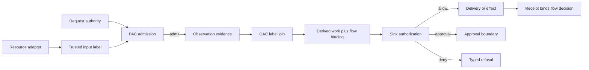
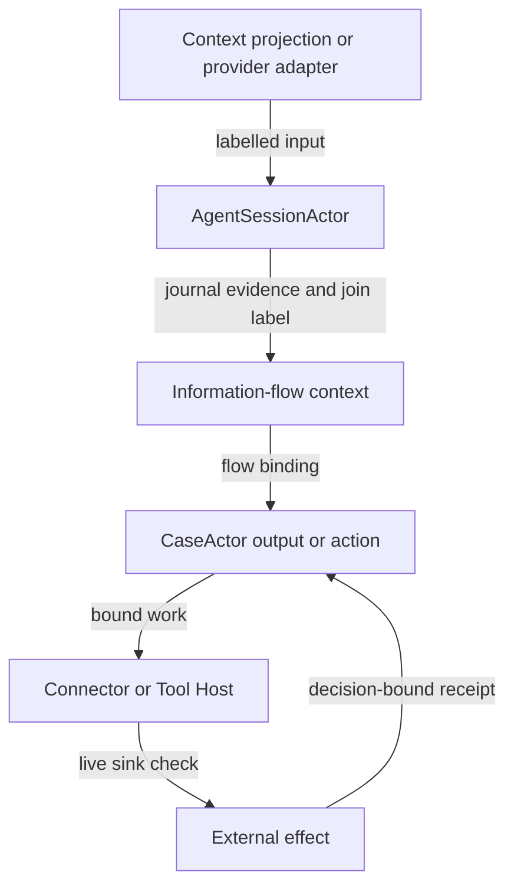

# Plan 27 — Agent Information Flow Control

Status: implemented; simplified by [Plan 27C](plan-27C-simple-information-flow.md),
which replaces the input check, the reader rules at the exits and the Portal label
checks with three levels and one exit rule. This plan is the history.
Date: 2026-08-20 · Updated: 2026-09-23 · Owner: Satyr platform
Depends on: [Plan 25 — Conversation Authority and Permission-Aware Context](https://github.com/seams-tech/pantry-history/blob/2cf5676a714978ce2887a78523b1b0f6c87a53a8/docs/plan-25-conversation-authority-and-organizational-context.md),
[Security architecture: Vault and policy (was Spec 6)](./architecture/security.md#vault-policy-and-revocation),
[Security architecture: identity and approval (was Spec 8)](./architecture/security.md#identity-approval-and-authorization),
and [AD-010 — Policy Engine](./plan-3-decisions.md#ad-010--policy-engine-layered-configurability-under-three-rules-2026-07-07)

## Purpose

Consolidate Satyr's information-flow concepts into one coherent system and
refactor the current authority, context, policy, actor, and effect boundaries
to use it.

The system has two complementary controls:

- **Permission-Aware Context (PAC):** Can this information be observed here?
- **Observation-Aware Context (OAC):** Given what was observed, where may the
  resulting work go?

Together they form **Agent Information Flow Control (AIFC)**.

PAC governs information entering an agent's context. OAC accumulates the
policies attached to admitted inputs and governs later delivery, actions,
sharing, handoff, and export. Neither replaces the other.

## Implementation outcome

Plan 27 now operates across these complete paths:

```text
labelled Case context → PAC → cumulative OAC → bound Case output → Slack sink
protected commerce order read → PAC/OAC → bound action → tool-effect sink
```

The implementation also:

- persists canonical labels on Case journal entries and D1 context projections;
- propagates accepted Case work into later session context with its producing
  label;
- updates the current turn binding when a protected tool read occurs during
  execution;
- binds Case delivery and Lab, Shopify, and Underclerk provider receipts to
  exact flow-binding and decision digests;
- releases each streamed Slack part only after the turn's current binding
  passes the destination check ([Plan 57](https://github.com/seams-tech/pantry-history/blob/2cf5676a714978ce2887a78523b1b0f6c87a53a8/docs/plan-57-live-delivery.md),
  Decision 8). The binding only grows, so the binding at release covers all
  text written before it. A denial stops the stream with a withheld notice
  and refuses the delivery. The final message still needs the final
  cumulative binding to pass; and
- exposes AIFC and general policy composition through one `policy/` surface.

Plan 34's connected-file onboarding now creates the first useful PAC grant as
part of the Dropbox or Google Drive connection journey. OAuth completion opens
the Access page in a focused resource-selection mode with `file.read`, the
matching provider account, and the first available conversation already
selected. The operator chooses the exact file or folder and confirms the
grant. The resulting source label and visibility still derive from that exact
grant, so the convenience default does not create ambient organisation-wide reader
authority. Later additions and revocations continue through the same Access
surface and AIFC enforcement path.

Satyr has no external artifact-download or export boundary in the active
runtime. Harness artifact previews remain inside the held Case delivery path.
An `artifact_export` sink will be added with that future operating boundary;
the current implementation deliberately contains no permissive placeholder.

## Theoretical model

Plan 27 adapts the central idea from Myers and Liskov's decentralized label
model: principals attach policies to inputs, derived values carry the join of
the policies on the values used to produce them, and a destination must satisfy
every contributing policy.

Satyr applies that model at agent-work boundaries:

```text
PAC:  canObserve(admissionSubject, inputLabel)

OAC:  workLabel' = join(workLabel, inputLabel)

Flow: canRelease(workLabel, destination)
```

The first implementation is deliberately conservative. Every protected input
observed by a session lineage contributes to every later output from that
lineage. Satyr will not attempt field-level taint tracking or ask the model
which inputs influenced an answer.

This provides strong, understandable propagation at Satyr's trusted
boundaries. It is not a claim of language-level non-interference for arbitrary
generated programs.

## Accepted terminology

| Term                                  | Meaning                                                                                           |
| ------------------------------------- | ------------------------------------------------------------------------------------------------- |
| Agent Information Flow Control (AIFC) | The complete PAC, OAC, and sink-enforcement system.                                               |
| Permission-Aware Context (PAC)        | Read-time admission using the current request authority and the input's flow label.               |
| Observation-Aware Context (OAC)       | The cumulative context state produced by joining the labels of admitted observations.             |
| Flow policy                           | One policy owner's permitted readers and restriction-only effect rules.                           |
| Flow audience                         | The people or system principal that may receive information at the current surface.               |
| Flow label                            | The canonical set of flow policies attached to an input or derived work.                          |
| Observation evidence                  | The canonical source, revision, content digest, label digest, and time proving what was returned. |
| Flow binding                          | The compact label and digests carried by derived work across a durable boundary.                  |
| Flow sink                             | A normalized destination or effect evaluated before information leaves the current work boundary. |

Use these terms in code and documentation. Retire “policy follows what the
agent has seen,” PFWAHS, PAOC, and “observation-aware policy” as domain names.
The phrase may remain as an explanatory description.

## Security scope

Plan 27 initially governs confidentiality: who may observe information and
where work derived from it may flow.

Integrity labels, endorsement, and automatic declassification are excluded.
An approval permits an exact action; it does not silently remove a flow policy.
A future release mechanism must name the policy owner, exact label clauses,
recipient, purpose, approver authority, and durable receipt.

## Core domain model

### Flow policy

```text
FlowPolicy {
  owner
  readers
  restrictions
}
```

`owner` is a canonical policy principal:

```text
FlowPolicyOwner =
  platform
  | organisation { organisation_id }
  | integration_resource {
      organisation_id,
      integration_account_id,
      resource_scope
    }
```

`readers` is a non-empty set of existing `ContextVisibility` values. Reader
alternatives inside one policy are OR. Policies from different owners are AND:
a subject must satisfy at least one reader in every policy.

### Flow audience

Access authority and information audience are distinct. `RequestAuthority`
determines which grants may be exercised. A flow audience identifies who can
receive information at the current surface.

Destination checks derive audiences deterministically:

```text
direct conversation  → requester person, requester organisation role
shared conversation  → exact integration account and conversation
workflow             → exact workflow kind, ID, and revision
control              → requester person, requester organisation role
internal Case scope  → exact Case ID
```

A shared conversation does not inherit the requester's person or role audience.
This prevents one participant's authority from making person- or role-visible
information available to everyone in the conversation.

PAC evaluates the surface audience plus the exact internal Case. An external
sink evaluates only its destination audience. Consequently, a `case` reader can
admit information into its exact Case but cannot, by itself, authorize delivery
to an external recipient.

Source-owned labels use a narrower rule. Direct and control ingress is labelled
for the exact requester person; shared ingress is labelled for the exact
conversation; workflow ingress is labelled for the exact workflow revision.
Integration-resource readers come from every active grant for the exact
capability and resource. They are never inferred from the requester who
happened to perform the read.

`restrictions` contains existing normalized policy rules with only
`approval_required` or `deny` effects. An input label cannot grant a tool,
host, resource, budget, audience, credential, or action.

### Flow label

```text
FlowLabel {
  policies
  digest
}
```

A label is canonical, immutable, sorted, and deduplicated. It contains policy
metadata only. Protected content never appears in a label.

Joining labels takes the normalized union of their policy clauses:

```text
join(left, right) = normalize(left.policies ∪ right.policies)
```

More observed inputs can only retain or add restrictions. Without an explicit
release mechanism, policies cannot be removed.

### Observation evidence

```text
ObservationEvidence {
  source
  source_revision
  content_digest
  flow_label_digest
  observed_at
  evidence_digest
}
```

The trusted resource adapter constructs the input label and evidence. PAC
checks the label before protected content crosses into the harness. OAC records
the evidence and joins the label before returning that content.

`observed_at` is audit metadata. The stable `evidence_digest` covers the source,
source revision, content digest, and label digest. A retry of the same
observation therefore keeps one identity even when its audit timestamp differs.

The model, prompts, Pi, Code Mode, generated code, and workspace executor
cannot create, weaken, or omit labels.

### Information-flow context

```text
InformationFlowContext {
  organisation_id
  session_id
  authority_partition_digest
  work_label
  observation_set_digest
  revision
  digest
}
```

This is OAC's runtime state. It is immutable. Admitting an observation returns
a new context with a higher revision, the joined work label, and new digests.

The exact `RequestAuthority` remains turn-specific. Plan 25 starts a new
session lineage when the authority partition changes. A follow-up turn in the
same lineage retains the accumulated work label.

### Flow binding

```text
FlowBinding {
  organisation_id
  session_id
  turn_id
  authority_partition_digest
  flow_label
  information_flow_context_digest
  observation_set_digest
  context_revision
}
```

Outputs, proposals, and action requests carry a binding. The full observation
journal stays with `AgentSessionActor`. The binding's canonical digest covers
the embedded flow label, so a second label digest would be redundant.

When bound work is observed by another session, its label becomes an input
label and joins the receiving session's work label. This makes propagation
transitive without copying the producing session's observation history.

### PAC decision

```text
ContextAdmissionSubject {
  request_authority
  case_id
}

ContextAdmissionDecision =
  admit { input_label_digest, authority_digest }
  | deny { input_label_digest, authority_digest, reason }
```

PAC admits an input only when the audiences derived from the current
`RequestAuthority` and Case satisfy every flow policy in its label and current
grants authorize the exact read. The Case ID can be matched without pretending
the Case is a human principal. Unknown principals, readers, resources,
revisions, and policy fields fail closed.

### Flow sink and decision

The implemented sinks are exact conversation delivery, governed tool effects
and organisation-opted-in TypeSafe System One processing:

```text
FlowSink =
  conversation_delivery { destination_authority }
  | typesafe_system_one {
      organisation_id, purpose, connection_revision, model,
      processing: authorized_source { authority } | public_fixture { fixture_revision }
    }
  | tool_effect {
      destination_authority,
      capability_id,
      integration_account_id,
      resource_scope,
      approval_satisfied
    }
```

The destination uses the normalized Plan 25 direct- or shared-conversation
authority. This provides the person, integration account, conversation,
membership revision, and role needed to derive the exact destination audience.

TypeSafe evaluates the existing audience of its authenticated processing
authority and every contributing source restriction. This IFC decision alone
grants no provider access: the owning feature must also pass its published
source-scoped policy, live connection and usage reservation checks. A synthetic
fixture has no invented conversation or Session identity and accepts only an
empty public label. Protected inputs cannot use that branch.

The prepared request snapshots its exact bytes, joined label, purpose, model and
connection revision. Its decision digest is retained in the same transaction as
the provider-attempt reservation. Returned JEV judgments carry the joined label;
they confer no delivery authority. Old attempts with no disclosure proof remain
stale and charged. This operating boundary serves Cue CaseContextCollection discovery and
fixed synthetic evaluation; `case_context_discovery_relationship` is its only purpose since
Plan 48 was withdrawn.

```text
FlowDecision =
  allow { flow_binding_digest, decision_digest }
  | approval_required {
      flow_binding_digest, decision_digest, reason
    }
  | deny {
      flow_binding_digest, decision_digest, reason,
      violation_action
    }
```

Handoff and artifact-export sink branches join the union only when their full
enforcement path exists.

## Architecture



### Runtime ownership



- Resource adapters own canonical source resolution and trusted label creation.
- `AgentSessionActor` owns the observation journal and current OAC state.
- `CaseActor` durably carries flow bindings with accepted derived work.
- Connector and Tool Host own the final live sink check and external effect.
- The policy engine owns label algebra and decisions. Adapters cannot
  reinterpret labels independently.

No new service, Durable Object class, policy store, or actor is introduced.

## Module boundary

Create one pure AIFC module:

```text
services/platform/src/policy/information-flow/
  types.ts          closed labels, evidence, context, sink, and decision unions
  labels.ts         builders, canonicalization, join, and reader matching
  source-labels.ts  source-owned labels from organisation policy and live grants
  pac.ts            context admission
  oac.ts            observation admission and context advancement
  sinks.ts          sink authorization
  digest.ts         canonical digests
  index.ts          only public surface
```

`policy/index.ts` only re-exports AIFC. Organisation policy compilation lives in
`policy-snapshot.ts`, and capability enforcement lives in
`authorization/access-grants`, where every claim rechecks the partition's
pinned policy version against D1. AIFC adds no second rule engine.

Storage and provider code remain adapters outside the pure module:

- `policy-snapshot.ts` loads organisation policy;
- `authorization/access-grants` loads and compiles live authority;
- `context` loads canonical context candidates;
- actor journals persist evidence and bindings; and
- Connector, Tool Host, and artifact boundaries execute admitted sinks.

## Current-to-target mapping

| Current concept              | Target AIFC role                                 | Refactor                                                              |
| ---------------------------- | ------------------------------------------------ | --------------------------------------------------------------------- |
| `RequestAuthority`           | PAC principal and delivery destination authority | Keep the union; route all matching through AIFC.                      |
| `AuthorityPartition`         | Exact session-lineage authority                  | Keep it; bind its digest to the information-flow context.             |
| `ContextVisibility`          | Reader alternative inside a `FlowPolicy`         | Move audience derivation, matching, and canonicalization behind AIFC. |
| `ContextItem`                | Labelled PAC input plus observation evidence     | Replace standalone visibility with a required `FlowLabel`.            |
| `ContextBundle`              | Initial set of admitted observations             | Bind its digest to the first OAC revision.                            |
| Organisation policy version  | Pinned in the `AuthorityPartition`               | Recheck on every claim; a newer version supersedes the partition.     |
| `session_turn_context`       | Existing turn context persistence                | Extend or replace its schema with canonical OAC state and evidence.   |
| `CaseOutput` and proposals   | Derived work                                     | Require a `FlowBinding`.                                              |
| Action and delivery receipts | Effect evidence                                  | Require flow-binding and decision digests.                            |

## Fixed design decisions

1. PAC and OAC are sibling parts of AIFC. OAC depends on PAC's trusted input
   labels and does not replace read authorization.
2. Labels follow derived work. Observation histories remain at their source and
   are represented downstream by canonical digests.
3. All observations in one session lineage contribute to all later work from
   that lineage.
4. Label join is associative, commutative, and idempotent. Restore and retry
   order cannot change the result.
5. Multiple owner policies compose with AND. Reader alternatives within one
   owner policy compose with OR.
6. Flow rules are restriction-only and reuse the existing policy normal form.
7. There is no implicit declassification. Approval alone does not weaken a
   label.
8. Workflow, person, and shared-conversation authorities use the same PAC and
   OAC path after ingress normalization.
9. A shared-conversation audience contains the exact conversation and excludes
   the requester's person and role readers.
10. Every sink rechecks current membership, grants, policy, restriction and
    credential generations before performing an effect.
11. Missing or invalid labels, bindings, revisions, evidence, or digests fail
    closed at the boundary where they are consumed.
12. Model-visible content excludes labels, policy internals, credentials, and
    audit-only evidence unless a specific safe explanation is requested.
13. Compatibility parsing is confined to persisted or request boundaries and
    deleted after replacement. The runtime has one AIFC path.
14. `SessionProposal.turn_id` names the exact producing turn. Case acceptance
    verifies it against the binding and never infers it from a proposal ID or
    the assignment's first start record.

## Four-subagent implementation schedule

The domain refactor is split into two parallel waves. Each wave begins with a
short contract freeze and ends with an integration gate. Subagents own
non-overlapping source and test files. Shared contracts and cross-lane wiring
remain lead-owned.

### Phase 0 — Lead-owned contract freeze

Complete this before starting the first four subagents:

1. Create `services/platform/src/policy/information-flow/types.ts` with the
   exact closed types from this plan.
2. Add type-only operation signatures for label construction, PAC, OAC, sink
   decisions, and digesting. Export those types from a type-only
   `services/platform/src/policy/information-flow/index.ts`; runtime exports are
   connected at Gate P2.
3. Fix the authority-to-audience mapping, canonical field order, digest inputs,
   schema version, and error unions.
4. Add type fixtures proving that empty readers, `allow` rules, missing
   bindings, and invalid sink branches cannot be constructed.
5. Record the integration contracts below. Subagents request changes through
   the lead and do not independently edit the shared types.

```text
Context lane → OAC lane:
  AdmittedContextItem { content, observationEvidence, inputLabel }

OAC lane → delivery lane:
  FlowBinding

Delivery lane → Case settlement:
  FlowDecision + ConnectorDeliveryReceipt
```

Gate P0: the type-only contract scaffold and type fixtures compile without
runtime stubs.

### Phase 1 — Four parallel foundation lanes

All four subagents start after Gate P0.

| Subagent                | Ownership                                                                                                                                                                              | Deliverable                                                                                                                                                               |
| ----------------------- | -------------------------------------------------------------------------------------------------------------------------------------------------------------------------------------- | ------------------------------------------------------------------------------------------------------------------------------------------------------------------------- |
| A — Label kernel        | `services/platform/src/policy/information-flow/` except the frozen public contracts; new `information-flow-*.test.ts` pure tests                                                       | Canonical builders, label join, audience derivation, reader matching, PAC/OAC pure transitions, sink decisions, and digests.                                              |
| B — PAC context adapter | `services/platform/src/context/`, `services/platform/src/request-authority/index.ts`, and context-specific tests                                                                       | Labelled Case candidates, PAC before excerpt materialization, admitted context items carrying trusted evidence, and deletion of replaced authority-to-visibility helpers. |
| C — OAC session state   | `actor-journal.ts`, `agent-session-schema.ts`, a new focused `agent-session-information-flow.ts`, the narrow wiring in `agent-session.ts`, and actor-journal/session persistence tests | Transactional OAC journal, cumulative context revisions, deterministic restore, and current `FlowBinding` production.                                                     |
| D — Conversation sink   | `case.ts`, `case-walking-path.ts`, `connector-case-work.ts`, `connector-slack-stream.ts`, their focused tests, and delivery receipt parsing                                            | Flow binding on Case output, exact Slack audience decision immediately before delivery, and decision-bound settlement receipt.                                            |

Lane rules:

- A does not edit context, actor, Case, Connector, or Tool Host adapters.
- B does not edit actor persistence, Case output, Connector, or shared AIFC
  contracts.
- C does not edit context selection, Case, Connector, or Slack delivery.
- D does not implement label algebra, context admission, or session restore.
- Each subagent is responsible for its owned fixtures. There is no shared
  mutable mega-fixture.
- Subagents are not alone in the worktree. They preserve concurrent edits and
  report cross-lane requirements instead of rewriting another lane.

Each lane must finish with focused tests and clean TypeScript diagnostics for
its owned files. Temporary integration failures caused solely by another
unfinished lane are reported with their exact missing contract.

### Phase 2 — Lead-owned foundation integration gate

After all four lanes finish:

1. Wire the admitted context result into the OAC commit.
2. Wire the produced `FlowBinding` into Case proposal and output creation.
3. Wire the delivery decision into Connector settlement.
4. Resolve only genuine contract mismatches; preserve lane ownership for
   behavioral fixes.
5. Delete the replaced visibility and policy-propagation paths now that the
   complete Case-to-Slack route works.

Gate P2 requires:

- the operating direct-conversation allow case;
- the shared-conversation denial case;
- deterministic actor restore and retry;
- source and test type checks; and
- the focused PAC, OAC, Case, and Connector suites.

No provider propagation work starts before Gate P2. This keeps the
first proof small and prevents four partially working sink types.

### Phase 3 — Four parallel propagation lanes

Before this wave, the lead adds the exact `tool_effect` branch required by the
selected operating provider path. Additional sink branches are added only with
their operating boundary.

| Subagent                     | Ownership                                                                                                                                                                                                          | Deliverable                                                                                                                                             |
| ---------------------------- | ------------------------------------------------------------------------------------------------------------------------------------------------------------------------------------------------------------------ | ------------------------------------------------------------------------------------------------------------------------------------------------------- |
| A — Trusted provider read    | `embedded-harness-tool-host.ts`, one selected read adapter, and focused Tool Host tests                                                                                                                            | One real protected provider read returns a trusted label and completes PAC/OAC before its value reaches Pi or Code Mode.                                |
| B — Governed provider effect | `services/platform/src/commerce/provider-execution.ts`, `services/platform/src/actors/action-ledger.ts`, `services/platform/src/credential-vault/provider-action-resolution.ts`, and focused commerce action tests | The paired provider effect evaluates the current work label and binds its decision through approval, execution, and receipt.                            |
| C — Case propagation         | Case projection and context-source adapters with focused tests                                                                                                                                                     | Accepted labelled Case work becomes a trusted observation when selected for a later session.                                                            |
| D — Settlement provenance    | Case, action-ledger, provider-resolution, and receipt tests                                                                                                                                                        | Proposals, actions, delivery receipts, and provider receipts match the exact organisation, session, turn, authority partition, and flow-binding digest. |

Implementation note: the protected commerce read, all active commerce provider
effects, Case re-observation propagation, and exact settlement provenance are
complete. External agent handoff and artifact recipient boundaries are
deferred. Current artifact previews inherit the Case output's held conversation
decision.

The selected read and effect pair is frozen before the wave. A and B share only
the lead-owned labelled-result and effect-sink contracts; they do not edit each
other's files.

### Phase 4 — Lead-owned consolidation

After the propagation lanes pass focused tests:

1. Run the full source and test type checks.
2. Run the Case-to-Slack, commerce, Case re-observation, and settlement suites.
3. Move the remaining pure `policy.ts` surface under `policy/`.
4. Delete duplicate audience checks, digest builders, obsolete fixtures, and
   old policy imports.
5. Run onboarding closure, commerce lab, and full platform tests.
6. Review the diff once for invalid optional security fields, non-exhaustive
   unions, compatibility paths, and abstractions that no longer earn their
   cost.

The lead performs final consolidation because moving the policy surface touches
imports across all four lanes and is inherently conflict-prone.

Gate P4 requires every completion criterion in this plan and a clean full test
run.

### Parallel completion matrix

| Capability                       | Lane that implements it | Gate that accepts it |
| -------------------------------- | ----------------------- | -------------------- |
| Label algebra and audience rules | Phase 1A                | P2                   |
| PAC context admission            | Phase 1B                | P2                   |
| OAC persistence and restore      | Phase 1C                | P2                   |
| Slack sink and receipt           | Phase 1D                | P2                   |
| Trusted provider observation     | Phase 3A                | P4                   |
| Provider effect propagation      | Phase 3B                | P4                   |
| Case re-observation propagation  | Phase 3C                | P4                   |
| Exact settlement provenance      | Phase 3D                | P4                   |

## Refactor plan

The concurrent schedule above governs execution order and file ownership. The
sections below define the required behavior for each capability.

### P27.1 — Implement the label algebra and one operating path

Build the pure AIFC kernel and prove:

```text
labelled Case context
  → PAC admission
  → OAC label join
  → bound Case output
  → Slack conversation sink check
  → decision-bound delivery receipt
```

Work:

- Add the exact `FlowPolicy`, `FlowLabel`, `ObservationEvidence`,
  `InformationFlowContext`, `FlowBinding`, and conversation sink types.
- Add branch-specific builders that reject empty readers, `allow` rules,
  malformed principals, non-canonical identifiers, and digest mismatches.
- Add one exhaustive authority-to-audience derivation. Shared conversations
  yield only their exact conversation audience.
- Add canonical label normalization and join.
- Translate existing Case context visibility into organisation-owned flow policies at
  the context-source boundary.
- Run PAC before materializing each context excerpt for the harness.
- Persist the initial OAC revision transactionally with turn start.
- Attach the resulting binding to the Case output.
- Evaluate the exact Slack destination immediately before delivery and bind the
  decision to the receipt.

Operating evidence:

- Person-visible input may produce a reply to the same authorized direct
  conversation.
- The same bound output is denied to a shared conversation that does not
  satisfy the label.

### P27.2 — Refactor permission-aware context into PAC

- Make every context source return a required `FlowLabel` with its canonical
  candidate.
- Replace context-specific visibility filtering with the PAC decision API.
- Keep query, ranking, freshness, token, and time limits in context assembly;
  they are retrieval concerns rather than policy semantics.
- Record an `ObservationEvidence` entry only after PAC admits the source and
  before its content reaches the harness.
- Delete duplicate visibility encoders, matchers, and local authority checks
  after all context callers use PAC.
- Preserve `ContextBundle` as retrieval evidence only if it still removes
  ambiguity; otherwise replace it with a smaller admitted-context result.

### P27.3 — Make OAC cumulative and restorable

- Add an append-only observation-evidence journal owned by
  `AgentSessionActor`.
- Store one canonical IFC context per OAC revision. Its digest binds the work
  label and observation set.
- Store each turn's exact `FlowBinding` separately. A revision records the
  cumulative context once and does not duplicate a turn binding.
- Restore the same `InformationFlowContext` after actor eviction, turn retry,
  checkpoint restore, and session replay.
- Carry the previous work label into a follow-up turn in the same authority
  partition.
- Bind every proposal, output, and action request to the OAC revision current
  when it was produced.
- Reject stale or mismatched bindings during acceptance and settlement.

Use a canonical digest of the sorted evidence set. Do not introduce a Merkle
tree until evidence volume demonstrates that full-set digesting is a real
problem.

### P27.4 — Integrate trusted tool reads and provider effects

- Change one real protected read capability to return its value with a trusted
  input label and observation evidence.
- Complete PAC and OAC admission before returning the value to Pi, Code Mode,
  or the workspace executor.
- Add the exact `tool_effect` sink branch needed by the paired provider action.
- Compose the work label's restriction rules with current organisation policy,
  authority partition, live grants, resource scope, credential generation,
  lease, approval, and budget checks.
- Bind action-ledger entries, approval requests, and provider receipts to the
  flow decision.
- Expand to another provider only after the first pair demonstrates useful
  allowed and denied behavior.

### P27.5 — Propagate labels through Case re-observation

- Persist the producing label on every accepted Case entry.
- Require a later receiver to pass PAC before observing that entry.
- Join the producing label into the receiving session's OAC state.
- Keep artifact previews inside the bound, held Case output path.
- Add a handoff sink with an exact receiving authority partition when Satyr
  gains an external agent-handoff boundary.
- When an external artifact export or download boundary is implemented, bind
  its manifest to the producing label and add an exact-recipient sink in the
  same change.
- When a bound artifact becomes an independently observable input, join its
  carried label into the receiving work label.

Do not infer labels from artifact text or regenerated summaries.

### P27.6 — Clean cutover

- Agent-session persistence generation 26 starts with the canonical AIFC
  schema. Existing session objects are replaced through the actor-registry
  generation cutover rather than interpreted as partially labelled sessions.
- The current D1 schema baseline requires a label on every derived projection.
  The projection queue rebuilds rows from authoritative labelled Case entries.
- Historical Case entries without valid labels fail closed. The cutover does
  not synthesize labels from old content or requester roles.
- There is one runtime path. No feature flag, dual evaluator, or compatibility
  label is retained.

### P27.7 — Consolidate the policy module and delete replaced paths

- Move the current pure contents of `policy.ts` behind
  `services/platform/src/policy/` and expose one public policy surface.
- Keep policy snapshot I/O separate from the pure policy and AIFC kernels.
- Make context, Tool Host, Connector, approval, action, and implemented export
  adapters use the same AIFC decisions.
- Delete replaced visibility checks, policy-binding prototypes, digest helpers,
  and effect-specific policy interpretations.
- Remove the old `policy.ts` surface in the same refactor. Add no compatibility
  facade, legacy flag, or dual evaluation path.

## Verification

### Pure properties

1. Label join is associative, commutative, and idempotent.
2. Joining a label never makes work less restrictive.
3. Policy order and observation order do not affect canonical digests.
4. Every owner policy must be satisfied; one matching policy is insufficient.
5. One reader alternative within a policy is sufficient.
6. `allow` rules and empty reader sets cannot construct an input label.
7. Unknown authority branches and malformed labels fail closed.

### Behavioral evidence

1. PAC excludes a source the requester cannot observe.
2. PAC admits the same source for an authorized requester.
3. OAC changes the permitted destination after a protected observation.
4. A bound output survives actor restore with the same label and context
   digests.
5. A retry produces the same decision and receipt identity.
6. Revocation between observation and effect denies the effect.
7. A downstream session inherits the label of accepted Case work it observes.
8. Logs, model context, receipts, and diagnostics contain no protected content
   from the label evidence path.

Use one Case-to-Slack operating test, one real provider read/effect test, and
narrow pure tests for the algebra. Avoid source-text policy tests and duplicate
fixtures.

Required checks for each implemented phase:

```bash
pnpm --filter satyr-edge check:types
pnpm --filter satyr-edge check:test-types
pnpm --filter satyr-edge test
pnpm --filter satyr-edge test:onboarding-closure
git diff --check
```

Provider effect integration additionally requires:

```bash
pnpm --filter satyr-edge test:commerce-lab
pnpm lab:reset
pnpm lab:seed
pnpm lab:scenario
pnpm lab:verify
```

## Explicit non-goals

- Satyr-native MCP transport or discovery
- field-, token-, or expression-level taint tracking
- formal non-interference claims for model or generated-code execution
- integrity labels or endorsement
- automatic, approval-implied, or model-selected declassification
- a general DLP taxonomy or user-authored policy language
- labels inferred from content by an LLM
- a new service, actor class, policy database, or Rust Worker rewrite
- cross-organisation flows
- speculative sink branches without an operating path
- compatibility flags or parallel policy engines

## Completion criteria

Plan 27 is complete when:

- AIFC is the documented and implemented umbrella for PAC, OAC, and sink
  enforcement;
- every protected context and supported tool read has a trusted required flow
  label and passes PAC before entering the harness;
- `AgentSessionActor` restores one cumulative OAC state with deterministic
  labels and observation evidence;
- every implemented derived-work boundary carries a valid `FlowBinding`;
- every implemented outward sink uses the same AIFC decision surface and live
  authority checks;
- labels propagate transitively through implemented Case re-observation paths;
- observation-derived policy can only tighten information flow;
- allowed and denied Case-to-Slack and provider-effect paths have durable test
  evidence; and
- replaced visibility and policy-propagation paths have been deleted.

## References

- Andrew C. Myers and Barbara Liskov,
  [Complete, Safe Information Flow with Decentralized Labels](https://www.cs.cornell.edu/andru/papers/sp98/paper.html)
- Cloudflare,
  [Cloudflare OS: an open platform for agents, apps, and work](https://blog.cloudflare.com/cloudflare-os/)

## Information-flow contracts

Moved from the IFC integration guide
(`services/platform/src/policy/information-flow/README.md`) on 2026-10-19.
Code paths are under `services/platform/src/`, and test paths are under
`services/platform/tests/`. Record this plan's information-flow contracts here.
Change the guide only when the kernel, a sink, a rule for every surface or an
entry point changes.

The account platform supplies current organisation, platform project, and service
instance eligibility through `/account-platform/v1`. Each protected admission and
disclosure calls `AccountPlatformAccess` with its actual native authority origin.
Control requests carry their authenticated session. Accepted turns carry their
session and turn identity. Slack ingress carries its verified provider event and
current external identity link. Proposed recipients carry the exact retained
disclosure evidence. A recipient origin permits disclosure only.

The account client verifies the immutable tenant binding and linked provider
subject, resolves the current authority revision, then requests fresh eligibility.
The organisation picker evaluates each scope independently. Its incomplete result discloses only scopes that passed fresh checks.
A scoped failure cannot grant content access or block an independently authorised organisation.
The Portal reports an incomplete list explicitly. A refresh requests a fresh session and repeats authority checks.
The `e2e/account-session-isolation.test.ts` journey verifies scoped failure, total outage, and global identity refusal.

An unavailable authority withholds content and new execution. A prior successful
response grants no later request. Platform billing permissions grant no Satyr
content access. Keep native project grants, source labels, retained-history
checks, capability checks, placement fences, and final destination checks.

Each native service role records its acknowledged instance access revision. The
initial migration revision preserves existing grants. A later account regrant
clears earlier shared-project grants and restores private-chat placement before
admission. Cleanup and its revision acknowledgement share one fenced D1 batch.
An old invitation replay cannot restore a revoked account service grant.

The account platform owns organisation membership and invitations. Explicit
token acceptance creates a sealed receipt for the native service role and
person projection. One fenced D1 batch consumes the intended role, clears
earlier grants, and admits the user to Base only while Base has no shared
history or references. A repeated acceptance preserves the current native
role. A revoked native role requires a new explicit shared acceptance.

Accepted financial settlement uses authenticated service authority. The Actor
commits its terminal billing intent with its accepted checkpoint or cancellation
receipt. Its existing outbox retries that intent before user-dependent recovery.
Membership removal or service disable cannot discard it. Settlement grants no
disclosure. Customer service fees remain unpriced, with native provider funding
preserved. The one-cent completed-turn price applies only to isolated E2E accounts.

The composed `tests/e2e/shared-account-platform.test.ts` journey uses the built
Seams account Worker through HTTP and the native Satyr Worker and Actors. It
retains access decisions, financial receipts, and the consolidated statement as
repeatable evidence. No cross-runtime database access supplies its authority.
