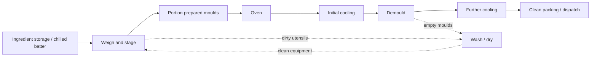

# Bakery calibration worksheet and scenario assumptions

Reviewed for recipe and six-hour shift scope: 2026-11-01. No new physical measurements were supplied.

## Current recipe target

[Plan 61A](history/plan-61A-financier-workflow.md) defines the draft full financier
workflow using the [working recipe](recipes/financiers.md) and eight-cavity
Matsunaga mould. Derive piece count from filled cavities and rejected pieces.
The recipe has no fixed 90-minute rest requirement. Bake settings, duration,
portion mass, total yield, and readiness for packaging still need measurement.

Plan 61A remains draft. This documentation update does not change the simulator's
existing finishing-shift preset or establish acceptance of the new recipe workflow.

## Finishing-shift reference scenario

The tables below retain the provisional scenario adopted on 26 September 2026.
Its two-tray batches, 24 pieces per tray, and recipe-specific timing placeholders
belong only to that scenario. They are not defaults for the eight-cavity recipe.

Actual observations remain blank. Manufacturer specifications and example recipes
support planning references. Labor, staffing, layout, and throughput figures are
assumptions. Native geometry and visual station positions remain unchanged.
A production batch in this reference means two trays travelling together.
A mixer batch and an oven cycle are separate quantities.

## 1. Reference-scenario inputs

| Item                      | Reference-scenario assumption                               | Basis                                                                      | Actual / evidence |
| ------------------------- | ----------------------------------------------------------- | -------------------------------------------------------------------------- | ----------------- |
| Morning production        | 3 batches × 2 trays × 24 pieces = 144 pieces before rejects | Small rehearsal volume, not a sales forecast                               | —                 |
| Workers                   | 2 production workers; compare a 1-worker scenario           | Planning choice; excludes counter service and deliveries                   | —                 |
| Portion size              | 25 g batter per piece                                       | Small-financier assumption; confirm against the chosen mould               | —                 |
| Batter needed             | 3.6 kg deposited, plus measured bowl/piping losses          | 144 × 25 g; do not hide loss in portion size                               | —                 |
| Tray format               | 600 × 400 mm                                                | Compatible with the referenced oven                                        | —                 |
| Oven capacity used        | 4 trays per cycle                                           | Conservative planning limit; MBCO-5E physically holds 5                    | —                 |
| Cooling capacity reserved | 8 tray-equivalent positions                                 | Planning allocation, distinct from rack's physical 15 levels               | —                 |
| Trays and moulds ready    | 6 complete tray/mould sets for this run                     | Prevents the third batch waiting for first-bake moulds                     | —                 |
| Loading window            | 2 min for a four-tray load                                  | Two sequential one-minute batch loads; avoid waiting on unportioned batter | —                 |
| Walking speed             | 0.8 m/s; compare 0.6–1.0 m/s                                | Existing model assumption plus sensitivity range                           | —                 |

The [Maruzen MBCO-5E specification](https://www.maruzen-kitchen.co.jp/product/bakery-machine/bakery-oven/item-bakery_050/)
lists five 600 × 400 mm tray positions. Using four is our capacity assumption,
not the appliance's rating. Validate bake uniformity for the chosen product/load
before increasing the usable count. The current simulator caps oven capacity at four.

### Task durations

Times below apply to a **two-tray, 48-piece batch**, except the shared oven cycle.
Manual estimates include local handling but exclude walking between stations.
The schedule below rounds local transfer allowances into load/unload windows;
do not also add travel to those windows when reproducing that illustrative plan.

| Operation                            | Default          | Range to explore    | Worker occupied?                               | Basis                                                |
| ------------------------------------ | ---------------- | ------------------- | ---------------------------------------------- | ---------------------------------------------------- |
| Stage rested batter and ready moulds | 2 min            | 2–4 min             | Yes                                            | Estimate; mould washing/greasing is already complete |
| Portion 48 cavities                  | 6 min            | 4–8 min             | Yes                                            | Estimate: 7.5 s per cavity including handling        |
| Load two trays                       | 60 s             | 45–90 s             | Yes                                            | Estimate, including door and placement handling      |
| Bake a shared cycle                  | 16 min           | 15–18 min initially | Oven occupied; worker available between checks | Recipe-supported starting range                      |
| Unload two trays to nearby rack      | 60 s             | 45–90 s             | Yes                                            | Estimate                                             |
| Initial cooling in moulds            | 5 min            | Recipe-dependent    | No                                             | Recipe example                                       |
| Demould 48 pieces                    | 3 min            | 2–5 min             | Yes                                            | Estimate; includes inspection and transfer           |
| Further cooling before packaging     | 20 min allowance | 15–30 min initially | No                                             | Estimate; actual product condition controls release  |
| Bag/seal/label 48 pieces             | 8 min            | 6–12 min            | Yes                                            | Estimate: 10 s per piece with labels/materials ready |

[King Arthur's financier-style almond tea cakes](https://www.kingarthurbaking.com/recipes/almond-tea-cakes-recipe)
bake for 15–18 minutes and spend five minutes in the pan before being turned out
for further cooling. This supports the sequence and a starting range, not an
identical recipe for your moulds. [Valrhona's chocolate financier example](https://www.valrhona.com/en/inspiring-you/recipes/all-our-recipes/tonka-flavored-financier-sponges)
uses 15 minutes at 170°C fan-assisted and a refrigerated batter rest of 1–2 hours.
Choose one complete recipe and validate it; do not mix temperature, portion size
and timing instructions from different recipes as though they were interchangeable.

For upstream work, provisionally reserve 20–30 minutes for weighing/mixing one
small production lot, recipe-specific batter resting (90 minutes is a scheduling
placeholder within the cited example), 15–20 minutes for opening/mould preparation,
and 20–30 minutes for final wash-down. These are estimates outside the finishing
schedule. Oven preheating can overlap preparation; initially allow 20–30 minutes
and wait for the oven's actual ready condition. Ready batter, prepared moulds,
a preheated oven and prepared packaging are prerequisites for 06:00 below.

Cooling deserves its own release decision. Insufficiently cooled baked goods can
produce condensation inside packaging; the [American Society of Baking](https://asbe.org/article/packaging-temperature/)
discusses this relationship. Twenty minutes is a planning allowance, not a
universal packaging temperature, shelf-life claim or product safety limit.

### Example planned morning: two workers, one oven

These are **invented planned timestamps**, not actual observations and not a
measured-shift import file. A and B share the first oven cycle. C waits for the
oven. Spare worker periods remain available for checking, replenishment and
cleaning; they do not mean another full-time activity is automatically feasible.

| Operation       | Batch A               | Batch B               | Batch C               |
| --------------- | --------------------- | --------------------- | --------------------- |
| Stage           | 06:00–06:02, worker 1 | 06:00–06:02, worker 2 | 06:09–06:11, worker 1 |
| Portion         | 06:02–06:08, worker 1 | 06:02–06:08, worker 2 | 06:11–06:17, worker 1 |
| Load            | 06:08–06:09, worker 1 | 06:09–06:10, worker 2 | 06:28–06:29, worker 1 |
| Bake            | 06:10–06:26, cycle 1  | 06:10–06:26, cycle 1  | 06:29–06:45, cycle 2  |
| Unload          | 06:26–06:27, worker 1 | 06:27–06:28, worker 2 | 06:45–06:46, worker 1 |
| Cool in mould   | 06:27–06:32           | 06:28–06:33           | 06:46–06:51           |
| Demould         | 06:32–06:35, worker 1 | 06:33–06:36, worker 2 | 06:51–06:54, worker 1 |
| Further cooling | 06:35–06:55           | 06:36–06:56           | 06:54–07:14           |
| Pack            | 06:55–07:03, worker 1 | 06:56–07:04, worker 2 | 07:14–07:22, worker 1 |

Nominal packing finishes at **07:22**. For an initial customer promise, allow
another **15 minutes** of unallocated contingency and use approximately **07:40**;
this is judgement, not a measured service level. Packing starts only if cooling
and product checks have passed. Final washing follows or uses genuinely spare
labour; it is not included in the 144-piece completion time.

### What this teaches about operating a bakery

- Start with demand by product and delivery time. Six trays are a production
  decision, not proof that 144 pieces will sell. Track baked, rejected, sold,
  returned and wasted quantities separately.
- Plan the oven cycle around ready product. A two-tray mixer/handling batch need
  not occupy a whole four-tray oven cycle. A and B share one cycle; their bake
  time is counted once for oven throughput.
- Protect the next constraint. With four trays, 24 pieces each, 16 minutes baking
  and four minutes total loading/unloading, the theoretical full-load oven rate
  is 96 / 20 × 60 = **288 pieces/hour**. That excludes preheat, recovery delays,
  empty slots and quality losses. The last half-load makes this example slower.
- Manual work here totals 21 minutes per 48-piece batch. One continuously busy
  worker has a theoretical labour ceiling of about **137 pieces/hour**, before
  upstream prep, walking, checks and cleaning. A larger oven alone would not
  remove that labour limit. Two people do not automatically double output.
- Count moulds, racks and packaging as resources. If cooling occupies the moulds,
  they cannot be used to portion the next batch. A blocked rack can stop unloading
  and therefore stop the oven.
- Use repeatable recipes by weight, labelled lots, consistent portions and defined
  release checks. Reserve time for sanitation and allergen controls. For a Japan
  operation, the [MHLW HACCP guides](https://www.mhlw.go.jp/stf/seisakunitsuite/bunya/0000098735.html)
  include baked-confectionery guidance to adapt to the actual process.
- Cost saleable output. Include ingredients, packaging, paid labour, energy and
  waste; revenue less these costs still needs to cover rent and other overhead.
  Track labour minutes per saleable piece and on-time completion alongside taste.

### Current simulator boundary

The sample now uses two workers, 60-second loading/unloading, 16-minute baking,
five-minute in-mould cooling, three-minute demoulding, a separate 20-minute passive
cooling period and eight-minute packing. Rack reservations continue through both
cooling phases, demoulding and pickup. The loading window is two minutes.

The current scheduler still has one staging bench, one portioning bench and one
packing bench; batches release two minutes apart. Its default run finishes at
**07:43:18**, versus **07:46:18** with one worker. With a two-minute loading
window it cannot reproduce the simultaneous A/B portioning in the two-bench
worksheet example. Keep that example as a separate proposed layout; its 07:22
finish and 07:40 customer allowance are not promises derived from this model.
Review the existing illustrative deadlines separately before using them for orders.

The version 2 measured-shift template includes `finishCooling` between `demould`
and `pack`. Older logs require actual observations for the added phase; missing
values are never filled with assumed timestamps. Production exports now use
version 7, scenario entities use revision 2, and production scenario entities use
revision 4. Earlier production exports and six-operation procedures need a new
reviewed run/procedure; their original stored artifacts and evidence remain intact.
New workcell requests must receive matching evidence. The new sample has a distinct
identity, so creating it does not edit an existing shared procedure.

Mixing, batter rest, mould preparation, preheating, recipe temperature/quality and
final cleaning remain outside the bounded finishing schedule. See the
[implementation acceptance](https://github.com/seams-tech/pantry-history/blob/2cf5676a714978ce2887a78523b1b0f6c87a53a8/docs/evidence/plan-42-operating-defaults.md).

Actual timestamps must come from your shift. Keep proposed and observed schedules
separate, identify a fitting run and a held-out validation run, and record
interruptions rather than replacing them with ideal durations.

## 2. Layout defaults

Use a **6 × 4 m production-zone sketch** for initial planning. This is a spatial
allowance, not a complete shop plan: receiving/storage, dishwashing/handwashing,
refrigeration, services and customer space must be placed explicitly for the
actual premises. Keep the product moving from raw preparation toward clean
cooling and packing, with a separate dirty-utensil return.

| Item                                | Reference/default                 | Basis                                                                            | Actual / evidence |
| ----------------------------------- | --------------------------------- | -------------------------------------------------------------------------------- | ----------------- |
| Prep, portioning and packing tables | 1200 W × 750 D × 800 H mm, each   | Maruzen BW-T127N reference; adjust work height for operators/tasks               | —                 |
| Oven body                           | 900 W × 800 D × 705 H mm          | MBCO-5E; stand, services and door sweep additional                               | —                 |
| Oven chamber                        | 440 W × 670 D × 476 H mm          | MBCO-5E internal dimensions, not certified insertion-opening clearances          | —                 |
| Cooling rack                        | 515 W × 680 D × 1710 H mm         | HENDI 810651 reference                                                           | —                 |
| Rack levels / pitch                 | 15 levels / 80 mm                 | Manufacturer reference; allocate eight usable positions initially                | —                 |
| Tray format                         | 600 × 400 mm                      | Reference format; insert orientation matters                                     | —                 |
| Main clear walking aisle            | 1200 mm starting sketch allowance | Design assumption; verify actual requirements and open-door/trolley operation    | —                 |
| Portioning to oven walking path     | 1.5 m                             | Layout target, not a measured route                                              | —                 |
| Oven to cooling-rack walking path   | 1.0 m                             | Layout target; keep rack outside door sweep and required heat/service clearances | —                 |
| Cooling to packing walking path     | 2.0 m                             | Layout target, favouring a clean finishing area                                  | —                 |

References: [Maruzen tables](https://www.maruzen-kitchen.co.jp/product/work-equipment/cooking-table/item-ct_010/),
[Maruzen oven](https://www.maruzen-kitchen.co.jp/product/bakery-machine/bakery-oven/item-bakery_050/),
[HENDI rack](https://www.hendi.eu/nl/regaalwagen-15x-600x400-6096.html).
These describe separate reference products; they do not certify them as a complete
installation or robot-compatible equipment set.

Place preparation/portioning adjacent on one side, the oven at the hot end, the
rack beside its unloading route, and packing on the clean side beyond cooling.
Use the preparation and portioning tables as two separate ready bench positions
for the simultaneous A/B work in the example; one crowded bench is insufficient.
Keep flour handling and dirty returns away from exposed finished products.
Keep packaging within easy reach of the packing worker; repeatedly leaving the
bench can cost more time than a slightly faster oven cycle saves.

For modelling distances, use actual traversable routes around equipment, not
straight lines through tables. At the assumed 0.8 m/s, a two-metre walk alone is
2.5 seconds; picking up, balancing, opening a door and safely placing a tray are
additional work. Walk distances are planning targets and do not fix equipment
centre coordinates or required installation gaps.

Do not infer shelf heights above the floor from rack pitch. Measure the first
usable support height, each relevant shelf and the oven's installed stand height.
Keep oven insertion aperture, door swing, service space and robot tool envelope
separate from the outer-body bounding box. Confirm installation and access
requirements for the actual location before fixing the layout.

## 3. Robot mechanics: collect when validating physical handling

Keep the existing pinned cold-proxy model for simulated rehearsal. Changing
geometry, payload or contact parameters requires new native evidence; a worksheet
edit cannot validate or reinterpret an old recording.

| Item              | Current rehearsal assumption                                  | Actual / evidence                                           |
| ----------------- | ------------------------------------------------------------- | ----------------------------------------------------------- |
| Robot             | Existing FR10 model and pinned controller                     | Model, hardware revision, base pose: —                      |
| Tray footprint    | 600 × 400 mm                                                  | Outer dimensions, rim and gripping surfaces: —              |
| Empty tray mass   | 2.0 kg in the native cold-proxy model                         | Scale reading: —                                            |
| Cold payload mass | 1.0 kg; 3.0 kg total loaded proxy                             | Filled tray mass and load distribution: —                   |
| Source fixture    | Native support table: 640 × 520 mm top, 800 mm support height | Fixture dimensions and pose: —                              |
| Gripper/contact   | Existing hypothetical clamp and pinned contact parameters     | Tool model, jaw opening, force, slip observations: —        |
| Oven door         | Existing fixed-open transfer configuration                    | Door geometry/force only when door operation is in scope: — |

The small native support fixture is distinct from the proposed full-size bakery
work table above. Native masses are simulation assumptions from the
[checked-in model](https://github.com/seams-tech/pantry-history/blob/2cf5676a714978ce2887a78523b1b0f6c87a53a8/assets/bakery-mujoco/fr10-workcell/native/fairino-fr10/table-to-rack-nominal.xml).
The synthetic shift fixture has different example masses; neither dataset is a
measurement of your equipment. Do not copy these masses into a measured shift
unless you have actually measured them.

Later mechanical evidence should identify coordinate frames, units, instrument
uncertainty, model/controller versions and trial IDs. Keep cold-proxy observations
separate from hot-tray handling. Force/contact values remain unverified until
supported by measured data.

## Replacing assumptions

1. Fill the Actual / evidence column and retain the original logs/photos/drawings.
2. Review timing suggestions through the existing measured-shift import, draft
   and Apply flow. Update shared procedures under their existing revision controls.
3. Review layout/mechanical changes separately; regenerate affected native
   requests and recordings when model geometry or dynamics change.
4. Compare predictions against the separate validation shift, record errors and
   supported conditions, and agree acceptance tolerances before declaring calibration.

The [calibration intake](https://github.com/seams-tech/pantry-history/blob/2cf5676a714978ce2887a78523b1b0f6c87a53a8/docs/evidence/plan-42-physical-calibration.md) defines the
measurement format and full acceptance requirements. Until these steps have
measured evidence, runs retain **Assumed timings / Uncalibrated** status.

## Two-cell collection preparation — 1 October 2026

The first collection route is cell 1 rack → human pickup/carry → one-slot buffer
→ cell 2 source table. The current rehearsal follows the same material identity
through both cells. Its native worlds have independent coordinate frames. The
following values are prefilled from repository models and saved assumptions;
the Actual / evidence column still requires field observations.

| Quantity                        | Prefilled reference                         | Source and meaning                                                             | Actual / evidence                                                 |
| ------------------------------- | ------------------------------------------- | ------------------------------------------------------------------------------ | ----------------------------------------------------------------- |
| Human pickup                    | 10 s                                        | `human-cell-transfer.ts`, assumed active handling                              | Awaiting observation                                              |
| Human carry                     | 20 s                                        | Same assumed route; no measured walking distance                               | Awaiting observation                                              |
| Buffer/receiving placement      | 10 s                                        | Same assumed route; receiving source pose is assumed                           | Awaiting observation                                              |
| Shared buffer capacity          | One tray                                    | Saved rehearsal assumption                                                     | Awaiting usable-capacity measurement                              |
| Other cold staging / clearance  | 30 s / 15 s, plus worker travel             | `schedule.ts`, separate scheduler assumptions                                  | Awaiting observation                                              |
| Worker travel speed             | 0.8 m/s                                     | `schedule.ts`, illustrative route calculation                                  | Awaiting distance and elapsed-time observation                    |
| Model tray                      | 400 × 600 mm footprint; 2.0 kg modeled mass | Nominal table-to-rack XML: box half-extents and five geometry masses           | Awaiting actual dimensions, empty and filled mass                 |
| Source fixture reference        | x=1.31, y=−0.50, z=0.78 m                   | `workcell-instances.ts`, fixture pose in each model's frame                    | Awaiting site-frame pose and table dimensions                     |
| Rack fixture reference          | x=1.05, y=0.50, z=0.79 m                    | Same model-frame registry; rack support pose                                   | Awaiting site-frame pose and usable slot dimensions               |
| Source native completion checks | 10 mm position / 5° orientation             | Current simulated rack-resting checks; human placement has no observed receipt | Awaiting agreed physical tolerances and measurement uncertainty   |
| Cell-to-cell / buffer layout    | Unspecified                                 | Shared site placement is currently assumed                                     | Awaiting origins, yaw, buffer pose, aisle width and walking route |

Sources: [human transfer assumptions](../packages/production-simulation/src/recipes/bakery/human-cell-transfer.ts),
[scheduler](../packages/production-simulation/src/recipes/bakery/schedule.ts),
[resource poses](../packages/production-simulation/src/recipes/bakery/workcell-instances.ts),
and [nominal native model](https://github.com/seams-tech/pantry-history/blob/2cf5676a714978ce2887a78523b1b0f6c87a53a8/assets/bakery-mujoco/fr10-workcell/native/fairino-fr10/table-to-rack-nominal.xml).
The modeled tray mass is the sum 1.6 + 4 × 0.1 kg. Model geometry provides a
comparison reference; confirm the actual tray and fixtures before fitting.

### First useful observation set

Prepare a fitting shift and a separate validation shift with the same recipe,
tray, equipment and staffing configuration. Start with at least three batches
per shift if that matches normal operation. Use the existing version 2 shift
measurement template; record all actual phase starts/ends and shared oven cycle
identities. Preserve resource waits and interruptions between phases. Batch
finish error, oven-cycle error and active labour time are the first comparisons.
A larger sample may be needed once variability is visible.

For human transfer, propose ten supervised cold-tray repetitions as an initial
collection set, then a separate set for validation. Give each trial a unique ID
and record source-ready, pickup start/end, buffer arrival, destination-ready,
placement start/end and final custody confirmation. Record tray identity, worker,
load, walking distance, start/end poses, clock precision and original evidence
reference. Keep waiting time separate from pickup, carry and placement.
Retain unsuccessful trials and their observed final location.

Use normal unobstructed transfers first. Include an occupied destination if that
occurs in ordinary supervised operation; record the wait and the point where
pickup was permitted. Record naturally occurring interruptions. Any deliberate
physical fault trial requires an agreed operator procedure. This worksheet does
not dispatch equipment or start an experiment.

Before fitting, agree the tolerances for predicted batch finish time, transfer
phase time, destination pose and usable capacity. No physical error threshold
has been agreed yet. Fit on the first identified set, then compare predictions
with the separate set without retuning it. Report the sample count, median,
range and individual failures; ten observations alone do not establish a
reliable tail estimate. Leave F4 open until this evidence and its limits are reviewed.

## Six-hour combined café shift reference assumptions — Plan 61E (1 November 2026)

[Plan 61E](history/plan-61E-combined-cafe-shift.md) and its
[six-hour evidence report](https://github.com/seams-tech/pantry-history/blob/2cf5676a714978ce2887a78523b1b0f6c87a53a8/docs/evidence/plan-61E-six-hour-evidence.md) add the
six-hour combined café shift (`21,600 s` execution limit), stock-driven
replenishment wave dispatch (`close-arrivals`), and cross-shift refrigerated
and retail shelf carryover. The table below records the twelve reference bands
in [`shift-metrics.ts`](../packages/production-simulation/src/recipes/bakery/shift-metrics.ts),
their simulated baseline observations from
`output/acceptance/plan-61E/six-hour-stock-carryover-20261101/shift-report.json`,
and blank `Actual / evidence` columns.

These bands are **planning assumptions**, not observed population percentiles.
Barista occupied share (`17.17%`) falls below the assumed `30–88%` band in the
simulated baseline and is preserved as `Outside assumed range`. Do not clamp
observations or widen assumed bands to manufacture a passing score.

| Metric ID | Label | Assumed band | Simulated baseline (`n`) | Basis | Actual / evidence |
| --- | --- | --- | --- | --- | --- |
| `shift-span-seconds` | Completed shift duration | `0–21,600 s` | `19,956.50 s` (`1`) | Six-hour execution limit | Awaiting shop shift observation |
| `financier-bake-duration-seconds` | Mean financier bake duration | `900–1,080 s` | `900.00 s` (`8`) | Provisional recipe range in this worksheet | Awaiting shop shift observation |
| `financier-cool-in-mould-seconds` | Mean cooling duration in mould | `150–300 s` | `150.00 s` (`8`) | Scenario assumption; physical measurement required | Awaiting shop shift observation |
| `financier-demould-seconds` | Mean demould duration | `20–300 s` | `43.13 s` (`8`) | Scenario assumption; physical measurement required | Awaiting shop shift observation |
| `financier-pack-seconds` | Mean packing duration per tray | `45–180 s` | `60.00 s` (`8`) | Scenario assumption; physical measurement required | Awaiting shop shift observation |
| `worker-walk-transition-seconds` | Mean worker travel duration | `4–21 s` | `12.92 s` (`101`) | Assumed layout and walk speed | Awaiting shop shift observation |
| `drink-order-mean-wait-seconds` | Mean drink service time | `0–900 s` | `217.25 s` (`24`) | Plan 61E service target; excludes unfinished orders | Awaiting shop shift observation |
| `drink-order-p95-wait-seconds` | P95 drink service time | `0–1,200 s` | `661.50 s` (`24`) | Scenario service target; nearest-rank of completed drinks | Awaiting shop shift observation |
| `baker-utilization-percent` | Baker occupied share | `40–92 %` | `63.04 %` (`386`) | Planning assumption; occupied time / elapsed shift time | Awaiting shop shift observation |
| `barista-utilization-percent` | Barista occupied share | `30–88 %` | `17.17 %` (`187`, outside assumed band) | Planning assumption; occupied time / elapsed shift time | Awaiting shop shift observation |
| `mould-reuse-ratio` | Mould returns per carrier | `3–8 x` | `4.00 x` (`8`) | Completed returns divided by actual mould count | Awaiting shop shift observation |
| `saleable-financier-share-percent` | Saleable financier piece share | `82–100 %` | `87.10 %` (`62`) | Packed pieces / (packed + rejected pieces); excludes samples | Awaiting shop shift observation |

### Cross-shift carryover and stock-driven replenishment parameters

| Parameter / lot | Assumed value | Simulated verification | Basis | Actual / evidence |
| --- | --- | --- | --- | --- |
| `reorderThresholdUnits` | `4` packed units per financier flavour | At `t = 5,099 s`, `0 < 4` dispatches wave 1; `5 >= 4` suppresses wave 1 via `close-arrivals` (`35` vs `66` total units) | [`shift-inventory.ts`](../packages/production-simulation/src/recipes/bakery/shift-inventory.ts) | Awaiting shop par-level and waste observation |
| Retail shelf carryover (`carryoverRetailStock`) | Ending packed units by SKU seed next shift's `openingStock` | Carrying `37` remaining units lifts next-shift fulfilled sales from `29` to `56` and cuts stockouts from `31` to `4` | [`shift-inventory.ts`](../packages/production-simulation/src/recipes/bakery/shift-inventory.ts) | Awaiting shop opening/closing shelf count |
| Sesame concentrate (`sesame-concentrate-batch`) | `2` batches (`2,600 g`), `48 h` refrigerated hold (`4 °C`) | Afternoon prep finishes at `13,890 s`; rejected when age at shift end exceeds `48 h` | [`mise-en-place.ts`](../packages/production-simulation/src/recipes/bakery/mise-en-place.ts) | Awaiting refrigerator temperature and hold log |
| Ginger black tea decoction (`ginger-black-tea-decoction`) | `3` batches (`1,140 g`), `48 h` refrigerated hold (`4 °C`) | Afternoon prep finishes at `13,890 s`; rejected when age at shift end exceeds `48 h` | [`mise-en-place.ts`](../packages/production-simulation/src/recipes/bakery/mise-en-place.ts) | Awaiting refrigerator temperature and hold log |
| Ginger milk tea decoction (`ginger-milk-tea-decoction`) | `3` batches (`960 g`), `48 h` refrigerated hold (`4 °C`) | Afternoon prep finishes at `13,890 s`; rejected when age at shift end exceeds `48 h` | [`mise-en-place.ts`](../packages/production-simulation/src/recipes/bakery/mise-en-place.ts) | Awaiting refrigerator temperature and hold log |
| Shortcrust dough (`pie-shortcrust-dough`) | `1` batch (`1,980 g`), `48 h` refrigerated hold (`4 °C`) | Afternoon prep finishes at `13,890 s`; rejected when age at shift end exceeds `48 h` | [`mise-en-place.ts`](../packages/production-simulation/src/recipes/bakery/mise-en-place.ts) | Awaiting refrigerator temperature and hold log |
| Steak and pepper filling (`steak-and-pepper-filling`) | `1` batch (`900 g`), `72 h` refrigerated hold (`4 °C`) | Afternoon prep finishes at `13,890 s`; rejected when age at shift end exceeds `72 h` | [`mise-en-place.ts`](../packages/production-simulation/src/recipes/bakery/mise-en-place.ts) | Awaiting refrigerator temperature and hold log |
| Beef bourguignon filling (`beef-bourguignon-filling`) | `1` batch (`900 g`), `72 h` refrigerated hold (`4 °C`) | Afternoon prep finishes at `13,890 s`; rejected when age at shift end exceeds `72 h` | [`mise-en-place.ts`](../packages/production-simulation/src/recipes/bakery/mise-en-place.ts) | Awaiting refrigerator temperature and hold log |
