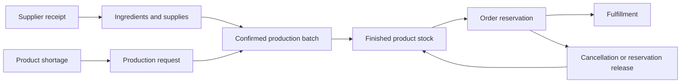

# Plan 47 — Connected Inventory Views

Status: complete; operations deployed and acceptance passed · Updated: 2026-10-01
Owners: CafeOS Portal, Underclerk commerce, and BakeryOS production

Related plans:
[Plan 21 — CafeOS UX foundation](./plan-21-cafeos-ux-foundation.md),
[Plan 22 — Commerce capabilities](./plan-22-commerce-capabilities-and-storefront-demos.md),
[Plan 23 — Flavored export catalog](./plan-23-flavored-export-catalog.md), and
[Plan 42 — Bakery workflow simulator](./plan-42-bakery-workflow-simulator.md).

## Decision

Provide two purpose-built views over the same authoritative inventory records.

| Section                           | Question                                           | Tracks                                                                                                     | Main actions                                                      |
| --------------------------------- | -------------------------------------------------- | ---------------------------------------------------------------------------------------------------------- | ----------------------------------------------------------------- |
| BakeryOS → Ingredients & supplies | What do we have available to bake and pack orders? | Ingredients, packaging, operating supplies; quantities, lots, expiry, suppliers                            | Receive supplies, count stock, reorder                            |
| AgentCommerce → Products          | What do we sell, and how much is available?        | Catalogue details and finished goods by product/variant and location; on hand, reserved, available to sell | Edit products, adjust stock, review shortages, request production |

Products combines the catalogue and physical availability in one destination.
Existing product detail pages retain descriptions, variants, prices, and selling
configuration. There is no separate Product stock sidebar entry. Purchasing remains
the place for suppliers and purchase requests. Inventory rows link to these
existing destinations with the selected item carried into the workflow.

This plan covers both views and their operational actions. Delivery is phased;
the read-only split can ship before the write workflows are complete.

## Current implementation and release status

The Portal reads one consistent stock snapshot from Underclerk. The server
projects separate supply rows and ecommerce product-variant rows. Ingredients,
packaging, and operating supplies appear only in BakeryOS; Products includes
variants with ecommerce offers, unlinked finished stock, and explicitly identified
untracked variants. The views show location,
on-hand, allocated, and available quantities, stock status, and configured
reorder points and targets. Its item panel links to Purchasing.

Relevant implementation:

- `apps/portal/src/features/commerce/inventory.tsx` and `inventory.css` own the
  current stock screen.
- `services/platform/src/commerce/inventory-overview.ts` builds its read model.
- `services/platform/src/control/routes/commerce.ts` exposes the authenticated
  `GET /v1/control/organisations/:organisationId/commerce/inventory` read.
- `apps/portal/src/route.ts` places Inventory under BakeryOS.
- `packages/contracts` defines inventory balances, quantities, movements,
  stock policies, lots, and completed production batches.
- `packages/underclerk-client` exposes snapshot reads, inventory-position
  creation, and receipt submission.

Product rows open stock details with a separate editor link. Both detail views
show lots, expiry and recent movements. Products also shows active reservations
and order links. Location filters use stable IDs, and stock links follow
checkout's location-specific consumption-plan precedence. Native usable stock
excludes expired and quarantined lots and respects reservations.

Operators can receive supplies against an existing position, link a delivery to
its replenishment request, and reconcile partial deliveries. Counts and explicit
correction, waste and damage adjustments produce native audited movements with
merchant, position and lot revision fences. Counts below reserved stock preserve
reservations and report the shortage. Receiving, counts and adjustments return
durable receipts and refresh authoritative stock; retries cannot add stock twice.

Purchasing links carry the selected item and location into the existing queue
and supplier setup. Supplier terms remain in Purchasing. Products can create a
linked recipe and durable production demand; BakeryOS can accept and mark that
demand scheduled. Confirmed native batches link actual output to the request.
Planned requests leave stock unchanged.

The connected receipt → production → reservation → fulfillment/cancellation
journey passed against Platform HTTP and native Underclerk SQLite. Local browser
checks covered stock details, search, filters, previews, keyboard focus, unsaved
Escape protection and a 390px layout. The selected light appearance was checked at desktop, 390px and 320px widths.
Both runtimes were deployed from reviewed revision `20a843917`; authenticated
production reads and the updated modal were verified against the existing merchant.
The complete shared suite passed 2,424 checks with three skipped, and the test-type
gate passed. Dark appearance passed on desktop and 390px mobile layouts after
the approved temporary theme switch; light appearance and the default viewport
were restored. See
[operations acceptance evidence](https://github.com/seams-tech/pantry-history/blob/2cf5676a714978ce2887a78523b1b0f6c87a53a8/docs/evidence/plan-47-inventory-operations-2026-10-01.md).

## Navigation and page structure

### BakeryOS: Ingredients & supplies

Keep the existing workspace `/inventory` URL. Rename the sidebar entry and
page heading to **Ingredients & supplies**. Show categories `ingredient`,
`packaging`, and `operating_supply`.

The default page contains:

1. Summary counts for items needing replenishment, items with recorded lots
   expiring soon, and items with no recorded balance.
2. Search, location, category, and stock-status filters.
3. A table with item, location, on hand, allocated, available, and stock status.
4. An item panel with lot/expiry information, reorder point, target stock,
   supplier options, incoming purchase quantities, and recent movements.
5. Actions to receive supplies, count stock, and review a reorder request.

Display expiry only when lot data supports it. The expiring-soon filter shows
its time window explicitly. Missing expiry or purchasing data is shown as
unavailable, with a useful setup action where one exists. Do not turn missing
data into a zero count.

### AgentCommerce: Products

Use workspace `/products`, with one **Products** entry in the AgentCommerce
sidebar. Its overview shows finished-product stock; existing `/products/:id`
detail pages remain available. Show category `finished_good` in the stock view.

The default page contains:

1. Summary counts for out-of-stock products, products below their stock
   targets, and products whose availability is unknown.
2. Search and location/status filters.
3. A table with product/variant, location, on hand, reserved, available to
   sell, and stock status. Keep quantities in their recorded units.
4. An item panel with its catalogue link, linked reservations, lots/expiry
   when tracked, recent movements, target stock, and production requests.
5. Actions to adjust stock, review shortages, and request production.

Finished stock without a catalogue mapping remains visible and is labelled
**Product link missing**. Catalogue products without a tracked stock item are
labelled **Stock tracking not configured** wherever their availability is
displayed. Neither condition means zero stock.

Selecting a row opens the item panel without triangle expanders. Stock-changing
actions open focused modals with item, location, current quantity, proposed
change, and confirmation. On narrow screens, use a clearly reachable detail
view with a back action rather than placing details below a long table.

## Shared stock model

Underclerk remains the authority for stock and stock movements. Portal views
use the same inventory-item and position identities. The existing canonical
category determines which view owns a record; names and sidebar location must
never determine classification.

- Keep category values typed in the read model. Format their labels in the UI.
- Preserve item, location, lot, and product/variant identities through reads
  and actions. Display names are labels, never mutation identifiers.
- A position is scoped to an item and location. Lots provide the finer
  breakdown where tracking supports them.
- For an accounted balance, display the authoritative on-hand, allocated,
  and available quantities. Label allocated finished goods **Reserved**.
- For an available-only balance, show available quantity and explicitly mark
  on-hand/reserved as unreported. Do not infer either value.
- Preserve quantity amount, scale, and unit in typed data. Compare thresholds
  only across compatible units. Never sum grams, pieces, and liters together.
- Keep incoming purchases and planned production separate from stock already
  available. Forecast output cannot increase available-to-sell quantity.
- Available-to-sell must respect the authority's expiry, holds, and channel
  eligibility rules. Verify those rules before presenting raw availability
  as sellable; do not invent a second browser-side stock calculation.
- Several offers or channels can reference the same physical stock pool.
  Listing that pool in several places must not multiply its quantity.

Reuse the existing read endpoint and shared stock components where they fit.
Add only the fields and focused reads needed by each view. Do not introduce
separate ingredient and finished-product stock databases or duplicate counters.
If a read contract changes, replace its Portal consumer in the same milestone.

## How the views connect

Confirmed production consumes actual inputs and records actual finished yield
through the existing production authority. Both views update from those
receipts. Batch completion, retry, and reconciliation must not consume inputs
or create output twice.

Order reservations reduce availability according to the existing order
lifecycle. Fulfillment settles the reservation and deducts stock without a
second availability deduction. Cancellation releases the eligible reservation.
Refunding a payment alone does not restock a physical product.

Example: a confirmed batch uses ingredients to produce 24 cookies. Product
stock then shows 24 on hand. An order reserves six: 24 on hand, six reserved,
18 available. Once those six are fulfilled, it shows 18 on hand, zero reserved,
18 available, assuming no other stock movements.

BakeryOS simulations remain isolated. A simulated batch or robot run cannot
post real ingredient consumption or finished-goods output. Production requests
are demand records; recording one does not certify that baking occurred.

## Operational workflows

### Receive supplies

Select the supplier or purchase request, item, location, quantity and unit.
Require lot and expiry when the item's tracking policy requires them. Review
and submit through the existing inventory receipt command. Show the durable
receipt and resulting balance. Support partial deliveries without marking the
entire purchase received.

### Count or adjust stock

A count records the observed physical on-hand quantity. Show the current
balance, observed count, resulting difference, and reason before confirmation.
Product adjustments cover explicit corrections, waste, or damage using the
supported movement reasons.

Audit the existing command model first. If count reconciliation is absent,
introduce one typed governed command at the authority boundary; do not restore
the retired generic `adjust_inventory` path mentioned in Plan 22. Recheck the
position revision before applying a count, so a concurrent sale or receipt
cannot silently be overwritten. A conflict requires refreshing and reviewing
the new difference. A count below reserved stock must produce an explicit
shortage for resolution, without silently deleting reservations.

### Reorder supplies

Open a purchase-request draft with item, location, supplier options, reorder
point, target, and proposed quantity. Use the existing purchasing calculation
and its open-request/incoming-stock rules to avoid duplicate replenishment.
Expose pack sizes, units, lead time, and minimum order quantity where known.
When supplier linkage is missing, route to supplier setup for this item.
Creating a request does not send an order or spend money; those transitions
retain the existing purchasing review and authorization boundaries.

### Request production

Start from a finished-product shortage. Select the linked recipe revision,
requested output quantity, destination location, and needed-by date. Show
ingredient availability and any blocking shortages. Create durable demand
that BakeryOS can accept and schedule. Link both views to the same request.

If no recipe produces that stock item, show **Link a recipe** instead of a
nonfunctional production action. Actual batch completion remains a separate,
authorized workflow recording actual consumption, yield, and waste.

## Authorization and interaction rules

All mutations use existing capability, policy, approval, revision, idempotency,
receipt, and reconciliation boundaries. Readers can inspect stock; write
controls follow the actor's actual capabilities. Do not add an ungoverned
Portal-to-provider mutation path.

Represent pending, completed, conflicted, and failed operations explicitly.
Disable duplicate submission while pending. Refresh from the authoritative
receipt before displaying success. Keep the form values when submission fails
and explain the recovery action beside the error.

Maintain the light/dark appearances of the selected theme, compact shell,
visible hover feedback, and current 2px translucent keyboard focus treatment.
Modals support keyboard focus, Escape, and return focus to their trigger.
Unsaved changes must not disappear through accidental dismissal.

## Delivery milestones

### M1 — Split and connect the read views

- [x] Audit item categories and catalogue/variant mappings in the current data.
- [x] Preserve typed categories and identities in the inventory read model.
- [x] Restrict Ingredients & supplies to its three categories.
- [x] Replace the Products overview with the combined catalogue/stock view,
      preserving product detail routes and one Products sidebar entry.
- [x] Add catalogue-to-stock and stock-to-catalogue navigation.
- [x] Preserve location separation, unknown quantities, filters, empty states,
      loading, and recoverable errors in both views.
- [x] Remove the replaced mixed-category presentation and obsolete tests.

Exit: no ingredients appear in Products and no finished goods appear in
Ingredients & supplies. Both screens display the same authoritative records
without new stock persistence or fabricated quantities.

### M2 — Supply operations

- [x] Connect lot/expiry and supplier-linked incoming-purchase reads, with supplier
      terms available in existing Purchasing.
- [x] Implement the receiving modal using the existing receipt command.
- [x] Link receipts to suppliers/purchase requests and reconcile partial deliveries.
- [x] Implement governed count reconciliation with conflict handling.
- [x] Link reorder review to existing purchasing with duplicate-demand checks.

Exit: receiving, counting, and requesting replenishment persist real changes
and survive refresh/retry. The resulting balances and purchase state are
consistent with their durable receipts.

### M3 — Finished-stock operations and production demand

- [x] Expose governed adjustments and reservation/shortage details.
- [x] Connect finished goods to recipes and durable production demand.
- [x] Add request-production review and the linked BakeryOS demand view.
- [x] Verify actual production completion updates inputs and output once.
- [x] Verify order reservation, fulfillment, and release against that output.

Exit: an operator can follow a shortage from Products to a production
request, confirmed production, and newly available stock. No simulation writes
real stock, and no planned quantity appears as available.

### M4 — Acceptance and release

- [x] Exercise ingredient receipt → confirmed batch → finished stock → order
      reservation → fulfillment, plus reservation cancellation.
- [x] Cover partial receipts, duplicate retries, concurrent count conflicts,
      lot expiry, incompatible units, and available-only balances.
- [x] Prove cross-organisation isolation and unauthorized mutation rejection.
- [x] Verify navigation, search, filters, modals, keyboard behavior and narrow
      layouts with real service-backed data in the selected light appearance.
- [x] Complete dark-appearance acceptance.
- [x] Run relevant type/build/test gates and commerce-lab closure checks; record
      shared failures separately from the passing inventory journey.
- [x] Close the three shared chat failures observed during acceptance.
- [x] Deploy the initial inventory release to both runtimes from a reviewed revision.
- [x] Record implementation evidence and remaining limitations.

## Completion criteria

The plan is complete when both views answer their respective operational
questions, their actions persist through the established authority, and the
receipt-backed stock transitions reconcile across receiving, production,
reservation, and fulfillment. M1 alone is a read-view release; it does not
complete the operational scope of this plan.

Demand forecasting, warehouse optimization, new accounting valuation, and
physical robot execution are outside this plan. Existing production and
purchasing systems retain ownership of scheduling and commercial commitments.

## Review follow-up

The [2026-10-02 recovery acceptance](https://github.com/seams-tech/pantry-history/blob/2cf5676a714978ce2887a78523b1b0f6c87a53a8/docs/evidence/plan-47-recovery-2026-10-02.md)
records queue-failure retry protection, long-lived forms, cursor pagination,
retained drafts, stale receiving recovery, and typed production quantities.

The [2026-10-02 settlement and membership acceptance](https://github.com/seams-tech/pantry-history/blob/2cf5676a714978ce2887a78523b1b0f6c87a53a8/docs/evidence/plan-47-settlement-2026-10-02.md)
closes the architectural follow-up: frozen submission recovery, preserved paginated
views, native filtering and indexed request reads, explicit list membership with
populated schema migration, and scheduled outbox recovery independent of queue
wake-ups.

The [2026-10-02 purchasing and query acceptance](https://github.com/seams-tech/pantry-history/blob/2cf5676a714978ce2887a78523b1b0f6c87a53a8/docs/evidence/plan-47-purchasing-query-2026-10-02.md)
verifies merchant isolation for OR and nested search queries, populated schema
v50 upgrades, and two complete replenishment cycles for the same stock policy.

The [2026-10-02 production recovery and signature acceptance](https://github.com/seams-tech/pantry-history/blob/2cf5676a714978ce2887a78523b1b0f6c87a53a8/docs/evidence/plan-47-production-recovery-2026-10-02.md)
closes the remaining P2 review items: frozen production creation and transitions,
independent cursor freshness and operation readiness, native production validation
with a shared typed quantity codec, and verified repair of stored outbox signatures.

- [x] Implement the P1/P2 review fixes and record repeatable backend and browser acceptance.
- [x] Pass the relevant shared checks, source/test types, and portal build.
- [ ] Deploy the follow-up release to Platform and Underclerk, then verify production
      migration and outbox recovery.

The signature repair remains at the persistence boundary until production backlogs
have been converted and verified. All follow-up changes are currently verified locally.

### Port onto `dev`, 2026-10-10

The follow-up was written on `codex/plan39-release` and had not reached `dev`.
Its three commits were ported onto `dev` on 2026-10-10. The port follows the
Organisation names, the User identifier and the regional databases that `dev`
gained after the branch was cut. The port found two defects in the scheduled
outbox recovery and corrected them:

- The recovery read the binding tables through the global database. Those tables
  now live in the regional databases, so the recovery reads each of them.
- The recovery required an integration account row for each binding. No code path
  creates that row for a Satyr commerce binding, so the recovery found bindings
  only in the test fixture. It now requires an active row only where a row exists.

Checks on the ported tree: 2,385 Platform checks passed with three skipped, as
did 184 Underclerk checks and 78 commerce-lab closure checks. The inventory and
commerce-lab Worker journeys passed, and so did the rendered production browser
acceptance. The contracts tests passed with unchanged bindings, as did source and
test types and the portal build. The order attention journey needs a live model
key and was skipped. The lab scripts were not run, because they need a deployed
Worker with a lab Organisation.

The release adds a one-minute cron trigger to the production Worker for the
outbox recovery.

### Release state and the schema 49 upgrade, 2026-10-10

Both halves are in production.

- **Platform:** `satyr-edge` version `c856803d` since 2026-10-10 04:39 UTC,
  built from `02b6d7b84`.
- **Underclerk:** version `92e0cd49` since 2026-10-10 05:18 UTC, built from
  `7e0189741`, which holds the corrected schema 49 step. It replaced
  `4fad9753d` with schema 47.

The production merchant object was used once after the Underclerk
deployment, through a public catalog read. Its constructor completed, so the
schema upgrade to 50 did not fail. The outbox signing migration reported
`complete` with no delivery to change. Row counts in production were not
read, because that needs the operator token. A return to the older Underclerk
code is not possible: it refuses a schema above 47.

The one-minute cron runs. Its first run was at 05:33 UTC, 54 minutes after
the Platform deployment, and it has run each minute since then with outcome
`ok` and no recovery warning. Before 05:33 the live tail showed no run with
that label, and Underclerk received no request from the Platform. Not
explained: the 15-minute work runs three times each quarter hour since the
deployment, and it ran twice before it. The Worker's registered schedules
were not read.

The first Underclerk release attempt was stopped before deployment, for this
reason. The schema 49 step
rebuilds `commerce_list_entry`. It turned foreign keys off with a pragma
first. A Durable Object ignores that pragma. The drop of the old table then
deleted every row of `commerce_list_entry_attribute_value` through its cascade.
The foreign key check stayed clean, and the step reported success.

A rehearsal in the Workers runtime shows it. The code of `4fad9753d` made a
merchant object with two lists, two entries and 13 entry values. The code of
`02b6d7b84` upgraded it to schema 50 with 0 entry values. Its purchasing
reconciliation then failed with `invalid_attribute_value`. The Underclerk tests
did not show the loss, because Node's SQLite honours the pragma.

Commit `f112d4f93` corrects the step. It copies the entry values aside before
the drop and restores them after the rename, and it no longer changes the
pragma. The same rehearsal then keeps all 13 values, and the reconciliation
finds the open requirement. The 184 Underclerk checks and the type check pass.

- Evidence: [both rehearsal results](https://github.com/seams-tech/pantry-history/blob/2cf5676a714978ce2887a78523b1b0f6c87a53a8/docs/evidence/plan-47-schema-49-upgrade-2026-10-10.json).
- Replay: `node scripts/plan47/underclerk-upgrade-rehearsal/run.mjs <tree at 4fad9753d> <tree under test>`.
  The old tree needs its own install and its contracts Wasm built in its own
  Cargo target directory. A shared target directory gives it the new Wasm.
- The rehearsal also runs the outbox signing migration, with an Ed25519 key
  made for the run. The old code's one pending delivery was signed again and
  stayed pending. It verifies in the form the Platform checks. The production
  signing key was not used.
- The Underclerk schema upgrade cannot be reversed by a return to the older
  code, which refuses a schema above 47.
