# Commerce Spec

Status (2026-10-23): first version. This spec is the contract for what
Commerce does and how its API behaves. [Plan 76](../../../docs/history/plan-76-standalone-underclerk.md)
and [Plan 76A](../../../docs/history/plan-76A-shopify-parity.md) keep the history and
the reasons for each decision; this spec keeps the result.

## 1. How to use this spec

- Commerce is a headless commerce backend. Shopify's Admin and Storefront
  APIs are the reference product. Parity means that a merchant can do the
  same work. It does not mean the same API shapes, names or limits.
- Each section names the Shopify area that it covers, the records, the
  operations, the rules, the gaps and a status. Appendix A lists every HTTP
  route with its access and its section.
- A change in behavior changes this spec in the same commit as the code. A
  plan proposes the change; this spec states the result.
- `pnpm lint:commerce-spec` fails when the code has a route, a scope or an
  event kind that the appendices do not list, when the appendices list one
  that the code does not have, when a route's access differs, or when a
  journey that the spec names does not exist.
  `node scripts/check-commerce-spec.mjs --write` rewrites the appendices
  from the code. It keeps the section of each known entry. A new entry gets
  `?`, and the check fails until a person gives it a section.
- Status words:
  - **Built**: in the code and proven by an end-to-end journey.
  - **Partial**: built, with the gaps that the section lists.
  - **Planned**: accepted and not built; the section names the plan.
  - **Deferred**: the owner stopped the work. It starts again only on the
    owner's word.
  - **Not planned**: a non-goal (section 23).
- Release state (production or local dev) is not part of this spec. The
  plans record it.

## 2. Principles

These rules apply to every section.

Timestamp admission must return a refusal when UTC conversion exceeds the
supported date range. It must not stop the runtime. Commerce timestamp
validation uses `invalid_timestamp`; entity-plane cursor validation maps that
refusal to `invalid_date`.

1. **One writer for each merchant.** The records of a merchant live in one
   SQLite-backed Durable Object (`CommerceMerchantDO`). Only that object
   writes them, so two requests for one merchant never write at the same
   time.
2. **Commands, not field writes.** Every change is a typed command with
   the expected revision of each record that it changes (or the expected
   merchant revision). On an admin route that takes a command (Appendix A
   names its version), the body carries only the command's own fields. The
   path names the merchant and the other records, the `Idempotency-Key`
   header (1 to 255 characters) names the attempt, and the merchant's clock
   gives the time of the request. A body that names `schemaVersion`,
   `organisationId`, `idempotencyKey`, `actionNonce`, `requestedAt` or a
   path field is refused with 400 and that `field`; so is a missing key. A
   repeated command with the same key and the same body returns the first
   receipt, whatever the order of its fields; the same key with another
   body is refused with `idempotency_conflict`. Two merchants may use the
   same key. A command with a stale revision is refused with
   `stale_resource_revision` or `stale_merchant_revision`. A buyer
   command keeps its own version and idempotency key in the body (Plan 80
   D10); it names no owner and no time.
3. **One transaction.** A command commits the domain change, its signed
   receipt (`commerce.mutation-receipt.v2`) and its signed delivery
   (`commerce.commerce-delivery.v2`) in one SQLite transaction. Both name
   the merchant and the idempotency key, and no owner or action nonce
   (Plan 80 step 2). Receipts and deliveries of version 1, which also named
   the owner as `organisationId`, stay stored as they were signed, and every
   reader takes both versions
   (`src/commerce-authority/ledger.ts`). A refund reservation commits a
   delivery with no receipt; its resolution records the receipt.
4. **Money.** Amounts are integers in minor units with an ISO 4217 code
   (`CURRENCY_MINOR_UNITS` in `@purin-labs/commerce-client`). A cart, a checkout and
   an order have one currency. A conversion uses a stored rate with its time
   and source.
5. **Accepted records do not change in place.** A placed order keeps its
   accepted snapshot. An edit, a later payment, a return or an exchange is
   an order change that points to it. A quote freezes titles, prices and
   revisions, so a catalog edit never changes an order.
6. **No personal data in events and receipts.** Events, receipts, webhook
   posts and logs carry identifiers and non-personal fields. Customer fields
   are sealed for each customer, and erasure deletes the key (section 16).
   Gift card codes are kept only as digests (section 17).
7. **Old data stays as it is.** A new feature applies to records made after
   it ships. Commerce does not convert old records. An old record that
   blocks a new path is refused with a clear error.
8. **Contracts first.** Record and command types live in
   `packages/commerce-contracts` (TypeBox schemas and their parsers)
   and `packages/commerce-client` (`@purin-labs/commerce-client`, the
   parsers). There is no second hand-made copy.
9. **Boundary.** Commerce imports no Pantry package. Pantry reaches
   Commerce only through `@purin-labs/commerce-contracts`, `@purin-labs/commerce-client` or
   the built Worker. Commerce's source names Cloudflare runtime APIs only
   in its adapter files (`worker.ts`, `durable-object-database.ts`,
   `catalog-snapshots.ts`), so that another host stays possible. Both rules
   are checked by `pnpm lint:runtime-boundary`.
10. **Storage tiers.** The working set stays in the merchant's SQLite.
    Finished orders and old events move to R2 files that never change
    (section 19). Production storage is in Asia Pacific.
11. **Proof.** Each feature has one end-to-end journey in
    `services/commerce/tests/` on the real HTTP API and SQLite store, with
    fakes only for outside services. A journey writes a repeatable evidence
    file. New work adds journeys, not unit tests.
12. **Plugins.** Each built-in plugin keeps its code in
    `src/plugins/<plugin>/`, and other code reaches it only through its
    `index.ts` (section 21).
13. **State machines.** Every lifecycle (checkout profiles, discounts,
    checkouts, payment attempts, payments, disputes, orders, draft orders,
    fulfillments, shipments, refund attempts, returns, customers, stored
    value accounts and webhook subscriptions) is data in the contracts
    (Appendix D). Every planner asks `commerceTransition` before it moves a
    record. A move that the machine forbids is refused with
    `invalid_transition`, which names the machine, the state and the event.
    Two answers differ: a buyer who enters an inactive discount code or a
    disabled gift card sees the same refusal as for a code that does not
    apply, and the checkout profile routes keep `invalid_lifecycle` with the
    state that the event needs.

## 3. Merchants, access and apps

Shopify: shops, Admin API access tokens, custom apps and access scopes.
Status: **Partial**.

Records: `merchant` (one for each Durable Object) and API credentials (API
keys and app installations, with secrets kept only as SHA-256 hashes). The
operator sets a merchant's `externalReference` once, at provisioning
(`commerce.provision-merchant.v2`): its own name for the merchant's
owner, such as a Pantry organisation. Snapshots name the merchant only by
`merchantId`. A merchant id has 3 to 80 lowercase letters, digits, `_` or
`-`; the Worker routes no other id. The entity-plane routes are Pantry's own
integration routes: their `organisationId` is the merchant's external
reference.

- The operator token (`COMMERCE_SERVICE_TOKEN`) opens every route of every
  merchant. Only the operator token opens the `operator` routes:
  provisioning, the migration inventory, app installations, archive runs
  and the internal routes.
- An API key `uck_<id>_<secret>` opens the admin routes of its scopes on one
  merchant. An API key cannot hold `payments:record`.
- An app installation token `uca_<id>_<secret>` opens the admin routes of
  its scopes on one merchant. The token is derived from the operator token,
  the app and the installation's external reference, so a new operator token
  stops every earlier app token at once. Pantry is an installed app. An
  install of an app that is installed changes its scopes and keeps its
  token. An install after a revoke makes a new credential with a random
  nonce in its token (`commerce.app-token.v2`), so the revoked token stays
  refused and only the install answer shows the new one. The operator reads
  the token of an active installation with `GET …/app-installations/:appId`
  and its `externalReference`; a revoked installation, or another reference,
  answers 404. Pantry reads it when its derived token is refused, so an
  operator's install after a revoke lets Pantry in again, and an uninstall
  keeps it out.
- Each credential has a state (machine `credential`, Appendix D):
  `active`, then `revoked` or `expired`. A key may have an `expiresAt`; at
  that time it is refused and ends as `expired`. A key that an app
  installation issued names it as `parentCredentialId`. A revoke of a
  credential revokes every active key below it, with `revokedBy`
  `parent:<id>`; `revokedBy` is otherwise `operator`, `credential:<id>` or
  `merchant_closure`.
- Merchant closure: `POST …/closure` (operator) closes a merchant whose
  owner ended, such as an Organisation that Pantry purges. It revokes every
  credential, removes every outbound webhook subscription with its pending
  deliveries, removes the Stripe account links, and revokes the Square
  connection at Square or, when Square cannot, forgets its tokens and
  locations. A closed merchant refuses a new API key, app installation,
  webhook subscription or provider link with 409 `merchant_closed`. A
  repeated close answers the first closure.
- The merchant's object checks a credential in its own database, so a
  credential of merchant A never opens merchant B. Every secret compare runs
  in constant time.
- Every admin route needs one scope (Appendix A). Appendix B lists the
  scopes.

Rules:

1. An installation whose external reference is not the merchant's
   `externalReference` is refused.
2. A buyer route never takes an admin credential (section 7).

- A credential with `credentials:write` (an app installation, or the
  operator) creates, lists and revokes the merchant's API keys. A new key
  gets only scopes that its creator holds, and never `credentials:write` or
  `payments:record`. A revoked key stops at once.
- Each receipt of version 2 names its `actor`: the operator, the API key
  (`credentialId`) or the app (`appId`). An app may add the person it acts
  for, as its own opaque reference of 1 to 200 characters, in the
  `Commerce-Actor` header; any other credential that sends it is refused
  with 400. Work that no request started (the alarm, plugin handlers) names
  no actor.

Not planned: staff accounts with passwords (the operator keeps its members)
and a directory across merchants (the operator keeps its own map).

MCP server (Plan 40B phase 6): `POST /v1/admin/merchants/:merchantId/mcp`
answers the Model Context Protocol, so that an operator's coding agent can
build a shop site against Commerce (`src/mcp-server.ts`).

- The transport is MCP's Streamable HTTP without a session: each POST holds
  one JSON-RPC message and gets one JSON answer, and a notification gets 202.
  The server answers protocol versions `2025-06-18`, `2025-03-26` and
  `2024-11-05`. `GET` answers 405.
- It takes the merchant's own credential: an API key, an app installation
  token or the operator token. Any other bearer, a buyer session among them,
  is refused with 401 before the JSON-RPC message is read.
- Each tool needs one scope, and `tools/list` shows only the tools of the
  caller's scopes: `list_storefronts` (`settings:read`), `read_catalog`
  (`catalog:read`: the buyer catalog with its menus, or a search),
  `create_checkout` (`orders:write`: a guest buyer's cart and pickup
  checkout) and `read_order` (`orders:read`). A tool without its scope
  answers an error result and calls nothing.
- A tool calls the same routes that a site calls. Admin calls carry the
  caller's credential, so each route checks its own scope again. Buyer calls
  carry a guest buyer session that the tool makes; `create_checkout` returns
  it, and the site pays the checkout with it through the buyer routes. A
  buyer's idempotency keys belong to its session, so a retry that sends the
  same key and the returned `buyerSessionToken` gets the same checkout.

Proof: `api-access-journey.test.ts`, `mcp-server-journey.test.ts`,
`credential-lifecycle-journey.test.ts` (a revoked app token stays refused
after a reinstall, the app's keys end with it, and a closed merchant refuses
its credentials and posts no webhook), and on Platform
`tests/e2e/purged-organisation-commerce.test.ts` (a purge closes the
Organisation's merchant).

## 4. Locations, storefronts and checkout profiles

Shopify: locations, sales channels and publications, checkout settings, POS
locations. Status: **Partial**.

Records: `location`, `sales_channel`, `storefront`, `checkout_profile` with
its revisions and its activation on a storefront, and the point-of-sale
configuration of a counter.

- A storefront serves one sales channel and one fulfillment kind: pickup at
  a location with a ready lead time, or shipping from an origin location
  with a shipping profile.
- A checkout profile is a versioned set of policies: currency, buyer
  (`guest` or `guest_or_account`, the required contact and saved addresses),
  cart, pricing, fulfillment, tax, payment (an external provider binding),
  after-sale (cancellation and refund policies and refund governance) and
  presentation. Staff edit a draft, publish it, and activate one published
  revision on a storefront.
- A point-of-sale configuration publishes a counter's terminal and payment
  binding for one location.
- A storefront's tax is a percentage or a provider quote.
  `update_storefront_tax` changes it and gives the storefront a new
  revision. A percentage is `added` on top of the subtotal (the default) or
  `included` in the listed prices, as Japan requires; then the buyer pays
  the subtotal and the tax is the part above the net amount, rounded half
  up. Only a pickup storefront takes an included percentage. Its quotes and
  orders carry `taxIncluded: true`: their total is the subtotal with duty
  and shipping, and each line still records its share of the tax. A refund
  of such an order returns line amounts only; tax named on top is refused
  (`refund.relationships`), because the line amounts hold it.
- A storefront may hold one shop name, such as `nuki`, which a shop site
  serves at `nuki.menu.<domain>` (Plan 40B phase 2).
  `set_storefront_shop_name` takes a name; `read_storefront_shop_name`
  reads the current name and the earlier ones. `GET
  /v1/public/shop-names/:name` answers the merchant and storefront of a
  name without a session, or 404 when no shop holds it.

Rules:

1. A published profile revision never changes. A change is a new revision.
2. A buyer session pins the storefront revision and the profile revision. A
   session made before a storefront change is refused.
3. A shop name has 3 to 30 lowercase letters, digits and single hyphens. It
   starts with a letter and ends with a letter or a digit. Names of the
   services themselves, such as `www`, `api` and `menu`, are reserved.
4. One object holds each name, so one name has one storefront. A name never
   leaves its storefront: after a change, an earlier name opens the same
   storefront with `current: false` and names the current one, so a printed
   QR code never opens another shop. A storefront holds at most five names
   in all; taking an earlier name again does not count.
5. A refused name is an answer, not an error: the change answers 200 with
   `outcome: "refused"` and the reason `invalid`, `reserved`, `taken` or
   `limit`.

Gaps (Planned): more than one fulfillment kind for each storefront; a
shop's own domain for its shop name; giving a name back so another shop may
take it.

Proof: `checkout-profile-http.test.ts`, `punter-acceptance.test.ts`,
`included-tax-journey.test.ts`.

## 5. Catalog: products, variants, offers and media

Shopify: products, variants, options, media, prices and compare-at prices,
publications, bulk editing. Status: **Partial**.

Records:

- `product`: title, description, handle (unique in the merchant), product
  type, vendor, tags and status `draft`, `active` or `archived`.
- `sellable_variant`: SKU (unique in the merchant), title, options (name and
  value pairs), media, barcode and status `active` or `archived`. Its
  shipping specification (weight, dimensions and customs facts) has its own
  revision.
- `offer`: one price and an optional compare-at price for a variant on one
  sales channel, with lifecycle `prepared`, `listed` or `archived`. An
  optional price policy caps automatic price changes.
- `media`: an image (JPEG, PNG, WebP, AVIF or GIF, checked by its first
  bytes, at most 20 MB) kept in R2 under its SHA-256, with alt text. A
  product keeps an ordered media list; each item is for every variant or for
  some.

Operations: `prepare_catalog_listing` makes a product, a variant and an offer
in one command; `place_channel_listing` and `publish_catalog_listing` list
it; `update_product`, `update_variant` and `update_offer` change fields, and
fields that a command omits stay as they are; `adjust_offer_price` changes a
listed price within the price policy; `delete_product` removes a product that
was never sold; media upload, create, update, delete and `set_product_media`.
The merchant's own app reads one library image's bytes with
`read_media_content` (`catalog:read`, never cached); the public storefront
route still serves only the images that its catalog shows.

Rules:

1. Only an active product with a listed offer appears in a storefront.
2. A variant that was sold is archived, never deleted. An image that is
   still on a product cannot be deleted.
3. A catalog edit never changes a placed order. A quoted checkout whose
   offer revision changed must be refreshed before payment
   (`checkout_refresh_required`).
4. A cart line keeps its variant and shows the current price at the next
   read. `delete_product` removes the lines of its variants from every cart.
5. The entity plane shows an offer's `price` (amount and currency). An offer
   with a price policy also shows `price_policy` (`enabled` or `disabled`)
   and `price_policy_revision`; an enabled policy adds `price_minimum` and
   `price_maximum`, the range that it allows now. An `adjust_offer_price`
   command binds the offer revision and the policy revision that a read
   shows. An offer write, a price change and a policy change update these
   values in the same commit.

6. `delete_product` removes the product, its variants, offers, price policies,
   consumption plans, shipping specifications, sold-out marks, collection
   memberships and media links in one transaction. A finished good that no
   other product consumes becomes `inactive`, and its stock ledger stays. The
   image stays in the media library. The command is refused with
   `product_delete_refused` and a reason: `sold` for any line of a live order,
   also a cancelled one, or of an accepted checkout, which stays after its order
   moves to the archive; `on_menu` for an active entry of a published menu;
   `open_checkout` for a payment that is pending or a quote that has not
   expired; `reserved_stock` for a held or allocated quantity of a finished good
   that it retires; `draft_order` for an open or invoiced draft; `price_list` for
   a market or a company price list; `discount` for a discount rule;
   `linked_record` for an active list entry or relationship. Archive is the end
   for a product with a refusal.

Gaps (Planned): a `sold` check of the lines that an order edit added to an
order that has since moved to the archive, because no live record keeps them;
product-level option records; commands to add and archive a variant;
`bulk_update_catalog`; image sizes from Cloudflare Images; video and 3D
models; catalog command schemas in the contracts.

Proof: `catalog-editing-journey.test.ts`, `media-journey.test.ts`.

## 6. Collections

Shopify: manual and automated collections. Status: **Partial**.

Records: `collection` (handle, title, description, one sales channel, sort
order manual, title, price up, price down or newest, and status) and its
stored members.

- A manual collection keeps a staff order. An automated collection keeps a
  rule that matches all or any of tag, product type, vendor, title text and
  price on its channel.
- Every command that writes products, variants or offers recomputes the
  automated members in its own transaction, so the edit and the member
  change share one receipt.
- Buyers list the collections of a storefront and read one by handle in
  pages, with tag, price and availability filters. A product that is not
  active or not on sale stays a member but is not shown.

Gaps (Planned): images; more than one channel; a
`collection.membership_changed` event; the cost of recomputing every
automated collection on each catalog write for large catalogs.

Proof: `collection-journey.test.ts`.

## 7. Storefront reads and buyer sessions

Shopify: the Storefront API catalog queries, search and buyer identity.
Status: **Built**.

- A buyer session is a signed token for one storefront revision and its
  checkout profile, as a `guest` or an `identified_customer` (section 16). It
  lasts 30 minutes.
- The Worker answers catalog reads, catalog searches and guest sessions from
  a snapshot of the storefront that the merchant's object builds. The Cache
  API keeps the snapshot for 2 seconds (`src/catalog-snapshots.ts`). The
  Worker checks the session token itself. A token that the snapshot cannot
  confirm (a customer session, another storefront revision, an expired or a
  forged token) goes to the merchant's object, which decides.
- A snapshot can show an item as available for up to 2 seconds after it
  sold out. The cart or the checkout refuses it, so a snapshot never
  oversells.
- Search: every term must match. A term in the title counts most, then the
  variant title, then the SKU, handle and options, then the description.
  Available listings come first. Text is compared in NFKC form, in lower
  case, with katakana as hiragana. A search gives 20 results by default and
  50 at most.
- The Worker serves an image without a session only while the storefront's
  catalog shows it, with an ETag and a one-hour cache.

Proof: `flash-sale-journey.test.ts` (in workerd), `catalog-search-journey.test.ts`.

## 8. Inventory

Shopify: inventory items, inventory levels at locations, adjustments and
transfers. Status: **Partial**.

Records: `inventory_item` (merchant code, base unit, category, aggregate or
lot tracking), `inventory_position` (one item at one location, with on hand,
allocated and available), a ledger of stock movements, lots with expiry, and
`inventory_allocation` (stock held for a checkout line, then for an order
line).

Operations: create an item, open a position, receive stock (with an
optional purchase link), reconcile a count, and read the stock snapshot.

Rules:

1. Available stock never goes below zero. A quoted checkout holds its
   stock, a placed order keeps it allocated, and fulfillment consumes it.
2. The merchant's alarm expires a quoted online checkout whose quote has
   lapsed and that has no payment under way. Its stock comes back, and the
   feed shows `checkout.expired`.
3. A restocked return is a stock receipt that names the return.
4. A menu, a catalog listing, a checkout and an order edit count only the
   stock that a sale can consume: for a lot-tracked item, the unexpired lots
   less the stock already allocated. A lot that expires after a sale holds
   that order's preparation until a fresh lot arrives, or until staff cancel
   the order (section 15).
5. The merchant's alarm runs a `lot_expiry` pass when a lot's expiry passes.
   It writes each lapsed lot off with the reconcile command that staff send:
   one `waste` decrease for the lot (`lot_expiry_<lotId>_<lotRevision>`), so
   on hand drops and the feed shows `inventory.updated`. The lot moves to
   `expired`. On hand never drops below the stock that open allocations
   hold, so the pass writes off only the free part of a position; the rest
   goes in the pass after an allocation ends or fresh stock arrives. A count
   or an adjustment of a lot past its expiry also moves it to `expired`.
   Schema 90 adds the `stock_lot_expiry` index that the pass reads.
6. Each allocation moves through the `inventory_allocation` machine, and its
   one writer checks the move and the revision that the commit read. A
   refreshed quote keeps the holds of the lines it keeps (`refresh`) and
   releases the others. Each lot moves through the `stock_lot` machine.

Gaps (Planned): transfers between locations; a return disposition stock
movement; stock holds for draft orders.

Proof: `lapsed-hold-journey.test.ts`, `purchasing-replenishment.test.ts`,
`expired-lot-journey.test.ts` (a lapsed lot written off as waste; a paid
made-to-order latte whose lot lapsed, cancelled and refunded).

## 9. Markets and currencies

Shopify: Markets. Status: **Partial** (pickup and shipping checkouts).

Records: `market`, with countries, a currency, its storefronts and a price
mode: a fixed price list, or the shop price times a rate that the merchant
sets (kept with its time and source), rounded half up to an increment.

Rules:

1. A buyer checkout names its market. The quote is in the market currency
   and keeps the market revision, the rate and the shop subtotal. An open
   checkout keeps the rate that it quoted.
2. Refunds are in the order currency.
3. Stripe charges in the market currency. Square takes only the account
   currency and refuses another before any payment.
4. A shipping checkout takes a market with a converted rate (`marketId` on
   `create-buyer-shipping-checkout.v1`); a price list is refused
   (`checkout.market`), because the carrier, tax and duty quote in the
   shop currency. The quote's lines, tax, duty and shipping are each the
   shop amount converted at the rate and rounded; the totals add up the
   converted amounts. The carrier, tax and duty quotes stay in the shop
   currency, and the buyer's quote names the market (`market`: id,
   currency, shop currency, rate, rounding increment), so a reader can
   convert each quote and match it with its total. The stored market keeps
   the rounding increment. Plugins and the shipping quote see shop amounts.

Gaps (Planned): draft orders, edits and balances in a market; prices that include tax in a market currency; a market from the buyer's country; reports
in the shop currency; fixed-amount discounts in a market currency.

Proof: `market-journey.test.ts`, `market-shipping-journey.test.ts`.

## 10. Discounts

Shopify: discounts (amount off products, amount off order, buy X get Y,
free shipping). Status: **Partial** (pickup and shipping checkouts).

Records: `discount` (title; method `code` with its codes or `automatic`;
rule `amount_off_products` or `amount_off_order` with a percentage or a
fixed amount; conditions: minimum subtotal, start and end, a total use
limit and one use for each customer; status `active` or `inactive`) and its
redemptions.

Rules:

1. A discount is published as created. It can only be turned off.
2. Codes match in any case. Each code is unique in the merchant.
3. Product discounts apply first, then order discounts on what is left.
   Each discount spreads over its lines in whole minor units, with the
   remainders in a fixed order, so the same cart always gives the same
   result. Tax is computed on the discounted amounts. At a shipping
   checkout the discounted lines go to the shipping quote, so tax and duty
   are on what the buyer pays.
4. A checkout holds its uses until it is paid or its quote expires;
   placement redeems them. Because the merchant has one writer, two buyers
   cannot pass a use limit together.
5. An order line keeps its discount, so a refund of the line is capped at
   the discounted amount.

Gaps (Planned): buy X get Y; free shipping; draft orders and edits through
the evaluator; collection and customer scopes; combination classes. A
counter sale takes discount codes (`discountCodes`) and holds their uses
like an online checkout.

Proof: `discount-journey.test.ts`, `shipping-tenders-journey.test.ts`.

## 11. Carts and checkout

Shopify: carts, checkout, draft order invoices and POS checkout. Status:
**Partial**.

Records: `cart` (lines, `active` or `submitted`), `checkout` (lifecycle
`quoted`, `payment_pending`, `accepted` or `expired`) with its quote
snapshot (lines with frozen titles, prices and revisions; totals;
fulfillment; expiry; an optional market and stored value), and counter
sales.

Checkout kinds:

- Online pickup: a buyer's cart for a pickup storefront, or a pickup
  checkout that staff make.
- Online shipping: the buyer validates an address (or names a saved one);
  Commerce quotes the carrier rate, tax and duty and keeps each quote
  attempt.
- Draft invoice: a draft order's invoice link opens a checkout at staff
  prices (section 13).
- Balance: a checkout with one `order_balance` line pays the outstanding
  balance of an order (section 13).
- In person: a counter checkout paid on a Square Terminal.

Rules:

1. A quote expires after the storefront's quote time. Payment starts only
   before expiry. A refresh makes a new quote revision and keeps the held
   discount codes and stored value.
2. A quote holds stock, discount uses and stored value. An expired checkout
   releases them.
3. A payment provider collects the quote total less stored value
   (`amountDue` in `src/commerce-authority/checkout-shared.ts`).
4. A buyer route accepts only the buyer session that made the cart or the
   checkout.
5. Pickup, shipping, draft and counter checkouts run the same stages in
   the same order (`src/commerce-authority/checkout-pipeline.ts`): the
   lines and their prices, discounts, tax (and for shipping the carrier
   rate and duty), the total, and stored value against the total. Each
   stage returns its part of the quote and the holds that it takes. A
   draft runs them at its staff prices. A counter sale runs the lines,
   discount, delivery and validation stages, so discount codes and
   merchant plugin rules apply at the counter; it takes no stored value.
6. A pickup is ready after the storefront's lead time, or at the time that
   the buyer chooses (`pickupAt`): at least the lead time after the request
   and at most 60 days ahead, else `checkout.pickupAt` is refused. A
   refresh keeps a chosen time and checks it again.

Gaps (Planned): stored value at the counter; a buy-now checkout with its lines inline (one request
instead of two), when a production sale keeps the merchant's object busy
more than half the time (Plan 76 phase 7 decision).

Proof: `checkout-persistence.test.ts`, `punter-acceptance.test.ts`,
`plan33-core-acceptance.test.ts`, `flash-sale-journey.test.ts`,
`lapsed-hold-journey.test.ts`, `shipping-tenders-journey.test.ts`,
`merchant-plugin-journey.test.ts` (chosen pickup times).

## 12. Payments

Shopify: Shopify Payments, payment apps and disputes. Status: **Partial**.

- A checkout profile's payment policy names a provider binding:
  `stripe_online`, `square_online` or `gmo_pg_online` online, and
  `square_terminal` or `gmo_stera` (`lan_gateway` via the shop gateway) in person.
- Stripe runs inside Commerce. A merchant connects a Stripe account that
  is connected to the platform, or opens Stripe's hosted onboarding.
  Commerce makes the PaymentIntent on the connected account with the
  platform key, reads each payment from Stripe and refunds on Stripe. No
  merchant secret is stored.
- Square runs inside Commerce (Plan 77 step 8, Plan 80 step 4). A partner
  connects the merchant's Square account (`PUT …/square/connection`) with an
  authorization code, which Commerce exchanges with its Square
  application's client secret, or with tokens that the same application
  issued. Commerce keeps the tokens sealed with the merchant key of the
  customer vault, refreshes a token in its last day before use, one refresh
  at a time for each merchant, and revokes the tokens at Square when the
  partner disconnects (`POST …/square/connection/revocation`); the locations
  stop taking payments at once. A new seller account replaces the old one and
  its locations. The connection keeps the scopes that Square's token status
  shows (`scopes`, null when Square does not show them) and a `state`:
  `connected`; `scope_missing` when a scope that Commerce uses is not
  granted or Square answers `INSUFFICIENT_SCOPES`; `refresh_failed` when
  Square refuses to refresh the token, which works until it expires; or
  `revoked` when Square answers 401 for a token that has not expired.
  Commerce sends no call with a revoked token. Only a new connection moves
  the state back to `connected`. The partner reads the account's locations and devices, and
  pairs a Square Terminal with a device code (`POST …/square/device-codes`,
  with an `Idempotency-Key` header). A location of the connected account
  takes payments under a binding id (`PUT …/payment-accounts/square`);
  Commerce reads it first and refuses one that cannot take card payments.
  The buyer's browser tokenizes the card with
  Square's Web Payments SDK; Commerce pays from the one-time source token
  in the location's currency and keeps the token until Square answers, so a
  lost answer is asked again under the same idempotency key. A refund names
  its attempt id in Square's reason, so a lost refund answer is found
  before a new refund is asked for.
- Square Terminal runs inside Commerce for a counter sale on a connected
  location. Commerce sends a Terminal checkout to the binding's device,
  with no tip and no partial authorization; a repeated request under the
  same idempotency key reads the same checkout. The counter sale reads the
  checkout, then the payment behind it, and records the capture only for a
  completed payment at that location for the exact amount with no tip, whose
  tender is the payment type that the counter asked for. Square records
  Japanese e-money as a `CARD` payment with the card brand `FELICA` and the
  sub-brand in `electronic_money_details.felica_details.felica_brand`, and a
  QR payment as a `WALLET` payment with `wallet_details.brand`. The merchant's
  alarm reads a waiting Terminal checkout every five seconds for ten
  minutes, then once a minute for an hour, and places the order when the
  card is paid; reads that find the checkout still waiting write nothing.
- A `square_terminal` binding with `transport: "client_app_handoff"` hands a
  counter payment to the Square Point of Sale app on the Register's iPad,
  which takes it on a Square Reader. The collection answers with a
  `client_app_handoff` session: the application id, the location, the amount,
  the tender types (`CREDIT_CARD`, which includes e-money in Japan, or
  `PAYPAY`) and a 40-character `handoffReference` that the app returns as its
  `state`. `record_counter_sale_handoff_result` (`POST
  /v1/admin/merchants/:merchantId/counter-sales/:checkoutId/handoff-result`,
  `orders:write`) keeps the app's first answer for the open attempt: the same
  answer again is a retry, and another reference, another answer or a
  transaction id that another handoff used is refused with 409. The answer is
  a hint. Commerce reads the order (`GET /v2/orders/:transactionId`) and its
  one tender's payment, and records the capture only for a completed payment
  of that order at the binding's location, for the exact amount, with no tip,
  with no `reference_id`, made after the handoff started, and taken by no
  other handoff. A `payment_canceled` answer declines the attempt. An answer
  with no transaction id (the app's Offline Mode), and a payment that fails a
  check, leave the attempt indeterminate for staff. No alarm reads a handoff.
- Stripe's Connect webhook (`POST /v1/providers/stripe/webhooks`, outside
  the route table) is only a prompt. The Worker checks the signature and
  finds the merchant and the payment attempt in the PaymentIntent's
  metadata. The merchant's object reads the payment from Stripe and places
  the order when the buyer does not come back. `charge.dispute.*` events
  record disputes in the same way. A dispute names the order's checkout and
  matches its card payment, also after an edit or a later payment (a
  balance checkout's card or a manual payment, each with its order
  change).
- A payment attempt starts for the amount due, is captured, and then placed
  (section 13). A declined attempt expires the checkout and releases its
  holds.
- An online payment that Commerce runs is due when its quote expires, and
  a slow or lost answer not before its `reconcileAfter`. Before that, a
  provider notification that is not a capture writes nothing: the buyer can
  still try another card on the same session, and the checkout keeps its
  holds. The merchant's alarm runs a `payment_due` pass that reads each due
  payment from the provider. A capture places the order, as a notification
  does. A decline expires the checkout and releases its stock holds and
  discount uses, so a buyer who leaves after a declined card or a failed
  card check holds nothing. A slow or lost answer is read again after its
  `reconcileAfter`. A card check that the provider still waits for an hour
  after the quote expired is declined as `payment_authentication_abandoned`.
- A capture with no order: when the provider took the money but the capture
  record or the placement is refused, or the checkout had already expired,
  Commerce opens a staff item in the `capture_unplaced` state (machine
  `unplaced_capture`, Appendix D). It keeps the amount, the provider's
  payment reference and the reason. Commerce does not refund it by itself.
  `GET …/unplaced-captures` lists the open items first.
  `POST …/unplaced-captures/:paymentAttemptId/resolution` with
  `{schemaVersion: "commerce.resolve-unplaced-capture.v1",
  expectedRevision, resolution, note?}` records what staff did: `refunded`
  on the provider, or `placed_by_hand`. A stale revision answers 409 with the
  current item, and a resolved item answers `invalid_transition`. The
  notification of a payment with an item answers 200 and changes nothing.
- Failed payments: `GET …/reports/failed-payments?start=&end=` lists the
  declined attempts of a window, the most recent first and at most 200 runs.
  A decline has no order and expires its checkout, so a later attempt counts
  as its retry when it has the same buyer session, which lasts 30 minutes. A
  run ends at a captured attempt. A run belongs to the window of its first
  decline. A counter sale has no buyer
  session, so its decline stands alone. Each step has the amount, the provider's
  reason, the lines, and the pickup code of a placed order. It names no buyer
  and no session.
- Payments: `GET …/reports/payments?start=&end=` lists every card payment that
  the provider answered in a window, paid or declined, the most recent first and
  at most 500 runs. A step has the shape of a failed-payments step. A run is a
  decline with the tries that follow it, joined as in the failed-payments read,
  or one payment that no decline came before. A payment that still waits for the
  provider is not listed, and a refund does not change its payment. It names no
  buyer and no session.
- Bank payouts: `GET …/reports/bank-payouts?start=&end=` lists the money that
  Stripe and Square send to the merchant's bank, with an arrival day in a window
  of calendar days, the latest first and at most 200. Each read asks each
  connected account and location again and keeps the answer in `bank_payout`,
  because a provider can still fail a payout that it reported as paid. A payout
  has its amount, which is negative when the provider takes money back, its
  status (`on_its_way`, `arrived`, `failed`, `cancelled`), its arrival day, when
  the provider sent it, and the first and last sale that it pays out. Stripe's
  balance transactions and Square's payout entries name those sales, and a
  refund or a fee does not move them. They are read once, for at most 32 payouts
  in one read; the next read goes on. A payout that a person started on Stripe,
  or one with more than 2,000 Stripe transactions, has no known sales. `sources`
  says for each provider how the read went: `read`, `needs_permission` when the
  provider refuses the key or the token, or `unavailable`. For Square, a refused
  read names the connection's state instead: `scope_missing`, `refresh_failed`
  or `revoked`. The kept payouts stay in the answer in each case. Square needs
  the `PAYOUTS_READ` permission, so a connection made before it must connect
  again. No webhook feeds this record.
  It names no bank account.
- The merchant's alarm reads again a refund that Stripe reports as pending
  or whose answer was lost. The gateway looks for the earlier refund before
  it asks for a new one.
- No payment runs outside Commerce. A `gmo_pg_online` binding, and a
  merchant with no connected Stripe account or Square location, are refused
  as unavailable: no payment session starts, and a counter sale cannot
  collect. The `payments:record` routes let an app that runs its own
  provider record captures, resolutions and disputes; an API key cannot
  hold that scope.
- A counter policy (`point_of_sale_configuration`, section 4) names its
  `catalogScope` (`supported_items` or `{ kind: "published_menu", menuId,
  maxQuantityPerLine }`) and whether `cashEnabled` is active. When
  `published_menu` is active, `create_in_person_checkout` accepts menu lines
  and modifiers through the same menu, serving-hours, sold-out and recipe-lot
  checks as online pickup. A cash-enabled counter may open an in-person
  checkout with `terminalAssignmentRevision: null`.
- `record_counter_cash_payment` (`POST
  /v1/admin/merchants/:merchantId/counter-sales/:checkoutId/cash-payment`,
  `orders:write`) settles a quoted cash-enabled counter checkout: it verifies
  `cashReceived >= amountDue`, records `manual_tender` (`method: "cash"`,
  `cashReceivedMinor`, `changeDueMinor`), places the `point_of_sale` order
  with `terminalId: null`, opens pickup fulfillment and emits `order.created`.
- Manual tender: staff record cash, or a bank transfer with its reference,
  when they mark a draft order as paid (section 13) or settle a counter cash
  sale. The payment is captured at once, and its `manual_tender` row names
  the method. A refund of a manual payment asks no provider: Commerce
  resolves it in the same request, and staff return the money in the same way.
- Square Terminal in-person collection accepts `paymentMethod: "card" |
  "felica" | "qr_code"` (default `"card"`), sending `CARD_PRESENT`,
  `FELICA_ALL` or `QR_CODE` to Square `/v2/terminals/checkouts`. Reconciliation
  verifies `GET /v2/payments/:id` tender evidence (`CARD`, `FELICA` with
  `felica_details`, or `WALLET` with `wallet_details`), stores the verified
  `tenderBrand` on the captured attempt, and marks `providerRefundable: false`
  on FeliCa captures.
- `record_counter_manual_cash_refund` (`POST
  /v1/admin/merchants/:merchantId/orders/:orderId/manual-cash-refunds`,
  `orders:write`) refunds a non-provider-refundable counter capture (such as
  FeliCa) in cash without calling the provider's Refunds API, recording a
  `manual_cash_refund` outflow and emitting `refund.succeeded` while preserving
  provider payout figures. Normal `refund_order` refuses provider dispatch when
  `providerRefundable: false`.
- Every amount that a payment paid, settled, reserved or can still refund
  comes from one payment position (`src/payments/position.ts`), for each
  tender: card, stored value or manual.

Gaps (Planned): GMO PG inside Commerce; Square's payment notifications; the Square OAuth sign-in itself (a partner hands
Commerce the tokens); a refund attempt that stays `requested` is not read
again.

Proof: `bank-payouts-journey.test.ts`, `failed-payments-journey.test.ts`, `stripe-journey.test.ts` (real Stripe test mode; it skips without
keys), `stripe-after-sale-journey.test.ts` (fake Stripe),
`online-payment-due-journey.test.ts` (a declined card with no buyer action
releases its holds after the due time; a capture after the checkout expired
is a staff item; fake Stripe),
`square-connection-journey.test.ts` (connection, pairing, alarm-read
Terminal sale, one refresh, revoke; fake Square),
`square-journey.test.ts` (real Square sandbox, online and Terminal; it
skips without a token), `counter-register-cash-journey.test.ts` (counter menu,
modifiers, sold-out refusal, included tax, cash tender with change, stock
deduction and idempotent cash refund), `square-japan-tenders-journey.test.ts`
(Square Terminal `CARD_PRESENT`, `FELICA_ALL`, `QR_CODE`, FeliCa manual cash
refund and cancel-to-cash switch).

## 13. Orders, draft orders and order edits

Shopify: orders, order editing and draft orders. Status: **Partial**.

Records: `commerce_order` (origin, buyer, lines with their tax and discount,
totals, adjustments and lifecycle), `payment` (one or more for each order),
`order_change` (each edit, exchange and later payment; no two changes start
from the same order revision) and `draft_order`.

- Placement: a captured payment for the amount due, stored value that pays
  everything, or a manual tender that staff record, turns an accepted
  checkout into an order, its payments, a fulfillment and allocated stock in
  one transaction. The order copies the quote, never the live catalog.
- Lifecycle: `fulfillment_pending`, then `fulfilled` or `cancelled`; an
  exchange opens a fulfilled order again (Appendix D.4).
- Edits of pickup orders: change the quantity of a line, remove a line or
  add a catalog line, until the pickup is ready. Stock, pickup lines and tax
  change in the same transaction. A higher total blocks `ready_for_pickup`
  until the balance is paid: by the buyer through a balance checkout, or by
  staff who record cash or a bank transfer for exactly the outstanding amount
  at the order's revision (`record_order_manual_payment`, `POST
…/orders/:orderId/manual-payment`, event `order.paid`). The record is a
  captured payment with its manual tender and a payment change that names no
  checkout; a refund or a cancellation returns it inside Commerce. It is
  refused while the buyer's card payment of a balance is in progress, and a
  balance checkout from an earlier order revision cannot start a payment
  (`checkout_refresh_required`). A lower total shows as `refundDue`, and
  staff refund it.
- Draft orders: create, update, send the invoice and cancel. A staff price
  keeps its reason. An invoice link is bound to one draft revision and opens
  a checkout. A drafted quote cannot be refreshed. The draft keeps its
  buyer as a customer record whose profile is sealed (section 16); staff
  read the email from it, and an erased buyer leaves the draft with no email
  and an invoice that cannot open. Draft orders need customer accounts.
- Mark as paid: staff record cash or a bank transfer for an open or invoiced
  draft. The draft's open checkout, or a new one at the draft's prices,
  becomes the order with one captured payment of the total, and the draft
  view names the tender. A checkout that the buyer is paying by card is
  refused (`invalid_transition`), so a draft is never paid twice.
- Reads: the order (live or archived), its changes and its balance
  (`outstanding` and `refundDue`), and the buyer's order view through the
  buyer session or an order recovery token (90 days).

Gaps (Planned): edits of shipping orders and food-service lines; custom
lines; balance collection in person; stock holds and completion in person
for draft orders; partial pickups and split shipments (the
order machine has `partially_fulfilled`, which no flow reaches yet); the
buyer's view of an order with a balance payment (it answers 404).

Proof: `order-edit-journey.test.ts`, `draft-order-journey.test.ts`,
`manual-tender-journey.test.ts`.

## 14. Fulfillment and shipping

Shopify: fulfillment orders, fulfillments, shipping labels, tracking and
shipping zones. Status: **Partial**.

- Pickup: one fulfillment for an order (more after an exchange), `requested`,
  then `ready_for_pickup`, then `completed`. Ready and completion hand over
  one fulfillment at a time.
- Shipping: one first-party shipment for an order, with a label rate quote,
  label purchase, a tracking attachment and carrier tracking events.
- Shipping from Japan is the `japan_export` built-in plugin (section 21):
  Yamato within Japan,
  Japan Post to Singapore, and zones for Australia, the United States and
  the 27 EU countries, with EMS and Air Parcel test rates, tax and duty
  rules, address checks for each country, and delivery dates in the
  destination's time zone. A merchant who pauses the plugin ships nothing:
  each shipping storefront closes to buyers and a shipping checkout is
  refused (`buyerCheckout.shippingServiceAvailability`), while placed
  orders keep their shipments, labels and tracking.

Gaps (Planned): real carrier adapters (the carriers are test fixtures); a
tax adapter (Japan's 8% and 10% rates and invoice rounding for each rate);
fulfillment orders across locations and split shipments; reduced EU food VAT
rates; food import rules.

- Order times: `GET …/reports/order-times?start=&end=` lists the orders placed
  in a window, the most recent first and at most 200. Each order has its pickup
  code, its lines, its total, when its checkout was accepted, the earliest time
  that a fulfillment promised, and its stage: preparing, ready, finished or
  cancelled, with when that stage began. A pickup that is handed over keeps only
  the hand-over time, so a finished pickup does not say when it was ready. It
  names no buyer.

Proof: `order-times-journey.test.ts`, `plan33-core-acceptance.test.ts`, `market-shipping-journey.test.ts`,
`japan-export-pause-journey.test.ts`.

## 15. Cancellations, refunds, returns and exchanges

Shopify: order cancellation, refunds, returns and exchanges. Status:
**Partial**.

- Cancellation: for the whole order, before fulfillment. It refunds every
  payment of the order and releases its stock. A made-to-order order can be
  cancelled until its preparation ends: its preparation tickets move to
  `cancelled` in the same commit, and the stock that they held comes back.
  An order with a completed ticket is refused with `invalid_transition`
  (`preparation_ticket`, `completed`, `cancel`): its stock was used.
- Refund: money spread over lines, tax, duty and shipping, through one
  payment. A refund first reserves its attempt, then the provider answers,
  then the resolution records the receipt. A refund to store credit, or of a
  manual payment, makes no provider refund (sections 12 and 17).
- Split refund (`tender-refunds`): one refund over all the payments of an
  order. Named tenders take the amounts given, in that order; with none
  named, card and manual payments come first, then gift cards and store
  credit, each up to what it can still refund. The allocation is cut in the
  same order. Each part is an ordinary refund of one payment, with the
  attempt `<refundId>_<digest of paymentId>`. A refused part stops the parts
  after it, and the same request again replays the parts that ran and
  resumes there. A refund larger than the payments can return is refused
  before any part runs.
- Returns: requested by the buyer (with the order recovery token) or by
  staff; authorized or rejected by line; received with a disposition by line
  (a restock happens in the same transaction); and closed by the refund or
  the exchange that settled it. States: `requested`, `authorized`,
  `rejected`, `received` and `closed`. A request is refused
  (`return.window`) later than the returns plugin's `returnWindowDays`
  after fulfillment: 30 days unless staff set 0 to 365 (section 21).
- Exchanges of pickup orders: received units leave their lines, new catalog
  lines join with stock held for them and a new pickup fulfillment, and the
  balance decides a payment or a refund.

Gaps (Planned): a return window and a returnable flag for each variant;
restocking fees; refund lines with quantities; return labels; exchanges of
shipping orders and exchanges that the buyer chooses; refunds and disputes
on archived orders.

Proof: `return-journey.test.ts`, `exchange-journey.test.ts`,
`stripe-after-sale-journey.test.ts`, `tender-refund-journey.test.ts`,
`plugin-settings-journey.test.ts`.

## 16. Customers and notifications

Shopify: customers, customer accounts, marketing consent, data requests and
order notifications. Status: **Partial**.

- `customer`: email, name, phone, note, tags, email and SMS consent and
  saved addresses, sealed with AES-GCM under the customer's own key. That
  key is wrapped by a merchant key from a root key that the merchant's
  object makes and keeps. Lookup by email uses an HMAC with a merchant
  lookup key.
- A guest checkout with an email finds or makes the merchant's customer for
  that email, so a buyer who signs in later sees the guest orders.
- Sign-in is a six-digit email code (10 minutes, five tries, one use). It
  gives a 30-day customer access token; a buyer session made from it is
  `identified_customer`.
- Staff create, update, export and erase a customer. Erasure deletes the
  key, the lookup value and the sealed profile, and drops queued email.
- Emails (order confirmation, ready for pickup, shipped with tracking,
  refunded, sign-in code) go from an outbox after the commit, through a
  `NotificationGateway`. A failed email never rolls back a command.

- B2B companies (the `companies` built-in plugin, which needs `customers`;
  Shopify: B2B companies and catalogs). A company has a name, the customers
  who buy for it and a price list in one currency: a unit price for some
  variants. A customer is in at most one company. Staff create and update a
  company at its revision (`create_company`, `update_company`, events
  `company.created` and `company.updated`) and list them
  (`list_companies`). Each member must be an active customer and each price
  a known variant.
- At a pickup or shipping checkout in the company's currency, a signed-in
  member of an active company pays the company's unit price of each listed
  catalog line, in place of the shop price. It comes before the
  `checkout.lines` hook of merchant plugins and before discounts, so a code
  comes off the company price. A market checkout, a draft price, a counter
  sale and a guest pay as before. A paused plugin closes the routes and the
  checkouts use shop prices.
- A company can have invoice terms (`paymentTerms`: net days, 0 to 120).
  Staff place a draft order for its buyer on those terms
  (`place_draft_order_on_terms`, pickup drafts only): the order holds a
  captured payment of the amount due, as a paid draft does, so it is
  prepared and handed over before the company pays, and an invoice
  (`list_invoices`) is due after the net days. A buyer without terms is
  refused (`company.paymentTerms`).
- Staff record the company's bank transfer with its reference at the
  invoice's revision (`record_invoice_payment`, event `invoice.paid`); the
  payment then has a bank-transfer tender, so a later refund goes back the
  same way. A second payment is refused (`invoice.paid`). Until then a
  cancellation or a refund of the order is refused (`invoice.unpaid`).
- The alarm marks an open invoice whose due date has come as overdue, in a
  system commit (`mark_invoice_overdue`, event `invoice.overdue`); it can
  still be paid.

Gaps (Planned): merge of two customers; session refresh; order recovery
tokens that survive storefront changes; draft orders that keep the buyer
email in clear text; the production email binding. For companies: terms
on a buyer's own checkout, partial invoice payments, reminders to the
company, company locations, and the company on the order record.

Proof: `customer-account-journey.test.ts`, `saved-address-journey.test.ts`,
`company-price-journey.test.ts`, `invoice-terms-journey.test.ts`.

## 17. Gift cards and store credit

Shopify: gift cards and store credit accounts. Status: **Partial** (slice 1).
Further work is **Deferred** (owner, 2026-10-23).

- An account is a gift card (found by its code) or the store credit of one
  customer, in one currency. Its balance is the sum of its entries: credits
  and refunds add; a checkout's hold and an order's redemption take away.
  The balance never goes below zero.
- The merchant's own system makes a gift card code and sends it with
  `issue_gift_card`. Commerce keeps only a SHA-256 digest and the last four
  characters. Codes match in any case, with or without hyphens, and in
  full-width form.
- At a pickup or shipping checkout, gift cards pay in the order that the
  buyer entered them, then store credit pays, after tax (and shipping and
  duty). The card pays only the amount due. A quote that stored value pays
  in full is placed through the stored-value placement route with no
  provider, and a payment session for it is refused.
- Each tender becomes a payment of the order. Cancellation returns each
  stored-value payment to its account in the refund's transaction. A card
  refund can go to the customer's store credit (`destination:
"store_credit"`).
- The liability report gives the unused balances at one moment, for the
  base dates of Japan's Payment Services Act (31 March and 30 September). A
  gift card that has expired by then counts nothing.

Deferred: selling gift cards online with email delivery; counter sales;
Pantry screens and the two new scopes on Pantry's
installation; the legal status of store credit from a refund.

Proof: `gift-card-journey.test.ts`, `shipping-tenders-journey.test.ts`.

## 18. Events, webhooks and the feed

Shopify: webhooks and their topics. Status: **Partial**.

- Every commit stores one signed delivery (Ed25519). The event feed
  (`GET …/events`) reads deliveries in merchant revision order after a cursor
  that the client keeps; reading changes nothing. Each event has a kind from
  the command receipt that made it (Appendix C). A delivery with no receipt,
  or a command with no named kind, is `<resource>.updated`.
- A feed consumer can keep its cursor in Commerce
  (`…/feed-consumers/:consumerId`). Pantry reads the feed this way.
- A webhook subscription names topics (`*`, `order.*` or exact kinds) and a
  public HTTPS address; private, loopback and local addresses are refused. A
  post carries identifiers only, with `x-commerce-signature: v1=`
  HMAC-SHA256 over the timestamp and the canonical JSON body. A failed post
  is tried again after 1, 5, 15 and 30 minutes, then after 1 to 12 hours. The
  first retry after an event has failed for 48 hours makes the event dead,
  and the subscription becomes `failing` (the `fail` move, Appendix D): it
  gets no posts and its cursor stops.
- The merchant's object runs one webhook pass at a time, so an event is
  posted once for each try, also when many requests end at once. A request
  that ends during a pass asks for one more pass after it.
- Staff restart a `failing` subscription (`…/:subscriptionId/restart`).
  Every event that it did not deliver, dead or pending, gets a new 48-hour
  window, and the events that came while it failed follow from its cursor.
  A delivery whose event the archive moved (section 19) cannot be posted
  again: the restart, or the next pass, ends it as `gone`. A `gone`
  delivery is terminal, is not due again, and counts in `failedEvents`;
  the consumer reads the event from the feed. Schema 86 adds `gone`.
- The Worker arms its alarm for the next retry at least one second ahead,
  so a delivery that stays due cannot spin the alarm.
- Staff rotate the secret (`…/:subscriptionId/secret-rotations`). The answer
  holds the new secret once; a replay answers null. For
  `keepPreviousSecretSeconds` (at most 24 hours) after the rotation, a post
  carries two signatures, `v1=<new>,v1=<previous>`, so the endpoint can
  change its secret without refusing a post. An endpoint accepts a post when
  one signature matches. The list shows `previousSecretExpiresAt` while the
  previous secret signs.
- Staff delete a subscription (`DELETE …/:subscriptionId`). The record and
  its deliveries go; the feed keeps the events. A new subscription can take
  the same id; it starts after the newest event.
- Restart, rotation and delete name the subscription's revision, and a
  stale one is refused.
- Pantry marks a delivery that can never apply as rejected through the
  acknowledgement route.

Gaps (Planned): delivery through Queues; Pantry as a webhook subscriber.

Proof: `webhook-journey.test.ts`, `webhook-lifecycle-journey.test.ts`,
`archive-journey.test.ts` (a `gone` delivery), and
Platform's `tests/e2e/commerce-feed-catch-up.test.ts`.

## 19. Archive

Shopify: none (Shopify keeps all records). Status: **Partial**.

- An order moves to R2 when it is cancelled or fulfilled, has no open
  refund attempt, dispute or return, and its last change is older than 180
  days. Events move when they are older than 90 days, acknowledged and not
  needed by a webhook. Files never change:
  `merchants/<merchant>/<kind>/<yyyy-mm>/<sequence>.ndjson.gz`, with an index
  of offsets, lengths and SHA-256 digests.
- A stop between the R2 write and the commit repeats nothing: the next run
  finds the same file with the same digest.
- `GET …/orders/:orderId` reads an order from either place and says which.
  The event feed reads the archive first, then the live outbox.

Gaps (Planned): command receipts; compaction; the Cache API in front of
range reads; a history of public signing keys; refunds and disputes on an
archived order; customer order history from the archive.

Proof: `archive-journey.test.ts`.

## 20. Reports, snapshots and the entity plane

Shopify: analytics reports, metafields, metaobjects and bulk queries.
Status: **Partial**.

- The product sales report gives sales by product for a time window, capped
  at 1,000 orders. The merchant snapshot returns every live record.
- The entity plane is Commerce's form of metafields and metaobjects:
  custom entities and relationships, system extensions with 12 value kinds,
  Commerce Lists and saved views, queried only through validated query
  plans.
- System records carry fixed attributes beside their extensions: a
  lifecycle, and fields such as an offer's price and price policy
  (section 5).

Gaps (Planned): reports from R2 tables that the event feed fills; reports in
the shop currency.

Proof: `entity-plane.test.ts`, `product-sales-http.test.ts`.

## 21. Extensions and plugins

Shopify: apps that add features. Status: **Partial**.

Each built-in plugin keeps its code in `src/plugins/<plugin>/` behind an
`index.ts`; `pnpm lint:runtime-boundary` refuses a deeper import, also from
a test. The core takes food service, purchasing and production demand
through `src/plugins/built-in-ports.ts`; pausing one of these plugins
closes its routes, and a paused food service also shows no menu and sells
no menu line, also on the refresh of an earlier quote. The Worker passes Japan export shipping in with its carrier key
(the `shipping` option); without it a core ships nothing, and a merchant
who paused the plugin ships nothing either.

- Food service: preparation stations, modifier groups, recipes, stock
  policies, menus, preparation tickets and production batches. A ticket
  moves through the `preparation_ticket` machine: `queued`, `preparing`,
  then `completed`, or `cancelled` when staff cancel its order first. A published
  menu is replaced by publishing it again with `expectedMenuRevision`, the
  revision it replaces; the replacement becomes the next revision, and a
  stale revision is refused. A buyer's menu entry shows the live offer's
  `price` and its `compareAtPrice` (null when the offer has none), so a
  price or a deal that `update_offer` sets shows on every menu without a new
  publication. A menu entry does not bind the offer revision.
- Pickup queue: `GET …/food-service/pickup-queue` lists the open pickups,
  oldest first in each stage: `preparing` (`requested`) and `ready`
  (`ready_for_pickup`). Each entry has the order's pickup code, its lines and
  modifiers, the revisions and the payment that staff commands need, and the
  state of its preparation ticket. It names no buyer. The pickup code comes
  from the order's ID (`commercePickupCode`), so a buyer's page and a staff
  screen agree; two open orders can share a code, about once in 26,000 pairs.
- Sold out today: `POST …/food-service/sold-out-marks` marks one variant as
  sold out at one location until the next midnight in the time zone that the
  command names, or clears the mark. It holds on every menu of that location
  and for a catalog line of the variant. The menu shows the item as
  `unavailable`, and a cart or a checkout refuses it (`checkout.soldOut`), also
  on the refresh of an earlier quote. The mark does not change a stock count.
  A checkout that was already quoted keeps its stock and can still be paid. The
  mark is not in the feed. `GET …/food-service/sold-out-marks` lists the marks
  that are active now.
- Menu hours: a menu's `validity` is `always`, one `window`, or a repeating
  `schedule`: an IANA time zone and 1 to 28 slots. Each slot names its days and
  a start and an end (`HH:MM`, `24:00` for the end of a day) on that day; a slot
  that passes midnight is two slots. Outside its slots a buyer does not see the
  menu, and a cart or a checkout refuses its lines. A catalog snapshot can show
  the old state for up to 2 seconds, as for a sold-out item (section on
  storefront reads). Proof: `sold-out-and-slots-journey.test.ts`.
- Purchasing: the purchasing preset of the entity plane (`supplier_directory`,
  `replenishment_queue` and `supply_cost_terms` pack prices and 7-day volume
  tiers on `inventory_item`) and the replenishment reconciler. A purchase
  request's `status` moves through the `purchase_request` machine. Staff
  move it to `requested` and `expected`; `partial`, `late` and `received`
  come from the receipts that name the request and from its expected
  delivery. A list patch that moves the status where the machine or that
  evidence does not allow is refused with `invalid_attribute_value`
  (`status`). A receipt that names a request that receipts already cover is
  refused (`purchase.entryId`), also before the reconciler runs.
- Production demand: the production demand preset of the entity plane.
- Japan export shipping: section 14.

Proof: `checkout-persistence.test.ts`, `purchasing-replenishment.test.ts`,
`plan33-core-acceptance.test.ts`.

Plugins ([Plan 77](../../../docs/history/plan-77-underclerk-modular-core.md) step 3):

- The plugin contract is TypeScript data (`packages/commerce-contracts/src/plugin-definitions.ts`):
  identity, requirements (hook points, reads, commands, dependencies),
  contributions (routes, checkout pipeline steps, entity types, settings,
  functions) and limits. `src/commerce-plugins.ts` lists the built-in
  plugins. A route that two plugins own, an unknown dependency or a circular
  one fails `pnpm --filter @purin-labs/commerce-contracts commerce-data:check`;
  a plugin route that the route table does not have stops Commerce at
  start.
- Built-in plugins: collections, media, markets, discounts, customers,
  draft orders, returns and exchanges, gift cards and store credit, food
  service, purchasing, production demand, B2B companies and Japan export
  shipping. Each is active for every
  merchant until the merchant pauses it.
- `GET …/plugins` lists them with each merchant's state and revision. A
  preview of a pause or a resume names the routes that close or open, the
  checkout steps, the refusal if any, and what the plugin's data leaves:
  open gift card and store credit balances and the checkouts that hold
  some, or active discounts and their held uses. It changes nothing.
- A pause (`plugin` machine, Appendix D) closes the plugin's routes with
  404 `plugin_paused` and skips its checkout steps: discount codes and gift
  card codes are ignored, and a market is refused. Its data stays, and a
  resume restores it as it was. A plugin that an active plugin depends on
  cannot pause (`plugin.dependents`; draft orders need customers), and a
  plugin cannot resume while one that it needs is paused.
- A built-in plugin's settings: `PUT …/plugins/:pluginId/settings`
  (`configure_plugin`, `plugin.configured`) sets all of them with the
  plugin's revision; a setting that the command leaves out goes back to
  the plugin's default. A key that the definition does not name, a value of
  another kind or one that the plugin refuses is refused
  (`plugin.settings.<key>`), and so is a merchant plugin (`plugin.kind`),
  whose settings come with its installation. The list shows each setting
  with the defaults filled in, and a pause or a resume keeps them. Schema
  79 adds the settings to the plugin state. The returns plugin's
  `returnWindowDays` is the first setting (section 15).

Merchant plugins (step 4):

- An agent writes a definition for one merchant: settings with their value
  kinds (`integer`, `text`, `boolean`, `text_list`) and `checkout.validate`
  functions in JavaScript, with limits within the core's caps.
  `install_merchant_plugin` keeps each version (a version never changes and
  never goes back) and the settings. A first install is active. A new
  version or new settings keep the plugin's state: an upgrade, also an
  agent's rewrite, does not resume a plugin that staff or its failures
  paused, and a paused plugin keeps its failures in a row. Staff resume it.
  `remove_plugin` removes a merchant plugin; a built-in plugin cannot be
  removed. Schema 71 holds versions and installations.
- `…/merchant-plugins/runs` runs one function of a draft on an input, and
  `…/merchant-plugins/previews` runs a draft over the merchant's recent
  checkouts (at most 200 runs) and names the ones that it would refuse.
  Neither changes anything. It also takes draft `handlers` and `actions` and runs the one
  that `functionId` names: the result lists each command that it would
  submit, with `accepted` and the reason when the requirements do not name
  it or its fields are wrong. Nothing is applied.
- Functions run in QuickJS (`quickjs-wasi`) inside the merchant's object.
  A request prepares clean VMs before the synchronous commit, and each run
  takes its own. The clock is the request time, the random source is
  fixed, there is no network or database, and the budget counts interrupt
  checks (about 10,000 bytecode steps each).
- At a pickup or shipping checkout, after stored value, each active merchant
  plugin's functions read the quote (lines with variant, product, SKU and
  quantity; totals; when the order is ready or delivered) and the settings,
  and return `{ refusals: [{ message }] }`. A refusal refuses the checkout
  with `checkout_refused`, naming the plugin and its message. The quote
  records each other run (`pluginRuns`: version, code digest, input digest,
  `passed` or `skipped`), and the quote digest covers them.
- A function that throws, runs past its budget or returns something else is
  skipped, or refuses the checkout when it is required. The checkout's
  transaction counts the plugin's failures in a row and keeps the failure
  (`plugin_failure`: version, function, reason, message, checkout). After
  the request, and from the alarm, a system commit reports each failure as
  a `plugin.function_failed` event (`report_plugin_function_failure`). At
  the third failure in a row of an active plugin, one more system commit
  pauses it (`pause_failing_plugin`, a `plugin.paused` event): the
  `auto_pause` move of the `plugin` machine, with the guard of a staff
  pause. Only a merchant plugin runs functions, and a merchant plugin can
  depend only on built-in plugins, so no active plugin depends on a failing
  one. If the guard ever refuses, the plugin stays active, and its
  `plugin.function_failed` events are the record. The plugin list names
  each plugin's last failure (`lastFailure`).
- Four more checkout hooks run next to the pipeline stages, each with a
  typed output that the core checks and applies
  (`src/plugins/checkout-hooks.ts`):
  - `checkout.lines`, after pricing: `{ prices: [{ checkoutLineId,
unitPriceMinor }] }` lowers a catalog line's unit price; the lowest
    price applies. It does not run on market or draft-price checkouts.
  - `checkout.discount`, after the code discounts: `{ discounts: [{
checkoutLineId?, amountMinor }] }` takes an amount off one line, or off
    the order split over the lines by what is left; it is part of the
    quote's discount, before tax.
  - `checkout.tenders`, before stored value: `{ refusals: [{ tender:
"gift_card" | "store_credit", message }] }`; a refused tender that the
    buyer asked for refuses the checkout with the message.
  - `checkout.delivery`, when the ready time or the shipping quote is
    known: `{ refusals?, earliestReadyAt?, message? }`. A refusal refuses
    the checkout. For a pickup, the latest `earliestReadyAt` (at most 60
    days ahead) moves the ready time; a buyer's own earlier time is
    refused with `message`. A refresh keeps only a time that the buyer
    chose (`checkout_pickup_choice`, schema 73).
- A price above the line's, a line that is not in the checkout, or another
  shape is a failure, as for `checkout.validate`. The runs of every hook go
  on the quote in pipeline order.
- `machine.guard` runs after a machine allows a staff move in a request:
  an order's cancellation, refund, edit, exchange and pickup readiness, and
  a return's authorization or rejection. The function reads the move
  (`machine`, `event`, `from`, `to`, `at`) and its record (for an order:
  lines, total, and its fulfillment's kind, state and `expectedBy`; for a
  return: its order and decisions) and returns `{ refusals: [{ message }] }`.
  A refusal refuses the command with `transition_refused` (plugin, machine,
  event, message). A provider's report or an alarm is a fact that no guard
  refuses. Each failure is kept with its hook point and subject (the
  checkout or the record).
- A merchant plugin can add fields to products and variants: its install
  names them (`fields`: entity type `product` or `sellable_variant`, key,
  kind `integer`, `text`, `boolean` or `text_list`, description; at most 20).
  Staff and agents set values on one record with `set_plugin_field_values`
  (`PUT …/plugins/:pluginId/fields/:entityType/:entityId`, the record's
  revision; null removes a value, a wrong kind or an unknown field is
  refused), and read them with `GET …/plugins/:pluginId/fields`. Only that
  plugin's functions see them, as `productFields` and `variantFields` on
  each checkout or order line; a plugin without fields gets its input as
  before. Values stay when a version drops a field or the plugin is
  removed.
- Schema 78 adds fields on customers (entity type `customer`, kind
  `integer` or `boolean` only, so a plugin keeps no free text about a
  person). Staff set them by customer id. A handler or an action names the
  customer by an order (`set_plugin_field_values` with `orderId` in place
  of `entityId`), as store credit does, and reads the values as the order's
  `customerFields`, so a plugin never holds a customer id. A checkout
  function reads its values on the signed-in buyer as the checkout's
  `customerFields` (`{}` for a guest), so a rule can sell an item to
  regulars only. An erasure of the customer deletes every plugin's values
  on it.
- A merchant plugin can add up to eight entity types to the entity plane
  (`src/plugins/plugin-entity-types.ts`, schema 74
  `merchant_plugin_entity_type`), each with a different type id. The
  install names them in
  `contributions.entityTypes` and describes it (`entityTypes`: type id,
  label, description, 1 to 20 attributes with key, label, kind
  `short_text`, `integer`, `boolean`, `date` or `timestamp`, and
  `required`). The installation publishes the types in the same commit,
  records the plugin as their owner, and writes each type to the entity
  plane's change feed at the install's merchant revision. Schema 76 lets
  one merchant revision hold more than one change, and a page of the change
  feed always holds whole revisions. A later version with other
  attributes publishes the type's next revision; the same type publishes
  nothing. A version without the list keeps the plugin's types, and a
  version must name exactly the types that it brings. A type that the
  merchant or another plugin made is refused (`plugin.entityTypes`).
  Staff and agents add, change and archive records through the entity
  plane. The plugin's functions, handlers and actions read the active
  records of the types that its version names as `records` (by type id,
  up to 200 for each type, in entity id order: entity id, display name and
  attribute values). A plugin without a type gets its input as before. The
  type and its records stay when the plugin is removed.
- A merchant plugin can have event handlers and actions (step 5;
  `src/plugins/plugin-commands.ts`). The install names them (`handlers`:
  id, event kinds such as `order.created` or `order.*`, source; `actions`:
  id, title, typed inputs, source; at most 10 each). A version without a
  list keeps the one it had. A plugin needs at least one function, handler
  or action.
  - A handler runs after the commit, after each request and from the alarm,
    once for each new event of its kinds, at most 50 runs in one pass. It
    reads the event and its order (by the order or its fulfillment: lines,
    total, fulfillment, and the buyer with `placedOrders`, the identified
    buyer's orders up to this one), with the plugin's own field values on
    the lines. A new handler starts after the newest
    event at its installation; one that a new version keeps keeps its
    cursor. A paused plugin's handlers wait at their cursor. A handler does
    not run on the events of commands that a handler submitted.
  - An action runs with `run_plugin_action` (`POST
…/plugins/:pluginId/actions/:actionId/runs`, the input of each key). An
    `order` input names an order id and the function reads the order, with
    the plugin's field values on its lines. An
    unknown or missing key, a wrong kind or an unknown order is refused
    before the function runs. A refusal in the output refuses the call with
    `action_refused` (plugin, action, message).
  - Each returns `{ refusals?, commands? }` with at most five commands.
    The core applies them in one transaction, all or none: each gets its
    own receipt with the plugin as the principal, under the run's key and
    then `_2`, `_3` and so on. When one is refused, the commands before it
    are undone and the run is refused; an action answers `action_refused`
    with `Command <place> (<kind>): <reason>`. An action call that applies
    its commands gets one more receipt in the same transaction, under the
    caller's key, with the action as its principal (`run_plugin_action`,
    `plugin.action_run`), and answers with it; a retry of the call answers
    with that receipt and runs nothing. The commands:
    - `create_discount` (`key`, `title`, `code`, `percentOff` or
      `amountOff`, `usageLimit?`, `oncePerCustomer?`, `endsAt?`): a code
      off the order. The discount id comes from the plugin and the key.
    - `set_plugin_field_values` (`entityType`, `entityId`, `values`): the
      plugin's own values on one product or variant, at the record's
      current revision; for a customer, `orderId` names the order's
      customer in place of `entityId`.
    - `credit_store_credit` (`orderId`, `amountMinor`, `note?`): store
      credit for the order's customer, in the order's currency; an order
      with no customer is refused. A guest who gave an email has a
      customer, and uses the credit after signing in with that email.
  - The core applies the command through the staff path, and its receipt
    names the plugin, version, handler or action as its `principal`. A
    handler's command keeps the key of its event and plugin version; a pass
    after a lost cursor answers with the first receipt, also when the
    record has moved on. An action's command keeps the caller's key.
  - A handler runs after the commit, so a count that it keeps is not a
    stock hold: two checkouts in the same moment can both pass.
  - A command that the plugin's requirements do not name, or that the core
    refuses, is a failure with the reason `refused`. Failures of handlers
    and actions are reported and count toward the pause as at checkout.
  - The installer, and the caller of an action, need the scope of each
    command in the plugin's requirements (`discounts:write` for
    `create_discount`, `catalog:write` for `set_plugin_field_values`,
    `stored_value:write` for `credit_store_credit`).

Proof: `plugin-journey.test.ts`, `merchant-plugin-journey.test.ts`,
`checkout-hooks-journey.test.ts`, `machine-guard-journey.test.ts`,
`plugin-fields-journey.test.ts`, `plugin-entity-types-journey.test.ts`,
`plugin-handlers-journey.test.ts`, `plugin-limited-edition-journey.test.ts`,
`plugin-loyalty-journey.test.ts`.

Planned: a plugin's fields on orders and on records other than products,
variants and customers; more commands for handlers and actions; the handler
queue of step 8. Not planned: a delivery hook that changes the carrier rate
(the shipping quote is stored with its tax and duty), and line prices above
the catalog's. A plugin returns operations; only the core changes data.

### Recipe revisions

`POST /v1/admin/merchants/:merchantId/food-service/recipes` creates the next
active revision of the given recipe ID. A new recipe starts at revision 1.
Each write requires the current merchant revision and an idempotency key.
A stale merchant revision refuses the write. A retry returns its original receipt.
Earlier recipe revisions remain immutable. Snapshots return the latest revision.
Menus, preparation and production resolve their explicitly selected revision,
so a recipe edit does not change an existing menu or production request.

## 22. Not built yet

| Area                                   | Shopify reference             | Status                      | Owner           |
| -------------------------------------- | ----------------------------- | --------------------------- | --------------- |
| Bulk CSV import and export             | Bulk operations, CSV import   | Planned                     | Plan 76 phase 8 |
| Subscriptions                          | Selling plans                 | Planned                     | Plan 76 phase 8 |
| Selling gift cards online              | Gift card products            | Deferred                    | Plan 76 phase 8 |
| Tax adapter                            | Shopify Tax                   | Planned; needs its own plan | none yet        |
| Fulfillment orders and stock transfers | Fulfillment orders, transfers | Planned; needs its own plan | none yet        |
| Bundles                                | Bundles                       | Planned; needs its own plan | none yet        |
| Shopify import tool                    | none                          | Planned; a separate plan    | none yet        |

## 23. Non-goals

- Themes, an online store editor, blogs and pages. Commerce is headless.
- An app store or a public extension marketplace.
- Holding buyer funds. The payment provider holds funds.
- Shopify API compatibility. The API shapes and names are Commerce's own.
- Commerce state with more than one writer. Each merchant keeps one writer.

## Appendix A. API index

Every route of `src/http-routes.ts`, with its access: a scope (Appendix B),
`operator` (the operator token only), or `buyer` (a storefront route, which
takes a buyer session where it needs one). The Worker also answers
`GET /health`, `POST /v1/providers/stripe/webhooks`,
`GET /v1/public/shop-names/:name` (§4) and
`POST /v1/admin/merchants/:merchantId/mcp` (the MCP server, §3) outside the
route table.

<!-- commerce-spec:routes:start -->

| Method   | Path                                                                                                         | Route kind                                 | Access             | Command                                          | Section |
| -------- | ------------------------------------------------------------------------------------------------------------ | ------------------------------------------ | ------------------ | ------------------------------------------------ | ------- |
| `POST`   | `/v1/public/merchants/:merchantId/storefronts/:storefrontId/sessions`                                        | `create_buyer_session`                     | buyer              |                                                  | §7      |
| `GET`    | `/v1/public/merchants/:merchantId/storefronts/:storefrontId/catalog`                                         | `read_buyer_catalog`                       | buyer              |                                                  | §7      |
| `GET`    | `/v1/public/merchants/:merchantId/storefronts/:storefrontId/catalog/search`                                  | `search_buyer_catalog`                     | buyer              |                                                  | §7      |
| `POST`   | `/v1/public/merchants/:merchantId/storefronts/:storefrontId/carts`                                           | `create_buyer_cart`                        | buyer              |                                                  | §11     |
| `GET`    | `/v1/public/merchants/:merchantId/storefronts/:storefrontId/carts/:cartId`                                   | `read_buyer_cart`                          | buyer              |                                                  | §11     |
| `PUT`    | `/v1/public/merchants/:merchantId/storefronts/:storefrontId/carts/:cartId`                                   | `replace_buyer_cart`                       | buyer              |                                                  | §11     |
| `POST`   | `/v1/public/merchants/:merchantId/storefronts/:storefrontId/address-validations`                             | `validate_buyer_shipping_address`          | buyer              |                                                  | §11     |
| `POST`   | `/v1/public/merchants/:merchantId/storefronts/:storefrontId/checkouts`                                       | `create_buyer_checkout`                    | buyer              |                                                  | §11     |
| `GET`    | `/v1/public/merchants/:merchantId/storefronts/:storefrontId/checkouts/:checkoutId`                           | `read_buyer_checkout`                      | buyer              |                                                  | §11     |
| `POST`   | `/v1/public/merchants/:merchantId/storefronts/:storefrontId/checkouts/:checkoutId/payment-sessions`          | `create_buyer_payment_session`             | buyer              |                                                  | §12     |
| `POST`   | `/v1/public/merchants/:merchantId/storefronts/:storefrontId/checkouts/:checkoutId/reconcile`                 | `reconcile_buyer_payment`                  | buyer              |                                                  | §12     |
| `POST`   | `/v1/public/merchants/:merchantId/storefronts/:storefrontId/checkouts/:checkoutId/refresh`                   | `refresh_buyer_checkout`                   | buyer              |                                                  | §11     |
| `GET`    | `/v1/public/merchants/:merchantId/storefronts/:storefrontId/checkouts/:checkoutId/order`                     | `read_buyer_order`                         | buyer              |                                                  | §13     |
| `GET`    | `/v1/admin/merchants/:merchantId/counter-sales/:checkoutId`                                                  | `read_counter_sale`                        | orders:read        |                                                  | §11     |
| `POST`   | `/v1/admin/merchants/:merchantId/counter-sales/:checkoutId/reconciliation`                                   | `reconcile_counter_sale_payment`           | orders:write       |                                                  | §12     |
| `POST`   | `/v1/admin/merchants/:merchantId/counter-sales/:checkoutId/handoff-result`                                   | `record_counter_sale_handoff_result`       | orders:write       |                                                  | §12     |
| `POST`   | `/v1/admin/merchants/:merchantId/counter-sales/:checkoutId/refund-reconciliation`                            | `reconcile_counter_sale_refund`            | orders:write       |                                                  | §12     |
| `GET`    | `/v1/admin/merchants/:merchantId/point-of-sale-configurations`                                               | `list_point_of_sale_configurations`        | settings:read      |                                                  | §4      |
| `POST`   | `/v1/admin/merchants/:merchantId/point-of-sale-configurations`                                               | `publish_point_of_sale_configuration`      | settings:write     |                                                  | §4      |
| `GET`    | `/v1/admin/merchants/:merchantId/point-of-sale-configurations/:pantryLocationId`                             | `read_point_of_sale_configuration`         | settings:read      |                                                  | §4      |
| `GET`    | `/v1/admin/merchants/:merchantId/checkout-profiles`                                                          | `list_checkout_profiles`                   | settings:read      |                                                  | §4      |
| `POST`   | `/v1/admin/merchants/:merchantId/checkout-profiles`                                                          | `create_checkout_profile`                  | settings:write     |                                                  | §4      |
| `GET`    | `/v1/admin/merchants/:merchantId/checkout-profile-activations`                                               | `list_checkout_profile_activations`        | settings:read      |                                                  | §4      |
| `GET`    | `/v1/admin/merchants/:merchantId/storefronts`                                                                | `list_storefronts`                         | settings:read      |                                                  | §4      |
| `GET`    | `/v1/admin/merchants/:merchantId/storefronts/:storefrontId`                                                  | `read_storefront`                          | settings:read      |                                                  | §4      |
| `GET`    | `/v1/admin/merchants/:merchantId/storefronts/:storefrontId/shop-name`                                        | `read_storefront_shop_name`                | settings:read      |                                                  | §4      |
| `PUT`    | `/v1/admin/merchants/:merchantId/storefronts/:storefrontId/shop-name`                                        | `set_storefront_shop_name`                 | settings:write     |                                                  | §4      |
| `PUT`    | `/v1/admin/merchants/:merchantId/checkout-profiles/:checkoutProfileId/draft`                                 | `replace_checkout_profile_draft`           | settings:write     |                                                  | §4      |
| `POST`   | `/v1/admin/merchants/:merchantId/checkout-profiles/:checkoutProfileId/publication`                           | `publish_checkout_profile`                 | settings:write     |                                                  | §4      |
| `POST`   | `/v1/admin/merchants/:merchantId/checkout-profiles/:checkoutProfileId/retirement`                            | `retire_checkout_profile`                  | settings:write     |                                                  | §4      |
| `PUT`    | `/v1/admin/merchants/:merchantId/storefronts/:storefrontId/checkout-profile-activation`                      | `activate_checkout_profile`                | settings:write     |                                                  | §4      |
| `GET`    | `/v1/admin/merchants/:merchantId/storefronts/:storefrontId/checkout-profile-activation`                      | `read_active_checkout_profile`             | settings:read      |                                                  | §4      |
| `POST`   | `/v1/admin/merchants/:merchantId/entity-plane/list-entry`                                                    | `entity_plane_list_entry`                  | entity_plane:read  |                                                  | §20     |
| `POST`   | `/v1/admin/merchants/:merchantId/entity-plane/query`                                                         | `entity_plane_query`                       | entity_plane:read  |                                                  | §20     |
| `POST`   | `/v1/admin/merchants/:merchantId/entity-plane/query-plan`                                                    | `entity_plane_query_plan`                  | entity_plane:read  |                                                  | §20     |
| `POST`   | `/v1/admin/merchants/:merchantId/entity-plane/capability-metadata`                                           | `entity_plane_capability_metadata`         | entity_plane:read  |                                                  | §20     |
| `POST`   | `/v1/admin/merchants/:merchantId/entity-plane/published-resources`                                           | `entity_plane_published_resource_metadata` | entity_plane:read  |                                                  | §20     |
| `POST`   | `/v1/admin/merchants/:merchantId/entity-plane/export-preset`                                                 | `entity_plane_export_preset`               | entity_plane:read  |                                                  | §20     |
| `POST`   | `/v1/admin/merchants/:merchantId/entity-plane/relationship-step`                                             | `entity_plane_relationship_step`           | entity_plane:read  |                                                  | §20     |
| `POST`   | `/v1/admin/merchants/:merchantId/entity-plane/commands`                                                      | `entity_plane_command`                     | entity_plane:write |                                                  | §20     |
| `GET`    | `/v1/admin/merchants/:merchantId/entity-plane/changes`                                                       | `entity_plane_changes`                     | entity_plane:read  |                                                  | §20     |
| `POST`   | `/v1/internal/merchants/:merchantId/entity-plane/system-extensions`                                          | `entity_plane_system_extensions`           | entity_plane:read  |                                                  | §20     |
| `PUT`    | `/v1/admin/merchants/:merchantId`                                                                            | `provision_merchant`                       | operator           |                                                  | §3      |
| `GET`    | `/v1/admin/merchants/:merchantId/reports/product-sales`                                                      | `read_product_sales`                       | orders:read        |                                                  | §20     |
| `GET`    | `/v1/admin/merchants/:merchantId/reports/failed-payments`                                                    | `read_failed_payments`                     | orders:read        |                                                  | §20     |
| `GET`    | `/v1/admin/merchants/:merchantId/reports/payments`                                                           | `read_payments`                            | orders:read        |                                                  | §20     |
| `GET`    | `/v1/admin/merchants/:merchantId/unplaced-captures`                                                          | `list_unplaced_captures`                   | orders:read        |                                                  | §12     |
| `POST`   | `/v1/admin/merchants/:merchantId/unplaced-captures/:paymentAttemptId/resolution`                             | `resolve_unplaced_capture`                 | orders:write       |                                                  | §12     |
| `GET`    | `/v1/admin/merchants/:merchantId/reports/order-times`                                                        | `read_order_times`                         | orders:read        |                                                  | §14     |
| `GET`    | `/v1/admin/merchants/:merchantId/reports/bank-payouts`                                                       | `read_bank_payouts`                        | orders:read        |                                                  | §12     |
| `GET`    | `/v1/admin/merchants/:merchantId/snapshot`                                                                   | `read_snapshot`                            | orders:read        |                                                  | §20     |
| `GET`    | `/v1/admin/merchants/:merchantId/migration-inventory`                                                        | `read_migration_inventory`                 | operator           |                                                  | §3      |
| `POST`   | `/v1/admin/merchants/:merchantId/locations`                                                                  | `create_location`                          | settings:write     | `commerce.create-location.v1`                    | §4      |
| `POST`   | `/v1/admin/merchants/:merchantId/catalog/listings`                                                           | `prepare_catalog_listing`                  | catalog:write      | `commerce.prepare-catalog-listing.v1`            | §5      |
| `PUT`    | `/v1/admin/merchants/:merchantId/products/:productId/description`                                            | `update_product_description`               | catalog:write      | `commerce.update-product-description.v1`         | §5      |
| `PUT`    | `/v1/admin/merchants/:merchantId/products/:productId`                                                        | `update_product`                           | catalog:write      | `commerce.update-product.v1`                     | §5      |
| `DELETE` | `/v1/admin/merchants/:merchantId/products/:productId`                                                        | `delete_product`                           | catalog:write      | `commerce.delete-product.v1`                     | §5      |
| `PUT`    | `/v1/admin/merchants/:merchantId/variants/:variantId`                                                        | `update_variant`                           | catalog:write      | `commerce.update-variant.v1`                     | §5      |
| `PUT`    | `/v1/admin/merchants/:merchantId/offers/:offerId`                                                            | `update_offer`                             | catalog:write      | `commerce.update-offer.v1`                       | §5      |
| `PUT`    | `/v1/admin/merchants/:merchantId/storefronts/:storefrontId/tax`                                              | `update_storefront_tax`                    | settings:write     | `commerce.update-storefront-tax.v1`              | §4      |
| `POST`   | `/v1/admin/merchants/:merchantId/orders/:orderId/edits`                                                      | `edit_order`                               | orders:write       | `commerce.edit-order.v1`                         | §13     |
| `POST`   | `/v1/admin/merchants/:merchantId/orders/:orderId/manual-payment`                                             | `record_order_manual_payment`              | orders:write       | `commerce.record-order-manual-payment.v1`        | §13     |
| `GET`    | `/v1/admin/merchants/:merchantId/notifications`                                                              | `list_notifications`                       | customers:read     |                                                  | §16     |
| `GET`    | `/v1/admin/merchants/:merchantId/events`                                                                     | `read_events`                              | events:read        |                                                  | §18     |
| `GET`    | `/v1/admin/merchants/:merchantId/feed-consumers/:consumerId`                                                 | `read_feed_consumer`                       | events:read        |                                                  | §18     |
| `PUT`    | `/v1/admin/merchants/:merchantId/feed-consumers/:consumerId`                                                 | `advance_feed_consumer`                    | events:read        |                                                  | §18     |
| `GET`    | `/v1/admin/merchants/:merchantId/payment-accounts`                                                           | `list_payment_accounts`                    | settings:read      |                                                  | §12     |
| `PUT`    | `/v1/admin/merchants/:merchantId/payment-accounts/stripe`                                                    | `link_stripe_account`                      | settings:write     |                                                  | §12     |
| `POST`   | `/v1/admin/merchants/:merchantId/payment-accounts/stripe/onboarding`                                         | `start_stripe_onboarding`                  | settings:write     |                                                  | §12     |
| `PUT`    | `/v1/admin/merchants/:merchantId/payment-accounts/square`                                                    | `link_square_account`                      | settings:write     |                                                  | §12     |
| `PUT`    | `/v1/admin/merchants/:merchantId/square/connection`                                                          | `connect_square`                           | settings:write     |                                                  | §12     |
| `GET`    | `/v1/admin/merchants/:merchantId/square/connection`                                                          | `read_square_connection`                   | settings:read      |                                                  | §12     |
| `POST`   | `/v1/admin/merchants/:merchantId/square/connection/revocation`                                               | `disconnect_square`                        | settings:write     |                                                  | §12     |
| `GET`    | `/v1/admin/merchants/:merchantId/square/locations`                                                           | `list_square_locations`                    | settings:read      |                                                  | §12     |
| `GET`    | `/v1/admin/merchants/:merchantId/square/devices`                                                             | `list_square_devices`                      | settings:read      |                                                  | §12     |
| `POST`   | `/v1/admin/merchants/:merchantId/square/device-codes`                                                        | `create_square_device_code`                | settings:write     |                                                  | §12     |
| `GET`    | `/v1/admin/merchants/:merchantId/square/device-codes/:deviceCodeId`                                          | `read_square_device_code`                  | settings:read      |                                                  | §12     |
| `POST`   | `/v1/internal/merchants/:merchantId/payment-attempts/:paymentAttemptId/settlement`                           | `settle_online_payment`                    | operator           |                                                  | §12     |
| `POST`   | `/v1/internal/merchants/:merchantId/payment-attempts/:paymentAttemptId/stripe-disputes`                      | `observe_stripe_dispute`                   | operator           |                                                  | §12     |
| `GET`    | `/v1/internal/merchants/:merchantId/storefronts/:storefrontId/catalog-snapshot`                              | `read_catalog_snapshot`                    | operator           |                                                  | §7      |
| `POST`   | `/v1/admin/merchants/:merchantId/api-keys`                                                                   | `issue_api_key`                            | credentials:write  |                                                  | §3      |
| `POST`   | `/v1/admin/merchants/:merchantId/closure`                                                                    | `close_merchant`                           | operator           |                                                  | §3      |
| `GET`    | `/v1/admin/merchants/:merchantId/api-credentials`                                                            | `list_api_credentials`                     | credentials:write  |                                                  | §3      |
| `POST`   | `/v1/admin/merchants/:merchantId/api-keys/:credentialId/revocation`                                          | `revoke_api_key`                           | credentials:write  |                                                  | §3      |
| `PUT`    | `/v1/admin/merchants/:merchantId/app-installations/:appId`                                                   | `install_app`                              | operator           |                                                  | §3      |
| `GET`    | `/v1/admin/merchants/:merchantId/app-installations/:appId`                                                   | `read_app_installation`                    | operator           |                                                  | §3      |
| `POST`   | `/v1/admin/merchants/:merchantId/app-installations/:appId/revocation`                                        | `uninstall_app`                            | operator           |                                                  | §3      |
| `GET`    | `/v1/admin/merchants/:merchantId/orders/:orderId`                                                            | `read_order_record`                        | orders:read        |                                                  | §13     |
| `POST`   | `/v1/admin/merchants/:merchantId/archive-runs`                                                               | `run_archive`                              | operator           |                                                  | §19     |
| `POST`   | `/v1/admin/merchants/:merchantId/webhook-subscriptions`                                                      | `create_webhook_subscription`              | webhooks:write     | `commerce.create-webhook-subscription.v1`        | §18     |
| `GET`    | `/v1/admin/merchants/:merchantId/webhook-subscriptions`                                                      | `list_webhook_subscriptions`               | events:read        |                                                  | §18     |
| `POST`   | `/v1/admin/merchants/:merchantId/webhook-subscriptions/:subscriptionId/restart`                              | `restart_webhook_subscription`             | webhooks:write     | `commerce.restart-webhook-subscription.v1`       | §18     |
| `POST`   | `/v1/admin/merchants/:merchantId/webhook-subscriptions/:subscriptionId/secret-rotations`                     | `rotate_webhook_secret`                    | webhooks:write     | `commerce.rotate-webhook-secret.v1`              | §18     |
| `DELETE` | `/v1/admin/merchants/:merchantId/webhook-subscriptions/:subscriptionId`                                      | `delete_webhook_subscription`              | webhooks:write     | `commerce.delete-webhook-subscription.v1`        | §18     |
| `GET`    | `/v1/admin/merchants/:merchantId/orders/:orderId/changes`                                                    | `read_order_changes`                       | orders:read        |                                                  | §13     |
| `POST`   | `/v1/public/merchants/:merchantId/storefronts/:storefrontId/checkouts/:checkoutId/order/balance-checkouts`   | `open_buyer_order_balance`                 | buyer              |                                                  | §13     |
| `GET`    | `/v1/admin/merchants/:merchantId/plugins`                                                                    | `list_plugins`                             | settings:read      |                                                  | §21     |
| `POST`   | `/v1/admin/merchants/:merchantId/plugins/:pluginId/previews`                                                 | `preview_plugin_change`                    | settings:read      |                                                  | §21     |
| `POST`   | `/v1/admin/merchants/:merchantId/plugins/:pluginId/pause`                                                    | `pause_plugin`                             | settings:write     | `commerce.pause-plugin.v1`                       | §21     |
| `POST`   | `/v1/admin/merchants/:merchantId/plugins/:pluginId/resume`                                                   | `resume_plugin`                            | settings:write     | `commerce.resume-plugin.v1`                      | §21     |
| `PUT`    | `/v1/admin/merchants/:merchantId/plugins/:pluginId/settings`                                                 | `configure_plugin`                         | settings:write     | `commerce.configure-plugin.v1`                   | §21     |
| `POST`   | `/v1/admin/merchants/:merchantId/plugins/:pluginId/remove`                                                   | `remove_plugin`                            | settings:write     | `commerce.remove-plugin.v1`                      | §21     |
| `POST`   | `/v1/admin/merchants/:merchantId/merchant-plugins`                                                           | `install_merchant_plugin`                  | settings:write     | `commerce.install-merchant-plugin.v1`            | §21     |
| `PUT`    | `/v1/admin/merchants/:merchantId/plugins/:pluginId/fields/:entityType/:entityId`                             | `set_plugin_field_values`                  | catalog:write      | `commerce.set-plugin-field-values.v1`            | §21     |
| `GET`    | `/v1/admin/merchants/:merchantId/plugins/:pluginId/fields`                                                   | `list_plugin_field_values`                 | catalog:read       |                                                  | §21     |
| `POST`   | `/v1/admin/merchants/:merchantId/plugins/:pluginId/actions/:actionId/runs`                                   | `run_plugin_action`                        | settings:read      | `commerce.run-plugin-action.v1`                  | §21     |
| `POST`   | `/v1/admin/merchants/:merchantId/merchant-plugins/runs`                                                      | `run_plugin_function`                      | settings:read      |                                                  | §21     |
| `POST`   | `/v1/admin/merchants/:merchantId/merchant-plugins/previews`                                                  | `preview_merchant_plugin`                  | settings:read      |                                                  | §21     |
| `POST`   | `/v1/admin/merchants/:merchantId/channel-listings`                                                           | `place_channel_listing`                    | catalog:write      | `commerce.place-channel-listing.v1`              | §5      |
| `POST`   | `/v1/admin/merchants/:merchantId/pickup-storefronts`                                                         | `configure_pickup_storefront`              | settings:write     | `commerce.configure-pickup-storefront.v1`        | §4      |
| `POST`   | `/v1/admin/merchants/:merchantId/shipping-storefronts`                                                       | `configure_shipping_storefront`            | settings:write     | `commerce.configure-shipping-storefront.v1`      | §4      |
| `POST`   | `/v1/admin/merchants/:merchantId/in-person-checkouts`                                                        | `create_in_person_checkout`                | orders:write       | `commerce.create-in-person-checkout.v1`          | §11     |
| `POST`   | `/v1/admin/merchants/:merchantId/pickup-checkouts`                                                           | `create_pickup_checkout`                   | orders:write       | `commerce.create-pickup-checkout.v1`             | §11     |
| `POST`   | `/v1/admin/merchants/:merchantId/pickup-checkouts/:checkoutId/payment-attempts`                              | `begin_checkout_payment`                   | orders:write       | `commerce.begin-checkout-payment.v1`             | §12     |
| `POST`   | `/v1/admin/merchants/:merchantId/pickup-checkouts/:checkoutId/payment-attempts/in-person-collections`        | `collect_in_person_checkout_payment`       | orders:write       | `commerce.collect-in-person-checkout-payment.v1` | §12     |
| `POST`   | `/v1/admin/merchants/:merchantId/counter-sales/:checkoutId/cash-payment`                                     | `record_counter_cash_payment`              | orders:write       | `commerce.record-counter-cash-payment.v1`        | §12     |
| `POST`   | `/v1/admin/merchants/:merchantId/pickup-checkouts/:checkoutId/payment-attempts/:paymentAttemptId/captures`   | `record_checkout_payment_capture`          | payments:record    | `commerce.record-checkout-payment-capture.v1`    | §12     |
| `POST`   | `/v1/admin/merchants/:merchantId/payment-dispute-observations`                                               | `observe_payment_dispute`                  | payments:record    |                                                  | §12     |
| `POST`   | `/v1/admin/merchants/:merchantId/pickup-checkouts/:checkoutId/payment-attempts/:paymentAttemptId/placements` | `place_paid_checkout`                      | orders:write       | `commerce.place-paid-checkout.v1`                | §13     |
| `POST`   | `/v1/admin/merchants/:merchantId/orders/:orderId/pickup-fulfillments/:fulfillmentId/ready`                   | `mark_pickup_ready`                        | orders:write       | `commerce.mark-pickup-ready.v1`                  | §14     |
| `POST`   | `/v1/admin/merchants/:merchantId/orders/:orderId/pickup-fulfillments/:fulfillmentId/complete`                | `complete_pickup`                          | orders:write       | `commerce.complete-pickup.v1`                    | §14     |
| `POST`   | `/v1/admin/merchants/:merchantId/orders/:orderId/cancellations`                                              | `cancel_order`                             | orders:write       | `commerce.cancel-order.v1`                       | §15     |
| `POST`   | `/v1/admin/merchants/:merchantId/orders/:orderId/refunds`                                                    | `refund_order`                             | orders:write       | `commerce.refund-order.v1`                       | §15     |
| `POST`   | `/v1/admin/merchants/:merchantId/orders/:orderId/manual-cash-refunds`                                        | `record_counter_manual_cash_refund`        | orders:write       | `commerce.record-counter-manual-cash-refund.v1`  | §12     |
| `POST`   | `/v1/admin/merchants/:merchantId/orders/:orderId/tender-refunds`                                             | `refund_order_tenders`                     | orders:write       | `commerce.refund-order-tenders.v1`               | §15     |
| `POST`   | `/v1/admin/merchants/:merchantId/pickup-checkouts/:checkoutId/payment-attempts/:paymentAttemptId/resolution` | `resolve_checkout_payment`                 | payments:record    | `commerce.resolve-checkout-payment.v1`           | §12     |
| `POST`   | `/v1/admin/merchants/:merchantId/pickup-checkouts/:checkoutId/expiration`                                    | `expire_checkout`                          | orders:write       | `commerce.expire-checkout.v1`                    | §11     |
| `POST`   | `/v1/admin/merchants/:merchantId/shipments/:shipmentId/label-rates`                                          | `quote_shipment_label_rate`                | orders:write       | `commerce.quote-shipment-label-rate.v1`          | §14     |
| `POST`   | `/v1/admin/merchants/:merchantId/shipments/:shipmentId/labels`                                               | `purchase_shipping_label`                  | orders:write       | `commerce.purchase-shipping-label.v1`            | §14     |
| `POST`   | `/v1/admin/merchants/:merchantId/shipments/:shipmentId/tracking`                                             | `record_shipping_tracking`                 | orders:write       | `commerce.record-shipping-tracking.v1`           | §14     |
| `GET`    | `/v1/admin/merchants/:merchantId/offers/:offerId/price-policy`                                               | `read_offer_price_policy`                  | catalog:read       |                                                  | §5      |
| `PUT`    | `/v1/admin/merchants/:merchantId/offers/:offerId/price-policy`                                               | `set_offer_price_policy`                   | catalog:write      |                                                  | §5      |
| `DELETE` | `/v1/admin/merchants/:merchantId/offers/:offerId/price-policy`                                               | `disable_offer_price_policy`               | catalog:write      |                                                  | §5      |
| `POST`   | `/v1/admin/merchants/:merchantId/offers/:offerId/price`                                                      | `adjust_offer_price`                       | catalog:write      | `commerce.adjust-offer-price.v1`                 | §5      |
| `POST`   | `/v1/admin/merchants/:merchantId/shipments/:shipmentId/tracking-attachment`                                  | `attach_fulfillment_tracking`              | orders:write       | `commerce.attach-fulfillment-tracking.v1`        | §14     |
| `GET`    | `/v1/admin/merchants/:merchantId/inventory/snapshot`                                                         | `read_stock_snapshot`                      | inventory:read     |                                                  | §8      |
| `POST`   | `/v1/admin/merchants/:merchantId/actions/publish-catalog-listing`                                            | `publish_catalog_listing`                  | catalog:write      | `commerce.publish-catalog-listing.v1`            | §5      |
| `POST`   | `/v1/admin/merchants/:merchantId/inventory/items`                                                            | `create_inventory_item`                    | inventory:write    | `commerce.create-inventory-item.v1`              | §8      |
| `POST`   | `/v1/admin/merchants/:merchantId/inventory/positions`                                                        | `open_inventory_position`                  | inventory:write    | `commerce.open-inventory-position.v1`            | §8      |
| `POST`   | `/v1/admin/merchants/:merchantId/inventory/receipts`                                                         | `receive_inventory`                        | inventory:write    | `commerce.receive-inventory.v3`                  | §8      |
| `POST`   | `/v1/admin/merchants/:merchantId/inventory/reconciliations`                                                  | `reconcile_inventory`                      | inventory:write    | `commerce.reconcile-inventory.v1`                | §8      |
| `POST`   | `/v1/admin/merchants/:merchantId/deliveries/:deliveryId/acknowledgements`                                    | `acknowledge_delivery`                     | events:read        |                                                  | §18     |
| `POST`   | `/v1/admin/merchants/:merchantId/collections`                                                                | `create_collection`                        | catalog:write      | `commerce.create-collection.v1`                  | §6      |
| `GET`    | `/v1/admin/merchants/:merchantId/collections`                                                                | `list_collections`                         | catalog:read       |                                                  | §6      |
| `PUT`    | `/v1/admin/merchants/:merchantId/collections/:collectionId`                                                  | `update_collection`                        | catalog:write      | `commerce.update-collection.v1`                  | §6      |
| `POST`   | `/v1/admin/merchants/:merchantId/collections/:collectionId/deletion`                                         | `delete_collection`                        | catalog:write      | `commerce.delete-collection.v1`                  | §6      |
| `GET`    | `/v1/public/merchants/:merchantId/storefronts/:storefrontId/collections`                                     | `list_buyer_collections`                   | buyer              |                                                  | §6      |
| `GET`    | `/v1/public/merchants/:merchantId/storefronts/:storefrontId/collections/:handle`                             | `read_buyer_collection`                    | buyer              |                                                  | §6      |
| `POST`   | `/v1/admin/merchants/:merchantId/companies`                                                                  | `create_company`                           | customers:write    | `commerce.create-company.v1`                     | §16     |
| `GET`    | `/v1/admin/merchants/:merchantId/companies`                                                                  | `list_companies`                           | customers:read     |                                                  | §16     |
| `PUT`    | `/v1/admin/merchants/:merchantId/companies/:companyId`                                                       | `update_company`                           | customers:write    | `commerce.update-company.v1`                     | §16     |
| `POST`   | `/v1/admin/merchants/:merchantId/draft-orders/:draftOrderId/terms-placement`                                 | `place_draft_order_on_terms`               | orders:write       | `commerce.place-draft-order-on-terms.v1`         | §16     |
| `POST`   | `/v1/admin/merchants/:merchantId/invoices/:invoiceId/payments`                                               | `record_invoice_payment`                   | orders:write       | `commerce.record-invoice-payment.v1`             | §16     |
| `GET`    | `/v1/admin/merchants/:merchantId/invoices`                                                                   | `list_invoices`                            | orders:read        |                                                  | §16     |
| `POST`   | `/v1/admin/merchants/:merchantId/customers`                                                                  | `create_customer`                          | customers:write    | `commerce.create-customer.v1`                    | §16     |
| `PUT`    | `/v1/admin/merchants/:merchantId/customers/:customerId`                                                      | `update_customer`                          | customers:write    | `commerce.update-customer.v1`                    | §16     |
| `POST`   | `/v1/admin/merchants/:merchantId/customers/:customerId/erasure`                                              | `erase_customer`                           | customers:write    | `commerce.erase-customer.v1`                     | §16     |
| `GET`    | `/v1/admin/merchants/:merchantId/customers/:customerId`                                                      | `read_customer`                            | customers:read     |                                                  | §16     |
| `GET`    | `/v1/admin/merchants/:merchantId/customers/:customerId/export`                                               | `export_customer`                          | customers:read     |                                                  | §16     |
| `POST`   | `/v1/public/merchants/:merchantId/storefronts/:storefrontId/customer-sign-ins`                               | `request_customer_sign_in`                 | buyer              |                                                  | §16     |
| `POST`   | `/v1/public/merchants/:merchantId/storefronts/:storefrontId/customer-sign-ins/:challengeId/verification`     | `verify_customer_sign_in`                  | buyer              |                                                  | §16     |
| `GET`    | `/v1/public/merchants/:merchantId/storefronts/:storefrontId/customer`                                        | `read_buyer_customer`                      | buyer              |                                                  | §16     |
| `POST`   | `/v1/public/merchants/:merchantId/storefronts/:storefrontId/customer/addresses`                              | `save_customer_address`                    | buyer              |                                                  | §16     |
| `POST`   | `/v1/admin/merchants/:merchantId/discounts`                                                                  | `create_discount`                          | discounts:write    | `commerce.create-discount.v1`                    | §10     |
| `GET`    | `/v1/admin/merchants/:merchantId/discounts`                                                                  | `list_discounts`                           | discounts:read     |                                                  | §10     |
| `POST`   | `/v1/admin/merchants/:merchantId/discounts/:discountId/deactivation`                                         | `deactivate_discount`                      | discounts:write    | `commerce.deactivate-discount.v1`                | §10     |
| `POST`   | `/v1/admin/merchants/:merchantId/draft-orders`                                                               | `create_draft_order`                       | orders:write       | `commerce.create-draft-order.v1`                 | §13     |
| `GET`    | `/v1/admin/merchants/:merchantId/draft-orders/:draftOrderId`                                                 | `read_draft_order`                         | orders:read        |                                                  | §13     |
| `PUT`    | `/v1/admin/merchants/:merchantId/draft-orders/:draftOrderId`                                                 | `update_draft_order`                       | orders:write       | `commerce.update-draft-order.v1`                 | §13     |
| `POST`   | `/v1/admin/merchants/:merchantId/draft-orders/:draftOrderId/invoice`                                         | `send_draft_invoice`                       | orders:write       | `commerce.send-draft-invoice.v1`                 | §13     |
| `POST`   | `/v1/admin/merchants/:merchantId/draft-orders/:draftOrderId/cancellation`                                    | `cancel_draft_order`                       | orders:write       | `commerce.cancel-draft-order.v1`                 | §13     |
| `POST`   | `/v1/admin/merchants/:merchantId/draft-orders/:draftOrderId/manual-payment`                                  | `mark_draft_order_paid`                    | orders:write       | `commerce.mark-draft-order-paid.v1`              | §13     |
| `POST`   | `/v1/public/merchants/:merchantId/storefronts/:storefrontId/draft-orders/:draftOrderId/checkouts`            | `open_draft_invoice`                       | buyer              |                                                  | §13     |
| `POST`   | `/v1/admin/merchants/:merchantId/food-service/preparation-stations`                                          | `create_preparation_station`               | orders:write       | `commerce.create-preparation-station.v1`         | §21     |
| `POST`   | `/v1/admin/merchants/:merchantId/food-service/modifier-groups`                                               | `create_modifier_group_revision`           | catalog:write      | `commerce.create-modifier-group-revision.v1`     | §21     |
| `POST`   | `/v1/admin/merchants/:merchantId/food-service/recipes`                                                       | `create_recipe_revision`                   | inventory:write    | `commerce.create-recipe-revision.v1`             | §21     |
| `POST`   | `/v1/admin/merchants/:merchantId/food-service/stock-policies`                                                | `configure_stock_policy`                   | inventory:write    | `commerce.configure-stock-policy.v1`             | §21     |
| `POST`   | `/v1/admin/merchants/:merchantId/food-service/menus`                                                         | `publish_menu`                             | catalog:write      | `commerce.publish-menu.v1`                       | §21     |
| `GET`    | `/v1/admin/merchants/:merchantId/food-service/snapshot`                                                      | `read_food_service_snapshot`               | catalog:read       |                                                  | §21     |
| `GET`    | `/v1/admin/merchants/:merchantId/food-service/preparation-tickets/:ticketId`                                 | `read_preparation_ticket`                  | orders:read        |                                                  | §21     |
| `GET`    | `/v1/admin/merchants/:merchantId/food-service/pickup-queue`                                                  | `read_pickup_queue`                        | orders:read        |                                                  | §21     |
| `GET`    | `/v1/admin/merchants/:merchantId/food-service/sold-out-marks`                                                | `read_sold_out_marks`                      | catalog:read       |                                                  | §21     |
| `POST`   | `/v1/admin/merchants/:merchantId/food-service/sold-out-marks`                                                | `mark_sold_out`                            | inventory:write    | `commerce.mark-sold-out.v1`                      | §21     |
| `POST`   | `/v1/admin/merchants/:merchantId/food-service/preparation-tickets`                                           | `manage_preparation_ticket`                | orders:write       | `commerce.manage-preparation-ticket.v1`          | §21     |
| `POST`   | `/v1/admin/merchants/:merchantId/food-service/production-batches`                                            | `complete_production_batch`                | inventory:write    | `commerce.complete-production-batch.v1`          | §21     |
| `POST`   | `/v1/admin/merchants/:merchantId/markets`                                                                    | `create_market`                            | settings:write     | `commerce.create-market.v1`                      | §9      |
| `GET`    | `/v1/admin/merchants/:merchantId/markets`                                                                    | `list_markets`                             | settings:read      |                                                  | §9      |
| `PUT`    | `/v1/admin/merchants/:merchantId/markets/:marketId`                                                          | `update_market`                            | settings:write     | `commerce.update-market.v1`                      | §9      |
| `GET`    | `/v1/public/merchants/:merchantId/storefronts/:storefrontId/media/:mediaId`                                  | `read_storefront_media`                    | buyer              |                                                  | §7      |
| `POST`   | `/v1/admin/merchants/:merchantId/media-uploads`                                                              | `upload_media`                             | catalog:write      |                                                  | §5      |
| `POST`   | `/v1/admin/merchants/:merchantId/media`                                                                      | `create_media`                             | catalog:write      | `commerce.create-media.v1`                       | §5      |
| `GET`    | `/v1/admin/merchants/:merchantId/media`                                                                      | `list_media`                               | catalog:read       |                                                  | §5      |
| `GET`    | `/v1/admin/merchants/:merchantId/media/:mediaId/content`                                                     | `read_media_content`                       | catalog:read       |                                                  | §5      |
| `PUT`    | `/v1/admin/merchants/:merchantId/media/:mediaId`                                                             | `update_media`                             | catalog:write      | `commerce.update-media.v1`                       | §5      |
| `POST`   | `/v1/admin/merchants/:merchantId/media/:mediaId/deletion`                                                    | `delete_media`                             | catalog:write      | `commerce.delete-media.v1`                       | §5      |
| `PUT`    | `/v1/admin/merchants/:merchantId/products/:productId/media`                                                  | `set_product_media`                        | catalog:write      | `commerce.set-product-media.v1`                  | §5      |
| `POST`   | `/v1/admin/merchants/:merchantId/entity-plane/production-demand-preset`                                      | `publish_production_demand_preset`         | entity_plane:write |                                                  | §21     |
| `POST`   | `/v1/admin/merchants/:merchantId/entity-plane/purchasing-preset`                                             | `entity_plane_purchasing_preset`           | entity_plane:write |                                                  | §21     |
| `POST`   | `/v1/admin/merchants/:merchantId/entity-plane/purchasing-reconcile`                                          | `entity_plane_purchasing_reconcile`        | entity_plane:write |                                                  | §21     |
| `POST`   | `/v1/admin/merchants/:merchantId/orders/:orderId/returns`                                                    | `request_return`                           | orders:write       | `commerce.request-return.v1`                     | §15     |
| `GET`    | `/v1/admin/merchants/:merchantId/orders/:orderId/returns`                                                    | `list_order_returns`                       | orders:read        |                                                  | §15     |
| `POST`   | `/v1/admin/merchants/:merchantId/orders/:orderId/exchanges`                                                  | `exchange_order_lines`                     | orders:write       | `commerce.exchange-order-lines.v1`               | §15     |
| `POST`   | `/v1/admin/merchants/:merchantId/returns/:returnId/authorization`                                            | `authorize_return`                         | orders:write       | `commerce.authorize-return.v1`                   | §15     |
| `POST`   | `/v1/admin/merchants/:merchantId/returns/:returnId/receipt`                                                  | `receive_return`                           | orders:write       | `commerce.receive-return.v1`                     | §15     |
| `POST`   | `/v1/admin/merchants/:merchantId/returns/:returnId/closure`                                                  | `close_return`                             | orders:write       | `commerce.close-return.v1`                       | §15     |
| `POST`   | `/v1/public/merchants/:merchantId/storefronts/:storefrontId/checkouts/:checkoutId/order/returns`             | `request_buyer_return`                     | buyer              |                                                  | §15     |
| `POST`   | `/v1/admin/merchants/:merchantId/gift-cards`                                                                 | `issue_gift_card`                          | stored_value:write | `commerce.issue-gift-card.v1`                    | §17     |
| `POST`   | `/v1/admin/merchants/:merchantId/store-credit`                                                               | `credit_store_credit`                      | stored_value:write | `commerce.credit-store-credit.v1`                | §17     |
| `POST`   | `/v1/admin/merchants/:merchantId/stored-value-accounts/:accountId/disable`                                   | `disable_stored_value_account`             | stored_value:write | `commerce.disable-stored-value-account.v1`       | §17     |
| `GET`    | `/v1/admin/merchants/:merchantId/stored-value-accounts`                                                      | `list_stored_value_accounts`               | stored_value:read  |                                                  | §17     |
| `GET`    | `/v1/admin/merchants/:merchantId/stored-value-liability`                                                     | `read_stored_value_liability`              | stored_value:read  |                                                  | §17     |
| `POST`   | `/v1/public/merchants/:merchantId/storefronts/:storefrontId/gift-card-balances`                              | `read_gift_card_balance`                   | buyer              |                                                  | §17     |
| `POST`   | `/v1/public/merchants/:merchantId/storefronts/:storefrontId/checkouts/:checkoutId/stored-value-placement`    | `place_buyer_stored_value_checkout`        | buyer              |                                                  | §17     |

<!-- commerce-spec:routes:end -->

## Appendix B. Scopes

<!-- commerce-spec:scopes:start -->

| Scope                | Opens                                                                                                                           |
| -------------------- | ------------------------------------------------------------------------------------------------------------------------------- |
| `catalog:read`       | Read products, variants, offers, media, collections and the food-service snapshot.                                              |
| `catalog:write`      | Change the catalog: listings, products, variants, offers, prices, media, collections, menus and modifier groups.                |
| `inventory:read`     | Read the stock snapshot.                                                                                                        |
| `inventory:write`    | Change stock: items, positions, receipts, counts, recipes, stock policies and production batches.                               |
| `orders:read`        | Read orders, their changes and returns, draft orders, counter sales, the snapshot and the product sales report.                 |
| `orders:write`       | Make checkouts for staff, place, edit, exchange, cancel and refund orders, and run fulfillment and returns.                     |
| `customers:read`     | Read and export customers, and read the notification outbox.                                                                    |
| `customers:write`    | Create, update and erase customers.                                                                                             |
| `discounts:read`     | Read discounts.                                                                                                                 |
| `discounts:write`    | Create and turn off discounts.                                                                                                  |
| `stored_value:read`  | Read gift card and store credit accounts and the liability report.                                                              |
| `stored_value:write` | Issue gift cards, credit store credit and disable accounts.                                                                     |
| `settings:read`      | Read storefronts, checkout profiles, markets, counter configurations and payment accounts.                                      |
| `settings:write`     | Change locations, storefronts, checkout profiles, markets, counter configurations and payment accounts.                         |
| `events:read`        | Read the event feed, keep a feed cursor, list webhook subscriptions and acknowledge deliveries.                                 |
| `webhooks:write`     | Create webhook subscriptions.                                                                                                   |
| `entity_plane:read`  | Query the entity plane and read its changes.                                                                                    |
| `entity_plane:write` | Run entity-plane commands and publish presets.                                                                                  |
| `credentials:write`  | Create, list and revoke the merchant's API keys, with only scopes that the caller holds. No API key may hold it.                |
| `payments:record`    | Record provider results that Commerce does not check: captures, resolutions and disputes. Only an app installation may hold it. |

<!-- commerce-spec:scopes:end -->

## Appendix C. Event kinds

The kind of each event comes from the command that made it.

<!-- commerce-spec:events:start -->

| Event kind                            | Command kind                        | Section |
| ------------------------------------- | ----------------------------------- | ------- |
| `checkout.created`                    | `create_in_person_checkout`         | §11     |
| `checkout.created`                    | `create_pickup_checkout`            | §11     |
| `checkout.created`                    | `create_shipping_checkout`          | §11     |
| `checkout.created`                    | `open_order_balance`                | §13     |
| `checkout.expired`                    | `expire_checkout`                   | §11     |
| `checkout.payment_resolved`           | `resolve_checkout_payment`          | §12     |
| `checkout.payment_started`            | `begin_checkout_payment`            | §12     |
| `collection.created`                  | `create_collection`                 | §6      |
| `collection.deleted`                  | `delete_collection`                 | §6      |
| `collection.updated`                  | `update_collection`                 | §6      |
| `company.created`                     | `create_company`                    | §16     |
| `company.updated`                     | `update_company`                    | §16     |
| `customer.created`                    | `create_customer`                   | §16     |
| `customer.erased`                     | `erase_customer`                    | §16     |
| `customer.updated`                    | `update_customer`                   | §16     |
| `discount.created`                    | `create_discount`                   | §10     |
| `discount.updated`                    | `deactivate_discount`               | §10     |
| `dispute.updated`                     | `observe_payment_dispute`           | §12     |
| `draft_order.cancelled`               | `cancel_draft_order`                | §13     |
| `draft_order.created`                 | `create_draft_order`                | §13     |
| `draft_order.invoiced`                | `send_draft_invoice`                | §13     |
| `draft_order.updated`                 | `update_draft_order`                | §13     |
| `fulfillment.completed`               | `complete_pickup`                   | §14     |
| `fulfillment.label_purchased`         | `purchase_shipping_label`           | §14     |
| `fulfillment.ready`                   | `mark_pickup_ready`                 | §14     |
| `gift_card.created`                   | `issue_gift_card`                   | §17     |
| `inventory_item.created`              | `create_inventory_item`             | §8      |
| `inventory.updated`                   | `open_inventory_position`           | §8      |
| `inventory.updated`                   | `receive_inventory`                 | §8      |
| `inventory.updated`                   | `reconcile_inventory`               | §8      |
| `invoice.overdue`                     | `mark_invoice_overdue`              | §16     |
| `invoice.paid`                        | `record_invoice_payment`            | §16     |
| `location.created`                    | `create_location`                   | §4      |
| `market.created`                      | `create_market`                     | §9      |
| `market.updated`                      | `update_market`                     | §9      |
| `media.created`                       | `create_media`                      | §5      |
| `media.deleted`                       | `delete_media`                      | §5      |
| `media.updated`                       | `update_media`                      | §5      |
| `offer.updated`                       | `adjust_offer_price`                | §5      |
| `offer.updated`                       | `update_offer`                      | §5      |
| `order.cancelled`                     | `cancel_order`                      | §15     |
| `order.created`                       | `mark_draft_order_paid`             | §13     |
| `order.created`                       | `place_draft_order_on_terms`        | §16     |
| `order.created`                       | `place_paid_checkout`               | §13     |
| `order.created`                       | `place_stored_value_checkout`       | §17     |
| `order.created`                       | `record_counter_cash_payment`       | §12     |
| `order.edited`                        | `edit_order`                        | §13     |
| `order.exchanged`                     | `exchange_order_lines`              | §15     |
| `order.paid`                          | `place_paid_checkout`               | §13     |
| `order.paid`                          | `record_order_manual_payment`       | §13     |
| `payment.captured`                    | `record_checkout_payment_capture`   | §12     |
| `plugin.action_run`                   | `run_plugin_action`                 | §21     |
| `plugin.configured`                   | `configure_plugin`                  | §21     |
| `plugin.fields_updated`               | `set_plugin_field_values`           | §21     |
| `plugin.function_failed`              | `report_plugin_function_failure`    | §21     |
| `plugin.installed`                    | `install_merchant_plugin`           | §21     |
| `plugin.paused`                       | `pause_failing_plugin`              | §21     |
| `plugin.paused`                       | `pause_plugin`                      | §21     |
| `plugin.removed`                      | `remove_plugin`                     | §21     |
| `plugin.resumed`                      | `resume_plugin`                     | §21     |
| `product.deleted`                     | `delete_product`                    | §5      |
| `product.listed`                      | `place_channel_listing`             | §5      |
| `product.media_updated`               | `set_product_media`                 | §5      |
| `product.published`                   | `publish_catalog_listing`           | §5      |
| `product.updated`                     | `update_product`                    | §5      |
| `product.updated`                     | `update_product_description`        | §5      |
| `refund.succeeded`                    | `record_counter_manual_cash_refund` | §12     |
| `refund.succeeded`                    | `refund_order`                      | §15     |
| `refund.updated`                      | `refund_order`                      | §15     |
| `return.authorized`                   | `authorize_return`                  | §15     |
| `return.closed`                       | `close_return`                      | §15     |
| `return.received`                     | `receive_return`                    | §15     |
| `return.requested`                    | `request_return`                    | §15     |
| `shipment.updated`                    | `attach_fulfillment_tracking`       | §14     |
| `shipment.updated`                    | `record_shipping_tracking`          | §14     |
| `store_credit.credited`               | `credit_store_credit`               | §17     |
| `stored_value_account.disabled`       | `disable_stored_value_account`      | §17     |
| `storefront.updated`                  | `update_storefront_tax`             | §4      |
| `variant.updated`                     | `update_variant`                    | §5      |
| `webhook_subscription.created`        | `create_webhook_subscription`       | §18     |
| `webhook_subscription.deleted`        | `delete_webhook_subscription`       | §18     |
| `webhook_subscription.restarted`      | `restart_webhook_subscription`      | §18     |
| `webhook_subscription.secret_rotated` | `rotate_webhook_secret`             | §18     |

<!-- commerce-spec:events:end -->

## Appendix D. State machines

Each lifecycle is written once as data in
`packages/commerce-contracts/src/commerce-machines.ts`. Every planner moves
a record through `commerceTransition(machine, from, event)`. An event that a
machine does not allow in the record's state is refused with
`invalid_transition`, which names the machine, the state and the event. A
guard is a check that the planner makes before the move; a refused guard
keeps its own error. The By column names who usually causes a move;
`commerceTransition` does not check it, so the guards decide. A staff list
patch can make a `system` move of a purchase request only when the receipts
and the expected delivery prove it. An external state comes only from records read from
another platform, or from older rows that no command writes now; its meaning
says which. A diagram leaves out the events that keep the state; the
table lists them. `pnpm lint:commerce-spec` checks that this appendix
equals the generated tables.

Proof: `state-machine-journey.test.ts` (checkouts, payment attempts,
payments, disputes, orders, pickup fulfillments and refund attempts) and
`lifecycle-machine-journey.test.ts` (draft orders, returns, customers,
discounts and stored value accounts) ask for every move that a buyer or staff
can ask for in each state that they reach, and list the cells that they do
not reach with the journey that drives them; `plugin-journey.test.ts` does
the same for plugins, and `online-payment-due-journey.test.ts` resolves an
unplaced capture and asks again. An Exit column names how a state that is
not terminal ends: the alarm pass that reads it again, or the staff surface
where a person acts on it. The delivery loop moves a
webhook subscription to `failing` through `commerceTransition`, with an
update that holds the machine's source state in its condition.

<!-- commerce-spec:machines:start -->

### D.1 `checkout_profile` (§4)

States of `CheckoutProfileLifecycle`:

| State       | Kind         | Meaning                                   |
| ----------- | ------------ | ----------------------------------------- |
| `draft`     | initial      | Staff can replace it with a new revision. |
| `published` | intermediate | A storefront can activate it.             |
| `retired`   | terminal     | No storefront can activate it again.      |

| Event      | From        | To          | By           | Guards       |
| ---------- | ----------- | ----------- | ------------ | ------------ |
| `replace`  | `draft`     | `draft`     | staff        | none         |
| `publish`  | `draft`     | `published` | staff        | none         |
| `retire`   | `published` | `retired`   | staff        | `not_active` |
| `activate` | `published` | `published` | staff        | none         |
| `use`      | `published` | `published` | buyer, staff | none         |
| `use`      | `retired`   | `retired`   | buyer, staff | none         |

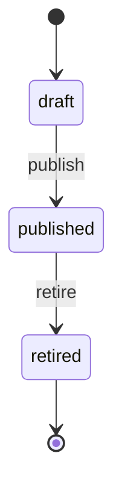

### D.2 `discount` (§10)

States of `DiscountStatus`:

| State      | Kind     | Meaning                                   |
| ---------- | -------- | ----------------------------------------- |
| `active`   | initial  | Its codes and its automatic rule apply.   |
| `inactive` | terminal | Turned off. New checkouts do not take it. |

| Event        | From     | To         | By    | Guards                                      |
| ------------ | -------- | ---------- | ----- | ------------------------------------------- |
| `apply`      | `active` | `active`   | buyer | `within_window`, `uses_left`, `minimum_met` |
| `deactivate` | `active` | `inactive` | staff | none                                        |

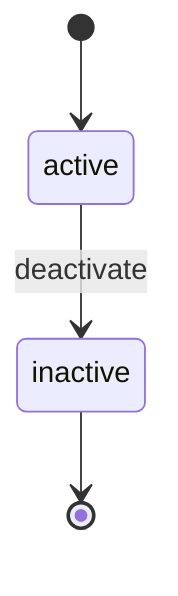

### D.3 `checkout` (§11)

States of `CheckoutLifecycle`:

| State             | Kind         | Meaning                                                                                                             | Exit               |
| ----------------- | ------------ | ------------------------------------------------------------------------------------------------------------------- | ------------------ |
| `quoted`          | initial      | Priced. It holds stock, discount uses and stored value until the quote expires.                                     | none               |
| `payment_pending` | intermediate | A payment attempt is open for the amount due. When the quote expires, Commerce reads the payment from the provider. | due: `payment_due` |
| `accepted`        | terminal     | Paid and placed. The order exists.                                                                                  | none               |
| `expired`         | terminal     | The quote ran out or the payment was declined. The holds are released.                                              | none               |

| Event                     | From              | To                | By                     | Guards                                                                   |
| ------------------------- | ----------------- | ----------------- | ---------------------- | ------------------------------------------------------------------------ |
| `refresh`                 | `quoted`          | `quoted`          | buyer                  | `no_staff_prices`, `revisions_match`                                     |
| `begin_payment`           | `quoted`          | `payment_pending` | buyer, staff           | `quote_digest_matches`, `quote_not_expired`                              |
| `record_capture`          | `payment_pending` | `payment_pending` | provider               | none                                                                     |
| `record_progress`         | `payment_pending` | `payment_pending` | provider, system       | none                                                                     |
| `place`                   | `payment_pending` | `accepted`        | buyer, staff, provider | `payment_captured`                                                       |
| `place_with_stored_value` | `quoted`          | `accepted`        | buyer                  | `quote_digest_matches`, `quote_not_expired`, `stored_value_covers_total` |
| `place_manually`          | `quoted`          | `accepted`        | staff                  | `quote_not_expired`, `revisions_match`, `no_stored_value`                |
| `decline`                 | `payment_pending` | `expired`         | provider               | none                                                                     |
| `expire`                  | `quoted`          | `expired`         | system, staff          | `quote_time_passed`                                                      |

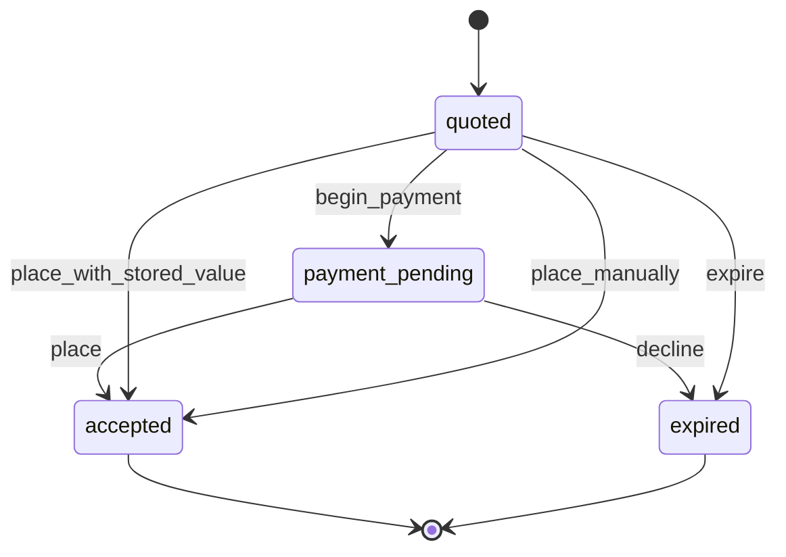

### D.4 `payment_attempt` (§12)

States of `CheckoutPaymentAttemptLifecycle`:

| State           | Kind         | Meaning                                                                                                    | Exit               |
| --------------- | ------------ | ---------------------------------------------------------------------------------------------------------- | ------------------ |
| `pending`       | initial      | Created for the amount due. The provider has not answered. Commerce reads it when the quote expires.       | due: `payment_due` |
| `processing`    | intermediate | The provider is working. Commerce reads it again after `reconcileAfter`, and not before the quote expires. | due: `payment_due` |
| `indeterminate` | intermediate | The answer was lost. Commerce reads it again after `reconcileAfter`, and not before the quote expires.     | due: `payment_due` |
| `captured`      | terminal     | The provider took the money.                                                                               | none               |
| `declined`      | terminal     | The provider refused the payment.                                                                          | none               |

| Event                  | From                                     | To              | By               | Guards              |
| ---------------------- | ---------------------------------------- | --------------- | ---------------- | ------------------- |
| `capture`              | `pending`, `processing`, `indeterminate` | `captured`      | provider         | `answer_time_valid` |
| `report_processing`    | `pending`, `processing`, `indeterminate` | `processing`    | provider         | `answer_time_valid` |
| `report_indeterminate` | `pending`, `processing`, `indeterminate` | `indeterminate` | provider, system | `answer_time_valid` |
| `decline`              | `pending`, `processing`, `indeterminate` | `declined`      | provider         | `answer_time_valid` |

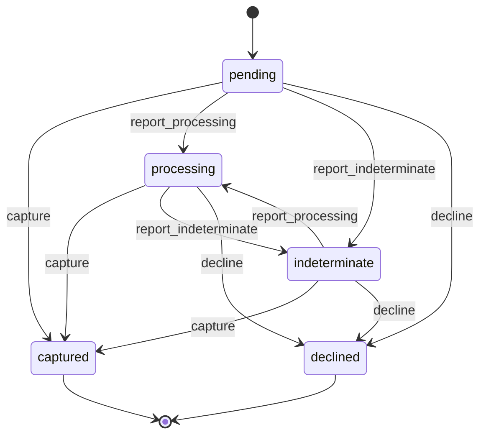

### D.5 `payment` (§12)

States of `PaymentLifecycle`:

| State                | Kind         | Meaning                                                      |
| -------------------- | ------------ | ------------------------------------------------------------ |
| `pending`            | external     | A payment read from another platform that is not authorized. |
| `authorized`         | external     | A payment read from another platform that is authorized.     |
| `failed`             | external     | A payment read from another platform that failed.            |
| `captured`           | initial      | Paid at placement, by a provider or by stored value.         |
| `partially_refunded` | intermediate | Part of the amount went back.                                |
| `refunded`           | terminal     | All of the amount went back. A dispute can still arrive.     |

| Event            | From                             | To                   | By               | Guards                     |
| ---------------- | -------------------------------- | -------------------- | ---------------- | -------------------------- |
| `request_refund` | `captured`                       | `captured`           | staff            | `amount_within_refundable` |
| `request_refund` | `partially_refunded`             | `partially_refunded` | staff            | `amount_within_refundable` |
| `refund_part`    | `captured`, `partially_refunded` | `partially_refunded` | provider, system | none                       |
| `refund_rest`    | `captured`, `partially_refunded` | `refunded`           | provider, system | none                       |
| `record_dispute` | `captured`                       | `captured`           | provider         | none                       |
| `record_dispute` | `partially_refunded`             | `partially_refunded` | provider         | none                       |
| `record_dispute` | `refunded`                       | `refunded`           | provider         | none                       |

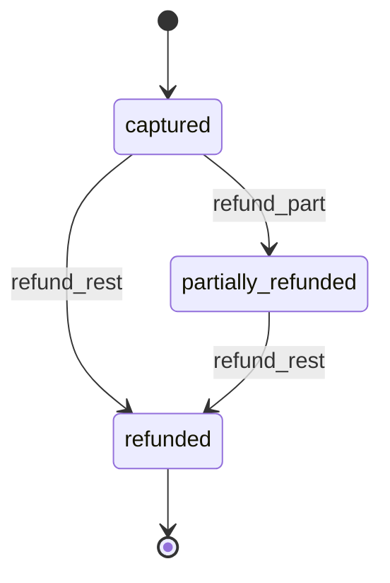

### D.6 `payment_dispute` (§12)

States of `PaymentDisputeLifecycle`:

| State             | Kind         | Meaning                                      |
| ----------------- | ------------ | -------------------------------------------- |
| `action_required` | initial      | The merchant must answer by `responseDueAt`. |
| `under_review`    | intermediate | The bank reviews the answer.                 |
| `won`             | terminal     | The bank decided for the merchant.           |
| `lost`            | terminal     | The bank decided for the buyer.              |

| Event                    | From                              | To                | By       | Guards              |
| ------------------------ | --------------------------------- | ----------------- | -------- | ------------------- |
| `report_action_required` | `action_required`, `under_review` | `action_required` | provider | `later_observation` |
| `report_under_review`    | `action_required`, `under_review` | `under_review`    | provider | `later_observation` |
| `win`                    | `action_required`, `under_review` | `won`             | provider | `later_observation` |
| `lose`                   | `action_required`, `under_review` | `lost`            | provider | `later_observation` |

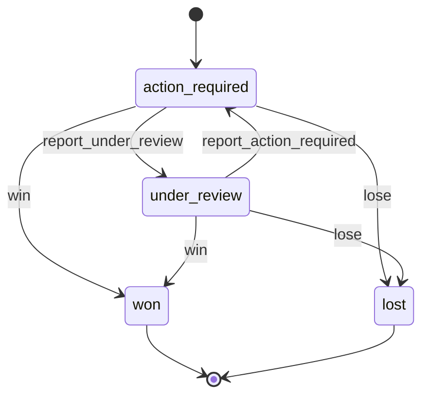

### D.7 `order` (§13)

States of `OrderLifecycle`:

| State                  | Kind         | Meaning                                                        |
| ---------------------- | ------------ | -------------------------------------------------------------- |
| `pending_confirmation` | external     | An order read from another platform that is not confirmed.     |
| `confirmed`            | external     | An order read from another platform that is confirmed.         |
| `fulfillment_pending`  | initial      | Placed. At least one fulfillment is open.                      |
| `partially_fulfilled`  | intermediate | Some fulfillments are complete and some are open.              |
| `fulfilled`            | intermediate | Every fulfillment is complete. An exchange can open a new one. |
| `cancelled`            | terminal     | Cancelled before fulfillment. Its refunds still resolve.       |

| Event                  | From                  | To                    | By               | Guards                                             |
| ---------------------- | --------------------- | --------------------- | ---------------- | -------------------------------------------------- |
| `edit`                 | `fulfillment_pending` | `fulfillment_pending` | staff            | `pickup_not_ready`                                 |
| `open_balance`         | `fulfillment_pending` | `fulfillment_pending` | buyer            | `balance_outstanding`                              |
| `pay_balance`          | `fulfillment_pending` | `fulfillment_pending` | buyer            | `balance_outstanding`                              |
| `ready_pickup`         | `fulfillment_pending` | `fulfillment_pending` | staff            | `balance_paid`                                     |
| `prepare`              | `fulfillment_pending` | `fulfillment_pending` | staff            | none                                               |
| `complete_pickup`      | `fulfillment_pending` | `fulfilled`           | staff            | `payments_paid`, `last_open_fulfillment`           |
| `complete_pickup_part` | `fulfillment_pending` | `partially_fulfilled` | staff            | `payments_paid`                                    |
| `deliver`              | `fulfillment_pending` | `fulfilled`           | provider         | `handed_to_carrier`, `last_open_fulfillment`       |
| `deliver_part`         | `fulfillment_pending` | `partially_fulfilled` | provider         | `handed_to_carrier`                                |
| `cancel`               | `fulfillment_pending` | `cancelled`           | staff            | `preparation_not_completed`, `payments_refundable` |
| `resolve_cancellation` | `cancelled`           | `cancelled`           | provider, system | none                                               |
| `exchange`             | `fulfilled`           | `fulfillment_pending` | staff            | `return_received`                                  |
| `request_return`       | `fulfilled`           | `fulfilled`           | buyer, staff     | none                                               |
| `refund`               | `fulfillment_pending` | `fulfillment_pending` | staff            | `amount_within_refundable`                         |
| `refund`               | `partially_fulfilled` | `partially_fulfilled` | staff            | `amount_within_refundable`                         |
| `refund`               | `fulfilled`           | `fulfilled`           | staff            | `amount_within_refundable`                         |
| `refund`               | `cancelled`           | `cancelled`           | staff            | `amount_within_refundable`                         |

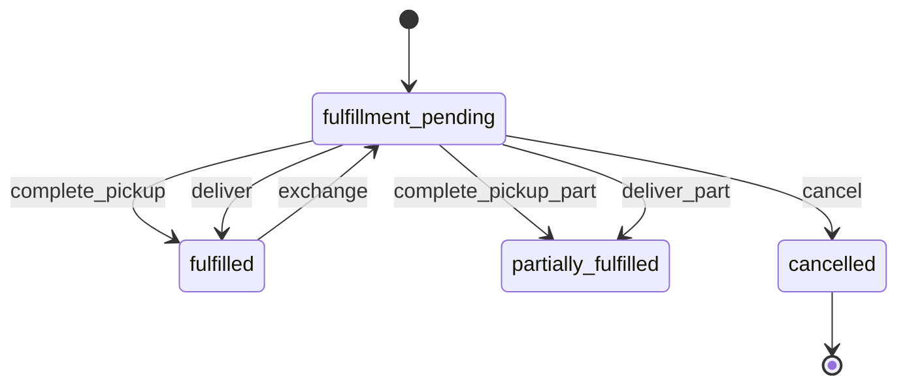

### D.8 `draft_order` (§13)

States of `DraftOrderState`:

| State       | Kind         | Meaning                                                      |
| ----------- | ------------ | ------------------------------------------------------------ |
| `open`      | initial      | Staff can change it.                                         |
| `invoiced`  | intermediate | Its invoice link opens this revision until the link expires. |
| `cancelled` | terminal     | No invoice opens it again.                                   |

| Event          | From               | To          | By    | Guards          |
| -------------- | ------------------ | ----------- | ----- | --------------- |
| `update`       | `open`, `invoiced` | `open`      | staff | `not_completed` |
| `send_invoice` | `open`, `invoiced` | `invoiced`  | staff | `not_completed` |
| `cancel`       | `open`, `invoiced` | `cancelled` | staff | `not_completed` |
| `mark_paid`    | `open`             | `open`      | staff | `not_completed` |
| `mark_paid`    | `invoiced`         | `invoiced`  | staff | `not_completed` |

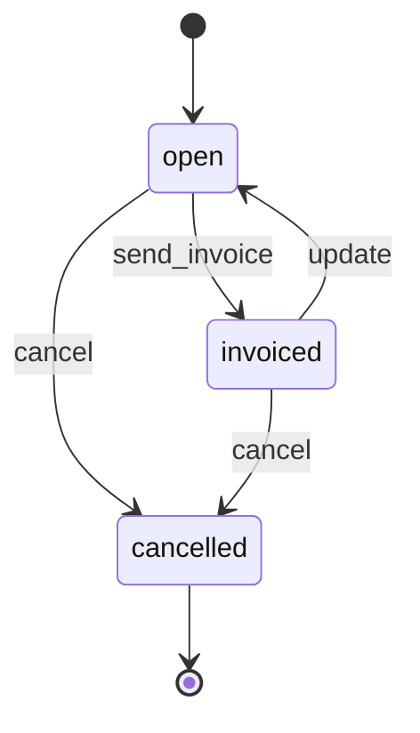

### D.9 `pickup_fulfillment` (§14)

States of `PickupFulfillmentLifecycle`:

| State              | Kind         | Meaning                                                                       |
| ------------------ | ------------ | ----------------------------------------------------------------------------- |
| `requested`        | initial      | Waits for staff to make it ready.                                             |
| `preparing`        | external     | A fulfillment read from another platform uses it; Commerce does not write it. |
| `blocked`          | external     | A fulfillment read from another platform uses it; Commerce does not write it. |
| `ready_for_pickup` | intermediate | Ready. The buyer may collect it.                                              |
| `completed`        | terminal     | Handed to the buyer.                                                          |
| `cancelled`        | terminal     | Cancelled with its order.                                                     |

| Event      | From               | To                 | By    | Guards                       |
| ---------- | ------------------ | ------------------ | ----- | ---------------------------- |
| `edit`     | `requested`        | `requested`        | staff | `no_handed_over_fulfillment` |
| `prepare`  | `requested`        | `requested`        | staff | none                         |
| `ready`    | `requested`        | `ready_for_pickup` | staff | `balance_paid`               |
| `complete` | `ready_for_pickup` | `completed`        | staff | `payments_paid`              |
| `cancel`   | `requested`        | `cancelled`        | staff | none                         |

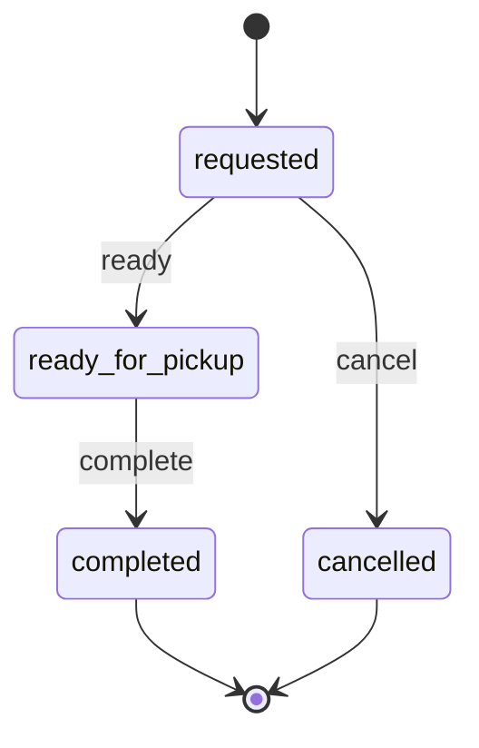

### D.10 `shipping_fulfillment` (§14)

States of `ShippingFulfillmentLifecycle`:

| State               | Kind     | Meaning                                                                       |
| ------------------- | -------- | ----------------------------------------------------------------------------- |
| `requested`         | initial  | Waits for the carrier.                                                        |
| `preparing`         | external | A fulfillment read from another platform uses it; Commerce does not write it. |
| `blocked`           | external | A fulfillment read from another platform uses it; Commerce does not write it. |
| `handed_to_carrier` | terminal | The carrier has the parcel. The shipment records the delivery.                |
| `cancelled`         | terminal | Cancelled with its order.                                                     |

| Event       | From                | To                  | By              | Guards            |
| ----------- | ------------------- | ------------------- | --------------- | ----------------- |
| `hand_over` | `requested`         | `handed_to_carrier` | staff, provider | `label_purchased` |
| `deliver`   | `handed_to_carrier` | `handed_to_carrier` | provider        | none              |
| `cancel`    | `requested`         | `cancelled`         | staff           | none              |

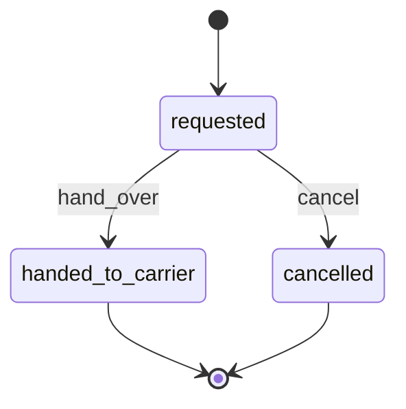

### D.11 `shipment` (§14)

States of `FirstPartyShipmentLifecycle`:

| State             | Kind         | Meaning                             |
| ----------------- | ------------ | ----------------------------------- |
| `ready`           | initial      | Placed. No label is bought yet.     |
| `label_purchased` | intermediate | The label is bought.                |
| `in_transit`      | intermediate | The carrier has scanned the parcel. |
| `delivered`       | terminal     | The carrier delivered the parcel.   |

| Event            | From              | To                | By              | Guards                    |
| ---------------- | ----------------- | ----------------- | --------------- | ------------------------- |
| `quote_label`    | `ready`           | `ready`           | staff           | none                      |
| `purchase_label` | `ready`           | `label_purchased` | staff           | `rate_quote_current`      |
| `hand_over`      | `label_purchased` | `in_transit`      | staff, provider | `tracking_number_matches` |
| `deliver`        | `in_transit`      | `delivered`       | provider        | `scan_after_handover`     |

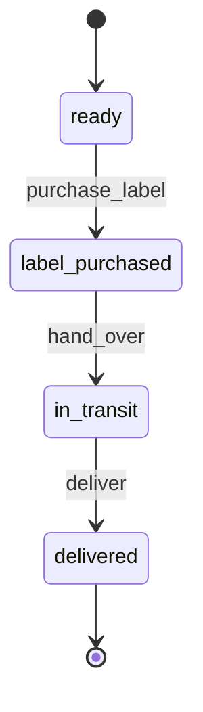

### D.12 `refund_attempt` (§15)

States of `RefundAttemptLifecycle`:

| State           | Kind         | Meaning                                                       |
| --------------- | ------------ | ------------------------------------------------------------- |
| `requested`     | initial      | Reserved before Commerce asks the provider.                   |
| `processing`    | intermediate | The provider is working. The merchant's alarm reads it again. |
| `indeterminate` | intermediate | The answer was lost. The merchant's alarm reads it again.     |
| `succeeded`     | terminal     | The money went back, to the card or to stored value.          |
| `failed`        | terminal     | The provider refused the refund.                              |

| Event                  | From                                       | To              | By               | Guards |
| ---------------------- | ------------------------------------------ | --------------- | ---------------- | ------ |
| `ask_provider`         | `requested`                                | `requested`     | staff, system    | none   |
| `ask_provider`         | `processing`                               | `processing`    | staff, system    | none   |
| `ask_provider`         | `indeterminate`                            | `indeterminate` | staff, system    | none   |
| `succeed`              | `requested`, `processing`, `indeterminate` | `succeeded`     | provider, system | none   |
| `report_processing`    | `requested`, `processing`, `indeterminate` | `processing`    | provider         | none   |
| `report_indeterminate` | `requested`, `processing`, `indeterminate` | `indeterminate` | provider, system | none   |
| `fail`                 | `requested`, `processing`, `indeterminate` | `failed`        | provider         | none   |

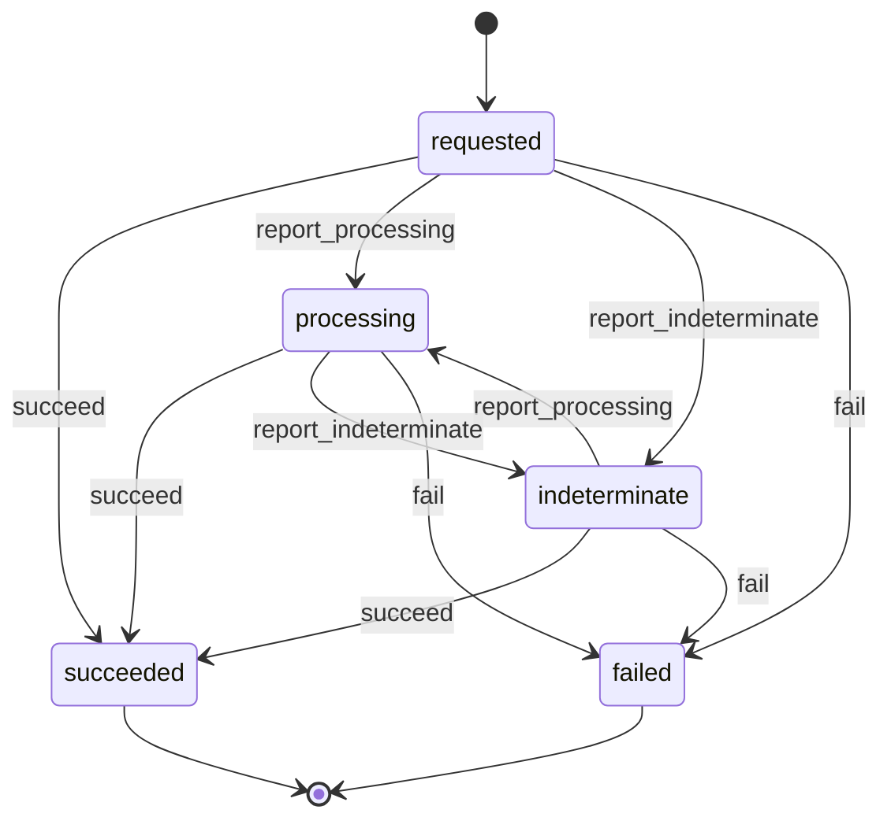

### D.13 `return` (§15)

States of `ReturnState`:

| State        | Kind         | Meaning                                             |
| ------------ | ------------ | --------------------------------------------------- |
| `requested`  | initial      | Asked for by the buyer or by staff.                 |
| `authorized` | intermediate | Staff accepted some of its lines.                   |
| `rejected`   | terminal     | Staff refused every line.                           |
| `received`   | intermediate | The units are back, each line with its disposition. |
| `closed`     | terminal     | A refund or an exchange settled it.                 |

| Event       | From         | To           | By    | Guards             |
| ----------- | ------------ | ------------ | ----- | ------------------ |
| `authorize` | `requested`  | `authorized` | staff | none               |
| `reject`    | `requested`  | `rejected`   | staff | none               |
| `receive`   | `authorized` | `received`   | staff | none               |
| `close`     | `received`   | `closed`     | staff | `refund_succeeded` |
| `exchange`  | `received`   | `closed`     | staff | none               |

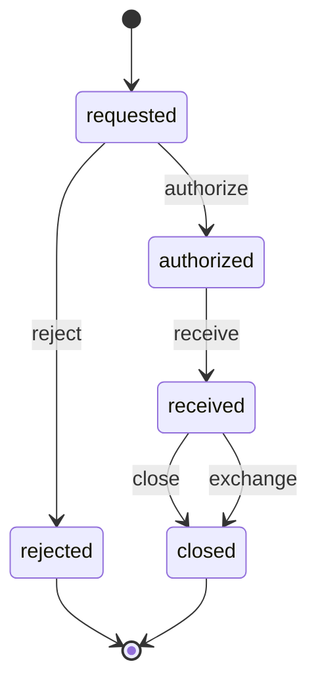

### D.14 `customer` (§16)

States of `CustomerState`:

| State    | Kind     | Meaning                                      |
| -------- | -------- | -------------------------------------------- |
| `active` | initial  | Its sealed profile can be read.              |
| `erased` | terminal | Its key is deleted, so no field can be read. |

| Event    | From     | To       | By           | Guards |
| -------- | -------- | -------- | ------------ | ------ |
| `update` | `active` | `active` | staff, buyer | none   |
| `erase`  | `active` | `erased` | staff        | none   |

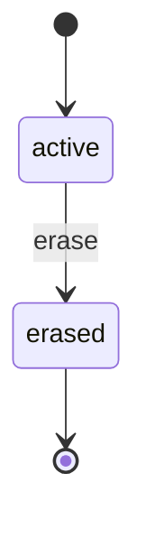

### D.15 `stored_value_account` (§17)

States of `StoredValueAccountStatus`:

| State      | Kind     | Meaning                                                            |
| ---------- | -------- | ------------------------------------------------------------------ |
| `active`   | initial  | Pays at checkout until it expires.                                 |
| `disabled` | terminal | Staff turned it off. It keeps its balance and still takes refunds. |

| Event     | From       | To         | By            | Guards                         |
| --------- | ---------- | ---------- | ------------- | ------------------------------ |
| `apply`   | `active`   | `active`   | buyer         | `not_expired`, `same_currency` |
| `credit`  | `active`   | `active`   | staff, system | none                           |
| `credit`  | `disabled` | `disabled` | staff, system | none                           |
| `disable` | `active`   | `disabled` | staff         | none                           |

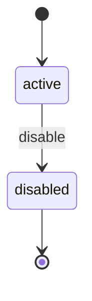

### D.16 `webhook_subscription` (§18)

States of `WebhookSubscriptionState`:

| State     | Kind         | Meaning                                                                               |
| --------- | ------------ | ------------------------------------------------------------------------------------- |
| `active`  | initial      | Receives posts.                                                                       |
| `failing` | intermediate | An event still failed 48 hours after its first post. No posts until staff restart it. |

| Event           | From      | To        | By     | Guards                |
| --------------- | --------- | --------- | ------ | --------------------- |
| `fail`          | `active`  | `failing` | system | `failed_for_48_hours` |
| `restart`       | `failing` | `active`  | staff  | none                  |
| `rotate_secret` | `active`  | `active`  | staff  | none                  |
| `rotate_secret` | `failing` | `failing` | staff  | none                  |

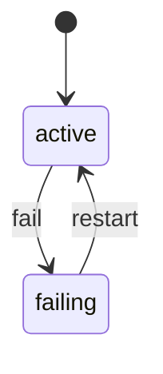

### D.17 `plugin` (§21)

States of `PluginState`:

| State     | Kind         | Meaning                                                                   |
| --------- | ------------ | ------------------------------------------------------------------------- |
| `active`  | initial      | Its routes answer and its pipeline steps run.                             |
| `paused`  | intermediate | Its routes answer 404 and its pipeline steps are skipped. Its data stays. |
| `removed` | terminal     | A merchant plugin that its merchant removed. Its data stays.              |

| Event        | From               | To        | By     | Guards                 |
| ------------ | ------------------ | --------- | ------ | ---------------------- |
| `pause`      | `active`           | `paused`  | staff  | `no_active_dependents` |
| `auto_pause` | `active`           | `paused`  | system | `no_active_dependents` |
| `resume`     | `paused`           | `active`  | staff  | `dependencies_active`  |
| `remove`     | `active`, `paused` | `removed` | staff  | `merchant_plugin`      |

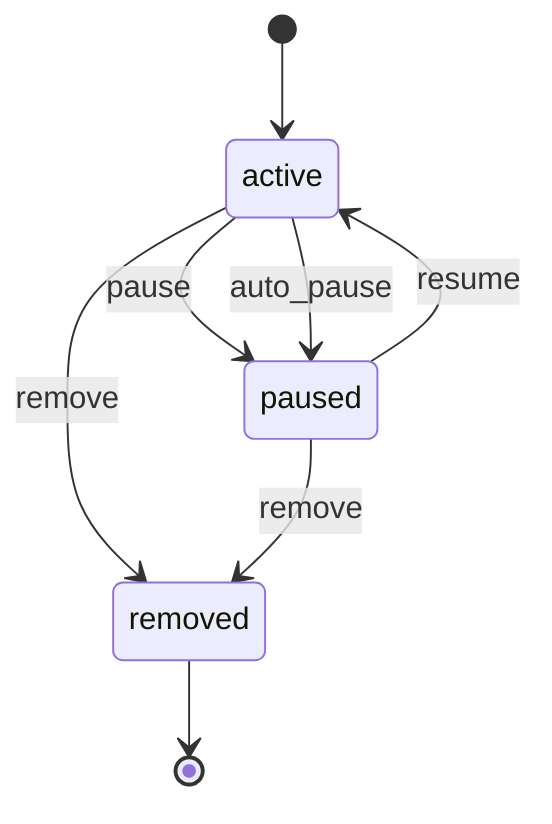

### D.18 `unplaced_capture` (§12)

States of `UnplacedCaptureLifecycle`:

| State              | Kind     | Meaning                                                                                           | Exit                             |
| ------------------ | -------- | ------------------------------------------------------------------------------------------------- | -------------------------------- |
| `capture_unplaced` | initial  | The provider took the money, and Commerce placed no order. Commerce does not refund it by itself. | staff: `admin_unplaced_captures` |
| `resolved`         | terminal | Staff refunded the buyer on the provider, or made the order by hand.                              | none                             |

| Event     | From               | To         | By    | Guards |
| --------- | ------------------ | ---------- | ----- | ------ |
| `resolve` | `capture_unplaced` | `resolved` | staff | none   |

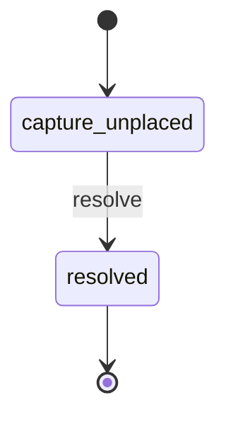

### D.19 `credential` (§3)

States of `CredentialState`:

| State     | Kind     | Meaning                                                                                          |
| --------- | -------- | ------------------------------------------------------------------------------------------------ |
| `active`  | initial  | Opens the routes of its scopes on its merchant until its `expiresAt`.                            |
| `revoked` | terminal | Refused. A person revoked it, the credential that issued it was revoked, or the merchant closed. |
| `expired` | terminal | Refused. Its `expiresAt` passed.                                                                 |

| Event    | From     | To        | By            | Guards          |
| -------- | -------- | --------- | ------------- | --------------- |
| `revoke` | `active` | `revoked` | staff, system | none            |
| `expire` | `active` | `expired` | system        | `expiry_passed` |

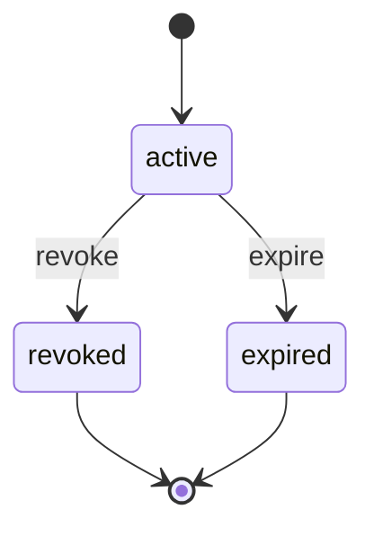

### D.20 `preparation_ticket` (§21)

States of `PreparationTicketLifecycle`:

| State       | Kind         | Meaning                                                                  |
| ----------- | ------------ | ------------------------------------------------------------------------ |
| `queued`    | initial      | Staff opened it for a paid made-to-order pickup.                         |
| `preparing` | intermediate | Staff started it. The order's stock is still allocated, not used.        |
| `completed` | terminal     | Staff made it. Its stock left the lots that were fit to use.             |
| `cancelled` | terminal     | Staff cancelled the order before preparation ended. Its stock came back. |

| Event      | From                  | To          | By    | Guards            |
| ---------- | --------------------- | ----------- | ----- | ----------------- |
| `start`    | `queued`              | `preparing` | staff | none              |
| `complete` | `preparing`           | `completed` | staff | `lots_fit_to_use` |
| `cancel`   | `queued`, `preparing` | `cancelled` | staff | none              |

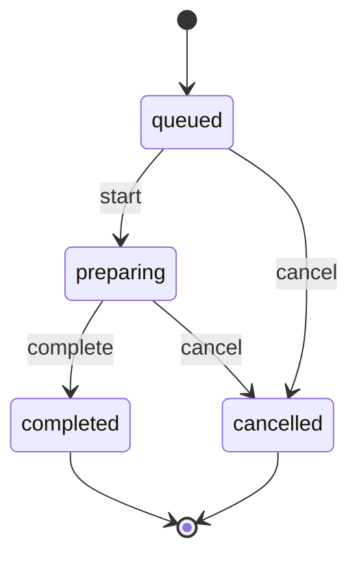

### D.21 `inventory_allocation` (§8)

States of `InventoryAllocationLifecycle`:

| State                | Kind     | Meaning                                                                                                            | Exit                    |
| -------------------- | -------- | ------------------------------------------------------------------------------------------------------------------ | ----------------------- |
| `held`               | initial  | A quoted checkout line holds the stock until its quote expires.                                                    | due: `lapsed_checkouts` |
| `allocated_to_order` | initial  | A placed order line, or a line that an order edit added, keeps the stock until fulfillment or preparation uses it. | none                    |
| `committed`          | terminal | A stock movement used it.                                                                                          | none                    |
| `released`           | terminal | The stock came back: the checkout ended, the order was cancelled, or an edit changed the line.                     | none                    |
| `expired`            | external | Older rows only. A lapsed hold is now released with the reason `checkout_expired`.                                 | none                    |

| Event      | From                         | To                   | By                   | Guards                 |
| ---------- | ---------------------------- | -------------------- | -------------------- | ---------------------- |
| `refresh`  | `held`                       | `held`               | buyer                | none                   |
| `allocate` | `held`                       | `allocated_to_order` | buyer, staff, system | none                   |
| `commit`   | `allocated_to_order`         | `committed`          | staff, provider      | `position_can_commit`  |
| `release`  | `held`, `allocated_to_order` | `released`           | buyer, staff, system | `position_can_release` |

```mermaid
stateDiagram-v2
  [*] --> held
  [*] --> allocated_to_order
  held --> allocated_to_order: allocate
  allocated_to_order --> committed: commit
  held --> released: release
  allocated_to_order --> released: release
  committed --> [*]
  released --> [*]
```

### D.22 `stock_lot` (§8)

States of `InventoryLotLifecycle`:

| State         | Kind         | Meaning                                                                                      | Exit              |
| ------------- | ------------ | -------------------------------------------------------------------------------------------- | ----------------- |
| `available`   | initial      | A sale can use it until its expiry. When its expiry passes, the merchant's alarm expires it. | due: `lot_expiry` |
| `depleted`    | intermediate | Nothing is left in it. A count can find stock in it again.                                   | none              |
| `expired`     | terminal     | Its expiry passed. No sale uses it; what is left in it leaves on hand as waste.              | none              |
| `quarantined` | external     | Reserved for a hold by staff. No command writes it, and no sale uses a lot in it.            | none              |

| Event       | From                    | To          | By                   | Guards                |
| ----------- | ----------------------- | ----------- | -------------------- | --------------------- |
| `draw`      | `available`             | `available` | buyer, staff, system | none                  |
| `deplete`   | `available`, `depleted` | `depleted`  | buyer, staff, system | none                  |
| `restock`   | `depleted`              | `available` | staff                | none                  |
| `expire`    | `available`             | `expired`   | staff, system        | `expiry_passed`       |
| `write_off` | `expired`               | `expired`   | staff, system        | `stock_not_allocated` |

```mermaid
stateDiagram-v2
  [*] --> available
  available --> depleted: deplete
  depleted --> available: restock
  available --> expired: expire
  expired --> [*]
```

### D.23 `purchase_request` (§21)

States of `PurchaseRequestStatus`:

| State          | Kind         | Meaning                                                                       |
| -------------- | ------------ | ----------------------------------------------------------------------------- |
| `needs_review` | initial      | The reconciler opened it because stock fell below the reorder point.          |
| `requested`    | intermediate | Staff asked the supplier for it.                                              |
| `expected`     | intermediate | The supplier confirmed a delivery.                                            |
| `late`         | intermediate | Its expected delivery passed with no receipt.                                 |
| `partial`      | intermediate | Receipts that name it cover part of its quantity.                             |
| `received`     | terminal     | Receipts that name it cover its quantity. A receipt that names it is refused. |

| Event          | From                                                       | To          | By     | Guards                          |
| -------------- | ---------------------------------------------------------- | ----------- | ------ | ------------------------------- |
| `request`      | `needs_review`                                             | `requested` | staff  | none                            |
| `expect`       | `needs_review`, `requested`, `late`                        | `expected`  | staff  | `delivery_not_passed`           |
| `run_late`     | `needs_review`, `requested`, `expected`                    | `late`      | system | `delivery_passed`, `no_receipt` |
| `receive_part` | `needs_review`, `requested`, `expected`, `late`, `partial` | `partial`   | system | `receipts_below_quantity`       |
| `receive`      | `needs_review`, `requested`, `expected`, `late`, `partial` | `received`  | system | `receipts_cover_quantity`       |

```mermaid
stateDiagram-v2
  [*] --> needs_review
  needs_review --> requested: request
  needs_review --> expected: expect
  requested --> expected: expect
  late --> expected: expect
  needs_review --> late: run_late
  requested --> late: run_late
  expected --> late: run_late
  needs_review --> partial: receive_part
  requested --> partial: receive_part
  expected --> partial: receive_part
  late --> partial: receive_part
  needs_review --> received: receive
  requested --> received: receive
  expected --> received: receive
  late --> received: receive
  partial --> received: receive
  received --> [*]
```

<!-- commerce-spec:machines:end -->
